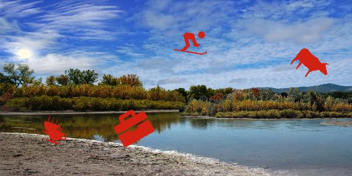
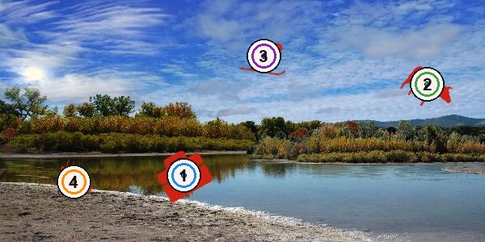
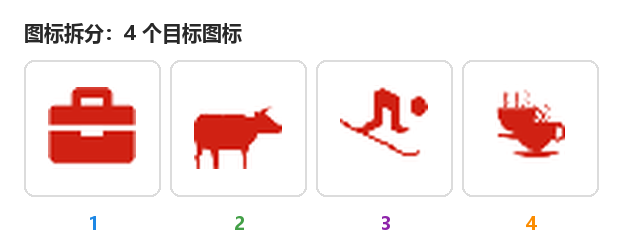
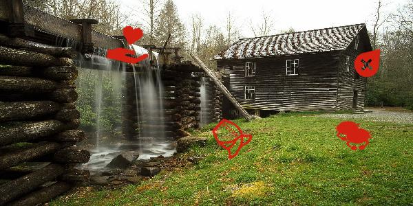
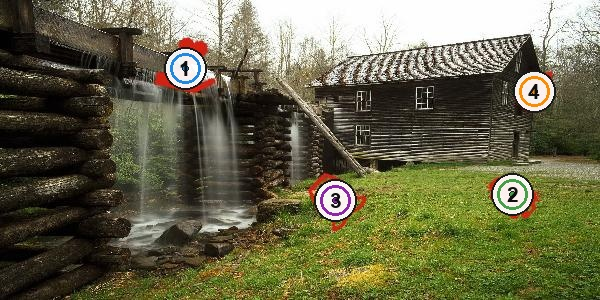
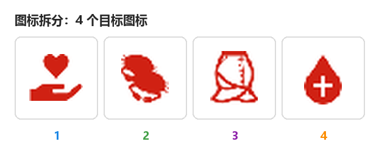

# 数美 · 图标点选（icon-click）

> 600×300 照片背景 + 148×40 红色参考条（4 个图标）；红掩膜 → 投影切分 → 10°×0.55–1.19 二值 IoU → 14px 聚类 → 匈牙利分配，14/14 离线核对 ≤7px，纯 CV、零 LLM。
>
> 返回：[数美索引](../../../docs/shumei.md) · [全量类型](../../../docs/types.md) · [方法论](../../../docs/00-methodology.md)

## 一、速览

| 项 | 值 |
|---|---|
| 厂商 | 数美（`shumei`） |
| 类型 / 变体 | `icon-click` / classic |
| 中文 | 图标点选 |
| 媒体 | 图片 |
| 样本 | 14 组（001–014） |
| 答案格式 | `points`：按参考条顺序的 4 个坐标 |
| 方法 | `CV`（红色掩膜 + 多角度/多尺度二值 IoU + 匈牙利，零 LLM） |
| 求解器 | `exists` · 高（源记录 14/14 离线核对 ≤7px，最大 6.2px） |
| 人工审查 | 14 通过 / 0 错误（截至 2026-11-21） |
| 证据等级 | `offline-verified`（14 组；未实机提交） |

## 二、题面与判定

题面统一为「按顺序点击图中图标」。参考条从左到右给出 4 个红色图标，用户需要在 600×300 的背景照片中找到同形图标并按参考条顺序点击；顺序错误不通过。

| 案例 | 题面（`meta.prompt`） | 参考条（`aux-01.png`） | 通过条件 |
|---|---|---|---|
| [001](001/) | 按顺序点击图中图标 | 公文包、牛、滑雪者、茶杯 | 按图中图标顺序依次点击；顺序错误不通过 |
| [005](005/) | 按顺序点击图中图标 | 爱心+手、松鼠、沙漏、血滴 | 同上 |
| [014](014/) | 按顺序点击图中图标 | 循环箭头、沙漏、火车、树 | 同上 |

> 参考条固定 4 个目标；答案空间是「4 个图标的身份 + 顺序」，不是自由点选。图标可能旋转、缩放、被前景遮挡，也有由多个不相连部件组成的图标。

## 三、样本长什么样

| 背景题面 | 参考条 | 答案标注 | 拆分过程 |
|---|---|---|---|
|  |  |  |  |
|  |  |  |  |

- 第 1 列是原始题面：风景/动物照片上散布 4 个红色实心图标，有些图标与背景的红叶、黄花颜色接近。
- 第 2 列是参考条，按从左到右定义点击顺序；图标由红色实心块构成，内部细节可能是镂空。
- 第 3 列按 ①②③④ 标出点击顺序（点击点取模板与红色前景交集的质心）。
- 第 4 列是源方案从参考条切出的 4 个目标图标，编号 1–4 对应参考条顺序。

## 四、形态与难点

- **旋转**：图标在背景中任意旋转，源方案按 10° 步长搜索多角度。
- **缩放**：半分辨率搜索尺度为 0.55–1.19；本库 14 组 `result.json` 记录的全分辨率尺度在 1.78–1.95 之间。
- **多部件图标**：虚线框、川字、爱心+手、条形图等由多个不相连部件组成，单独看连通域会拆散图标。
- **遮挡**：个别图标被前景遮挡（禾草、桥栏），红色掩膜会缺口。
- **颜色干扰**：背景中的红叶、黄花与图标的红色接近，不能只靠颜色连通域，还要做形状匹配与聚类。
- **目标数固定**：参考条 4 个、背景 4 个，适合用 1-1 分配；如果目标数变化，匈牙利分配需要改。

## 五、求解思路

源方案是一条纯 CV 流水线：先把红色前景从背景中分离，再把参考条的 4 个图标切出来，分别做旋转/缩放二值 IoU 搜索，最后用空间聚类和匈牙利分配把「参考图标」与「背景命中」一一对应。

| 步骤 | 做法 | 关键判据 / 参数 |
|---|---|---|
| 1 红掩膜 | 对背景做 RGB 阈值，得到红色二值掩膜 | 源记录未给具体阈值 |
| 2 参考条切分 | 对 148×40 参考条做列投影，切出 4 个图标 | 目标数固定为 4 |
| 3 多角度/多尺度搜索 | 半分辨率下按 10° 步长、0.55–1.19 尺度做二值 IoU | 只比二值形状，不比颜色强度 |
| 4 精修 | 对候选做全分辨率精修 | 源记录未展开精修轮数与步长 |
| 5 聚类 | 把命中位置按 14px 半径聚类成图标 | 避免同一图标的多个峰值被当成多个目标 |
| 6 分配 | 用匈牙利算法做参考图标与背景图标的 1-1 分配 | 目标数 4×4 |
| 7 点击点 | 取模板与红色前景交集的质心作为点击坐标 | 源记录按 ≤7px 离线核对 |

```text
# 由源记录步骤直译；阈值、角度/尺度采样细节未展开
refs = column_projection_split(aux_strip, k=4)
red  = rgb_threshold_red(bg)
for ref in refs:
    for angle in 0..350 step 10:
        for scale in 0.55..1.19:
            score = binary_iou(rotate_scale(ref.mask, angle, scale), red)
            keep_local_peaks(score)
    refine_full_resolution(ref)
hits  = cluster(peaks, radius=14)
match = hungarian(refs, hits, score)
click(centroid(template ∩ red_foreground))
```

> 源记录未给运行时间；二值 IoU 对颜色深浅不敏感，适合红色实心图标。

## 六、结果与审查

- **源记录**：14/14 与人工核对一致（图标身份与顺序；点击点最大误差 6.2px，均在 ≤7px 内）；求解器 `exists`、准确率 `high`。
- **本库结果**：14 组 `answer.txt` / `result.json` / `annotated.png` / `process-01-split.png` 齐全，`evidence: offline-verified`、`confidence: high`。
- **人工审查**：14 组 `review.state=pass`、`result=correct`（2026-11-18 回填）；本页统计按 `meta.review` 现算。

| 组 | 点击顺序（1→4，bg 像素） | 平均 IoU | 最大误差 |
|---|---|---:|---:|
| [001](001/) | 1:(227,218); 2:(529,105); 3:(326,70); 4:(91,226) | 0.849 | 2.0px |
| [002](002/) | 1:(380,215); 2:(511,182); 3:(126,155); 4:(231,117) | 0.770 | 3.8px |
| [003](003/) | 1:(180,69); 2:(524,139); 3:(217,137); 4:(72,67) | 0.869 | 3.4px |
| [004](004/) | 1:(329,154); 2:(456,202); 3:(107,70); 4:(159,196) | 0.852 | 5.1px |
| [005](005/) | 1:(185,68); 2:(513,195); 3:(336,200); 4:(534,92) | 0.859 | 3.2px |
| [006](006/) | 1:(342,198); 2:(179,211); 3:(270,226); 4:(448,211) | 0.795 | 3.8px |
| [007](007/) | 1:(515,129); 2:(270,85); 3:(112,196); 4:(481,220) | 0.854 | 4.0px |
| [008](008/) | 1:(522,166); 2:(137,121); 3:(291,187); 4:(426,204) | 0.842 | 4.5px |
| [009](009/) | 1:(395,195); 2:(174,76); 3:(179,232); 4:(466,81) | 0.862 | 6.2px |
| [010](010/) | 1:(478,173); 2:(151,232); 3:(273,126); 4:(208,219) | 0.821 | 5.2px |
| [011](011/) | 1:(184,218); 2:(487,151); 3:(167,143); 4:(351,103) | 0.841 | 0.7px |
| [012](012/) | 1:(72,75); 2:(151,171); 3:(280,91); 4:(509,149) | 0.895 | 0.5px |
| [013](013/) | 1:(75,168); 2:(75,238); 3:(521,142); 4:(272,144) | 0.870 | 0.6px |
| [014](014/) | 1:(493,169); 2:(411,118); 3:(330,167); 4:(222,109) | 0.762 | 0.4px |

> 平均 IoU 取每组 4 个图标得分的均值；最大误差是 4 个点击点相对人工核对位置的最大偏差。平均 IoU 范围 0.762–0.895，低分主要出现在多部件或遮挡图标上。

## 七、失败与边界

| 现象 | 根因 | 证据 | 结论 |
|---|---|---|---|
| 单个连通域拆散图标 | 虚线框、川字、爱心+手等由多个不相连部件组成 | 源记录列出多部件图标类型 | 用模板整体匹配，不按连通域计目标 |
| 红色掩膜被背景同化 | 红叶、黄花与图标红色接近 | 源记录明确「不能只靠颜色连通域」 | 颜色只做候选，形状匹配负责确认 |
| 图标被前景遮挡 | 禾草、桥栏挡住局部笔画 | 源记录列出遮挡样本 | 二值 IoU 对局部缺失有一定容忍，但边界样本仍需复核 |
| 同一图标多个峰值 | 模板在邻近位置反复命中 | 流程中用 14px 聚类合并 | 聚类半径与图标间距相关，换版式要重标 |
| 没有线上回执 | 只做离线核对，未实机提交 | 14 组 `evidence=offline-verified` | 14/14 是离线一致率，不是线上通过率 |
| 目标数变化 | 匈牙利按 4×4 分配 | 参考条固定 4 个 | 目标数不同时需要改分配逻辑 |

**适用边界**：方法依赖「红色实心图标 + 固定 4 目标 + 参考条完整可见」。如果图标颜色改变、目标数不对等，或参考条被裁切，现有参数不能直接复用。

## 八、相关

- 厂商索引：[docs/shumei.md](../../../docs/shumei.md)
- 全量类型：[docs/types.md](../../../docs/types.md) · 方法论：[docs/00-methodology.md](../../../docs/00-methodology.md)
- 同厂商对照：[text-click](../text-click/)（文字点选）、[spatial](../spatial/)（空间推理）、[slide](../slide/)（滑动拼图）、[word-order](../word-order/)（语序点选）
- 案例：[001](001/) – [014](014/)（每组含 `meta.json` / `bg.jpg` / `aux-01.png` / `annotated.png` / `process-01-split.png` / `answer.txt` / `result.json`）
- 来源：<https://www.ishumei.com/new/product/tw/code>；样本版权归数美所有，仅用于研究与教学。

> 统计截至 2026-11-21，以案例 `meta.json` 为准。
