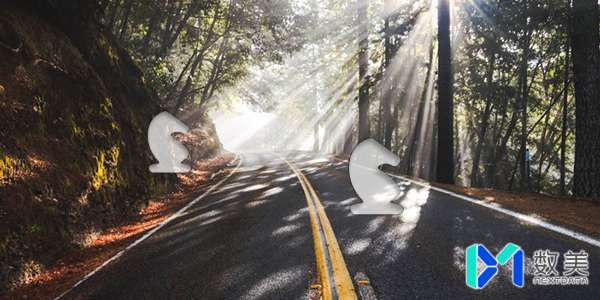
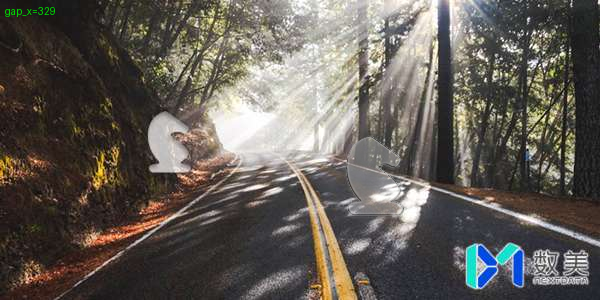
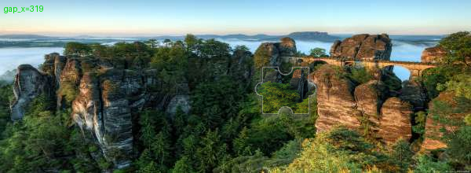

# 数美 · 滑动拼图（slide）

> 600×300 照片背景 + 90×300 拼图块；CV 可定位缺口，但服务端轨迹 ML 100% 拒绝模拟轨迹，图像答案没有独立价值，整体效果差。
>
> 返回：[数美索引](../../../docs/shumei.md) · [全量类型](../../../docs/types.md) · [方法论](../../../docs/00-methodology.md)

## 一、速览

| 项 | 值 |
|---|---|
| 厂商 | 数美（`shumei`） |
| 类型 / 变体 | `slide` / classic |
| 中文 | 滑动拼图 |
| 媒体 | 图片 |
| 样本 | 10 组（001–010） |
| 答案格式 | `offset-x`：拼图块的水平位移 |
| 方法 | `CV+ACT`（CV 定位缺口 + 轨迹） |
| 求解器 | `weak` · 低（源记录：服务端轨迹 ML 100% 拒绝模拟轨迹） |
| 人工审查 | 10 通过 / 0 错误（截至 2026-11-21） |
| 证据等级 | 案例未记录 `evidence`；无 `answer.txt` / `result.json`，只有 `bg.jpg` / `aux-01.png` / `solved.png` |

## 二、题面与判定

题面统一为「拖动滑块，将拼图块补入缺口」。与普通滑块题一样，用户需要把拼图块水平移动到缺口位置；通过条件由服务端校验最终位置，并很可能同时校验拖动轨迹。

| 案例 | 题面（`meta.prompt`） | 通过条件 | 答案空间 |
|---|---|---|---|
| [001](001/) | 拖动滑块，将拼图块补入缺口 | 拼图块与缺口对齐；服务端校验 | 一维水平位移 |
| [005](005/) | 拖动滑块，将拼图块补入缺口 | 同上 | 一维水平位移 |
| [010](010/) | 拖动滑块，将拼图块补入缺口 | 同上 | 一维水平位移 |

> 答案格式只记 `offset-x`；本库没有逐组偏移答案，`solved.png` 上的 `gap_x` 只是 CV 定位结果的叠加显示。

## 三、样本长什么样

| 背景题面 | 拼图块 | 求解叠加图 |
|---|---|---|
|  |  |  |
|  |  |  |

- 第 1 列是原始题面：600×300 的风景/动物照片，画面中有一个白色拼图轮廓缺口。
- 第 2 列是 `aux-01.png`，尺寸 90×300，内容为带 alpha 的拼图块，纵向铺满整幅高度。
- 第 3 列是源方案把 `gap_x` 叠加到题面上的检查图；001 可见 `gap_x=329`，005 可见 `gap_x=319`。这不是服务端回执。

## 四、形态与难点

- **图幅**：背景 600×300，拼图块 90×300；缺口位置横向变化，纵向基本固定。
- **缺口外观**：白色拼图轮廓与照片纹理叠加，缺口内部不一定是纯色，边缘可能被背景细节淹没。
- **双层校验**：图像坐标只是第一层；源记录明确指出服务端用轨迹 ML 判定，模拟轨迹被 100% 拒绝。
- **答案无独立价值**：即使 CV 找到缺口，若轨迹不能通过服务端模型，整题仍然失败；因此本类型的求解器状态是 `weak` 而不是 `exists`。
- **无真值**：本库没有 `answer.txt` / `result.json`，不能离线复算 10 组的定位准确率。

## 五、求解思路

源记录只给出「CV 定位缺口 + 轨迹」这一层方法，没有展开缺口检测的相似度、边缘算子或轨迹生成参数。可以确认的是：先定位水平缺口，再生成拖动轨迹提交；服务端拒绝模拟轨迹是主要失败点。

| 步骤 | 做法 | 关键判据 / 参数 |
|---|---|---|
| 1 定位缺口 | 用 CV 在 600×300 背景上找白色拼图轮廓 | 源记录未展开算法细节 |
| 2 取水平位移 | 以缺口左上角的 x 作为 `offset-x` | 纵向由题面固定 |
| 3 生成轨迹 | 按位移生成拖动轨迹 | 源记录未给轨迹模型与参数 |
| 4 提交 | 服务端同时校验位置与轨迹 | 轨迹 ML 拒绝模拟轨迹 |

> 本页不补写源记录没有的模板匹配、边缘检测或轨迹参数；仅有「CV 定位 + 轨迹」这一级信息。

## 六、结果与审查

- **源记录**：效果差（`weak` / `low`）；服务端轨迹 ML 100% 拒绝模拟轨迹，图像答案无意义。
- **本库结果**：10 组均有 `bg.jpg` / `aux-01.png` / `solved.png`；没有 `answer.txt` / `result.json`，`meta.evidence` 未记录。
- **人工审查**：10 组 `review.state=pass`、`result=correct`（2026-11-15 回填）；核对的是题面与缺口标注，不代表线上通过。

| 组 | 文件 | 审查 | 源记录 |
|---|---|---|---|
| 001–010 | bg + aux + solved | 10 通过 / 0 错误 | 效果差；轨迹 ML 拒绝 |

## 七、失败与边界

| 现象 | 根因 | 证据 | 结论 |
|---|---|---|---|
| 模拟轨迹被服务端拒绝 | 服务端用轨迹 ML 判定，模拟轨迹不像真人 | `meta.solver.notes`：100% 拒绝模拟轨迹 | 只解图像不够，必须解决行为轨迹 |
| 图像答案无意义 | 位置正确也可能因轨迹被拒 | `solver.status=weak`、`accuracy=low` | 本类型不计入可用求解能力 |
| 没有逐组答案 | 结果未纳入本库 | 无 `answer.txt` / `result.json` | 不能给出 10 组定位准确率 |
| 缺口被背景纹理淹没 | 白色轮廓与照片细节叠加 | 001/005 的缺口都在复杂背景上 | 定位只能作为辅助，不能保证提交通过 |

**适用边界**：本页只说明「图像侧可以定位、行为侧被拒」这一事实，不提供可用的轨迹方案。把 `solved.png` 上的 `gap_x` 当成答案是错误的。

## 八、相关

- 厂商索引：[docs/shumei.md](../../../docs/shumei.md)
- 全量类型：[docs/types.md](../../../docs/types.md) · 方法论：[docs/00-methodology.md](../../../docs/00-methodology.md)
- 同厂商对照：[icon-click](../icon-click/)（图标点选，纯 CV 14/14）、[text-click](../text-click/)（文字点选）、[spatial](../spatial/)（空间推理）、[word-order](../word-order/)（语序点选）
- 案例：[001](001/) – [010](010/)（每组含 `meta.json` + `bg.jpg` / `aux-01.png` / `solved.png`）
- 来源：<https://www.ishumei.com/new/product/tw/code>；样本版权归数美所有，仅用于研究与教学。

> 统计截至 2026-11-21，以案例 `meta.json` 为准。
