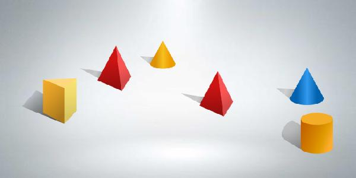
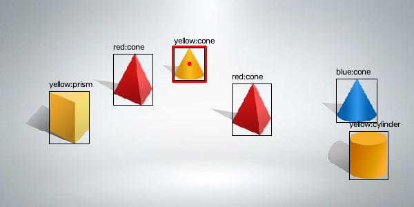
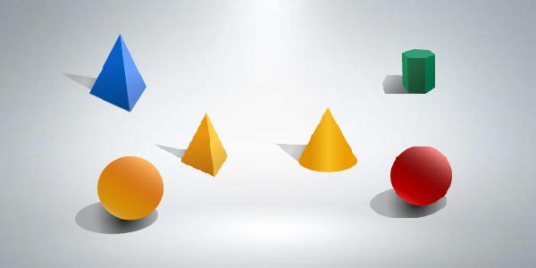
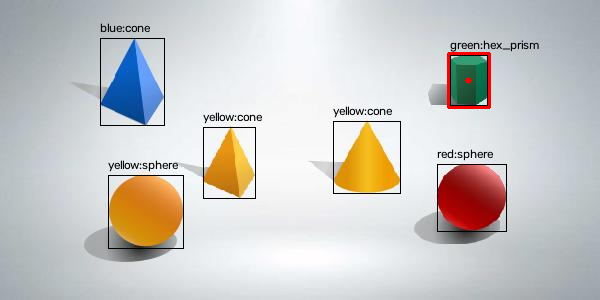

# 数美 · 空间推理（spatial）

> 600×300 灰底 3D 几何体场景，题面问「最小的某颜色某形状」；源方案用颜色/形状规则 + 面积极值，源记录 2/2，本库 10 组只有题面与标注。
>
> 返回：[数美索引](../../../docs/shumei.md) · [全量类型](../../../docs/types.md) · [方法论](../../../docs/00-methodology.md)

## 一、速览

| 项 | 值 |
|---|---|
| 厂商 | 数美（`shumei`） |
| 类型 / 变体 | `spatial` / classic |
| 中文 | 空间推理 |
| 媒体 | 图片 |
| 样本 | 10 组（001–010） |
| 答案格式 | `points`：单个坐标 |
| 方法 | `CV`（颜色/形状规则 + 面积极值，无 LLM） |
| 求解器 | `exists` · 高（源记录 2/2） |
| 人工审查 | 10 通过 / 0 错误（截至 2026-11-21） |
| 证据等级 | 案例未记录 `evidence`；有 `annotated.png`，无 `answer.txt` / `result.json` |

## 二、题面与判定

题面是「点击图中最小的<颜色><形状>」，画面是灰色背景上的 3D 几何体。用户需要按颜色与形状筛出候选，再取投影面积最小者点击；点错不通过。

| 案例 | 题面（`meta.prompt`） | 通过条件 | 答案空间 |
|---|---|---|---|
| [001](001/) | 点击图中最小的黄色圆锥 | 按提示点击对应空间对象；点错不通过 | 单个坐标 |
| [003](003/) | 点击图中最小的红色三棱锥 | 同上 | 单个坐标 |
| [008](008/) | 点击图中最小的蓝色长方体 | 同上 | 单个坐标 |
| [010](010/) | 点击图中最小的绿色六棱柱 | 同上 | 单个坐标 |

> 10 组的限定词只有颜色 + 形状 + 「最小」三类；没有自然语言空间关系，主要是检测与面积比较。

## 三、样本长什么样

| 背景题面 | 答案标注 | 背景题面 | 答案标注 |
|---|---|---|---|
|  |  |  |  |

- 第 1、3 列是原始题面：灰色地面、柔和阴影，散落 5–6 个不同颜色/形状的 3D 几何体。
- 第 2、4 列是标注图：每个物体有黑色框与 `颜色:形状` 标签（如 `yellow:cone`、`green:hex__prism`），红色框标出答案。
- 标注图用于人工核对，不是服务端返回的答案。

## 四、形态与难点

- **形状族**：源记录与题面覆盖圆锥、三棱锥/棱锥、三棱柱、长方体、球体、六棱柱等；同类形状的投影轮廓差异不大。
- **颜色族**：红、黄、蓝、绿四种高饱和色；同一画面里可能同时出现同色不同形状。
- **「最小」判定**：按投影面积比较，透视会让远处物体看起来更小；同一颜色形状可能有两个候选，需要严格取面积极小值。
- **遮挡/阴影**：物体之间有遮挡，阴影可能被颜色阈值误认为物体的一部分。
- **无逐组结果**：本库只有题面和标注，没有坐标答案与结果文件。

## 五、求解思路

源记录只给出一句「颜色/形状规则 + 面积极值」，没有展开分割阈值、形状分类器或面积计算方式。可以确定的流程是：先按颜色筛候选，再按形状筛，最后在同色同形状的候选里取面积最小者。

| 步骤 | 做法 | 关键判据 / 参数 |
|---|---|---|
| 1 颜色分割 | 按题面颜色做阈值，得到候选区域 | 源记录未给 RGB/HSV 阈值 |
| 2 形状分类 | 按轮廓/几何特征判断形状族 | 源记录未给分类器细节 |
| 3 候选筛选 | 只保留「题面颜色 + 题面形状」的物体 | 排除同色不同形状、同形不同色 |
| 4 面积极值 | 在候选中取投影面积最小者 | 「最小」按图像面积 |
| 5 点击 | 输出该物体的中心点 | 答案格式为单点 |

> 源记录只验证了 2 组（2/2），本库的 10 组标注没有对应的求解结果；因此不能把 2/2 写成 10/10。

## 六、结果与审查

- **源记录**：2/2 正确，求解器 `exists`、准确率 `high`；源记录没有展开测试集规模与失败样本。
- **本库结果**：10 组均有 `bg.jpg` / `annotated.png`；没有 `answer.txt` / `result.json` / `evidence`，无法逐组复算。
- **人工审查**：10 组 `review.state=pass`、`result=correct`（2026-11-17 回填）；核对的是题面与标注框是否正确，不等同 10/10 求解。

| 组 | 文件 | 审查 | 源记录 |
|---|---|---|---|
| 001–010 | bg + annotated | 10 通过 / 0 错误 | 2/2（仅源记录） |

## 七、失败与边界

| 现象 | 根因 | 证据 | 结论 |
|---|---|---|---|
| 只有 2/2 源记录 | 源方案只记录了 2 组验证 | `meta.solver.notes` | 不能外推成 10/10 |
| 同色同形状多候选 | 「最小」需要严格比较面积 | 题面限定词与画面可见多个同类物体 | 必须做面积极小值，不能取第一个命中 |
| 透视影响「最小」 | 远处物体投影更小 | 3D 场景有近大远小 | 面积判定要以图像投影为准 |
| 颜色阈值受阴影影响 | 阴影/高光改变颜色 | 标注图显示物体带阴影 | 颜色分割要排除阴影区域 |
| 没有逐组答案 | 结果未纳入本库 | 无 `answer.txt` / `result.json` | 只能做定性说明 |

**适用边界**：本页覆盖「颜色 + 形状 + 最小」这一类空间推理；如果题面出现相对位置、遮挡关系或自然语言比较，现有 CV 规则不能直接复用。

## 八、相关

- 厂商索引：[docs/shumei.md](../../../docs/shumei.md)
- 全量类型：[docs/types.md](../../../docs/types.md) · 方法论：[docs/00-methodology.md](../../../docs/00-methodology.md)
- 同厂商对照：[icon-click](../icon-click/)（图标点选，纯 CV 14/14）、[text-click](../text-click/)（文字点选）、[slide](../slide/)（滑动拼图）、[word-order](../word-order/)（语序点选）
- 案例：[001](001/) – [010](010/)（每组含 `meta.json` + `bg.jpg` / `annotated.png`）
- 来源：<https://www.ishumei.com/new/product/tw/code>；样本版权归数美所有，仅用于研究与教学。

> 统计截至 2026-11-21，以案例 `meta.json` 为准。
