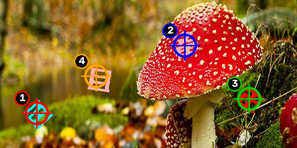
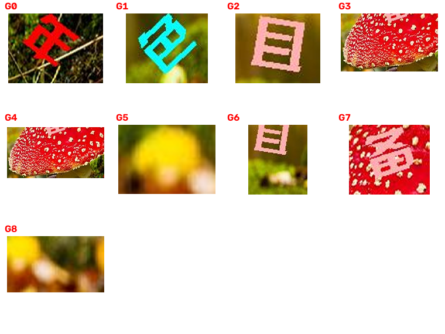
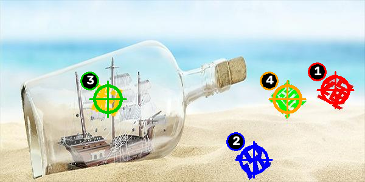
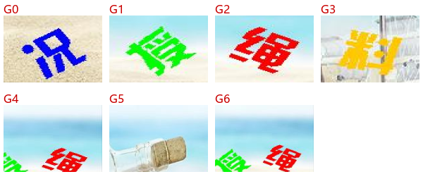

# 数美 · 文字点选（text-click）

> 600×300 照片背景上 4 个风格化空心汉字，题面给出目标字与顺序；前 10 组 OCR 0%、bbox 偏差大，011/012 用本地 RapidOCR 做到 4/4，但类型整体仍弱。
>
> 返回：[数美索引](../../../docs/shumei.md) · [全量类型](../../../docs/types.md) · [方法论](../../../docs/00-methodology.md)

## 一、速览

| 项 | 值 |
|---|---|
| 厂商 | 数美（`shumei`） |
| 类型 / 变体 | `text-click` / classic |
| 中文 | 文字点选 |
| 媒体 | 图片 |
| 样本 | 12 组（001–012） |
| 答案格式 | `points`：按题面顺序的 4 个坐标 |
| 方法 | `DET+OCR+VLM`（001–010）/ `DET+OCR`（011–012） |
| 求解器 | `weak` · 低（10 组）/ `exists` · 高（011/012，源记录 4/4） |
| 人工审查 | 12 通过 / 0 错误（截至 2026-11-21） |
| 证据等级 | 案例未记录 `evidence`；有 `annotated.png` / `process-01-candidates.png`，无 `answer.txt` / `result.json` |

## 二、题面与判定

题面给出 4 个目标字与箭头顺序，例如「请依次点击：备 → 色 → 年 → 且」。用户需要按顺序点击图中对应文字；顺序错误不通过。

| 案例 | 题面（`meta.prompt`） | 通过条件 | 答案空间 |
|---|---|---|---|
| [001](001/) | 请依次点击：备 → 色 → 年 → 且 | 按图中文字顺序依次点击；顺序错误不通过 | 4 个有序坐标 |
| [005](005/) | 请依次点击：结 → 等 → 义 → 征 | 同上 | 4 个有序坐标 |
| [011](011/) | 请依次点击：绳 → 况 → 料 → 授 | 同上 | 4 个有序坐标 |

> 12 组题面都是 4 个目标字，用箭头明确顺序；难点在字形风格与候选切分，而不是序列长度。

## 三、样本长什么样

| 背景题面 | 答案标注 | 候选切分过程 |
|---|---|---|
|  |  |  |
|  |  |  |

- 第 1 列是原始题面：照片背景（蘑菇、鸟、树枝等）上有 4 个彩色字，字是空心/描边风格，笔画细、对比不稳定。
- 第 2 列按 ①②③④ 标出点击顺序；标注用于离线核对。
- 第 3 列是候选切分图（G0–G8 等），能看到背景纹理被切成候选块，也会出现蘑菇斑点、枝叶等误检。

## 四、形态与难点

- **风格化字体**：字是空心/描边字，笔画细，橙色/红色/蓝色/绿色都可能出现，OCR 对细笔画与空心结构不敏感。
- **背景干扰**：照片纹理复杂，候选切分会把蘑菇斑点、枝叶等误当字符；001 的候选图就有多个非字块。
- **bbox 偏差**：源记录明确指出前 10 组「bbox 偏差大」，即使字读对，点击点也可能偏。
- **两条路线**：001–010 用 `DET+OCR+VLM`（YOLO + OCR/Siamese + LLM 版），整体弱；011/012 改为 `DET+OCR` 的本地 RapidOCR + 匈牙利指派，做到 4/4。
- **类型整体仍弱**：011/012 的成功不能外推成 12/12。

## 五、求解思路

前 10 组的源记录是「YOLO 候选 + OCR/Siamese + LLM 版」；011/012 的源记录是「YOLO 候选 + RapidOCR 识别 + 匈牙利指派，本地零 LLM」。两条路线的共同点是先切候选，再把题面 4 个字与候选一一对应。

| 步骤 | 做法 | 关键判据 / 参数 |
|---|---|---|
| 1 候选检测 | YOLO 在背景上检测字符候选框 | 源记录未给模型版本与阈值 |
| 2 候选切分 | 按框裁出候选块，保留候选图 | 001 的过程图显示 G0–G8 多个候选 |
| 3 识别 | 001–010 用 OCR/Siamese，VLM 版参与；011/012 用 RapidOCR | 011/012 记录 4/4 字形正确 |
| 4 指派 | 把题面 4 个字与候选按识别分数/位置做一对一指派 | 011/012 用匈牙利指派 |
| 5 排序输出 | 按题面箭头顺序输出 4 个坐标 | 顺序错误不通过 |

> 源记录没有给出 YOLO 版本、OCR 模型名、LLM 模型名与指派阈值；本页不补写这些参数。

## 六、结果与审查

- **001–010**：`solver.status=weak`、`accuracy=low`；源记录为「风格化字体 OCR 0%，bbox 偏差大；参考价值有限」。
- **011/012**：`solver.status=exists`、`accuracy=high`；源记录为「本地 RapidOCR 求解 4/4 字形正确（零 LLM）；类型整体仍弱」。
- **本库结果**：12 组均有 `bg.jpg` / `annotated.png` / `process-01-candidates.png`；没有 `answer.txt` / `result.json` / `evidence`。
- **人工审查**：12 组 `review.state=pass`、`result=correct`（2026-11-18 回填）；核对的是标注顺序与选字，不等同线上提交。

| 组 | 方法 | 求解器 | 源记录 | 审查 |
|---|---|---|---|---|
| 001–010 | DET+OCR+VLM | weak / low | OCR 0%，bbox 偏差大 | 10 通过 |
| 011–012 | DET+OCR | exists / high | 本地 RapidOCR 4/4，零 LLM | 2 通过 |

## 七、失败与边界

| 现象 | 根因 | 证据 | 结论 |
|---|---|---|---|
| 前 10 组 OCR 0% | 空心/描边风格化字体，笔画细 | `meta.solver.notes` | 需要针对空心字做预处理或换识别模型 |
| bbox 偏差大 | 候选框与真实字形边界不一致 | 源记录明确记录 | 即使读对字，点击点也可能偏 |
| 候选过多 | 背景纹理被切成字符候选 | 001 `process-01-candidates.png` 的 G0–G8 | 候选筛选与指派要做约束 |
| 011/012 成功但类型仍弱 | 只新增 2 组本地成功案例 | 逐组 `solver.status`：10 weak + 2 exists | 不能写成 12/12 |
| 没有线上回执 | 结果未纳入本库 | 无 `answer.txt` / `result.json` / `evidence` | 4/4 是离线字形识别，不是线上通过率 |

**适用边界**：本页说明「风格化空心字会让 OCR 失效」，以及 011/012 的本地 RapidOCR 路线为何有效；两条路线都只覆盖字形识别与顺序指派，不覆盖服务端风控。

## 八、相关

- 厂商索引：[docs/shumei.md](../../../docs/shumei.md)
- 全量类型：[docs/types.md](../../../docs/types.md) · 方法论：[docs/00-methodology.md](../../../docs/00-methodology.md)
- 同厂商对照：[icon-click](../icon-click/)（图标点选，纯 CV 14/14）、[spatial](../spatial/)（空间推理）、[slide](../slide/)（滑动拼图）、[word-order](../word-order/)（语序点选）
- 案例：[001](001/) – [012](012/)（每组含 `meta.json` + `bg.jpg` / `annotated.png` / `process-01-candidates.png`）
- 来源：<https://www.ishumei.com/new/product/tw/code>；样本版权归数美所有，仅用于研究与教学。

> 统计截至 2026-11-21，以案例 `meta.json` 为准。
