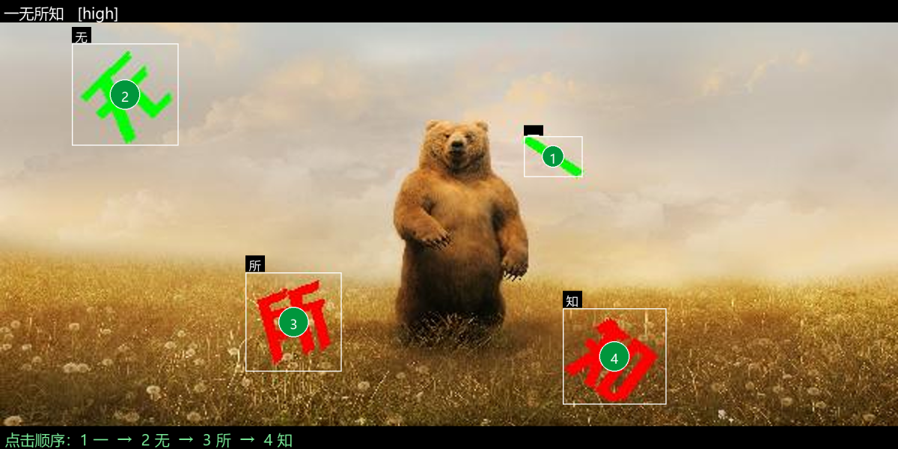
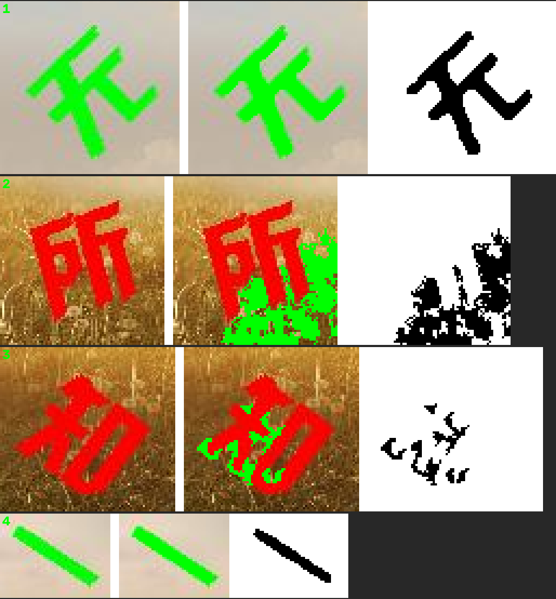
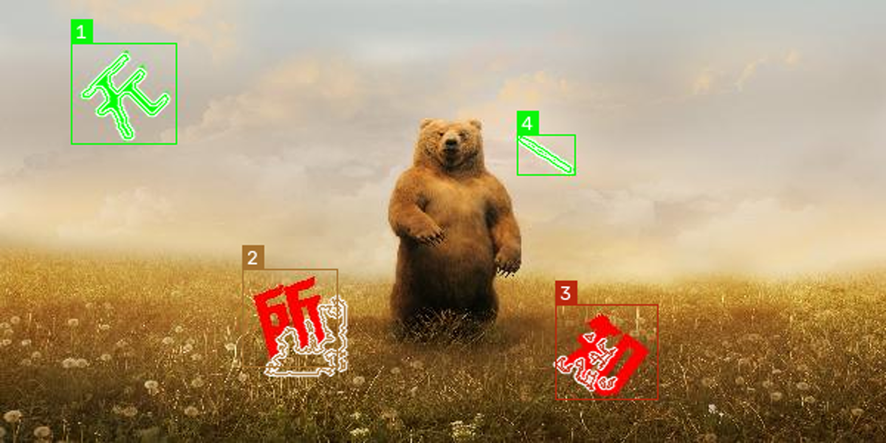
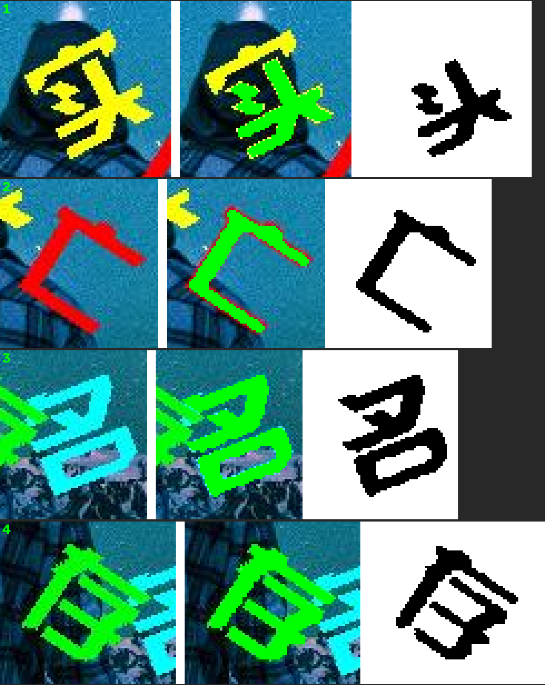
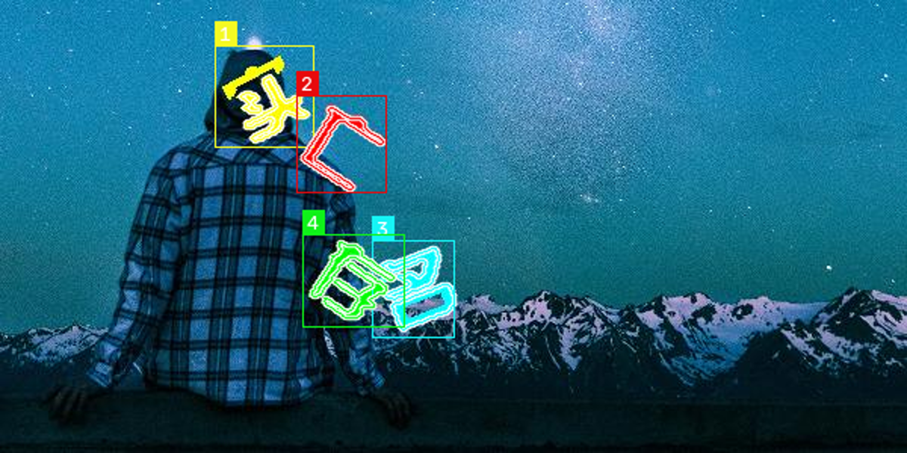

# 数美 · 语序点选（word-order）

> 600×300 照片背景上 4 个彩色汉字，按正确语序点击组成四字词语；零 LLM 路线：YOLO 定位（含并框拆分/细长笔画）+ 颜色轮廓 + RapidOCR/ddddocr 多角度读字 + 33,753 条词库约束。
>
> 返回：[数美索引](../../../docs/shumei.md) · [全量类型](../../../docs/types.md) · [方法论](../../../docs/00-methodology.md)

## 一、速览

| 项 | 值 |
|---|---|
| 厂商 | 数美（`shumei`） |
| 类型 / 变体 | `word-order` / classic |
| 中文 | 语序点选 |
| 媒体 | 图片 |
| 样本 | 10 组（001–010） |
| 答案格式 | `points+order`：4 个有序坐标 |
| 方法 | `DET+OCR+CV`（零 LLM、纯 CPU） |
| 求解器 | `exists` · 高（源记录 10/10 离线匹配） |
| 人工审查 | 10 通过 / 0 错误（截至 2026-11-21） |
| 证据等级 | `unverified`（离线自评，未实机提交） |

## 二、题面与判定

题面统一为「按正确语序点击文字」：画面是 4 个彩色汉字，用户需要先读出 4 个字，再按它们组成的四字词语/成语语序依次点击，顺序由服务端判定。API `order` 恒为空，不给答案。

| 案例 | 题面（`meta.prompt`） | 实际词语 / 点击序（px） |
|---|---|---|
| [001](001/) | 按正确语序点击文字 | 一无所知：一(369,104) → 无(85,65) → 所(206,229) → 知(408,241) |
| [002](002/) | 同上 | 名存实亡：名(277,191) → 存(263,199) → 实(181,72) → 亡(227,98) |
| [003](003/) | 同上 | 瞬息万变：瞬(338,115) → 息(116,242) → 万(96,50) → 变(552,111) |

> 题面不给出目标词；答案空间是「4 个字的排列」而不是自由坐标，难点是先把 4 个字读对，再确定词语。样本不限于严格成语（010 为「小桥流水」）。

## 三、样本长什么样

| 题面 | 答案标注 | 颜色轮廓过程 | 定位过程 |
|---|---|---|---|
|  |  |  |  |
|  |  |  |  |

- 第 1 列是原始题面：熊、星空、潜水、热气球等照片背景，4 个彩色字分散在画面各处。
- 第 2 列按点击顺序标注 ①②③④（绿圈），编号只表示顺序，不表示空间位置。
- 第 3 列是颜色聚类得到的字形轮廓（原始裁片 / 轮廓覆盖 / 二值）；低对比字会把背景并入掩码，识别仍交给 OCR 票数。
- 第 4 列是 4 个字的定位编号（按空间顺序，不按语序）；002 的「名/存」相邻且部分重叠，定位时由颜色拆分得到两框。
- 每个案例另有 5 张中间过程图，详情页按求解顺序展示：`detect_stages.png`（检测阶段：YOLO 原始框→拆分/细长笔画→最终框）、`cv_annotated.png`（定位标注）、`cv_glyphs.png`（颜色轮廓）、`ocr_votes.png`（每字 top-5 读字与票数）、`order_candidates.png`（词库候选与打分分解）。

## 四、形态与难点

- **背景**：600×300 真实照片（动物、星空、水下、雪地、热气球），纹理与同色物体会干扰颜色连通域。
- **字形**：单一纯色渲染（绿/红/黄/青/蓝/粉），旋转可达 40° 以上；1 组内 4 字颜色通常不同，但颜色与语序无关。
- **答案结构**：4 个字组成四字词语，可能是成语（一无所知、名存实亡、瞬息万变…），也可能是常用语（小桥流水），因此词库不能只收成语。
- **主要难点**：
  - 相邻字并框（002“名/存”被 YOLO 检成一个框）；
  - 细长单笔画字漏检（001、005 的「一」是 40×8 横条）；
  - 大旋转 + 照片同色背景导致单字 OCR 票数低（002「亡」仅 3 票；004「不」、005「一」0 票）。

## 五、求解思路

零 LLM 两步走：先定位 4 个字并提颜色轮廓，再把「逐字 OCR 票数」与「四字词库」联合起来找最优排列。

| 步骤 | 做法 | 关键判据 / 参数 | 10 组结果 |
|---|---|---|---|
| 1 定位 | YOLO `best_v3`（与 text-click 同模型）检测字符框 | `conf ≥ 0.05`，取置信前 4 | 7 组直接 4/4；002 并框、001/005 漏「一」 |
| 2 数美专项 | ① 并框拆分：框内高亮高饱和像素 k-means(k=3)，两簇大小相近 + 颜色差异大 + 空间分离则拆开；② 细长笔画：6 色轴 dominance 的细长实心连通域 | 拆分：count 比 ≥0.7、簇距 ≥25px、色差 L1 ≥100；细长：长宽比 ≥2.5、面积 100–1500 | 002：3→4 框；005：补「一」(254,205,298,214) |
| 3 颜色轮廓 | 每框外扩 6px，k-means(k=5) 选笔形细、居中、非边框背景色的簇，紧色距掩码 + 邻接生长 | 排除边框/背景色簇 | 作为 OCR 变体与点击中心 |
| 4 多角度 OCR | RapidOCR：原图裁片 ±25° + 颜色分簇白底；轮廓掩码 ±40° + 蓝/深墨迹。ddddocr：单字分类 ±60° × 双尺度 | 三路票数合并为 `{候选字: 票数}` | 002 实 16 / 名 13 / 存 7 / 亡 3 票 |
| 5 词库约束 | 枚举每条词的 4! 种「词位置 → 图中字框」双射 | 33,753 条词（29,502 成语 + 4,251 四字常用语）；THUOCL+jieba 词频先验 | 10/10 匹配成功 |
| 6 输出 | 取总分最高的分配，按语序输出 4 个坐标 | 证据分 + 0.35×top1 命中 + 0.5×常用度 + 0.3×覆盖字数 | 10 组全部 high |

```text
# 语序点选：定位 → 双 OCR 票数 → 词库约束（伪代码）

boxes = yolo(best_v3, bg, conf >= 0.05)[:4]
for box in boxes:
    if box_contains_two_solid_color_glyphs(box):   # 并框拆分（002 名/存）
        boxes.replace(box, split_by_color_clusters(box))
if len(boxes) < 4:
    boxes += thin_bar_candidates(bg)               # 细长笔画（005 的一）

votes = []
for box in boxes:
    crop = expand(box, 6px)
    contour = color_cluster_contour(bg, crop, k=5)
    v1 = rapidocr(crop, angles=[-25°..+25°])        # 原图角度扫描
    v2 = rapidocr(contour, angles=[-40°..+40°])     # 颜色轮廓扫描
    v3 = ddddocr_single_char(crop, angles=[-60°..+60°], scales=[4, 6])
    votes.append(merge(v1, v2, v3))                 # {候选字: 票数}

best = None
for word in lexicon:                                # 33,753 条（成语 + 常用语）
    for assign in permutations(4):                  # 4! 种「词位 → 字框」
        score = norm_votes(assign) * box_reliability
              + 0.35 * top1_hits(assign)
              + 0.5 * freq_prior(word)
              + 0.3 * cover(assign)                 # 有证据的字框数
        if best is None or score > best.score:
            best = (word, assign, score)

click(order_of(best.word, best.assign))             # 按词语语序点击
```

> 覆盖奖励是 010 的教训：只对上「川/流」两字的「川流不息」曾以 2.23 险胜对上 4 字的「小桥流水」；词库缺「小桥流水」时会直接落到错误词。

## 六、结果与审查

- **源记录**：10/10 组匹配到词语，全部 high；定位 10/10 组 4/4 字框（其中 3 组需专项兜底）。
- **本库结果**：10 组 `answer.txt` / `result.json` / `annotated.png` 齐全（标注图为大号 ①–④ + 底部「点击顺序」条），另有 5 张过程图（检测阶段 / 定位标注 / 颜色轮廓 / OCR 投票 / 词库候选）；`evidence: unverified`（离线自评，未在数美演示页跑服务端闭环）。
- **人工审查**：10 组 `review.state=pass`、`result=correct`（2026-11-21 人工复核）；核对的是离线标注、词语与语序是否正确，不等同线上通过率。

| 组 | 词语 | 置信 | 语序（图中空间编号） | OCR 关键证据 |
|---|---|:---:|---|---|
| 001 | 一无所知 | high | 一(4) → 无(1) → 所(2) → 知(3) | 「一」由 CV 峰值兜底 |
| 002 | **名存实亡** | high | 名(3) → 存(4) → 实(1) → 亡(2) | 名 13 / 存 7 / 实 16 / 亡 3 票；纠正旧 LLM 的「实至名归」 |
| 003 | 瞬息万变 | high | 瞬(2) → 息(4) → 万(1) → 变(3) | 13/27/11/24 票，4 字全 top1 |
| 004 | 不约而同 | high | 不(4) → 约(2) → 而(1) → 同(3) | 「不」0 票，靠 约 16 / 同 10 / 而 8 + 词库约束 |
| 005 | 一无所获 | high | 一(4) → 无(1) → 所(2) → 获(3) | 「一」细长笔画检出、0 票；无 27 / 所 29 / 获 4 |
| 006 | 啼笑皆非 | high | 啼(1) → 笑(3) → 皆(2) → 非(4) | 皆 5 票（ddddocr 一度读成 省 6） |
| 007 | 按部就班 | high | 按(2) → 部(1) → 就(3) → 班(4) | 4 字全 top1 |
| 008 | 后来居上 | high | 后(3) → 来(1) → 居(2) → 上(4) | 4 字全 top1（18/25/12/26 票） |
| 009 | 他山之石 | high | 他(2) → 山(1) → 之(3) → 石(4) | 4 字全 top1 |
| 010 | 小桥流水 | high | 小(3) → 桥(2) → 流(4) → 水(1) | 「小」被读成「川」12:1，靠四字常用语词库 + 覆盖奖励纠正 |

> **002 特别说明**：本库旧版 `annotated.png` 按 VLM 结论标注为「实至名归」，本次逐字 OCR（ddddocr：实 16 / 存 7 / 名 13 / 亡 4）+ 渲染比对 + 词库约束判定为「名存实亡」：四个框里「至/归」0 票，而「名/存/实/亡」都有强票。旧图已被新答案图覆盖，VLM 时代产物不再保留在案例目录中。

## 七、失败与边界

| 现象 | 根因 | 证据 | 结论 |
|---|---|---|---|
| VLM 整图判词幻觉 | 只做整体语义猜测，没有逐字约束 | 002 旧结论「实至名归」与逐字 OCR 冲突（至/归 0 票） | 改为双 OCR + 词库联合约束，零 LLM |
| YOLO 把相邻两字并成一框 | 字距过近、部分重叠 | 002 的「名/存」只给 1 个框 | 高亮高饱和像素颜色聚类拆分 |
| 细长「一」漏检 | 横条不是典型字形 | 001、005 各缺 1 框 | 6 色轴 dominance 细长笔画检测（005 命中） |
| 0 票字带偏词语选择 | 大旋转 / 照片同色背景 | 004「不」0 票、005「一」0 票 | 靠其余 3 字强票 + 词库约束；仍建议实机验证 |
| 成语库缺四字常用语 | 题面不限于成语 | 010「小桥流水」不在 29,502 条成语库中 | 补 jieba 四字词语 4,251 条（词频 ≥20） |
| 覆盖分不足时高分常用词抢答 | 高频先验压过覆盖 | 「川流不息」2.23 vs「小桥流水」2.25 | 总分加 0.3×覆盖字数 |
| 尚未实机验证 | 无服务端判定 | 10/10 为离线自评；人工复核 10/10 通过 | `evidence: unverified`、`review: pass`（复核 ≠ 线上通过率） |

**适用边界**：同色相邻字无法靠颜色拆分；更复杂的单笔画字（如「乙」）未覆盖；词语不在词库时会落到错误词或低置信候选。低置信（medium/low）应换图重试而不是硬点。

## 八、相关

- 厂商索引：[docs/shumei.md](../../../docs/shumei.md)
- 全量类型：[docs/types.md](../../../docs/types.md) · 方法论：[docs/00-methodology.md](../../../docs/00-methodology.md)
- 案例：[001](001/) – [010](010/)（每组含 `meta.json` + `bg.jpg`；有结果的含 `answer.txt` / `result.json` / `annotated.png`，以及 `detect_stages.png` / `cv_annotated.png` / `cv_glyphs.png` / `ocr_votes.png` / `order_candidates.png` 过程图）
- 同厂商对照：[text-click](../text-click/)（文字点选）、[icon-click](../icon-click/)（图标点选）、[spatial](../spatial/)（空间推理）、[slide](../slide/)（滑动拼图）
- 同类对照：[易盾 word-order](../../yidun/word-order/)（同一求解思路的源头实现）
- 来源：<https://www.ishumei.com/new/product/tw/code>；样本版权归数美所有，仅用于研究与教学。

> 统计截至 2026-11-21，以案例 `meta.json` 为准。
