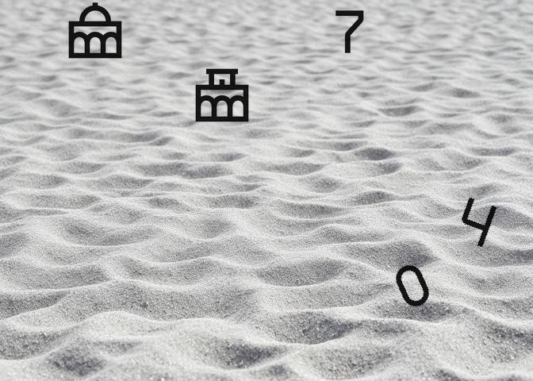
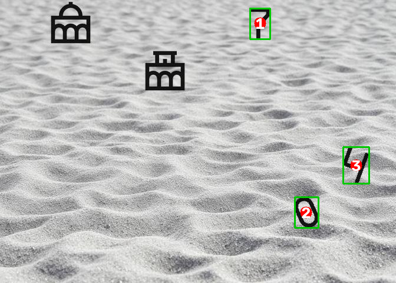
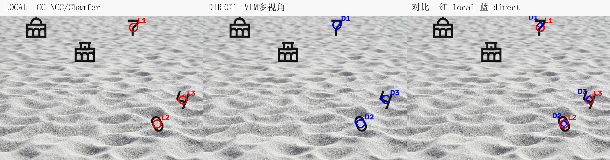
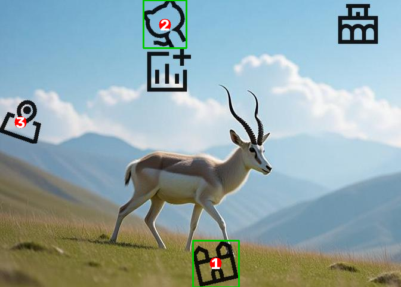
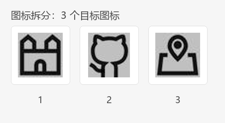

# 腾讯云验证码 · 图标点选（icon-click）

> 672×480 照片背景上散布黑色线稿图标，顶部 170×50 参考条给出 3 个目标图标；001–010 仅收样本，011/012 记录纯 CV 修复，但审查仍为未通过。
>
> 返回：[腾讯索引](../../../docs/tencent.md) · [全量类型](../../../docs/types.md) · [方法论](../../../docs/00-methodology.md)

## 一、速览

| 项 | 值 |
|---|---|
| 厂商 | 腾讯云验证码（`tencent`） |
| 类型 / 变体 | `icon-click` / classic |
| 中文 | 图标点选 |
| 媒体 | 图片 |
| 样本 | 12 组（001–012） |
| 答案格式 | `points`：按参考条顺序的 3 个坐标 |
| 方法 | `NONE(VLM)`（001–010）/ `CV`（011–012） |
| 求解器 | 部分存在（仅 011/012）· 高（源记录 3/3） |
| 人工审查 | 10 通过 / 2 错误（011/012，2026-11-16） |
| 证据等级 | 案例未记录 `evidence`；有 `annotated.png` / `aux-01.png` / `process-*.png`，无 `answer.txt` / `result.json` |

## 二、题面与判定

题面统一为「请依次点击图中提示的图标」，参考条按从左到右给出 3 个目标图标，用户需要在背景中按同样顺序点击对应图标；顺序错误不通过。

| 案例 | 题面（`meta.prompt`） | 参考条（`aux-01.png`） | 标注顺序 |
|---|---|---|---|
| [001](001/) | 请依次点击图中提示的图标 | 数字图标 `7 0 4` | ① 7（右上）→ ② 0（下方）→ ③ 4（右侧） |
| [011](011/) | 请依次点击图中提示的图标 | 城堡、猫、定位标 | ① 城堡（下方）→ ② 猫（上方）→ ③ 定位标（左侧） |
| [012](012/) | 请依次点击图中提示的图标 | 圆角 8、城堡、黑色 7 | ① 8（右上）→ ② 城堡（左上）→ ③ 7（叠在羚羊角上） |

> 参考条本身是 3 个独立图标；001–010 的题面与 011/012 相同，但只有 011/012 在本库中记录了求解器状态。

## 三、样本长什么样

| 背景题面 | 参考条 | 答案标注 | 过程图 |
|---|---|---|---|
|  |  |  |  |
|  |  |  |  |

- 第 1 列是原始题面：沙地、草原等照片背景上散布黑色图标，图标可能旋转、缩放、叠在动物或云层上。
- 第 2 列是参考条，从左到右定义点击顺序；001 用数字图标，011 用城堡/猫/定位标。
- 第 3 列按 ①②③ 标出正确点击位置；这是离线标注，不是服务端回执。
- 第 4 列：001 是源方案「LOCAL CC+NCC/Chamfer」与「DIRECT VLM 多视角」的双方案对比；011 是修复后的整列投影拆分，显示 3 个完整目标图标。

## 四、形态与难点

- **图幅**：背景 672×480，参考条 170×50；目标图标是黑色单色线稿，尺寸与旋转角度会变化。
- **背景干扰**：001 的数字图标落在明暗沙纹上，011/012 的图标落在草原、云层与动物轮廓附近，颜色和边缘都可能与图标混淆。
- **图标重叠**：011 上方的猫与柱状图图标彼此靠近，012 的黑色 7 直接叠在羚羊角上；定位时容易落到邻近的云或角。
- **参考条切分**：宽底座图标（如定位标）在简单按列切分时会被裁掉，011 的修复记录明确改为「整列投影切分」。
- **状态分裂**：001–010 在 `meta` 中是 `solver.status=none`，011/012 才是 `exists`；不能把 12 组都写成已解。

## 五、求解思路

011/012 的源记录给出了一条纯 CV 路线：整列投影切出参考图标，黑色掩膜找候选，旋转/尺度模板 IoU 打分，再用尺度一致峰值修正。001–010 的过程图来自源方案的另一条「本地 CC+NCC/Chamfer vs VLM 多视角」对比，但本库没有把这 10 组记为已解。

| 步骤 | 做法 | 关键判据 / 参数 |
|---|---|---|
| 1 拆分参考条 | 对 `aux-01.png` 做整列投影，切出 3 个完整目标图标 | 修复宽底座图标被裁掉的问题 |
| 2 候选提取 | 在背景上做黑色图标掩膜，得到候选连通域 | 源记录未给阈值 |
| 3 模板打分 | 对每个候选做旋转/尺度模板 IoU | 旋转/尺度范围源记录未展开 |
| 4 峰值修正 | 用「尺度一致」约束修正误落到云/角上的峰值 | 011 #3 修正到左侧定位标；012 #3 修正到羚羊角上的 7 |
| 5 输出 | 按参考条顺序给出 3 个坐标 | 顺序错误不通过 |

```text
# 由 meta.notes / process_note 直译；阈值与角度/尺度范围源记录未展开
refs = column_projection_split(aux_strip)      # 整列投影，保留宽底座图标
for ref in refs:
    candidates = black_mask_components(bg)
    for c in candidates:
        score = template_iou(rotate_and_scale(ref), c)
    peak = scale_consistent_peak(score)        # 尺度一致峰值修正
    click(centroid(peak))
```

> 001–010 的双方案过程图说明源侧曾比较本地模板与 VLM 直接定位，但没有留下本库可复算的坐标或结果文件。

## 六、结果与审查

- **001–010**：`solver.status=none`、`accuracy=unknown`，只有样本、参考条、标注与过程图；这 10 组的人工审查为 `pass/correct`。
- **011/012**：`solver.status=exists`、`accuracy=high`，`meta.notes` 记录修复后「3/3 图标正确」；但 `meta.review` 仍是 `fail/incorrect`（2026-11-16），审查没有随修复描述更新。
- **本库证据**：12 组均无 `answer.txt` / `result.json` / `evidence`，无法把「3/3」当成本库离线复算结果。

| 组 | 求解器 | 源记录 | 审查 | 结论 |
|---|---|---|---|---|
| 001–010 | none | 未撰写 | 10 通过 | 只收样本与源方案过程图 |
| 011 | exists | 3/3 图标正确（修复后） | fail / incorrect | 修复描述与审查结论矛盾，待复核 |
| 012 | exists | 3/3 图标正确（修复后） | fail / incorrect | 同上；#3 为羚羊角上的黑色 7 |

> 审查统计按 `meta.review` 现算：10 通过 / 2 错误。011/012 的 `notes` 与 `review` 不一致是本类型目前最大的未决事实。

## 七、失败与边界

| 现象 | 根因 | 证据 | 结论 |
|---|---|---|---|
| 宽底座定位标被裁掉 | 简单按列切分把底座切断 | 011 修复记录：改为整列投影 | 参考条必须先完整拆分，再做模板匹配 |
| #3 落到白云 | 云层边缘与黑色图标的局部对比相近 | 011/012 `meta.notes` 均提到「不再落到白云」 | 需要尺度一致峰值修正，不能只取最高分 |
| 012 的 7 与羚羊角重叠 | 图标压在动物轮廓上，前景边界不清 | 012 `meta.notes`：「叠在羚羊角上的黑色 7」 | 模板匹配要保留旋转/尺度变化 |
| 011/012 审查仍为 fail | 审查记录早于修复描述，未同步 | `review.reviewed_at=2026-11-16`，notes 记录修复后 3/3 | 不能宣称 12/12；等待复查 |
| 001–010 被误写成已解 | 旧汇总把类型整体标成 exists | 逐组 `meta.solver.status` 为 none | 以逐组状态为准 |

**适用边界**：本类型只覆盖 3 图标点选；011/012 的修复只说明图标身份与顺序，没有服务端回执。参考条必须完整可见，图标颜色/风格变化时需要重新标定掩膜与模板。

## 八、相关

- 厂商索引：[docs/tencent.md](../../../docs/tencent.md)
- 全量类型：[docs/types.md](../../../docs/types.md) · 方法论：[docs/00-methodology.md](../../../docs/00-methodology.md)
- 同厂商对照：[slide](../slide/)（滑动拼图）、[text-click](../text-click/)（文字点选）、[spatial](../spatial/)（空间推理）
- 案例：[001](001/) – [012](012/)（每组含 `meta.json` + `bg.png` / `aux-01.png` / `annotated.png`；001–010 另有 `process-02-compare.png`，011/012 只有 `process-01-split.png`）
- 来源：<https://cloud.tencent.com/product/captcha>；样本版权归腾讯云所有，仅用于研究与教学。

> 统计截至 2026-11-21，以案例 `meta.json` 为准。
