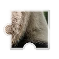
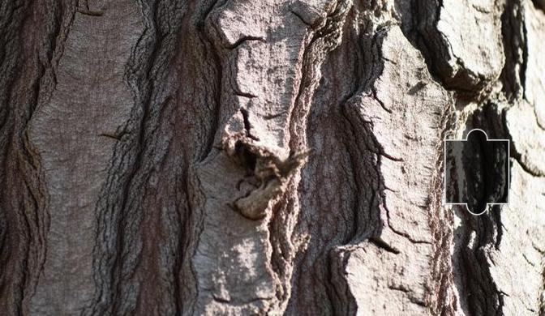
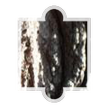
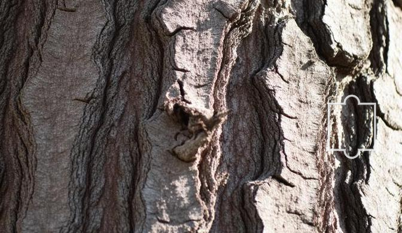

# 腾讯云验证码 · 滑动拼图（slide）

> 672×390 背景 + 120×120 带 alpha 的拼图块；源方案用 mask 模板匹配 + alpha 合成定位缺口，纯 CV、无 LLM，源记录 100%。
>
> 返回：[腾讯索引](../../../docs/tencent.md) · [全量类型](../../../docs/types.md) · [方法论](../../../docs/00-methodology.md)

## 一、速览

| 项 | 值 |
|---|---|
| 厂商 | 腾讯云验证码（`tencent`） |
| 类型 / 变体 | `slide` / classic |
| 中文 | 滑动拼图 |
| 媒体 | 图片 |
| 样本 | 12 组（001–012） |
| 答案格式 | `offset-x`：拼图块的水平偏移 |
| 方法 | `CV`（mask 模板匹配 + alpha 合成，无 LLM） |
| 求解器 | `exists` · 高（源记录 100%） |
| 人工审查 | 12 通过 / 0 错误（截至 2026-11-21） |
| 证据等级 | 案例未记录 `evidence`；无 `answer.txt` / `result.json`，只有题面、拼图块与拼合图 |

## 二、题面与判定

12 组题面统一为「拖动下方滑块完成拼图」。用户拖动滑块，把左侧的拼图块水平移入背景缺口；通过条件由服务端校验最终位置与拖动行为。

| 案例 | 题面（`meta.prompt`） | 通过条件 | 答案空间 |
|---|---|---|---|
| [001](001/) | 拖动下方滑块完成拼图 | 拼图块与缺口对齐；服务端校验最终位置与行为 | 一维水平偏移 |
| [003](003/) | 拖动下方滑块完成拼图 | 同上 | 一维水平偏移；缺口贴近右边界 |
| [005](005/) | 拖动下方滑块完成拼图 | 同上 | 一维水平偏移 |

> 答案格式只记 `offset-x`，纵向位置由题面固定；本库没有逐组偏移数值，不能从 `solved.png` 反推成提交答案。

## 三、样本长什么样

| 背景题面 | 拼图块（带 alpha） | 拼合结果 | 说明 |
|---|---|---|---|
|  |  |  | 001 是熊猫吃竹子的照片，缺口在画面中部；拼图块透明区不参与匹配 |
|  |  |  | 003 的缺口贴近右边界，拼合前后差异很小，容易误判 |
|  |  |  | 005 是另一种照片背景，用于观察缺口轮廓与纹理的对比 |

- 第 1 列是原始题面，缺口用细白/黑轮廓标出；第 2 列是待拖动的拼图块，四角与凸起形状和缺口一致；第 3 列是源方案把拼图块贴回缺口后的合成图，用于肉眼核对是否对齐。
- `solved.png` 只是合成检查图，不是服务端接受的回执。

## 四、形态与难点

- **固定图幅**：背景 672×390，拼图块 120×120；搜索空间主要是一维水平位移。
- **缺口外观弱**：缺口本身只保留轮廓，内部像素不一定与拼图块一致，直接做 RGB 像素匹配容易被背景纹理带偏。
- **透明区**：拼图块 PNG 带 alpha 通道（`Format32bppArgb`），透明区域如果参与相似度计算，会把拼图块外围当成有效特征。
- **边界情况**：003 的缺口紧贴右边界，模板可在有效范围内移动的距离很短；`meta.notes` 还记录了「边框约束修正垂直偏移」的修正点。
- **行为校验**：通过条件明确包含服务端校验最终位置与行为，因此仅坐标正确不等于线上通过。

## 五、求解思路

源记录给出的方法只有「mask 模板匹配 + alpha 合成」一句，具体相似度函数、搜索步长与阈值没有展开。可以确定的是：先用 alpha 掩膜屏蔽拼图块透明区，再把拼图块在背景上滑动匹配，取匹配峰值作为水平偏移，最后合成核对。

| 步骤 | 做法 | 关键判据 / 参数 |
|---|---|---|
| 1 读取 | 背景 `bg.png`、拼图块 `aux-01.png` | 拼图块 120×120，带 alpha |
| 2 掩膜 | 取拼图块 alpha 通道，透明区权重置 0 | 只比较拼图块前景 |
| 3 匹配 | 用掩膜模板在背景上搜索位置 | 源记录未给相似度与步长 |
| 4 取偏移 | 匹配峰值对应的 x 作为 `offset-x` | 纵向由题面固定 |
| 5 合成核对 | 把拼图块按偏移贴回背景，检查缺口是否闭合 | `solved.png` |
| 6 提交 | 按偏移拖动滑块 | 服务端还校验轨迹/行为 |

```text
# 由 method_note 直译；源记录未给匹配函数与搜索步长
tile  = load(aux-01.png)
alpha = tile.alpha                  # 透明区不参与匹配
pos   = argmax_x masked_match(bg, tile.rgb, alpha)
solved = alpha_composite(bg, tile, at=pos)
```

> 本页不补写源记录没有的阈值、归一化方式或轨迹参数。

## 六、结果与审查

- **源记录**：100%，求解器状态 `exists`、准确率 `high`。
- **本库结果**：12 组均有 `bg.png` / `aux-01.png` / `solved.png`；没有 `answer.txt` / `result.json`，`meta` 也没有 `evidence` 字段，因此无法把源记录的 100% 当成本库的离线复算结果。
- **人工审查**：12 组 `review.state=pass`、`result=correct`（2026-11-15 回填）。审查核对的是拼合图与缺口是否对齐，不等同线上提交通过。

| 组 | 文件 | 审查 | 证据 |
|---|---|---|---|
| 001–012 | bg + aux + solved | 12 通过 / 0 错误 | 未记录 `evidence` |

## 七、失败与边界

| 现象 | 根因 | 证据 | 结论 |
|---|---|---|---|
| 缺口位置难以从 `solved.png` 反推 | 合成图只显示贴回结果，没有记录偏移数值 | 12 组均无 `answer.txt` / `result.json` | 需要源求解器的坐标输出才能做逐组复算 |
| 003 的缺口贴近右边界 | 可搜索范围短，垂直方向也容易偏移 | `meta.notes` 记录「边框约束修正垂直偏移」 | 边界样本要单独看，不能只用中间区域样本评估 |
| 源记录 100% 但本库无证据字段 | 结果未纳入本库，只保留了图 | `meta.evidence` 缺失 | 准确率只能标「源记录」，不能写成 live-pass |
| 坐标正确仍可能不通过 | 通过条件包含服务端行为校验 | `pass_criteria` | 本页只覆盖缺口定位，不覆盖轨迹与风控 |

**适用边界**：本类型适合用带 alpha 的模板匹配做离线定位；线上通过还依赖拖动轨迹、时序与环境，本库没有这部分数据。

## 八、相关

- 厂商索引：[docs/tencent.md](../../../docs/tencent.md)
- 全量类型：[docs/types.md](../../../docs/types.md) · 方法论：[docs/00-methodology.md](../../../docs/00-methodology.md)
- 同厂商对照：[text-click](../text-click/)（文字点选）、[icon-click](../icon-click/)（图标点选）、[spatial](../spatial/)（空间推理）
- 案例：[001](001/) – [012](012/)（每组含 `meta.json` + `bg.png` / `aux-01.png` / `solved.png`）
- 来源：<https://cloud.tencent.com/product/captcha>；样本版权归腾讯云所有，仅用于研究与教学。

> 统计截至 2026-11-21，以案例 `meta.json` 为准。
