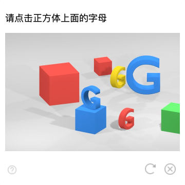
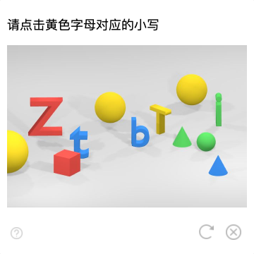

# 腾讯云验证码 · 空间推理（spatial）

> 360×360 的 3D 字母/数字场景配一句中文空间关系指令；本库只收题面，未撰写求解器，建议路线是 VLM 空间推理。
>
> 返回：[腾讯索引](../../../docs/tencent.md) · [全量类型](../../../docs/types.md) · [方法论](../../../docs/00-methodology.md)

## 一、速览

| 项 | 值 |
|---|---|
| 厂商 | 腾讯云验证码（`tencent`） |
| 类型 / 变体 | `spatial` / vtt-spatial |
| 中文 | 空间推理 |
| 媒体 | 图片 |
| 样本 | 12 组（001–012） |
| 答案格式 | `points`：单个坐标 |
| 方法 | `NONE(VLM)`（未撰写；建议 VLM 空间推理） |
| 求解器 | `none` · 未知 |
| 人工审查 | `not-applicable`（无求解结果可审） |
| 证据等级 | 无 `answer.txt` / `result.json` / `annotated.png`；12 组只有 `bg.png` |

## 二、题面与判定

题面是一句中文空间关系指令，画面是 3D 渲染的彩色字母、数字和几何体。用户需要点击符合指令的对象；点错不通过。12 组覆盖「侧对/正对」「正下方」「正方体上面」「黄色字母对应的小写」等关系。

| 案例 | 题面（`meta.prompt`） | 通过条件 |
|---|---|---|
| [001](001/) | 请点击侧对着你的字母 | 按题目提示点击对应的空间对象；点错不通过 |
| [008](008/) | 请点击正方体上面的字母 | 同上 |
| [010](010/) | 请点击黄色字母对应的小写 | 同上 |

> 答案空间是单个坐标，但自然语言关系（侧对、正下方、对应小写）不是固定类别表，无法用颜色/形状规则完全枚举。

## 三、样本长什么样

| 题面 001 | 题面 008 | 题面 010 |
|---|---|---|
|  |  |  |

- 001 是彩色字母随机朝向、互相遮挡；008 是多个立方体与字母 G/6 组合；010 需要同时看颜色与大小写。每张图上方是中文指令，主体是灰色地面上的 3D 场景，没有答案标注或坐标。
- 12 组仅有 `bg.png`，是 `sample-only` 的典型形态：只收题面，不做离线判定。

## 四、形态与难点

- **3D 关系**：「侧对着你」「正对着你」取决于字形的朝向，不是简单的位置；同一画面里有多个不同朝向的字母。
- **遮挡、透视与多约束**：字母/数字会挡住几何体，透视会让「正下方」偏移；010 还要求颜色与大小写对应，需要先识别大写再找小写。
- **无真值**：服务端不返回正确坐标，本库也没有人工点选标注，无法离线算准确率。

## 五、建议路线（未实现）

按「VLM 读指令 → VLM 定位候选 → 输出单点」起步最省；这类题语义开放，传统检测器难以枚举「侧对」这种关系。

| 步骤 | 建议做法 | 说明 |
|---|---|---|
| 1 读指令 | 用 OCR 或 VLM 读出题面中文 | 保留「侧对/正对/正下方/上面/对应小写」等关系词 |
| 2 候选观察 | VLM 描述画面中的字母、数字、几何体、颜色与朝向 | 可以用一次整图调用，也可以分区域裁剪 |
| 3 关系求解 | 按指令筛出唯一目标 | 多候选时要求模型给出理由与置信度 |
| 4 输出并复核 | 让模型给出目标中心点，或先用检测框再取中心；低置信时二次询问 | 答案格式是单点，复核只对分歧点调用 |

> 这条路线没有在本库落地，也没有样本级人工答案；它只是基于题型给出的起步建议，不代表准确率。

## 六、为什么没有结果

- 本库对腾讯 spatial 的策略是「先覆盖题面」：12 组只采集 `bg.png`，没有 `answer.txt` / `result.json` / `annotated.png`。
- 没有服务端返回的正确坐标，也没有人工逐组点选，因此不能把任何模型输出写成「准确率」；12 组题面只覆盖部分关系类型，不代表完整题面空间。

## 七、边界

- **不要把 VLM 输出当真值**：它只是建议路线；没有人工确认前，`review` 保持 `not-applicable`。
- **不要用固定类别表硬套，也不要忽略多候选**：「侧对」是朝向判断，「对应小写」是跨字号匹配，都不是固定物体类别；同一字母可能出现多次，必须先锁定指令约束再选唯一目标。

## 八、相关

- 厂商索引：[docs/tencent.md](../../../docs/tencent.md)
- 全量类型：[docs/types.md](../../../docs/types.md) · 方法论：[docs/00-methodology.md](../../../docs/00-methodology.md)
- 同厂商对照：[slide](../slide/)（滑动拼图）、[text-click](../text-click/)（文字点选）、[icon-click](../icon-click/)（图标点选）
- 案例：[001](001/) – [012](012/)（均为 `sample-only`，只有 `meta.json` + `bg.png`）；来源：<https://cloud.tencent.com/product/captcha>；样本版权归腾讯云所有。

> 统计截至 2026-11-21，以案例 `meta.json` 为准。
