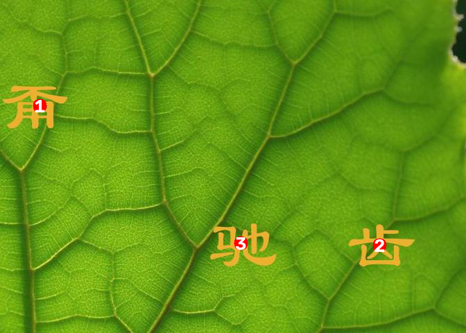
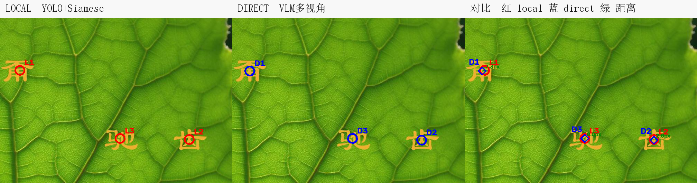
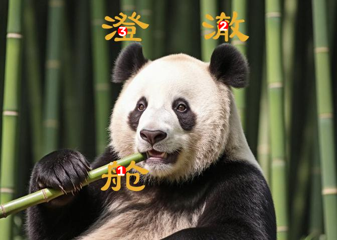
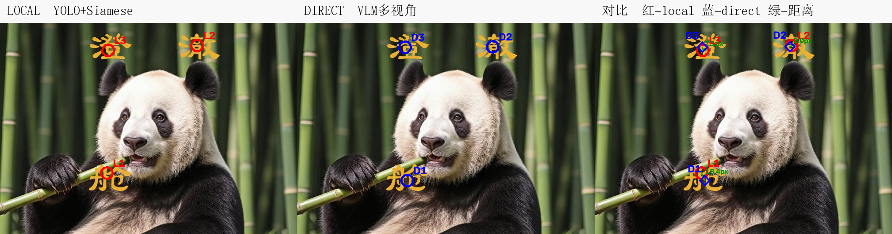

# 腾讯云验证码 · 文字点选（text-click）

> 672×480 照片背景上散落 3 个橙色汉字，题面给出目标字与顺序；源方案用 YOLO 定位 + Siamese 比对 + VLM 仲裁，源记录 12/12 离线、5/5 实机。
>
> 返回：[腾讯索引](../../../docs/tencent.md) · [全量类型](../../../docs/types.md) · [方法论](../../../docs/00-methodology.md)

## 一、速览

| 项 | 值 |
|---|---|
| 厂商 | 腾讯云验证码（`tencent`） |
| 类型 / 变体 | `text-click` / classic |
| 中文 | 文字点选 |
| 媒体 | 图片 |
| 样本 | 12 组（001–012） |
| 答案格式 | `points`：按题面顺序的 3 个坐标 |
| 方法 | `DET+OCR+VLM`（YOLO + Siamese + VLM 仲裁） |
| 求解器 | `exists` · 高（源记录 12/12 离线 + 5/5 实机） |
| 人工审查 | 12 通过 / 0 错误（截至 2026-11-21） |
| 证据等级 | 案例未记录 `evidence`；有 `annotated.png` / `process-01-compare.png`，无 `answer.txt` / `result.json` |

## 二、题面与判定

题面直接给出 3 个目标字及点击顺序，例如「请依次点击：甭 齿 驰」。用户需要按顺序点击图中对应文字；顺序或选字错误不通过。

| 案例 | 题面（`meta.prompt`） | 通过条件 | 答案空间 |
|---|---|---|---|
| [001](001/) | 请依次点击：甭 齿 驰 | 按提示字符的顺序依次点击全部文字；顺序或选字错误不通过 | 3 个有序坐标 |
| [005](005/) | 请依次点击：舱 澈 澄 | 同上 | 3 个有序坐标 |
| [011](011/) | 请依次点击：秤 饱 傲 | 同上 | 3 个有序坐标 |

> 12 组题面都是 3 个目标字；难点不在字数，而在照片背景、字形旋转/变形与近似字干扰。

## 三、样本长什么样

| 背景题面 | 答案标注 | 源方案过程对比 |
|---|---|---|
|  |  |  |
|  |  |  |

- 第 1 列是原始题面：照片背景上有 3 个橙色目标字，位置分散，字号和旋转角度不完全一致。
- 第 2 列按 ①②③ 标出点击顺序；标注是离线核对用的，不是服务端回执。
- 第 3 列是源方案的三联过程图：左「LOCAL YOLO+Siamese」、中「DIRECT VLM 多视角」、右「对比 红=local 蓝=direct 绿=距离」。这张图说明源方案同时保留本地检测与大模型直接定位两条路线，并用距离比较做仲裁。

## 四、形态与难点

- **图幅**：背景 672×480，目标字 3 个，橙色/金色描边或填充，叠在自然照片上。
- **背景干扰**：树叶、动物毛发、竹节等高频纹理会产生大量候选框，YOLO 候选需要再筛。
- **字形变化**：目标字有旋转、倾斜、缩放和描边风格差异；单靠 OCR 容易把形近字读错。
- **路线分工**：本地路线负责稳定定位与候选裁剪，VLM 路线提供第二套坐标；源记录强调 VLM 只对分歧点调用，以控制成本。
- **行为校验**：通过条件只看点击顺序与选字；是否额外校验轨迹，源记录未展开。

## 五、求解思路

源记录把方法拆成三条线：YOLO+Siamese 的本地识别、VLM 多视角的直接定位、以及两者的坐标对比与仲裁。过程图显示两套坐标用绿色距离线比较，分歧点再交给 VLM。

| 步骤 | 做法 | 关键判据 / 参数 |
|---|---|---|
| 1 本地检测 | YOLO 在背景上检测候选字符框 | 源记录未给模型版本与置信度阈值 |
| 2 本地识别 | Siamese 把目标字与候选字形比对 | 逐字匹配，保留候选分数 |
| 3 直接定位 | VLM 多视角读整图，给出目标字坐标 | 作为第二套独立坐标 |
| 4 对比仲裁 | 比较 local 与 direct 的距离，分歧点交给 VLM | 过程图：红=local、蓝=direct、绿=距离 |
| 5 排序输出 | 按题面字符顺序输出 3 个坐标 | 顺序错误不通过 |

> 源记录没有给出 YOLO 版本、Siamese 训练集、VLM 模型名、距离阈值等参数；本页不补写这些细节。

## 六、结果与审查

- **源记录**：12/12 离线正确，另有 5/5 实机记录；求解器状态 `exists`、准确率 `high`。
- **本库结果**：12 组均有 `bg.png` / `annotated.png` / `process-01-compare.png`；没有 `answer.txt` / `result.json`，`meta.evidence` 未记录，因此 12/12 与 5/5 都只能标「源记录」。
- **人工审查**：12 组 `review.state=pass`、`result=correct`（2026-11-18 回填）。审查核对的是标注顺序与选字，不等同线上提交通过。

| 组 | 文件 | 审查 | 证据 |
|---|---|---|---|
| 001–012 | bg + annotated + process | 12 通过 / 0 错误 | 未记录 `evidence`；源记录 12/12 离线 + 5/5 实机 |

## 七、失败与边界

| 现象 | 根因 | 证据 | 结论 |
|---|---|---|---|
| 本地与直接定位出现分歧 | 照片纹理干扰、字形旋转、VLM 视角差异 | `process-01-compare.png` 用红/蓝/绿标出两套坐标与距离 | 保留双路线，VLM 只在分歧点介入 |
| 形近字可能读错 | 橙色描边字与背景对比不稳定 | 12 组题面含多个形近字组合 | 需要 Siamese 字形比对，不能只靠 OCR |
| 源记录有实机 5/5，但本库没有回执 | 结果未纳入本库 | 无 `answer.txt` / `result.json` / `evidence` | 不要把 5/5 写成 live-pass |
| VLM 全量调用成本高 | 每次都要读整图 | `method_note` 明确「VLM 只对分歧点调用」 | 本地路线先筛，VLM 做仲裁 |

**适用边界**：本页覆盖 3 字点选的离线定位与识别；服务端是否额外校验轨迹、环境与提交频率，源记录未展开。12/12 与 5/5 均为源记录，不是本库复算。

## 八、相关

- 厂商索引：[docs/tencent.md](../../../docs/tencent.md)
- 全量类型：[docs/types.md](../../../docs/types.md) · 方法论：[docs/00-methodology.md](../../../docs/00-methodology.md)
- 同厂商对照：[slide](../slide/)（滑动拼图）、[icon-click](../icon-click/)（图标点选）、[spatial](../spatial/)（空间推理）
- 案例：[001](001/) – [012](012/)（每组含 `meta.json` + `bg.png` / `annotated.png` / `process-01-compare.png`）
- 来源：<https://cloud.tencent.com/product/captcha>；样本版权归腾讯云所有，仅用于研究与教学。

> 统计截至 2026-11-21，以案例 `meta.json` 为准。
