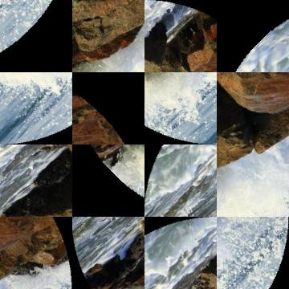
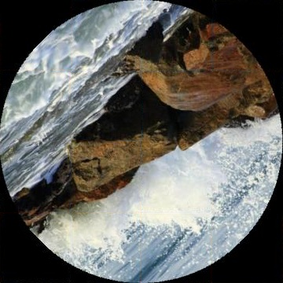
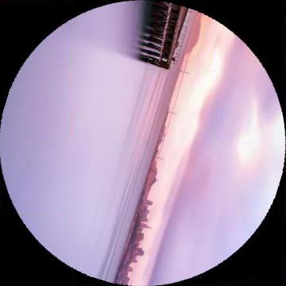
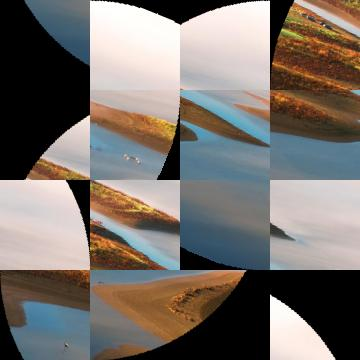
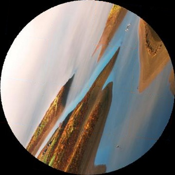

# 天爱 · 角度验证（angle）

> 360×360 圆形照片先做 4×4 块打乱、再整体旋转；拖动滑块把图调正。源方案是霍夫线 + 视觉模型兜底，本库 12 组人工审查为 8 通过 / 2 部分 / 2 错误。
>
> 返回：[天爱索引](../../../docs/tianai.md) · [全量类型](../../../docs/types.md) · [方法论](../../../docs/00-methodology.md)

## 一、速览

| 项 | 值 |
|---|---|
| 厂商 | 天爱（`tianai`） |
| 类型 / 变体 | `angle` / classic |
| 中文 | 角度验证 |
| 媒体 | 图片 |
| 样本 | 12 组（001–012） |
| 答案格式 | `angle`：旋转角（度） |
| 方法 | `CV+VLM`（霍夫线 + 视觉模型兜底） |
| 求解器 | `exists` · 中（源报告部分通过） |
| 人工审查 | 8 通过 / 2 部分 / 2 错误（截至 2026-11-21） |
| 证据等级 | 案例未写 `evidence` 字段；`status=sample-only` |

## 二、题面与判定

题面固定为「拖动滑块，调整到指定角度」。图片是一个圆形裁切，内部被切成 4×4 块并打乱，整图还带一个旋转角；用户需要把图调正。

| 案例 | 题面（`meta.prompt`） | 通过条件 | 审查 |
|---|---|---|---|
| [001](001/) | 拖动滑块，调整到指定角度 | 该批案例未记录 `pass_criteria`；按回正结果判定 | 通过 |
| [002](002/) | 同上 | 同上 | 部分 |
| [007](007/) | 同上 | 同上 | 错误 |

> `bg.jpg`、`restored.jpg`、`solved.jpg` 是三张不同的图：`bg` 是原始打乱 + 旋转；`restored` 只还原 4×4 块序，**仍然带旋转**；`solved` 才是回正后的彩色结果。不要把 `restored` 当最终答案。

## 三、样本长什么样

| 原始打乱 + 旋转 | 块序还原（仍旋转） | 回正结果 | 对照案例 |
|---|---|---|---|
|  |  |  |  |
|  |  |  |  |

- 001 是标准的通过案例：`restored` 还斜着，`solved` 已回正。
- 007 的 `solved` 仍明显倾斜，对应审查 `fail/incorrect`；009 同样错误。
- 010 是部分案例，`restored` 与 `solved` 可对照看误差。
- 12 组都只有 `bg` / `restored` / `solved` 三类图，没有 `answer.txt` / `result.json` / 过程图。

## 四、形态与难点

- **图幅**：360×360，圆形裁切；旋转后四角出现黑色。
- **两级变换**：4×4 块打乱 + 整体旋转。先还原块序，图仍然斜；块序和角度不能混为一步。
- **背景**：照片/插画内容，霍夫线是否稳定取决于画面里有没有长直线；抽象场景容易失败。
- **兜底**：源方案在霍夫线之外用视觉模型兜底，但没有记录模型名、阈值、候选角度范围。
- **目标角**：题面只说「指定角度」，本库案例的目标是回正；源记录没有给出滑块位移与角度的映射公式。

## 五、求解思路

源记录只到「霍夫线 + 视觉模型兜底」这一层，参数未展开。可以确认的处理顺序是：先还原块序，再估计整体旋转角，最后把图回正。

| 步骤 | 做法 | 说明 |
|---|---|---|
| 1 块序还原 | 按 4×4 块重排，得到仍旋转的完整图 | 对应 `restored.jpg` |
| 2 直线检测 | 霍夫变换找主方向 | 适合有建筑/地平线/长边的图 |
| 3 角度估计 | 由主方向推旋转角 | 源记录未给出角度候选与阈值 |
| 4 视觉兜底 | 霍夫线不足时交给视觉模型 | 源记录未给模型名/调用方式 |
| 5 输出 | 旋转到目标角，得到 `solved.jpg` | 12 组未记录角度数值 |

> 本页不写伪代码：源文档没有给出霍夫参数、角度范围或兜底模型的输入输出；再往下写就会变成臆造。

## 六、结果与审查

- **源记录**：源报告「部分通过」；没有逐组准确率。
- **本库**：12 组均有 `bg.jpg` / `restored.jpg` / `solved.jpg`；没有 `answer.txt` / `result.json`，无法计算角度误差。
- **审查口径**：看 `solved.jpg` 是否回正、是否还有明显倾斜；这是视觉核对，不是线上通过率。

| 组 | 审查 | 结果 | 备注 |
|---|---|---|---|
| [001](001/) | pass | correct | 回正 |
| [002](002/) | partial | partial | 仍有偏差 |
| [003](003/) | pass | correct | — |
| [004](004/) | pass | correct | — |
| [005](005/) | pass | correct | — |
| [006](006/) | pass | correct | — |
| [007](007/) | fail | incorrect | 结果仍倾斜 |
| [008](008/) | pass | correct | — |
| [009](009/) | fail | incorrect | 结果仍倾斜 |
| [010](010/) | partial | partial | 仍有偏差 |
| [011](011/) | pass | correct | — |
| [012](012/) | pass | correct | — |

> 8 通过 / 2 部分 / 2 错误是按 `meta.review` 现算的，不是源求解器的 12 组准确率；源记录只说「部分通过」。

## 七、失败与边界

| 现象 | 根因 | 证据 | 结论 |
|---|---|---|---|
| 007/009 回正失败 | 源记录未展开 | `solved.jpg` 仍倾斜；审查 fail | 不能把「有求解器」当成稳定能力 |
| 002/010 部分 | 源记录未展开 | 审查 partial | 需要角度误差数据才能定位 |
| 把 `restored.jpg` 当最终结果 | `restored` 只还原块序，仍带旋转 | 2026-11-21 展示修正记录 | 最终结果只看 `solved.jpg` |
| 无法计算角度误差 | 没有 `answer.txt` / `result.json` | 目录清单 | 只能做视觉审查 |
| 霍夫失效场景未知 | 参数与失败样本未记录 | 源文档只给方法名 | 不虚构阈值或模型 |

**边界**：本页只记录题面形态与人工审查。没有角度真值、没有滑块映射、没有线上提交，因此不能给出「角度误差 ≤ x°」或通过率。

## 八、相关

- 厂商索引：[docs/tianai.md](../../../docs/tianai.md)
- 全量类型：[docs/types.md](../../../docs/types.md) · 方法论：[docs/00-methodology.md](../../../docs/00-methodology.md)
- 同厂商对照：[rotate](../rotate/)（圆盘旋转嵌入）、[slide-restore](../slide-restore/)（错位条带还原）
- 案例：[001](001/) – [012](012/)（每组含 `meta.json` / `bg.jpg` / `restored.jpg` / `solved.jpg`）
- 来源：<https://captcha.tianai.cloud/>；样本版权归天爱所有，仅用于研究与教学。
