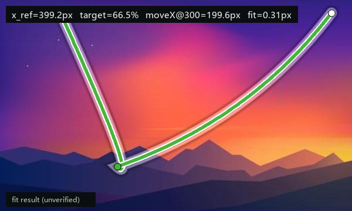
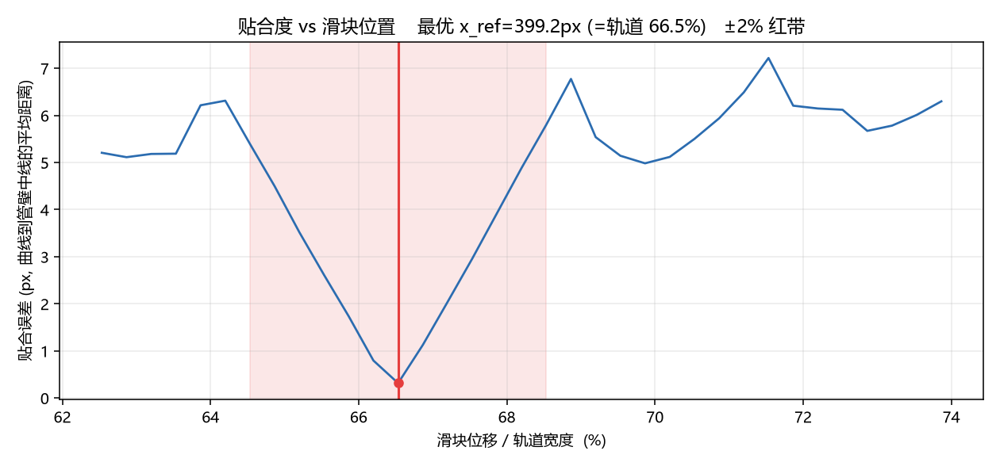
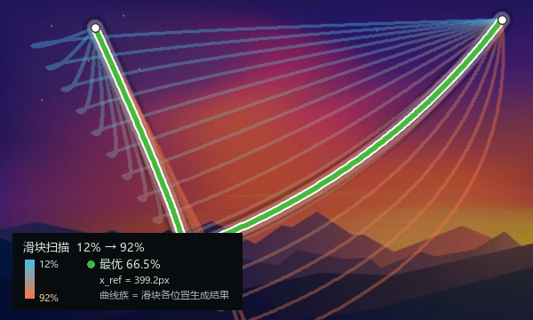
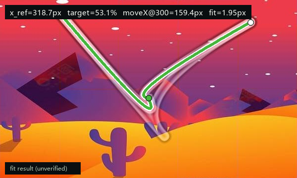

# 天爱 · 双贝塞尔曲线（curve-bezier / CURVE3）

> 两段**二次**贝塞尔（起点 → 接合点 J → 终点），白色参考管是双壁高光；沿法线取 `min(R,G,B)` 白度剖面，取两壁中点（管轴）拟合，12/12、残差 0.26–2.24px。目标 `moveX/300 = x_ref/600`，旧公式 A 0/12、B 仅 2/12。
>
> 返回：[天爱索引](../../../docs/tianai.md) · [全量类型](../../../docs/types.md) · [方法论](../../../docs/00-methodology.md)

## 一、速览

| 项 | 值 |
|---|---|
| 厂商 | 天爱（`tianai`） |
| 类型 / 变体 | `curve-bezier` / `CURVE3` |
| 中文 | 双贝塞尔曲线 |
| 媒体 | 图片 |
| 样本 | 12 组（001–012） |
| 答案格式 | `offset-x`：滑块位移 `moveX@300`（= `x_ref/2`） |
| 方法 | `CV+ACT`（亮边先验 + 白管两壁峰中线拟合；无 LLM） |
| 求解器 | `partial` · 中（离线管轴拟合 12/12；在线提交待实测） |
| 人工审查 | 12 通过 / 0 错误（截至 2026-11-21） |
| 证据等级 | 案例未写 `evidence` 字段；`status=sample-only`，答案不落库 |

## 二、题面与判定

用户拖动滑块，使客户端绘制的双贝塞尔与背景中的白色参考管贴合。两端固定，三个中间控制点（C1、J、C2）随 `moveX` 等比缩放。

| 案例 | 题面（`meta.prompt`） | 通过条件 | 拟合答案 |
|---|---|---|---|
| [001](001/) | 拖动滑块使曲线匹配背景参考曲线 | 按 `moveX/bgImageWidth` 与 `x_ref/600` 比对，容差 ±0.02；另有轨迹时长/点数/首点/步进/后段减速检查 | `x_ref=399.2` → `moveX=199.6` |
| [005](005/) | 同上 | 同上 | `x_ref=318.7` → `moveX=159.4` |
| [011](011/) | 同上 | 同上 | `x_ref=346.1` → `moveX=173.1` |

> ±0.02 的容差在 600 图像坐标下是 ±12px；在 300 展示宽下是 ±6px。不要把它写成「±6 图像像素」。

## 三、样本长什么样

| 原始打乱图 | 还原题面 | 管轴拟合结果 | 拟合叠加 |
|---|---|---|---|
|  |  |  |  |
|  |  |  |  |

- `bg.jpg` 是 API 原始 5×2 打乱图；`restored.jpg` 是 SDK 还原后的实际题面，可以看到白色双壁管。
- `solved.png` 的绿线是管轴目标，位于两壁正中；顶部标注目标百分比、`x_ref` 与 `moveX@300`。
- `process-01-fit.png` 叠合白管与拟合；`process-02-score.png` 是贴合度随滑块位置的变化，绿色带为 ±2% 容差。
- `trajectory.png` 把滑块 12%–92% 扫描时各位置生成的曲线族叠加，冷→暖表示拖动方向，绿色为最优 `x_ref`。
- 001 左上方另有一段短白管，不在拟合目标上；源文档没有说明它的角色，求解只跟随 V 形参考管。

## 四、形态与难点

- **图幅**：600×360；打乱后还原，展示宽 300。
- **参数**：`attr1` 是 10 个浮点数用小数点直接拼接，按 20 个 token 两两重组；前 4 个是左/右端点比例，后 6 个是 C1、接合点 J、C2 的 600×360 像素坐标。
- **曲线类型**：客户端画**两段二次贝塞尔**（起点 → J → 终点），不是一条三次贝塞尔。把 J 当普通控制点会画错形状。
- **缩放关系**：端点固定；中间三组坐标随 `moveX` 线性缩放，x 方向按 `moveX/展示宽`，y 方向按 `moveX/展示高`。
- **目标**：`moveX/展示宽 = x_ref/600`；展示宽 300 时 `moveX=x_ref/2`。
- **双壁管**：参考曲线是白色管状高光，有两条亮壁；只贴一条边会系统性偏向一侧，必须取两壁中点。
- **旧公式**：A = `(v0·300 + v4·0.5)/2`，B = `(v0·300 + v2·300)/2`；12 组中 A 命中 0 组、B 仅 2 组偶然落在 ±6px。

## 五、求解思路

核心是「先粗定位，再沿法线找两壁，取中点」。白色管有两条平行亮壁，管轴才是参考曲线的真实位置。

| 步骤 | 做法 | 关键判据 / 参数 |
|---|---|---|
| 1 还原 | 反打乱 5×2 条带，得到 600×360 | 展示宽 300 |
| 2 粗定位 | 中值背景减法 + 连通域，用亮边 ridge 先验找管的大致位置 | 排除背景纹理 |
| 3 法向剖面 | 沿候选曲线法线采样 `min(R,G,B)` 白度剖面 | 白管表现为两个亮壁峰 |
| 4 取管轴 | 找两个亮壁峰并取中点，作为最终拟合目标 | 只取一条边会偏一侧 |
| 5 细化 | 在粗定位 ±34px 内一维搜索 + 0.5px 细化 | 12 组管轴残差 0.26–2.24px |
| 6 换算 | `moveX@300 = x_ref/2`；服务端比较 `x_ref/600` | 容差 ±0.02（±12 图像 px / ±6 展示 px） |
| 7 提交 | 生成符合轨迹检查的拖动；本库未实测 | 时长、点数、首点、步进、末段减速 |

```text
# 白管管轴拟合（伪代码，对应「两壁峰中点」）

bg = restore_shuffle(bg_shuffled)            # 600 x 360
x_ref = coarse_ridge_peak(bg)                # 亮边先验，粗定位
best = None

for x in x_ref-34 .. x_ref+34 step 0.5:
    curve = two_quadratic_beziers(x, attr1)  # 起点 -> J -> 终点
    axes = []
    for p in sample_points(curve):
        n = normal_at(curve, p)
        profile = [min_rgb(bg, p + t*n) for t in -12 .. 12]
        wall1, wall2 = two_bright_peaks(profile)
        axes.append((wall1 + wall2) / 2)     # 两壁中点 = 管轴
    residual = rms(axes - curve_points)
    if best is None or residual < best.residual:
        best = (x, residual)

moveX = best.x / 600 * 300                   # = x_ref / 2
answer = moveX                               # 300px 展示坐标
```

## 六、结果与审查

- **源记录**：管轴拟合 12/12，残差 0.26–2.24px，远小于 ±12px 容差；绿色结果线位于两壁正中。
- **本库**：12 组均有 `solved.png`、`process-01-fit.png`、`process-02-score.png`、`trajectory.png`；没有 `answer.txt` / `result.json`，答案只写入案例页与过程图。
- **人工审查**：12 组 `review.state=pass`、`result=correct`；这是对离线拟合结果的核对，不是线上通过。
- **在线**：未实测；`solver.status=partial`，`status=sample-only`。

| 组 | x_ref | 目标百分比 | moveX@300 | 管轴残差 | 旧 A 偏差 | 旧 B 偏差 |
|---|---:|---:|---:|---:|---:|---:|
| [001](001/) | 399.2 | 66.5% | 199.6 | 0.31 | 83.6 | 31.6 |
| [002](002/) | 444.0 | 74.0% | 222.0 | 0.57 | 146.7 | 70.5 |
| [003](003/) | 341.6 | 56.9% | 170.8 | 0.90 | 41.9 | 41.1 |
| [004](004/) | 341.2 | 56.9% | 170.6 | 0.71 | 42.2 | 21.1 |
| [005](005/) | 318.7 | 53.1% | 159.4 | 1.95 | 29.0 | 2.9 |
| [006](006/) | 396.2 | 66.0% | 198.1 | 1.24 | 110.5 | 39.3 |
| [007](007/) | 459.1 | 76.5% | 229.6 | 1.11 | 145.6 | 83.3 |
| [008](008/) | 425.6 | 70.9% | 212.8 | 1.37 | 59.1 | 83.8 |
| [009](009/) | 391.2 | 65.2% | 195.6 | 1.71 | 47.8 | 42.1 |
| [010](010/) | 425.6 | 70.9% | 212.8 | 1.37 | 59.1 | 83.8 |
| [011](011/) | 346.1 | 57.7% | 173.1 | 2.24 | 9.9 | 1.2 |
| [012](012/) | 354.4 | 59.1% | 177.2 | 0.26 | 100.0 | 40.4 |

> 008 与 010 的 `x_ref`、残差、旧偏差完全相同，源表如此；没有证据表明是两次独立采集，统计时仍按 12 组计。旧公式 B 仅在 005（2.9px）和 011（1.2px）偶然落入 ±6px，A 为 0/12。

## 七、失败与边界

| 现象 | 根因 | 证据 | 结论 |
|---|---|---|---|
| 旧公式 A 全错 | 把端点比例按 300 直接缩放，忽略接合点与滑块关系 | 12 组 A 偏差 9.9–146.7px，0/12 命中 | 弃用 A |
| 旧公式 B 仅偶中 | 公式形式不匹配双贝塞尔缩放 | 仅 005/011 落入 ±6px | 只能当随机命中 |
| 单边拟合偏向一侧 | 白管是双壁高光，单条亮边不等于管轴 | 源记录明确说明 | 取两壁峰中点 |
| 把两段二次当三次 | 客户端绘制是起点→J→终点两段二次 | 参数与绘制机制 | 按二次贝塞尔建模 |
| 008/010 数据相同 | 源表数值完全重复 | 同表 | 不能据此声称 12 张独立图 |
| 在线未实测 | 只有离线拟合与结果图 | `status=sample-only` | 拟合正确 ≠ 服务端接受 |

**边界**：本页只覆盖离线管轴拟合。12 组没有 `answer.txt` / `result.json`，答案以案例页和 `solved.png` 标注为准；线上提交需要完整轨迹，尚未验证。

## 八、相关

- 厂商索引：[docs/tianai.md](../../../docs/tianai.md)
- 全量类型：[docs/types.md](../../../docs/types.md) · 方法论：[docs/00-methodology.md](../../../docs/00-methodology.md)
- 同厂商对照：[curve](../curve/)（单条三次贝塞尔、端点固定）、[curve-ellipse](../curve-ellipse/)（椭圆单参数族）
- 案例：[001](001/) – [012](012/)（每组含 `meta.json` / `bg.jpg` / `restored.jpg` / `solved.png` / `process-01-fit.png` / `process-02-score.png` / `trajectory.png`）
- 来源：<https://captcha.tianai.cloud/>；样本版权归天爱所有，仅用于研究与教学。
