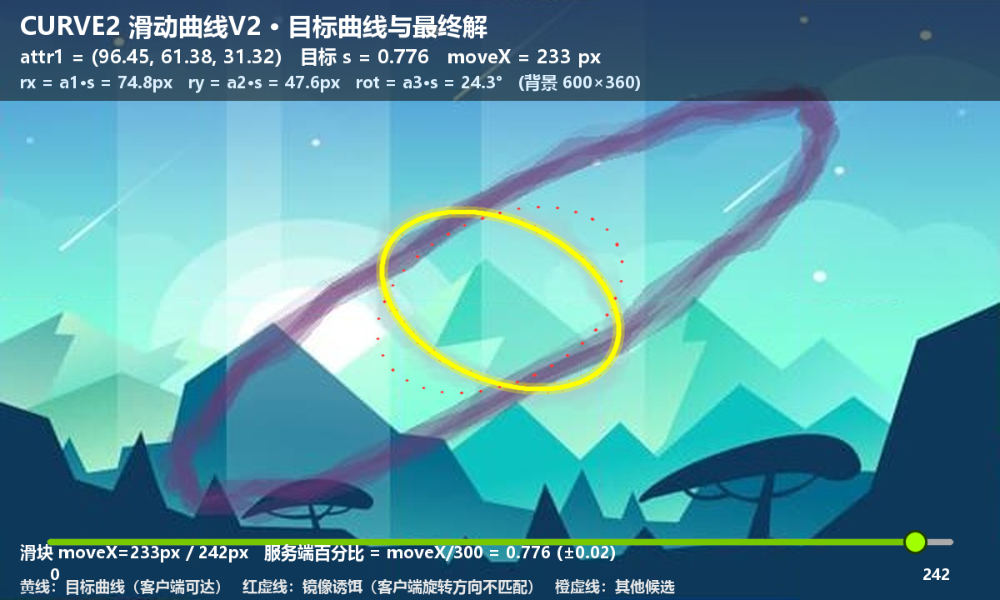
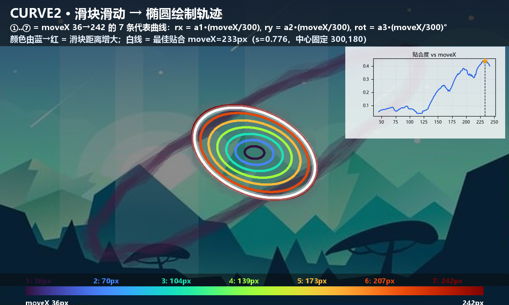
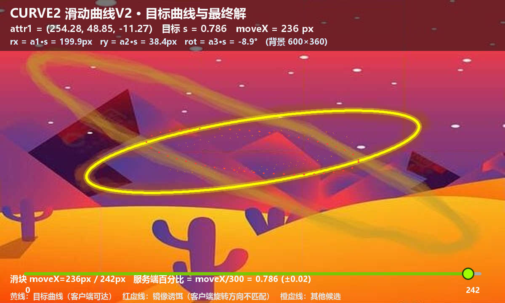
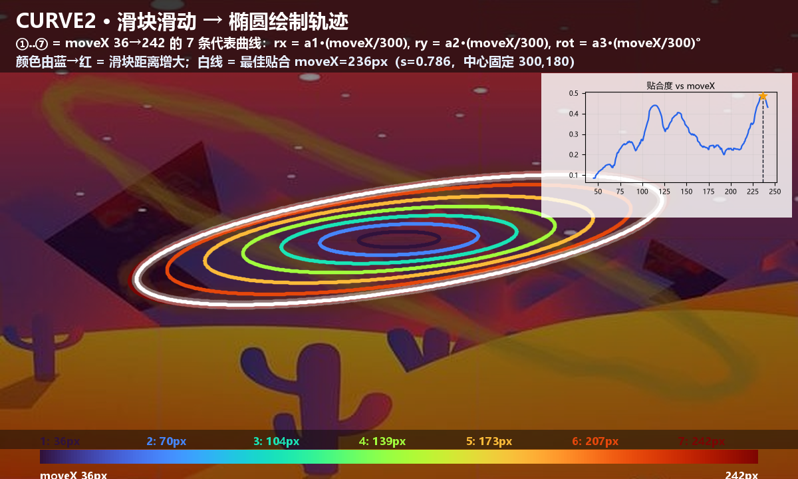

# 天爱 · 椭圆曲线（curve-ellipse / CURVE2）

> `attr1` 三个浮点数定义椭圆族；滑块只控制一个比例 `s=moveX/300`，客户端按 `(s·a1, s·a2, s·a3°)` 画椭圆。目标多为内侧细曲线，外侧醒目曲线常是诱饵，镜像族成员也必须排除；答案 `moveX=300·s`。
>
> 返回：[天爱索引](../../../docs/tianai.md) · [全量类型](../../../docs/types.md) · [方法论](../../../docs/00-methodology.md)

## 一、速览

| 项 | 值 |
|---|---|
| 厂商 | 天爱（`tianai`） |
| 类型 / 变体 | `curve-ellipse` / `CURVE2` |
| 中文 | 椭圆曲线 |
| 媒体 | 图片 |
| 样本 | 12 组（001–012） |
| 答案格式 | `offset-x`：`moveX=300·s`（300px 展示宽） |
| 方法 | `CV+ACT`（族椭圆法线 Lab 色差 ridge + 一维扫描；无 LLM） |
| 求解器 | `exists` · 中（12/12 有结果图；未逐题实拖） |
| 人工审查 | 12 通过 / 0 错误（截至 2026-11-21，备注均为「待复核」） |
| 证据等级 | `unverified`；`status=result-pending-review` |

## 二、题面与判定

用户拖动滑块，使客户端椭圆与背景中的目标椭圆曲线重合。椭圆由 `attr1` 的三个参数按同一比例 `s` 缩放/旋转，圆心固定在画布中心。

| 案例 | 题面（`meta.prompt`） | 通过条件 | 答案 |
|---|---|---|---|
| [001](001/) | 沿曲线拖动滑块 | `moveX/300` 与目标比例差 ≤ 0.02，且轨迹需过行为校验 | `s=0.776` → `moveX=232.8` |
| [005](005/) | 同上 | 同上 | `s=0.786` → `moveX=235.8` |
| [010](010/) | 同上 | 同上 | `s=0.526` → `moveX=157.8` |

> 关键换算：服务端比较的是 `moveX/300 = s`，不是像素差；容差 ±0.02 在 300px 轨道上是 ±6px。可达上限 `s ≤ 242/300 = 0.8067`。

## 三、样本长什么样

| 原始打乱图 | 还原题面 | 目标与诱饵 | 求解轨迹 |
|---|---|---|---|
|  |  |  |  |
|  |  |  |  |

- `bg.jpg` 是 API 原始 5×2 条带打乱图；`restored.jpg` 是还原题面，能同时看到内外两条椭圆族成员。
- `roles.solved` 指向 `solve.png`（不是 `solved.png`）：黄线 = 目标族成员，红虚线 = 镜像诱饵，底部带滑块与百分比。
- `trajectory.png` 叠加 7 条代表曲线，并带「贴合度 vs 滑块位置」小图；冷→暖表示 `s` 增大。
- 001 的还原图里，外侧紫色曲线更醒目，但目标是内侧白色细曲线；不能按「最亮/最大」选。

## 四、形态与难点

- **图幅**：600×360 还原背景；客户端画布 300×180；圆心固定。
- **客户端绘制**：`moveX = clamp(clientX - startX, 0, 242)`；画布上 `rx=a1·(moveX/300)·0.5`、`ry=a2·(moveX/300)·0.5`、`rot=a3·(moveX/300)°`；换算到 600 背景时 `rx_bg=a1·moveX/300`、`ry_bg=a2·moveX/300`、`rot=a3·moveX/300°`，圆心 (300,180)。
- **单参数族**：令 `s=moveX/300`，所有候选都是 `(s·a1, s·a2, s·a3°)`，只有一个自由度。
- **内外诱饵**：目标多为内侧细曲线，常被外侧更醒目的曲线包围或遮挡；只按亮度/尺度会选错。
- **镜像诱饵**：客户端旋转方向固定，`sign=-1` 的镜像族成员不可达；set05 的镜像得分 0.512 > 目标 0.486，必须固定 `sign=+1`。
- **不可达尺度**：`s` 只能到 0.8067；同族更大尺度不能作为答案。

## 五、求解思路

对每个候选 `s` 生成族椭圆，沿椭圆法线取 Lab 三通道颜色差的绝对值作为「脊」响应；目标曲线在法线方向有稳定的颜色跃变，诱饵则可能只在部分角度成立。再用角度覆盖约束排除只命中局部的曲线。

| 步骤 | 做法 | 关键判据 / 参数 |
|---|---|---|
| 1 读参数 | `attr1 = a1.a2.a3` 三个浮点数 | 单参数族 |
| 2 采样 | 每个候选沿椭圆采 480 点 | 覆盖全周 |
| 3 法线色差 | 在法线 ±(4/7/11)px 取 Lab 三通道绝对差 | 形成 ridge 响应 |
| 4 打分 | `score = strong·(0.4+0.6·angcov) + 0.15·cover` | 24 个角度桶；覆盖不足会被压分 |
| 5 扫描 | `s∈[0.15,0.8067]`，固定 `sign=+1`；NMS 取 top-3 | 镜像 `sign=-1` 只作诱饵对照 |
| 6 出答案 | `moveX=300·s*`；服务端百分比为 `s*` | 容差 ±0.02 |
| 7 提交 | 轨迹需过行为校验；本库未逐题实拖 | 时长/点数/首点/步进/末段减速 |

```text
# 椭圆族 ridge 扫描（伪代码，对应 CURVE2 单参数拟合）

a1, a2, a3 = parse_attr1(attr1)

best = None
for s in 0.15 .. 0.8067 step 0.002:          # 单参数族
    ellipse = (rx=s*a1, ry=s*a2, rot=s*a3)    # 600x360，圆心 (300,180)
    strong, covered_bins = [], set()
    for p in sample_ellipse(ellipse, n=480):
        n = normal_at(ellipse, p)
        d = lab_abs_diff(bg, p - 7*n, p + 7*n)  # 法线两侧色差
        if is_ridge(d):
            strong.append(ridge_strength(d))
            covered_bins.add(angle_bin(p, bins=24))
    angcov = len(covered_bins) / 24
    cover  = len(strong) / 480
    score  = mean(strong) * (0.4 + 0.6*angcov) + 0.15*cover
    keep_top3(best, (s, score))

s_star = best.s
mirror = scan(sign=-1)                        # 仅作诱饵对照
answer = 300 * s_star                         # moveX，300px 展示坐标
```

## 六、结果与审查

- **源记录**：12 组都有离线识别结果，`solve.png` 与 `trajectory.png` 齐全；没有逐题在线拖动记录，证据等级统一 `unverified`。
- **本库**：12 组 `answer.txt`（`moveX` / `s` / `percentage`）与 `result.json`（拟合指标与候选）齐全。
- **人工审查**：12 组 `review.state=pass`、`result=correct`，但 `notes` 均为「待复核：结果为离线视觉估计，未逐题实拖」。
- **在线错误码**：源记录中，位置吻合但轨迹为机器直线返回 `50000 check fail`；位置不符返回 `4001 基础校验失败`；同一 id 重复提交返回 `4000 已失效`。

| 组 | a1 | a2 | a3 | 目标 s | moveX | ridge 得分 | 覆盖/角度 | 镜像诱饵 s |
|---|---:|---:|---:|---:|---:|---:|---:|---:|
| [001](001/) | 96.5 | 61.4 | 31.3 | 0.776 | 232.8 | 0.438 | 0.69/0.96 | 0.806 |
| [002](002/) | 142.2 | 66.7 | 45.9 | 0.674 | 202.2 | 0.745 | 0.94/1.00 | 0.726 |
| [003](003/) | 311.6 | 80.6 | 39.6 | 0.722 | 216.6 | 0.534 | 0.74/0.88 | 0.378 |
| [004](004/) | 371.5 | 77.5 | -9.9 | 0.502 | 150.6 | 0.500 | 0.99/1.00 | 0.350 |
| [005](005/) | 254.3 | 48.9 | -11.3 | 0.786 | 235.8 | 0.486 | 0.87/1.00 | 0.498 |
| [006](006/) | 562.6 | 116.1 | -68.9 | 0.508 | 152.4 | 0.973 | 0.98/1.00 | 0.350 |
| [007](007/) | 393.0 | 70.5 | 1.5 | 0.668 | 200.4 | 0.726 | 0.98/1.00 | 0.634 |
| [008](008/) | 181.0 | 85.7 | -41.9 | 0.532 | 159.6 | 0.869 | 0.95/1.00 | 0.350 |
| [009](009/) | 164.5 | 101.2 | -23.5 | 0.550 | 165.0 | 0.399 | 0.85/1.00 | 0.570 |
| [010](010/) | 352.8 | 82.4 | 37.6 | 0.526 | 157.8 | 0.393 | 0.69/0.96 | 0.150 |
| [011](011/) | 220.6 | 76.6 | 22.4 | 0.542 | 162.6 | 0.878 | 0.94/1.00 | 0.374 |
| [012](012/) | 359.4 | 57.1 | -44.7 | 0.650 | 195.0 | 0.686 | 0.97/1.00 | 0.214 |

> 本表是离线拟合指标，不是线上通过率。005 的镜像得分 0.512 高于目标 0.486，是「必须固定 `sign=+1`」的直接证据。

## 七、失败与边界

| 现象 | 根因 | 证据 | 结论 |
|---|---|---|---|
| 选到外侧醒目曲线 | 目标常为内侧细曲线，外侧曲线更显眼 | 源记录形态说明；001 还原图 | 不按亮度/尺度选，按法线 ridge + 角度覆盖打分 |
| 选到镜像族成员 | `sign=-1` 的镜像旋转不可达 | set05 镜像 0.512 > 目标 0.486 | 固定 `sign=+1` |
| `50000 check fail` | 位置吻合，但轨迹是机器直线 | 源记录实测错误码 | 位置对仍需轨迹生成 |
| `4001 基础校验失败` | 位置与目标比例不符 | 源记录实测错误码 | 检查 `moveX/300` |
| `4000 已失效` | 同一 id 只能提交一次 | 源记录实测错误码 | 重试需新 id |
| 12 组未逐题实拖 | 只有离线视觉估计 | `evidence=unverified` | 审查 pass 不等于线上通过 |

**边界**：本页只覆盖椭圆族识别与 `s→moveX` 换算。真实提交还要轨迹满足时长、点数、首点近原点、步进 ≤50、末段减速以及 y 不恒定；这些条件未在 12 组上逐题验证。

## 八、相关

- 厂商索引：[docs/tianai.md](../../../docs/tianai.md)
- 全量类型：[docs/types.md](../../../docs/types.md) · 方法论：[docs/00-methodology.md](../../../docs/00-methodology.md)
- 同厂商对照：[curve](../curve/)（三次贝塞尔、控制点 x 缺失）、[curve-bezier](../curve-bezier/)（两段二次贝塞尔）
- 案例：[001](001/) – [012](012/)（每组含 `meta.json` / `bg.jpg` / `restored.jpg` / `solve.png` / `trajectory.png` / `answer.txt` / `result.json`）
- 来源：<https://captcha.tianai.cloud/>；样本版权归天爱所有，仅用于研究与教学。
