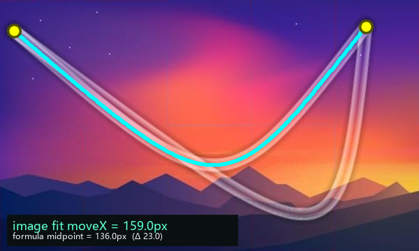
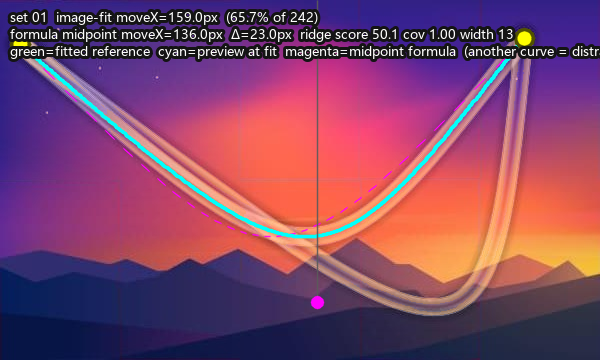
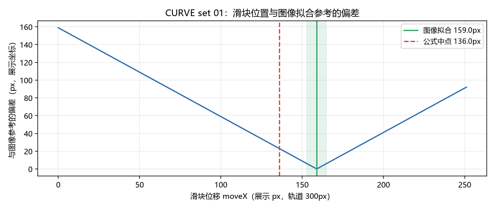
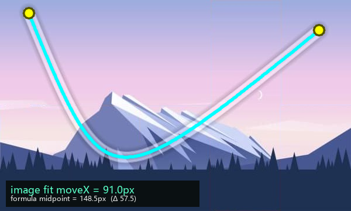
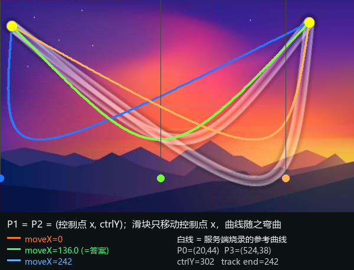
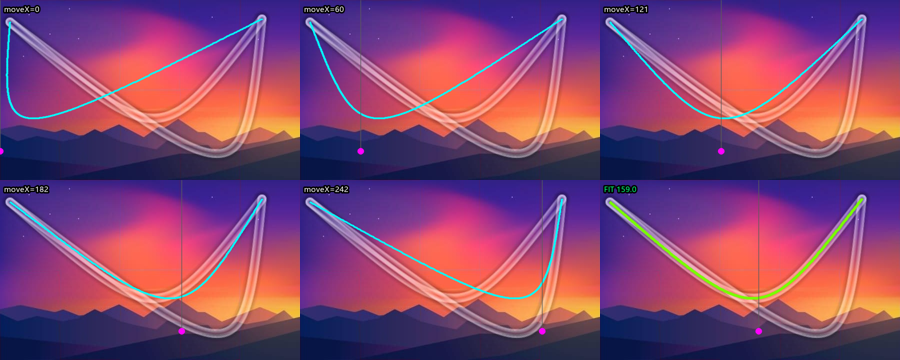

# 天爱 · 曲线滑动（curve / CURVE）

> 600×360 背景烘焙一条可见参考曲线，两个小球标出端点；`p` 只含端点和 `ctrlY`，**目标控制点 x 不在参数里**，必须从背景恢复。纯 CV 拟合 12/12 有值，但线上提交未验证。
>
> 返回：[天爱索引](../../../docs/tianai.md) · [全量类型](../../../docs/types.md) · [方法论](../../../docs/00-methodology.md)

## 一、速览

| 项 | 值 |
|---|---|
| 厂商 | 天爱（`tianai`） |
| 类型 / 变体 | `curve` / `CURVE` |
| 中文 | 曲线滑动 |
| 媒体 | 图片 |
| 样本 | 12 组（001–012） |
| 答案格式 | `offset-x`：滑块位移 `moveX`（300px 展示宽） |
| 方法 | `CV+ACT`（白度 top-hat + 法线对称脊对 + 族内一维扫描；无 LLM） |
| 求解器 | `exists` · 中（图像拟合 12/12；在线待复核） |
| 人工审查 | 12 通过 / 0 错误（截至 2026-11-21） |
| 证据等级 | 案例未写 `evidence` 字段；有 `answer.txt` / `result.json` / 过程图 |

## 二、题面与判定

用户拖动滑块，让预览曲线与背景中的可见参考曲线重合。预览是端点固定的三次贝塞尔，两个控制点始终重合于 `(moveX, ctrlY)`；滑块行程 0–242。

| 案例 | 题面（`meta.prompt`） | 通过条件 | 图像拟合答案 |
|---|---|---|---|
| [001](001/) | 沿曲线拖动滑块 | 服务端按 `moveX/bgImageWidth` 与 `randomX/600` 比对，容差 ±0.02（300px 展示宽下 ±6px）；另有轨迹时长/点数/首点/步进/末段减速检查 | `moveX=159.0` |
| [004](004/) | 同上 | 同上 | `moveX=161.2` |
| [009](009/) | 同上 | 同上 | `moveX=91.0` |

> `bgImageWidth` 是展示宽 300；还原图是 600×360，因此 `moveX = randomX/2`。这个 1/2 来自客户端缩放，不是经验系数。

## 三、样本长什么样

| 还原题面（页面主图） | 拟合结果 | 拟合叠加 | 偏差曲线 |
|---|---|---|---|
|  |  |  |  |
|  |  |  |  |

- `roles.bg` 指向 `restored.jpg`，它才是 SDK 还原后的实际题面；`bg.jpg` 是 API 原始 5×2 打乱图，只作来源保留。
- 001 题面里有两条共享端点的曲线：粗 U 是参考，细斜线是干扰；`solved.png` 的青色预览落在参考上，黄色圆点为端点。
- `process-01-fit.png`：绿线 = 图像拟合，洋红虚线 = 旧「端点中点」公式，青色 = 拟合位置预览；`process-02-score.png` 画偏差随滑块位移的变化。
- `process-03-mechanism.png` 与 `process-04-compare.png` 只 001 有，用来解释「端点不动、控制点 x 改变弯曲」。

## 四、形态与难点

- **图幅与还原**：600×360 照片按 5×2 打乱，参考曲线烘焙在图上；客户端反打乱后以 300×180 显示，缩放 0.5。
- **参数缺失**：`p` 是 5 个浮点数的小数点拼接，再插入 5 个 marker 数字；客户端按 2⁰…2⁴ 位取 marker，从右往左切出 5 个 `0.xxx`，重排为 `[lx/W, ly/H, rx/W, ry/H, ctrlY/H]`。**没有控制点 x**。
- **同族关系**：参考与预览都满足 `P1=P2=(x, ctrlY)`；参考的 `x=randomX`（背景可见曲线），预览的 `x=moveX·600/300`；重合时 `moveX=randomX/2`。
- **旧公式**：把 `randomX` 当成两端点中点，只有 `randomX` 恰好靠近中点时才是巧合；本批 12 组的 Δ 为 7.0–94.5px，按表没有一组落入 ±6px。
- **两条曲线**：干扰曲线与参考共享端点但形状不同；族内扫描只接受与预览同族的参考，典型 set09 的粗 U 为参考、细斜线为干扰。
- **视觉估计**：图像拟合是离线视觉估计；源记录时 demo API 返回 502，无法在线提交。

## 五、求解思路

核心是「只恢复一个自由度」：预览族里只有一个控制点 x 可变，因此对候选 `cx` 生成同族曲线，在曲线上按法线采样白度，找玻璃管的对称双亮脊，取整族最优。

| 步骤 | 做法 | 关键判据 / 参数 |
|---|---|---|
| 1 还原 | 按 `shuffle.pos` 反打乱 5×2 条带，得到 600×360；确认两端球心 | 端点固定，缩放 0.5 |
| 2 提亮脊 | `w=min(R,G,B)` 减 15px 开运算做白度 top-hat | 压掉宽天空/背景，保留细亮脊与玻璃管高光 |
| 3 找脊对 | 沿候选曲线法线采样，检测「两侧等距的平行亮脊对」 | 玻璃管有双脊；单条高光线没有平行脊 |
| 4 打分 | 强度 × 覆盖率 × 宽度一致性 | 对称脊对得分高，单脊/偏一侧得分低 |
| 5 族内扫描 | 对 `cx∈[20,580]` 生成预览族并打分，抛物线细化 | 干扰曲线不在族里，自然被排除 |
| 6 出答案 | 取峰值 `moveX`；与图像拟合的偏差就是贴合度 | 通过窗口 = 图像拟合 ±6px |
| 7 提交 | 生成拖动轨迹；源端另有行为检查 | 轨迹不在本库验证范围 |

```text
# 可见参考控制点 x 的图像拟合（伪代码，对应 top-hat + 脊对 + 族扫描）

white = min(R, G, B)
ridges = white - opening(white, radius=15)   # 白度 top-hat

best_x, best_score = None, -inf
for cx in 20 .. 580:                         # 预览族只有一个自由度
    curve = cubic_bezier(P0, P1=(cx, ctrlY),
                         P2=(cx, ctrlY), P3)
    scores = []
    for p in sample_points(curve):
        n = normal_at(curve, p)
        left  = max(ridges[p - k*n])         # 一侧亮脊
        right = max(ridges[p + k*n])         # 另一侧等距亮脊
        scores.append(pair_score(left, right))
    score = mean(scores) * coverage * width_consistency
    if score > best_score:
        best_x, best_score = cx, score

moveX = parabolic_refine(best_x)
answer = moveX                               # 300px 展示坐标
```

## 六、结果与审查

- **源记录**：图像拟合 12/12 有值；`ridge score` 13.7–62.2，覆盖 0.96–1.00。旧中点公式只作对照。
- **本库**：12 组均有 `answer.txt` / `result.json` / `process-01-fit.png` / `process-02-score.png`；001 另有机制图与六格对比图。
- **人工审查**：12 组 `review.state=pass`、`result=correct`；审查核对的是图像拟合位置，不含轨迹是否被服务端接受。
- **在线**：源记录时 demo API 502；12 组都没有线上提交结果，`status=sample-only`。

| 组 | 图像拟合 moveX | 旧公式中点 | Δ | ridge score | 覆盖 |
|---|---:|---:|---:|---:|---:|
| [001](001/) | 159.0 | 136.0 | 23.0 | 50.1 | 1.00 |
| [002](002/) | 118.6 | 134.8 | 16.1 | 44.6 | 1.00 |
| [003](003/) | 202.4 | 150.0 | 52.4 | 13.7 | 1.00 |
| [004](004/) | 161.2 | 154.2 | 7.0 | 53.4 | 1.00 |
| [005](005/) | 175.1 | 139.8 | 35.4 | 15.8 | 1.00 |
| [006](006/) | 66.5 | 161.0 | 94.5 | 15.8 | 1.00 |
| [007](007/) | 138.0 | 149.5 | 11.5 | 62.2 | 1.00 |
| [008](008/) | 122.7 | 138.8 | 16.0 | 52.4 | 1.00 |
| [009](009/) | 91.0 | 148.5 | 57.5 | 29.1 | 1.00 |
| [010](010/) | 208.8 | 148.0 | 60.8 | 49.3 | 1.00 |
| [011](011/) | 208.0 | 149.8 | 58.3 | 55.3 | 1.00 |
| [012](012/) | 169.3 | 144.0 | 25.3 | 52.6 | 0.96 |

> 表中 Δ 最小 7.0px，按本表旧公式没有一组 ≤6px；源文档另称旧公式「个别巧合」、源求解器约 10% 单次通过（靠重试）。两个说法并不完全一致，本页只把 7.0–94.5px 当作可核对的数据。

## 七、失败与边界

| 现象 | 根因 | 证据 | 结论 |
|---|---|---|---|
| 旧「端点中点」公式系统性偏移 | `randomX` 不在 `p` 里，也不等于端点中点 | 12 组 Δ 7.0–94.5px；set06 拟合 66.5 vs 旧 161.0 | 必须从背景可见曲线恢复控制点 x |
| 两条曲线都像参考 | 两条曲线可能共享端点且都在预览族里 | 源记录明确提示存在歧义 | 取亮脊更强的一条；无法消歧时人工复核 |
| 单条高光线误检 | 只有一条亮脊，没有成对管壁 | top-hat 后高光线仍是单脊 | 用「对称脊对」而不是单脊强度 |
| 低分组的拟合可信度不足 | 003/005/006 的 ridge score 仅 13.7–15.8 | 同表数值 | 低分样本需人工看图，不能只看峰值 |
| 没有线上结果 | demo API 502 | 源记录 | 图像拟合 ≠ 线上通过 |

**边界**：本页只覆盖可见参考曲线的离线拟合。真实提交还需要把 600 坐标换算到 300 展示坐标，并生成满足时长、点数、步进与末段减速的轨迹；这些都没有在 12 组上验证。

## 八、相关

- 厂商索引：[docs/tianai.md](../../../docs/tianai.md)
- 全量类型：[docs/types.md](../../../docs/types.md) · 方法论：[docs/00-methodology.md](../../../docs/00-methodology.md)
- 同厂商对照：[curve-bezier](../curve-bezier/)（两段二次贝塞尔）、[curve-ellipse](../curve-ellipse/)（椭圆单参数族）
- 案例：[001](001/) – [012](012/)（每组含 `meta.json` / `bg.jpg` / `restored.jpg` / `answer.txt` / `result.json`；001 的过程图最全）
- 来源：<https://captcha.tianai.cloud/>；样本版权归天爱所有，仅用于研究与教学。
