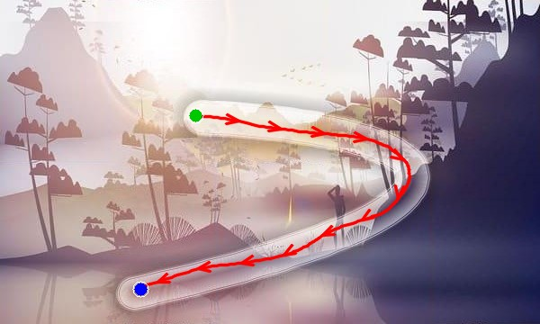

# 天爱 · 手势轨迹（gesture）

> 600×360 照片背景里烘焙一条曲线带，按带拖动；v7 用「胶囊管 + 端帽」纯 CV 检测，21 组源标注中 19 组平均误差 < 15px。本库 12 组均附路径答案，其中 8 组为自动求解、4 组为人工标注。
>
> 返回：[天爱索引](../../../docs/tianai.md) · [全量类型](../../../docs/types.md) · [方法论](../../../docs/00-methodology.md)

## 一、速览

| 项 | 值 |
|---|---|
| 厂商 | 天爱（`tianai`） |
| 类型 / 变体 | `gesture` / classic |
| 中文 | 手势轨迹 |
| 媒体 | 图片 |
| 样本 | 12 组（001–012） |
| 答案格式 | `path`：起点 + 终点 + 完整轨迹点（600×360 还原图坐标） |
| 方法 | `CV+ACT`（纯 CV 曲线检测 + 合成拖动） |
| 求解器 | `exists` · 中（v7；21 组源标注 19/21 < 15px） |
| 人工审查 | 12 通过 / 0 错误（截至 2026-11-21） |
| 证据等级 | `manual` 4 组（001–003、011）/ `offline-verified` 8 组（004–010、012） |

## 二、题面与判定

题面固定为「按提示绘制手势轨迹」：背景照片中有一条可见曲线带，用户需从一端沿带中心画到另一端。曲线带可能是黑带、反转白线或管状亮带，端点由两个圆帽标出。

| 案例 | 题面（`meta.prompt`） | 路径来源 | 通过条件 |
|---|---|---|---|
| [001](001/) | 按提示绘制手势轨迹 | 人工标注 ground truth | 该批案例未记录 `pass_criteria`；按轨迹沿可见曲线带判定 |
| [004](004/) | 同上 | 自动求解（v7） | 同上 |
| [006](006/) | 同上 | 自动求解（v7） | 同上 |

> 12 组答案都是 600×360 还原图坐标。页面真正绘制时需要先按反打乱顺序还原，再将坐标除以 2 映射到 300×180 画布；直接拿 600 坐标画会整体偏移。

## 三、样本长什么样

| 原始打乱图 | 还原题面 | 轨迹结果 |
|---|---|---|
|  |  |  |
|  |  |  |

- `bg.jpg` 是 API 原始 5×2 条带打乱图；`restored.jpg` 才是还原后的实际题面，能直接看到半透明曲线管。
- `solved.jpg` 是沿曲线中心绘制的路径：绿色为起点、蓝色为终点，红色为路径；001 是人工标注，006 为自动求解。
- 本类型没有 `process-*.png`，过程信息主要在 `answer.txt` / `result.json` 的完整点列里。

## 四、形态与难点

- **图幅与来源**：600×360 随机照片；服务端先在照片上烘焙曲线带，再按 5×2 条带打乱。
- **三种带形**：黑带、反转白线、热狗/管状亮带；同一套检测器要覆盖不同亮度极性。
- **端点**：两端是圆形端帽，不是曲线自然端点；画到带外或端帽边缘会被判偏。
- **难样本**：发卡急转弯、端部变暗、黑带弱尾、多条斜线、照片纹理与亮带混叠。
- **路径规模**：12 组答案 87–151 个点；源标注组与库内案例编号不是同一套，不能把「19/21」直接说成 12 组的通过率。

## 五、求解思路

v7 的思路是「先找管，再找管芯，最后拟合两端圆帽」。纯 CV，无视觉模型。

| 步骤 | 做法 | 关键判据 / 参数 |
|---|---|---|
| 1 找亮脊 | 白顶帽 + 绝对亮度 + 细度筛选，提取细白亮脊 | 宽背景与大面积天空被压掉 |
| 2 成管 | 闭运算把两条平行白边填成管状区域 | 两侧亮边近似等距 |
| 3 取管芯 | 距离变换取等宽管芯，骨架取最长路径 | 路径分 × 等宽度 × 双岸覆盖 × 管内平滑 |
| 4 定端帽 | 沿切线取距离变换最大处作为圆帽中心；黑带按 DT 裁掉细弱尾巴 | 端点落在圆帽中心，不落在带尖 |
| 5 选带 | 黑带（带宽均匀分组取最长）→ 反转白线（色度翼 + 高亮）→ 胶囊管 → 热狗/亮带印证 → medoid 共识 | 多候选时取共识，不取单次最高分 |
| 6 兜底 | 标注组用人工 ground truth，并写入同照片缓存 | 难样本 01/51 由标注覆盖 |
| 7 出路径 | 沿骨架中心生成拖动点列，记录起点、终点、点数 | 600×360 还原图坐标 |

```text
# 手势管检测（伪代码，对应 v7 的「亮脊 → 胶囊管 → 端帽」）

ridges = white_tophat(min_rgb(bg))          # 细亮脊
for kind in [black_band, inverse_white, capsule, hotdog]:
    tube  = close(ridges)                   # 两条平行白边填成管
    core  = distance_transform(tube)        # 等宽管芯
    path  = longest_skeleton_path(core)
    score = path_score(path)
          * width_uniformity(core)
          * bank_coverage(tube)
          * in_tube_smoothness(path)

best = medoid(candidates)                   # 多带候选取共识
start = cap_center(best, end="start")       # 端帽 DT 最大处
end   = cap_center(best, end="end")
answer = path_along(best, start, end)       # 600×360 坐标点列
```

> 2026-11-20 曾参考 qingtongbu/curve 的彩色/灰白描边模型、种子端点吸附、剖面端点裁剪，在天爱照片背景上实测回归均未采用；只采纳其 detect/score 方法论作为 `solver/qc.py` 自检（法向剖面一致性 + 标注/泛化解分歧），并加入 medoid 高分覆盖保护，结果仍为 19/21 < 15px。

## 六、结果与审查

- **源记录**：21 组源标注中 19 组平均误差 < 15px；2 组未达标，难样本 01/51 由人工标注覆盖。该统计是源标注组，不是本库 12 组案例的逐组准确率。
- **本库**：12 组均有 `answer.txt`（起终点/点数）与 `result.json`（完整 path）；8 组自动求解、4 组人工标注。
- **人工审查**：12 组 `review.state=pass`、`result=correct`（截至 2026-11-21）；`status` 仍为 `result-pending-review`，即离线路径已核对、线上提交未验证。

| 组 | 起点 (x,y) | 终点 (x,y) | 点数 | 路径来源 | 证据 |
|---|---|---:|---:|---|---|
| [001](001/) | 217.4, 128.2 | 155.6, 321.4 | 151 | 人工标注 | manual |
| [002](002/) | 219.4, 264.0 | 529.6, 300.2 | 117 | 人工标注 | manual |
| [003](003/) | 37.0, 115.0 | 398.6, 270.2 | 108 | 人工标注 | manual |
| [004](004/) | 266.1, 269.4 | 551.1, 217.9 | 115 | 自动求解 | offline-verified |
| [005](005/) | 558.7, 218.1 | 48.6, 179.1 | 141 | 自动求解 | offline-verified |
| [006](006/) | 332.9, 305.7 | 138.4, 129.0 | 87 | 自动求解 | offline-verified |
| [007](007/) | 544.1, 317.1 | 86.4, 74.9 | 138 | 自动求解 | offline-verified |
| [008](008/) | 44.7, 136.6 | 473.8, 217.6 | 123 | 自动求解 | offline-verified |
| [009](009/) | 536.3, 279.1 | 269.1, 141.9 | 97 | 自动求解 | offline-verified |
| [010](010/) | 386.4, 35.9 | 188.3, 268.1 | 106 | 自动求解 | offline-verified |
| [011](011/) | 434.0, 164.6 | 32.2, 249.0 | 105 | 人工标注 | manual |
| [012](012/) | 209.9, 64.0 | 538.1, 213.0 | 107 | 自动求解 | offline-verified |

## 七、失败与边界

| 现象 | 根因 | 证据 | 结论 |
|---|---|---|---|
| 01 多画斜线 | 标注首点悬垂到带外 | 源记录 2026-11-19 修复 | 删除悬垂首点 |
| 006 少画上半段 | 只检测到下半段管 | 26 胶囊管全覆盖 | 用完整胶囊管补全 |
| 29 终点多画 | 黑带细弱尾巴被当成路径 | 黑带 DT 端帽裁剪 | 端帽处截断 |
| 55 发卡急转弯少画 | 单一路径进不了急转弯 | 居中更长候选覆盖 | 候选覆盖后重选 |
| 008 左端少画 | 黄边白芯带端部变暗，白线检测丢端 | 36 号同带强胶囊补全 | 同带互补 |
| 多条斜线 / 照片纹理 | 单次检测可能锁错带 | 选择器 + medoid + 同照片缓存 | 取共识，不取最高分 |
| 「19/21」被误读成 12 组准确率 | 21 是源标注组，2 组靠人工覆盖 | 源求解器记录 | 只能表述为源标注统计 |

**边界**：本页只覆盖离线路径与人工标注，12 组都没有线上提交记录；答案坐标正确不等于服务端接受。真实提交还需要把 600 坐标反打乱、除以 2 后生成拖动轨迹与时序。

## 八、相关

- 厂商索引：[docs/tianai.md](../../../docs/tianai.md)
- 全量类型：[docs/types.md](../../../docs/types.md) · 方法论：[docs/00-methodology.md](../../../docs/00-methodology.md)
- 同厂商对照：[curve](../curve/)（贝塞尔曲线拟合）、[slide](../slide/)（缺口滑动）
- 案例：[001](001/) – [012](012/)（每组含 `meta.json`；均有 `answer.txt` / `result.json` / `bg.jpg` / `restored.jpg` / `solved.jpg`）
- 来源：<https://captcha.tianai.cloud/>；样本版权归天爱所有，仅用于研究与教学。
