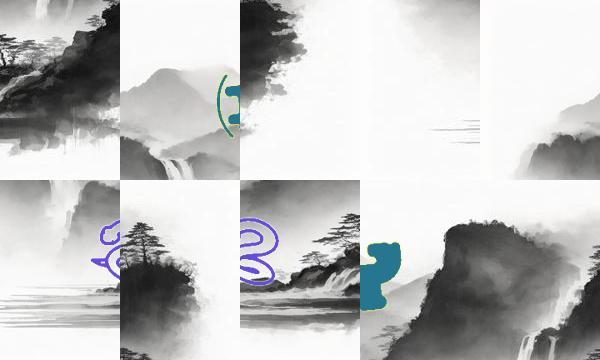
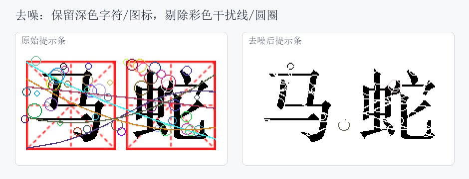
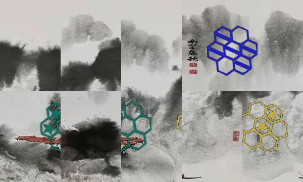
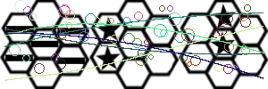
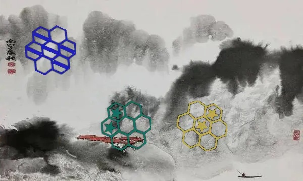
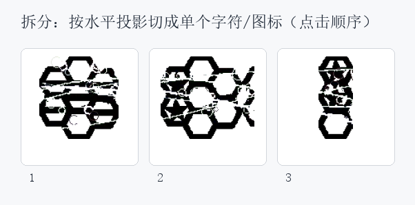

# 天爱 · 图标点选（icon-click）

> 600×360 水墨场景里散布彩色图标，提示条用文字给出目标图标名（001 为「马 蛇」）；YOLO 检测 + 视觉模型比对，源记录约 33% 通过。本库 12 组尚未人工审查。
>
> 返回：[天爱索引](../../../docs/tianai.md) · [全量类型](../../../docs/types.md) · [方法论](../../../docs/00-methodology.md)

## 一、速览

| 项 | 值 |
|---|---|
| 厂商 | 天爱（`tianai`） |
| 类型 / 变体 | `icon-click` / classic |
| 中文 | 图标点选 |
| 媒体 | 图片 |
| 样本 | 12 组（001–012） |
| 答案格式 | `points`：按顺序点击的坐标 |
| 方法 | `DET+VLM`（YOLO + 视觉模型） |
| 求解器 | `weak` · 低（源记录约 33% 通过） |
| 人工审查 | 待审 12（`pending`，截至 2026-11-21） |
| 证据等级 | 案例未写 `evidence` 字段；`status=sample-only` |

## 二、题面与判定

题面固定为「按顺序点击图中图标」。提示条用**文字**写出目标图标名，背景里散布对应图标与其他图标；用户按提示顺序点击。

| 案例 | 题面（`meta.prompt`） | 提示条 | 通过条件 |
|---|---|---|---|
| [001](001/) | 按顺序点击图中图标 | 马 蛇 | 该批案例未记录 `pass_criteria`；按图标类别与顺序判定 |
| [005](005/) | 同上 | 同类提示条（内容未逐字记录） | 同上 |
| [009](009/) | 同上 | 同上 | 同上 |

> 提示条是文字标签，不是目标图标图；不能把提示条里的字形直接当模板去匹配背景，必须先理解「马」「蛇」指的图标。

## 三、样本长什么样

| 001 原始打乱 | 001 提示条 | 001 还原题面 | 001 去噪 |
|---|---|---|---|
|  |  |  |  |

| 005 原始打乱 | 005 提示条 | 005 还原题面 | 005 拆分 |
|---|---|---|---|
|  |  |  |  |

- `bg.jpg` 是 5×2 条带打乱的原始题面；`restored.jpg` 是还原后的场景，能看到彩色图标。
- 001 提示条为「马 蛇」，带彩色圆圈/连线干扰；背景里对应蓝色马和紫色蛇，另有其他图标。
- `process-01-denoise.png`：保留深色字符/图标，剔除彩色干扰线/圆圈；`process-02-split.png` 按水平投影把提示条拆成单字/单词。
- 12 组没有 `answer.txt` / `result.json`，也没有最终点选结果图。

## 四、形态与难点

- **图幅**：600×360；5×2 条带打乱后还原。
- **提示是文字**：目标是「马」「蛇」这类类别名，不是图标模板；需要文本→图标的语义映射。
- **图标样式**：同类别可能有不同颜色/姿态；YOLO 检测框也不等于语义匹配。
- **干扰**：提示条与背景都有彩色圆圈、连线和标记；去噪不干净会污染拆分与识别。
- **顺序**：`points` 必须按提示顺序，不是按背景坐标排序。
- **源记录**：约 33% 通过、`weak`；没有说明失败主要在检测、分类还是排序。

## 五、求解思路

源方案是「清洗提示条 → 拆字 → 检测背景图标 → 视觉模型比对 → 按顺序输出点」。

| 步骤 | 做法 | 说明 |
|---|---|---|
| 1 清提示条 | 去彩色线/圆圈，保留深色文字与图标 | 对应 `process-01-denoise.png` |
| 2 拆提示 | 水平投影切分目标名 | 对应 `process-02-split.png` |
| 3 检测图标 | YOLO 检测背景中的图标块 | 源记录未给权重/阈值 |
| 4 语义比对 | 视觉模型判断图标是否对应提示名 | 源记录未给模型与提示词 |
| 5 排序 | 按提示顺序取点 | 不是背景从左到右 |
| 6 输出 | 逐图标坐标 `points` | 12 组未落库 |

> 本页不写伪代码：源文档只有「YOLO + 视觉模型」与两张过程图，没有检测阈值、类别表或 VLM 调用格式。

## 六、结果与审查

- **源记录**：约 33% 通过；`weak` · 低；参考价值有限。
- **本库**：12 组均有 `bg` / `aux` / `restored` / `process-01` / `process-02`；没有答案文件。
- **人工审查**：12 组全部 `pending`，不是失败；在有人工点选真值前不能算准确率。
- **源数字口径**：33% 是源求解器记录，未知样本集大小与判定细节。

| 范围 | 组数 | 方法 | 审查 | 源准确率 | 输出 |
|---|---:|---|---|---|---|
| 001–012 | 12 | YOLO + VLM | 待审 12 | 约 33%（源记录） | 题面/提示/过程图，无答案 |

## 七、失败与边界

| 现象 | 根因 | 证据 | 结论 |
|---|---|---|---|
| 源通过率约 33% | 检测/语义比对/排序任一段出错 | 源 `solver.notes` | 只能算弱能力 |
| 提示是文字而非图标 | 需要文本→图标语义映射 | `aux-01.png` | 不能用模板匹配替代 |
| 彩色干扰误检 | 提示条与背景都有彩色标记 | `process-01-denoise.png` | 先去干扰 |
| 待审被当成失败 | 12 组 `pending` | `meta.review` | 待审 ≠ 错误，但也不能算通过 |
| 同图标不同样式 | 颜色/姿态变化 | 背景样本 | 检测框不能直接当类别 |

**边界**：本页只覆盖题型、提示条清洗与源方法标签。12 组没有点选答案、没有线上提交、没有人工审查，因此不给出本库样本上的准确率。

## 八、相关

- 厂商索引：[docs/tianai.md](../../../docs/tianai.md)
- 全量类型：[docs/types.md](../../../docs/types.md) · 方法论：[docs/00-methodology.md](../../../docs/00-methodology.md)
- 同厂商对照：[text-click](../text-click/)（文字点选）、[word-order](../word-order/)（语序点选）、[scratch](../scratch/)（提示图计数）
- 案例：[001](001/) – [012](012/)（每组含 `meta.json` / `bg.jpg` / `aux-01.png` / `restored.jpg` / `process-01-denoise.png` / `process-02-split.png`）
- 来源：<https://captcha.tianai.cloud/>；样本版权归天爱所有，仅用于研究与教学。
