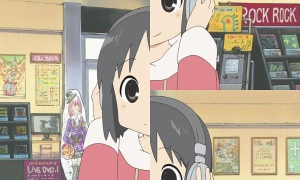
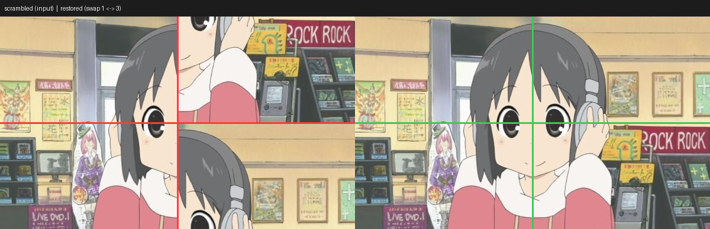

# 天爱 · 乱序拼图（jigsaw）

> 2×2 四块图打乱，交换两块还原；v2 用「切缝外侧 6px 颜色连续性 + Canny 线条连续性」枚举 6 种交换，源图 12/12、回归 12/12、本库人工复核 12/12。
>
> 返回：[天爱索引](../../../docs/tianai.md) · [全量类型](../../../docs/types.md) · [方法论](../../../docs/00-methodology.md)

## 一、速览

| 项 | 值 |
|---|---|
| 厂商 | 天爱（`tianai`） |
| 类型 / 变体 | `jigsaw` / classic |
| 中文 | 乱序拼图 |
| 媒体 | 图片 |
| 样本 | 12 组（001–012） |
| 答案格式 | `swap/order`：交换对 + 拖动中心 |
| 方法 | `CV`（切缝外颜色连续性 + Canny 边缘剖面；无 LLM） |
| 求解器 | `exists` · 高（源图 12/12，回归 12/12） |
| 人工审查 | 12 通过 / 0 错误（截至 2026-11-21，`evidence=manual`） |
| 证据等级 | `meta.evidence=manual`；但每组 `result.json` 内写 `unverified`（见第七节） |

## 二、题面与判定

题面固定为「交换拼图块，还原完整图像」。图被切成 2×2 四块，通常只交换一对；用户拖动两块互换位置。块的编号按行优先：`0 1 / 2 3`。

| 案例 | 题面（`meta.prompt`） | 通过条件 | 正确交换 |
|---|---|---|---|
| [001](001/) | 交换拼图块，还原完整图像 | 把 2×2 四块还原为正确排列；交换对正确即通过 | `1 <-> 3` |
| [006](006/) | 同上 | 同上 | `2 <-> 3` |
| [011](011/) | 同上 | 同上 | `0 <-> 3` |

> 交换对是 0-based、行优先。斜对角交换（`0<->3`、`1<->2`）和上下交换（`2<->3`）都会出现，不能只枚举相邻块。

## 三、样本长什么样

| 原始打乱 | 还原结果 | 对照标注 |
|---|---|---|
|  |  |  |
|  |  |  |

- `bg.jpg` 是 600×360 的 2×2 乱序图；`restored.jpg` 是还原结果。**本类型没有 `solved.jpg`**：`roles.solved` 直接指向 `restored.jpg`。
- `annotated.png` 是 1200×388 的双栏对照：左为原始打乱、右为还原图，红/绿十字标出交换的两块中心。
- 拖动中心已写入 `answer.txt`；坐标是 300×180 的拼图矩阵坐标，不是 600×360 图像坐标。

## 四、形态与难点

- **图幅**：600×360；2×2 四块，每块 300×180。
- **交换空间**：四块选两块，共 6 种交换；本批未出现三块轮换或旋转。
- **判据**：切缝两侧 6px 外的颜色应连续；Canny 线条跨过切缝应能接上。颜色是主判据，边缘是辅助。
- **难点**：均匀天空/水面会让颜色差接近 0；线条弱或切缝落在纯色区时，边缘也会失去区分度。
- **低置信**：源求解器会给 `LOW` / `AMBIG` 判定；这些组仍可能有正确答案，但需要人工复核。

## 五、求解思路

枚举 6 种交换，对每种还原图计算切缝代价；颜色代价最小者为主答案，Canny 连续性用于佐证。

| 步骤 | 做法 | 关键判据 / 参数 |
|---|---|---|
| 1 枚举 | 四块两两交换，共 6 种 | 0-based 行优先 |
| 2 还原 | 按候选交换重排四块 | 600×360 |
| 3 颜色代价 | 在每条切缝两侧 6px **以外**取色差 | 避开切缝本身的混合像素 |
| 4 边缘佐证 | Canny 边缘跨切缝的连续性 | 线条应能接上 |
| 5 选优 | 取颜色代价最小；记录与第二名的 margin | margin 小 → `LOW` / `AMBIG` |
| 6 输出 | 交换对 + 两块拖动中心 | 矩阵 300×180 坐标 |

```text
# 2×2 交换枚举（伪代码，对应 v2 的颜色 + Canny 判据）

best, second = None, None
for pair in combinations([0, 1, 2, 3], 2):   # 共 6 种
    img = restore_2x2(bg, swap=pair)
    color = 0
    for seam in seams_of(pair):
        left  = sample(img, seam, side="left",  offset=6)
        right = sample(img, seam, side="right", offset=6)
        color += color_distance(left, right)  # 切缝外 6px
    edge = canny_continuity(img, seams_of(pair))
    rank(best, second, cost=color, pair=pair, edge=edge)

answer = best.pair
margin = second.color - best.color               # 越小越不可靠
```

## 六、结果与审查

- **源记录**：源图 12/12 还原，回归集 12/12；人工复核 12/12 全部准确。
- **本库**：12 组均有 `bg.jpg` / `restored.jpg` / `annotated.png` / `answer.txt` / `result.json`；无 `solved.jpg`。
- **人工审查**：12 组 `review.state=pass`、`result=correct`、`reviewed_at=2026-11-17`，备注「人工复核：全部准确（12/12）」。
- **置信判据**：`margin` 为颜色代价与第二名的差；`LOW` 仅 005，`AMBIG` 为 006/007/010。

| 组 | 正确交换 | margin | color_gap | edge_score | 求解器判定 |
|---|---|---:|---:|---:|---|
| [001](001/) | 1 <-> 3 | 1.72 | 7.92 | 0.759 | OK |
| [002](002/) | 1 <-> 2 | 1.40 | 12.54 | 0.912 | OK |
| [003](003/) | 1 <-> 2 | 1.37 | 12.29 | 0.784 | OK |
| [004](004/) | 1 <-> 3 | 1.59 | 14.17 | 0.669 | OK |
| [005](005/) | 1 <-> 2 | 1.15 | 6.71 | 1.024 | LOW |
| [006](006/) | 2 <-> 3 | 1.05 | 2.62 | 1.071 | AMBIG |
| [007](007/) | 0 <-> 1 | 1.00 | 0.00 | 0.315 | AMBIG |
| [008](008/) | 2 <-> 3 | 2.37 | 14.62 | 0.761 | OK |
| [009](009/) | 2 <-> 3 | 1.25 | 10.04 | 1.032 | OK |
| [010](010/) | 2 <-> 3 | 1.07 | 3.62 | 0.987 | AMBIG |
| [011](011/) | 0 <-> 3 | 1.27 | 8.87 | 0.964 | OK |
| [012](012/) | 1 <-> 2 | 1.45 | 16.92 | 0.979 | OK |

> `color_gap` 是还原代价与次优候选的差，不是「颜色差绝对值」；007 的 `color_gap=0` 表示颜色判据无法区分两个候选，但 Canny 仍给出 0.315 的边缘分，人工复核最终判对。

## 七、失败与边界

| 现象 | 根因 | 证据 | 结论 |
|---|---|---|---|
| v1 把源图乱序误判 | 旧版判据不稳 | 源记录「v2 修正源图乱序误判」 | 用 v2 的颜色 + Canny |
| 007 颜色判据失效 | 两个候选颜色代价相同 | `color_gap=0`，`AMBIG` | 依赖边缘佐证与人工 |
| 006/010 低 margin | 切缝两侧颜色接近 | `margin≈1.05` | 标 `AMBIG`，需复核 |
| `meta` 与 `result` 证据等级冲突 | `meta.evidence=manual`，`result.json.evidence=unverified` | 两组文件都这么写 | 本页以人工审查为准，同时保留冲突说明 |
| 只覆盖 2×2 | 没有 3×3、旋转块或三块轮换 | 12 组样本 | 不能外推到其他拼图形态 |

**边界**：本页只覆盖 2×2 单次交换。`answer.txt` 的拖动中心是拼图矩阵坐标；真实页面还有拼块偏移与拖拽轨迹，未在 12 组上做线上验证。

## 八、相关

- 厂商索引：[docs/tianai.md](../../../docs/tianai.md)
- 全量类型：[docs/types.md](../../../docs/types.md) · 方法论：[docs/00-methodology.md](../../../docs/00-methodology.md)
- 同厂商对照：[slide](../slide/)（缺口滑块）、[slide-restore](../slide-restore/)（错位条带）
- 案例：[001](001/) – [012](012/)（每组含 `meta.json` / `bg.jpg` / `restored.jpg` / `annotated.png` / `answer.txt` / `result.json`）
- 来源：<https://captcha.tianai.cloud/>；样本版权归天爱所有，仅用于研究与教学。
