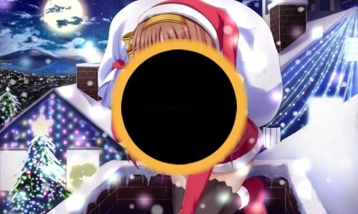
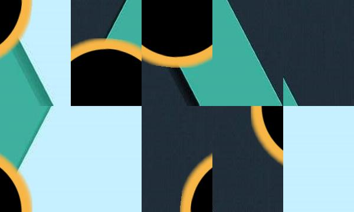
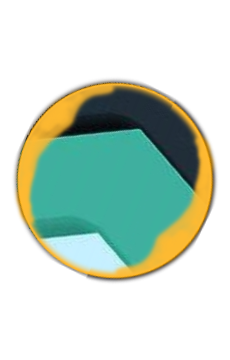
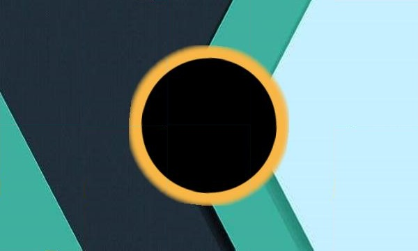

# 天爱 · 旋转验证（rotate）

> 600×360 场景中间挖圆孔，左侧圆盘需旋转后嵌入。主路线是 SIFT/ORB 直立场景库匹配；抽象几何场景用「圆盘多边形直边与背景色带边界共线」纯 CV 求角。本库 12 组审查全通过，但证据只有 6 组 `offline-verified`、6 组 `unverified`。
>
> 返回：[天爱索引](../../../docs/tianai.md) · [全量类型](../../../docs/types.md) · [方法论](../../../docs/00-methodology.md)

## 一、速览

| 项 | 值 |
|---|---|
| 厂商 | 天爱（`tianai`） |
| 类型 / 变体 | `rotate` / classic |
| 中文 | 旋转验证 |
| 媒体 | 图片 |
| 样本 | 12 组（001–012） |
| 答案格式 | `angle`：旋转角（度）+ 滑块距离（1:1） |
| 方法 | `CV+VLM`（SIFT/ORB 场景库、色带直线共线；Vision 兜底） |
| 求解器 | `exists` · 6 组中 / 6 组高（源报告部分通过 8/50） |
| 人工审查 | 12 通过 / 0 错误（截至 2026-11-21） |
| 证据等级 | `offline-verified` 6 组 / `unverified` 6 组 |

## 二、题面与判定

题面固定为「拖动滑块，将图片旋转到正确方向」。背景是一张 600×360 场景，中间有固定圆孔；左侧另有一块可旋转的圆盘素材，需要转到正确角度后嵌入孔中。

| 案例 | 题面（`meta.prompt`） | 通过条件 | 答案 |
|---|---|---|---|
| [001](001/) | 拖动滑块，将图片旋转到正确方向 | 该批案例未记录 `pass_criteria`；按圆盘与孔内场景对齐判定 | `angle=161.3°`，滑块 `161.3` |
| [002](002/) | 同上 | 同上 | `angle=225.2°`，滑块 `225.2` |
| [005](005/) | 同上 | 同上 | `angle=248.0°`，滑块 `248.0` |

> `result.json` 注明：`angle` 是圆盘当前逆时针旋转量，转正需顺时针旋转 `angle` 度；右拖滑块距离 = `angle`；若拖拽方向相反，用 `360-angle`。部分案例另记 `angle_alt`，与主解相差 180°，源记录未说明消歧依据。

## 三、样本长什么样

| 原始题面 | 圆盘素材 | 去掉圆盘的背景 | 嵌入结果 |
|---|---|---|---|
|  |  |  |  |
|  |  |  |  |

- `bg.jpg` 是题面：左侧圆盘 + 中间圆孔 + 场景背景；`aux-01.png` 是带 alpha 的圆盘，`restored.jpg` 是去掉圆盘后的背景（只剩孔）。
- `solved.jpg` 是圆盘转正后嵌入孔中的结果；001 是照片场景，005 是抽象几何场景（绿色/深蓝块面）。
- 12 组都有 `answer.txt` / `result.json`；`result.json` 还记录孔与圆盘的几何参数。

## 四、形态与难点

- **图幅**：600×360；孔心约 (299.5, 179.5)，半径约 96–97；圆盘心约 (114.5, 180)，实心半径约 97.5–98，alpha 半径约 103.5–104.5。
- **方向**：角度是逆时针旋转量；滑块距离与角度 1:1；拖拽方向相反时需换算 `360-angle`。
- **两类场景**：照片/插画可用直立场景库做 SIFT/ORB 匹配；纯色几何场景没有稳定关键点，改用色带边界直线共线。
- **180° 歧义**：部分场景旋转 180° 后仍可能「直立」，`result.json` 会写 `angle_alt`；源记录未说明如何自动消歧。
- **证据分层**：6 组 `offline-verified` 是库内离线匹配；6 组 `unverified` 是重建场景库/色带共线，未做线上提交。
- **源记录**：源报告只通过 8/50，说明这条路线对场景库覆盖依赖很强。

## 五、求解思路

两条纯 CV 路线，视觉模型只在两者都不可用时兜底。

| 步骤 | 做法 | 关键判据 / 参数 |
|---|---|---|
| 1 固定几何 | 从题面取孔心/孔半径，从 alpha 取圆盘心/半径 | 旋转不改变圆心 |
| 2 场景库匹配 | 圆盘与直立参考做 SIFT/ORB，估计旋转角 | 001 196 内点、006 43、007 177、008 100、010 87、012 65；scale 0.80–0.81 |
| 3 重建参考 | 未见库的图用同素材 `bg_restored` / `bg_marked` 重建直立参考 | 002/003/004/009/011 各 50–66 内点（源记录） |
| 4 几何场景 | 分割背景色带，取圆盘多边形的 5 条直边，找与色带边界共线的角度 | 005：5 条边垂距 0.2–3.9px，score 149.7 vs 次优 60.4 |
| 5 Vision 兜底 | 以上都失败时给视觉模型候选角 | 源记录未展开模型与阈值 |
| 6 输出 | `angle`、`slider_distance`、可选 `angle_alt` | 滑块 1:1 |

```text
# 旋转角求解（伪代码，对应「场景库 / 色带共线 / Vision 兜底」）

if disc_scene in upright_library:
    angle = sift_or_orb_angle(disc_scene, upright_reference)
elif has_color_bands(bg):
    angle = argmin_angle(sum(
        perpendicular_distance(edge, band_boundary)
        for edge in disc_polygon_edges[:5]
    ))
else:
    angle = vision_candidate(disc_scene)     # 源记录未展开

slider_distance = angle                      # 右拖 1:1
if drag_direction_is_reversed:
    slider_distance = 360 - angle
answer = (angle, slider_distance)
```

## 六、结果与审查

- **源记录**：源报告部分通过（8/50）；6 组离线匹配为中置信，5 组重建场景库 + 1 组色带共线为高置信但未验证。
- **本库**：12 组 `answer.txt` / `result.json` / `solved.jpg` 齐全；结果角与滑块距离一致。
- **人工审查**：12 组 `review.state=pass`、`result=correct`；这是对 `solved.jpg` 与角度的视觉核对，不含线上提交。
- **证据**：6 组 `offline-verified`（001、006、007、008、010、012）；6 组 `unverified`（002、003、004、005、009、011）。

| 组 | angle | 滑块 | 方法 | 内点 / 备注 | 证据 |
|---|---:|---:|---|---|---|
| [001](001/) | 161.3 | 161.3 | `library` | 196 内点，scale 0.80 | offline-verified |
| [002](002/) | 225.2 | 225.2 | `library_scene_reference` | 50 内点；`angle_alt=45.2` | unverified |
| [003](003/) | 159.8 | 159.8 | `library_scene_reference` | 场景匹配；`angle_alt=339.8` | unverified |
| [004](004/) | 317.5 | 317.5 | `library_scene_reference` | 66 内点；`angle_alt=137.5` | unverified |
| [005](005/) | 248.0 | 248.0 | `color_line_geometry` | 5 条边共线，score 149.7；`angle_alt=68.0` | unverified |
| [006](006/) | 195.7 | 195.7 | `library` | 43 内点，scale 0.81 | offline-verified |
| [007](007/) | 197.4 | 197.4 | `library` | 177 内点，scale 0.80 | offline-verified |
| [008](008/) | 159.1 | 159.1 | `library` | 100 内点，scale 0.80 | offline-verified |
| [009](009/) | 298.0 | 298.0 | `library_scene_reference` | 50 内点；`angle_alt=118.0` | unverified |
| [010](010/) | 157.7 | 157.7 | `library` | 87 内点，scale 0.80 | offline-verified |
| [011](011/) | 215.3 | 215.3 | `library_scene_reference` | 同场景匹配；`angle_alt=35.3` | unverified |
| [012](012/) | 181.8 | 181.8 | `library` | 65 内点，scale 0.80 | offline-verified |

> 6 组 `offline-verified` 的匹配都来自直立场景库；`unverified` 的 5 组也走场景库（重建参考），只有 005 是色带共线纯 CV。不要把这 12 组都当作线上通过。

## 七、失败与边界

| 现象 | 根因 | 证据 | 结论 |
|---|---|---|---|
| 源报告仅 8/50 | 场景库覆盖不足 / 场景差异大 | 源记录 | 不能把 12/12 审查通过当通过率 |
| 未见库场景需重建参考 | 没有同素材直立图就无法匹配 | 002/003/004/009/011 备注 | 重建参考也要验证 |
| 抽象场景关键点少 | SIFT/ORB 在纯色几何块上不稳 | 005 改用色带共线 | 需要第二条纯 CV 路线 |
| 180° 歧义 | 部分场景/圆盘旋转 180° 仍像直立 | 6 组有 `angle_alt` | 源记录未给消歧规则，需人工确认 |
| 6 组未验证 | 只有离线角度，没有线上记录 | `evidence=unverified` | 审查 pass ≠ 线上通过 |
| 拖拽方向反了 | 滑块距离与角度方向绑定 | `result.json` 备注 | 反方向用 `360-angle` |

**边界**：本页只覆盖角度求解与嵌入结果。真实提交还需要正确的拖拽方向、滑块映射和轨迹；12 组没有线上提交记录。

## 八、相关

- 厂商索引：[docs/tianai.md](../../../docs/tianai.md)
- 全量类型：[docs/types.md](../../../docs/types.md) · 方法论：[docs/00-methodology.md](../../../docs/00-methodology.md)
- 同厂商对照：[angle](../angle/)（整图回正）、[slide-restore](../slide-restore/)（错位条带还原）
- 案例：[001](001/) – [012](012/)（每组含 `meta.json` / `bg.jpg` / `aux-01.png` / `restored.jpg` / `solved.jpg` / `answer.txt` / `result.json`）
- 来源：<https://captcha.tianai.cloud/>；样本版权归天爱所有，仅用于研究与教学。
