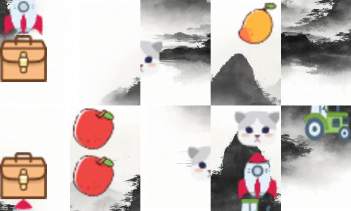
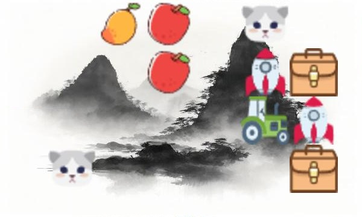
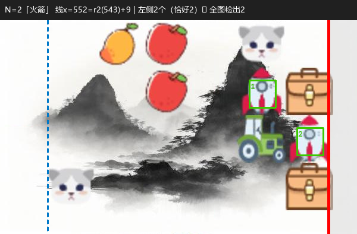
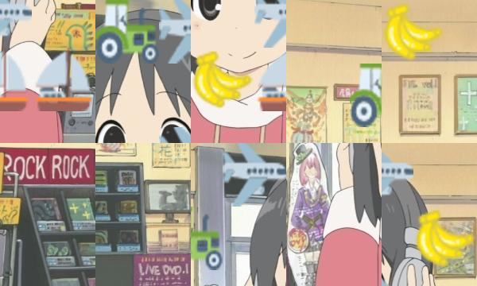
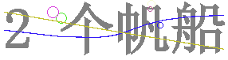
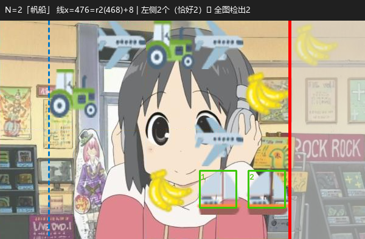

# 天爱 · 刮刮卡（scratch）

> 600×360 水墨场景里散布小物件，提示条给出「数量 + 类别」（001 为「2个 火箭」），刮开后要找出这些物件。源方案是提示图匹配，精度不足；本库 12 组有人工审查，但没有答案与结果数据。
>
> 返回：[天爱索引](../../../docs/tianai.md) · [全量类型](../../../docs/types.md) · [方法论](../../../docs/00-methodology.md)

## 一、速览

| 项 | 值 |
|---|---|
| 厂商 | 天爱（`tianai`） |
| 类型 / 变体 | `scratch` / classic |
| 中文 | 刮刮卡 |
| 媒体 | 图片 |
| 样本 | 12 组（001–012） |
| 答案格式 | `points`：目标点坐标 |
| 方法 | `CV`（提示图匹配；精度不足） |
| 求解器 | `weak` · 低（源记录未给准确率） |
| 人工审查 | 12 通过 / 0 错误（截至 2026-11-21） |
| 证据等级 | 案例未写 `evidence` 字段；`status=sample-only` |

## 二、题面与判定

题面固定为「拖动滑块刮开涂层」。刮开后露出水墨背景与若干小物件；提示条写明要找的类别与数量，例如「2个 火箭」。用户需要点中符合提示的物件。

| 案例 | 题面（`meta.prompt`） | 提示条 | 通过条件 |
|---|---|---|---|
| [001](001/) | 拖动滑块刮开涂层 | 2个 火箭 | 该批案例未记录 `pass_criteria`；按目标类别/数量判定 |
| [005](005/) | 同上 | 同类提示条（内容未逐字记录） | 同上 |
| [009](009/) | 同上 | 同上 | 同上 |

> 提示条是图像 `aux-01.png`，不是纯文本字段；类别与数量要从图里读。001 的提示条尺寸为 286×76。

## 三、样本长什么样

| 原始打乱 | 提示条 | 刮开后的背景 | 求解可视化 |
|---|---|---|---|
|  |  |  |  |
|  |  |  |  |

- `bg.jpg` 是 5×2 条带打乱的原始题面；`aux-01.png` 是提示条；`restored.jpg` 是刮开/还原后的水墨场景。
- `solved.png` 叠加检测框与计数文案；001 可见 `N=2 [火箭]` 一类状态文字，说明源方案在数目标个数。
- 12 组都有这四类图，但没有 `answer.txt` / `result.json`，目标点不落库。

## 四、形态与难点

- **图幅**：600×360；水墨/国风背景，小物件颜色与背景接近。
- **提示是图**：数量与类别在 `aux-01.png` 里，需要先读提示条，再做目标匹配。
- **小目标**：物件尺寸小、边缘软，模板匹配容易漏检或把纹理当目标。
- **计数**：提示是「2个」，不是「找到即可」；数量本身也是判定的一部分。
- **源记录**：只说「提示图匹配精度不够；参考价值有限」，没有给 33% 之类的数字，也没有分组准确率。
- **证据边界**：12 组审查 `pass` 是对图与可视化的核对，不是对目标点的准确率验证。

## 五、求解思路

源方案只记录到「提示图匹配」这一层。可以确认的流程是：读提示 → 还原背景 → 用提示图在背景里匹配目标 → 输出点。

| 步骤 | 做法 | 说明 |
|---|---|---|
| 1 读提示 | 从 `aux-01.png` 读类别与数量 | 001 为「2个 火箭」 |
| 2 还原背景 | 按 5×2 条带反打乱，得到完整场景 | 与 `restored.jpg` 对应 |
| 3 模板匹配 | 用提示图中的物件做模板匹配 | 源记录称「提示图匹配」 |
| 4 计数/取点 | 取匹配峰值，按数量输出点 | 源记录未给阈值/NMS |
| 5 复核 | 检查是否恰好命中提示数量 | `solved.png` 叠加计数文案 |

> 本页不写伪代码：源记录没有匹配算法、阈值、尺度或 NMS 参数；这些都不能从现有文档推出。

## 六、结果与审查

- **源记录**：`weak` · 低；提示图匹配精度不够，参考价值有限；没有准确率数字。
- **本库**：12 组有 `bg` / `aux` / `restored` / `solved` 四类图；没有 `answer.txt` / `result.json`。
- **人工审查**：12 组 `review.state=pass`、`result=correct`；这是对样本与可视化的核对，不能当作目标点准确率。
- **`status=sample-only`**：结果未纳入答案库。

| 范围 | 组数 | 方法 | 审查 | 源准确率 | 输出 |
|---|---:|---|---|---|---|
| 001–012 | 12 | 提示图匹配（CV） | 12 通过 / 0 错误 | 低（无数值） | 4 类图，无答案文件 |

> 「12 通过」不等于「12/12 找对目标」；源求解器明确标为 `weak`，本库也没有人工点选真值。

## 七、失败与边界

| 现象 | 根因 | 证据 | 结论 |
|---|---|---|---|
| 精度不足 | 小目标、低对比、提示图匹配不稳 | 源 `solver.notes` | 只能当参考，不能当可用能力 |
| 无法算准确率 | 没有 `answer.txt` / `result.json` | 目录清单 | 不写数字准确率 |
| 计数易错 | 提示要求「2个」，多检/漏检都错 | 001 提示条与 `solved` 计数文案 | 计数要单独校验 |
| 审查通过被误读 | 审查的是图，不是目标点 | `review` 与 `status` 分离 | 不要把 12 通过当准确率 |
| 提示条内容未逐字记录 | 12 组只核对了 001 的提示条 | `aux-01.png` | 不能编造其他组的类别 |

**边界**：本页只覆盖题型、样本与源方法标签。12 组没有可核对的目标点与线上提交，因此不能给出准确率、召回率或通过率。

## 八、相关

- 厂商索引：[docs/tianai.md](../../../docs/tianai.md)
- 全量类型：[docs/types.md](../../../docs/types.md) · 方法论：[docs/00-methodology.md](../../../docs/00-methodology.md)
- 同厂商对照：[text-click](../text-click/)（文字点选）、[icon-click](../icon-click/)（图标点选）
- 案例：[001](001/) – [012](012/)（每组含 `meta.json` / `bg.jpg` / `aux-01.png` / `restored.jpg` / `solved.png`）
- 来源：<https://captcha.tianai.cloud/>；样本版权归天爱所有，仅用于研究与教学。
