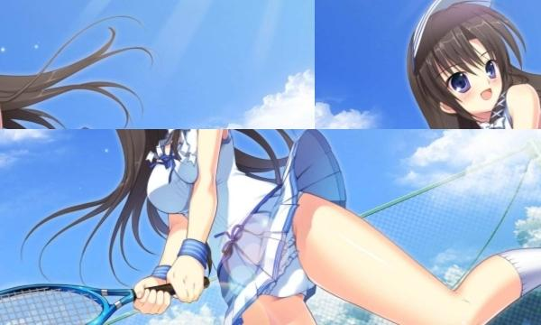
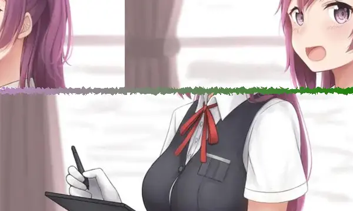
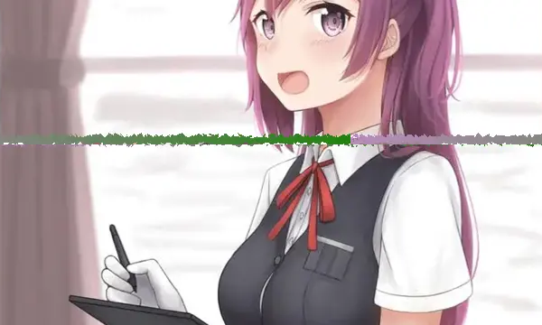

# 天爱 · 滑动还原（slide-restore）

> 600×360 图被切成多段垂直条带并水平错位，拖动滑块让接缝重新连续；源方案是分块/接缝还原，纯 CV、无 LLM。源报告部分通过，本库 12 组人工审查全部通过，但没有位移答案文件。
>
> 返回：[天爱索引](../../../docs/tianai.md) · [全量类型](../../../docs/types.md) · [方法论](../../../docs/00-methodology.md)

## 一、速览

| 项 | 值 |
|---|---|
| 厂商 | 天爱（`tianai`） |
| 类型 / 变体 | `slide-restore` / classic |
| 中文 | 滑动还原 |
| 媒体 | 图片 |
| 样本 | 12 组（001–012） |
| 答案格式 | `shift`：水平位移 |
| 方法 | `CV`（分块/接缝还原；无 LLM） |
| 求解器 | `exists` · 中（源报告部分通过） |
| 人工审查 | 12 通过 / 0 错误（截至 2026-11-21） |
| 证据等级 | 案例未写 `evidence` 字段；`status=sample-only` |

## 二、题面与判定

题面固定为「拖动滑块，将错位图像还原」。图像被切成若干垂直条带，每条带水平偏移不同，接缝处的天空、建筑或物体被切断；滑块调整位移，使画面重新连续。

| 案例 | 题面（`meta.prompt`） | 通过条件 | 答案 |
|---|---|---|---|
| [001](001/) | 拖动滑块，将错位图像还原 | 该批案例未记录 `pass_criteria`；按接缝连续判定 | `shift`（数值未记录） |
| [005](005/) | 同上 | 同上 | 同上 |
| [011](011/) | 同上 | 同上 | 同上 |

> 本类型与 `slide` 不同：`slide` 是把一块异形拼块拖进缺口；`slide-restore` 是条带整体错位，接缝连续才是目标。

## 三、样本长什么样

| 错位题面 | 还原结果 |
|---|---|
|  |  |
|  |  |
|  |  |

- `bg.jpg` 是 600×360 错位题面；001 能明显看到多段垂直条带与接缝断裂。
- `solved.png` 是接缝对齐后的连续画面；没有拼块、没有缺口。
- 12 组只有 `bg.jpg` / `solved.png` / `meta.json`，没有 `aux`、`answer.txt`、`result.json`。

## 四、形态与难点

- **图幅**：600×360；垂直条带，段数与每段位移未在 `meta` 中记录。
- **接缝线索**：天空线、建筑边缘、物体轮廓在接缝两侧应连续；均匀天空/水面几乎没有线索。
- **全局位移**：答案格式是单个 `shift`，但源记录没有说明是「一个全局位移」还是「每段独立位移」；不能替它补公式。
- **视觉核对**：结果图是否连续比数值更有说服力；本批没有位移真值，无法算误差。
- **源记录**：只说「部分通过」，没有分组通过率。

## 五、求解思路

源文档只给到「分块/接缝还原」这一层，没有参数、损失函数或搜索范围。可确认的处理顺序如下。

| 步骤 | 做法 | 说明 |
|---|---|---|
| 1 找接缝 | 检测垂直条带边界 | 边界处有明显断裂 |
| 2 估位移 | 用接缝两侧的颜色/边缘连续性估计水平位移 | 源记录未展开匹配函数 |
| 3 对齐 | 按位移重排条带 | 得到连续画面 |
| 4 输出 | `shift` | 源记录没有数值 |
| 5 复核 | 看接缝是否仍有错位 | 本库用人工审查代替真值 |

> 本页不写伪代码：源文档没有记录接缝检测算子、位移搜索范围或连续性评分；写出来就是自拟算法。

## 六、结果与审查

- **源记录**：源报告部分通过；没有逐组准确率。
- **本库**：12 组均有 `bg.jpg` / `solved.png`；无答案文件。
- **人工审查**：12 组 `review.state=pass`、`result=correct`（审查看 `solved.png` 的接缝是否连续）。
- **不能计算误差**：没有 `answer.txt` / `result.json`，也没有位移真值。

| 范围 | 组数 | 审查 | 源记录 | 输出 |
|---|---:|---|---|---|
| 001–012 | 12 | 12 通过 / 0 错误 | 部分通过 | `bg.jpg` + `solved.png`，无位移数值 |

> 「12 通过」是视觉核对，不是 12/12 线上通过；源求解器本身只记录「部分通过」。

## 七、失败与边界

| 现象 | 根因 | 证据 | 结论 |
|---|---|---|---|
| 源记录只到「部分通过」 | 接缝在低纹理区不稳 | 源 `solver.notes` | 不能宣称高准确率 |
| 005 等组接缝仍可能很弱 | 天空/水面缺少边缘 | 看 `bg.jpg` 即可见 | 需要人工复核 |
| 没有位移真值 | 只保留结果图 | 目录清单 | 只能视觉审查 |
| 位移模型不明 | 源记录未说明全局/分段 | 源文档只有方法名 | 不虚构公式 |
| 与 `slide` 混淆 | 两者都叫滑动 | 题面与图形态不同 | 本类型是条带还原，不是补块 |

**边界**：本页只覆盖离线还原结果。真实提交还需要滑块轨迹与时序；12 组都没有线上记录，也没有可核对的位移数值。

## 八、相关

- 厂商索引：[docs/tianai.md](../../../docs/tianai.md)
- 全量类型：[docs/types.md](../../../docs/types.md) · 方法论：[docs/00-methodology.md](../../../docs/00-methodology.md)
- 同厂商对照：[slide](../slide/)（异形拼块补缺口）、[jigsaw](../jigsaw/)（2×2 交换）
- 案例：[001](001/) – [012](012/)（每组含 `meta.json` / `bg.jpg` / `solved.png`）
- 来源：<https://captcha.tianai.cloud/>；样本版权归天爱所有，仅用于研究与教学。
