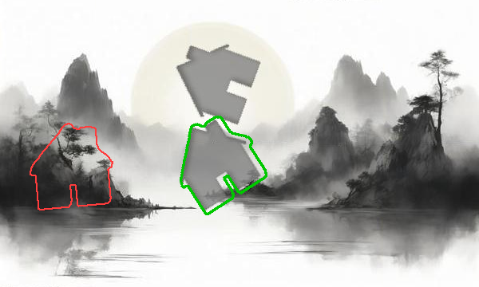

# 天爱 · 滑动拼图（slide）

> 600×360 背景按 5×2 条带打乱，一块异形拼块要从左侧拖进缺口；Canny 共识缺口定位，v1 源记录 12/12，v2 单次约 10%、多次重试约 80%。本库 12 组审查 11 通过 / 1 部分。
>
> 返回：[天爱索引](../../../docs/tianai.md) · [全量类型](../../../docs/types.md) · [方法论](../../../docs/00-methodology.md)

## 一、速览

| 项 | 值 |
|---|---|
| 厂商 | 天爱（`tianai`） |
| 类型 / 变体 | `slide` / v1（001–006）、v2（007–012） |
| 中文 | 滑动拼图 |
| 媒体 | 图片 |
| 样本 | 12 组（001–012） |
| 答案格式 | `offset-x`：水平拖动位移 |
| 方法 | `CV`（Canny 共识缺口定位；无 LLM） |
| 求解器 | `exists` · 高（v1 12/12；v2 单次约 10%，重试约 80%） |
| 人工审查 | 11 通过 / 1 部分（005）（截至 2026-11-21） |
| 证据等级 | 案例未写 `evidence` 字段；`status=sample-only` |

## 二、题面与判定

题面固定为「拖动滑块，将拼图块补入缺口」。背景是打乱图，左侧有异形拼块；用户水平拖动拼块，使它与背景缺口重合。

| 案例 | 变体 | 拼块形态（看图） | 题面（`meta.prompt`） | 通过条件 |
|---|---|---|---|---|
| [001](001/) | v1 | 圆形 | 拖动滑块，将拼图块补入缺口 | 该批案例未记录 `pass_criteria`；按拼块与缺口重合判定 |
| [005](005/) | v1 | 鹿形 | 同上 | 同上 |
| [007](007/) | v2 | 房子形 | 同上 | 同上 |

> 拼块形态是看图描述，不是接口字段；12 组里已经出现圆形、动物形、房子形，不能按「方形滑块」处理。

## 三、样本长什么样

| 原始打乱 | 拼块（alpha） | 缺口 / 轮廓 | 拼合结果 |
|---|---|---|---|
|  |  |  |  |
|  |  |  |  |

- `bg.jpg` 是 API 原始 5×2 条带打乱图；`restored.jpg` 是去掉拼块后的缺口背景；`solved.jpg` 是拼合结果，v1 会叠加绿框与目标 `x/w` 标注。
- `aux-01.png` 是带 alpha 的异形拼块；透明区必须在匹配时屏蔽。
- v2（007–012）多出 `mark.png`（缺口/拼块轮廓）与 `trajectory.png`（拖拽轨迹）；010–012 只有 `mark.png`，没有轨迹图。
- 12 组都没有 `answer.txt` / `result.json`，答案不在数据文件里。

## 四、形态与难点

- **图幅**：600×360；背景 5×2 条带打乱；拼块从原图裁出，形状不固定。
- **拼块形状**：001 圆形、005 鹿形、007 房子形；alpha 边缘不是矩形，模板匹配必须带掩膜。
- **缺口**：拼块被挖走后留下与拼块同形的缺口；缺口内部像素不等于拼块像素，颜色匹配不可靠。
- **v1 / v2 差异**：v1 只有原始/拼块/缺口/结果四类图；v2 增加 `mark` 与 `trajectory`，但求解器单次命中率明显下降。
- **源记录**：v1 12/12；v2 单次约 10%，多次重试约 80%。这是源求解器记录，不是本库 12 组的逐组答案。
- **无真值文件**：只能靠 `solved` 图与人工审查判断，不能算像素误差。

## 五、求解思路

源文档只给到「Canny 共识缺口定位」这一层，没有记录共识函数、阈值或搜索范围；可以确认的是：先把条带还原，再用边缘而不是颜色找缺口，最后水平拖动。

| 步骤 | 做法 | 关键判据 / 参数 |
|---|---|---|
| 1 还原条带 | 按 5×2 位置反打乱 | 600×360 |
| 2 取拼块 | 从 `aux-01.png` 取 alpha 掩膜与边缘 | 透明区不参与匹配 |
| 3 找缺口 | 对背景做 Canny，取缺口边缘 | 颜色不可靠，改用结构 |
| 4 共识定位 | 在多个 x 候选中取 Canny 共识 | 源记录未展开共识细节 |
| 5 拖动 | 水平移动拼块到缺口 x | 纵向通常固定 |
| 6 v2 重试 | v2 单次命中低，靠多次尝试 | 源记录约 10% → 80% |

> 本页不写伪代码：源文档没有给出「共识」的具体打分函数、候选数量或阈值；写成公式会超出已有记录。

## 六、结果与审查

- **源记录**：v1 12/12；v2 单次约 10%，多次重试约 80%。
- **本库**：12 组有图无答案文件；`solved` 图是唯一结果证据。
- **人工审查**：11 组 `pass/correct`，005 为 `partial/partial`；审查看拼块是否落在缺口内。
- **v2 过程图**：007–009 有 `trajectory.png`，010–012 只有 `mark.png`。

| 组 | 变体 | 审查 | 结果 | 备注 |
|---|---|---|---|---|
| [001](001/) | v1 | pass | correct | 圆形拼块 |
| [002](002/) | v1 | pass | correct | — |
| [003](003/) | v1 | pass | correct | — |
| [004](004/) | v1 | pass | correct | — |
| [005](005/) | v1 | partial | partial | 鹿形拼块，拼合有偏差 |
| [006](006/) | v1 | pass | correct | — |
| [007](007/) | v2 | pass | correct | 房子形；有轨迹图 |
| [008](008/) | v2 | pass | correct | 有轨迹图 |
| [009](009/) | v2 | pass | correct | 有轨迹图 |
| [010](010/) | v2 | pass | correct | 只有 mark |
| [011](011/) | v2 | pass | correct | 只有 mark |
| [012](012/) | v2 | pass | correct | 只有 mark |

> 005 的 `partial` 是按 `meta.review` 现算的；源求解器整体记录仍是「v1 12/12」，两者口径不同，不能互相替代。

## 七、失败与边界

| 现象 | 根因 | 证据 | 结论 |
|---|---|---|---|
| v2 单次约 10% | 源记录未展开 | 所有 v2 的 `solver.notes` | v2 需要多次重试，不能按单次成功率宣传 |
| 005 部分通过 | 拼块/缺口对位有偏差 | 审查 partial | 异形拼块仍需人工复核 |
| 无 `answer.txt` | 只保留结果图 | 目录清单 | 不能计算位移误差 |
| 010–012 无轨迹图 | v2 过程图未补齐 | `roles` 清单 | 不能声称 12 组都有轨迹证据 |
| 拼块形状被当成方形 | 12 组出现圆形/鹿形/房子形 | `aux-01.png` | 匹配必须带 alpha 掩膜 |
| 没有线上记录 | 12 组均 `sample-only` | `meta.status` | 离线拼合 ≠ 线上通过 |

**边界**：本页只覆盖缺口定位与拼合结果。真实提交还需要滑块拖动轨迹、时序与风控环境；这些不在 12 组的证据里。

## 八、相关

- 厂商索引：[docs/tianai.md](../../../docs/tianai.md)
- 全量类型：[docs/types.md](../../../docs/types.md) · 方法论：[docs/00-methodology.md](../../../docs/00-methodology.md)
- 同厂商对照：[jigsaw](../jigsaw/)（2×2 交换）、[slide-restore](../slide-restore/)（错位条带还原）
- 案例：[001](001/) – [012](012/)（v1 含 `bg` / `aux` / `restored` / `solved`；v2 另含 `mark`，007–009 含 `trajectory`）
- 来源：<https://captcha.tianai.cloud/>；样本版权归天爱所有，仅用于研究与教学。
