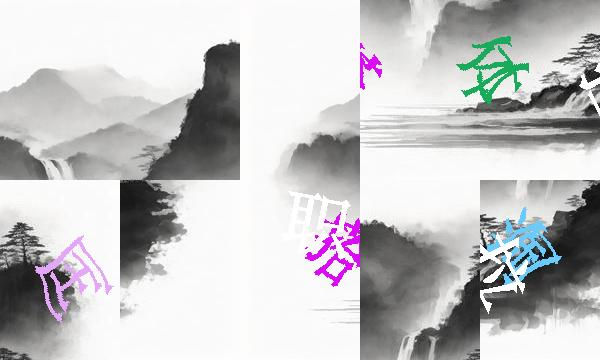
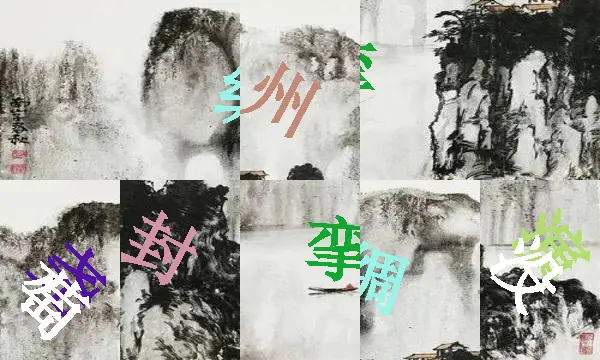
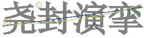

# 天爱 · 文字点选（text-click）

> 600×360 水墨背景上散布彩色汉字，提示条按顺序给出目标字（001 为「匠 淘 搭」）；YOLO + OCR + 视觉模型，源记录约 33% 通过。本库 12 组尚未人工审查。
>
> 返回：[天爱索引](../../../docs/tianai.md) · [全量类型](../../../docs/types.md) · [方法论](../../../docs/00-methodology.md)

## 一、速览

| 项 | 值 |
|---|---|
| 厂商 | 天爱（`tianai`） |
| 类型 / 变体 | `text-click` / classic |
| 中文 | 文字点选 |
| 媒体 | 图片 |
| 样本 | 12 组（001–012） |
| 答案格式 | `points`：按顺序点击的坐标 |
| 方法 | `DET+OCR+VLM`（YOLO + OCR + 视觉模型） |
| 求解器 | `weak` · 低（源记录约 33% 通过） |
| 人工审查 | 待审 12（`pending`，截至 2026-11-21） |
| 证据等级 | 案例未写 `evidence` 字段；`status=sample-only` |

## 二、题面与判定

题面固定为「按顺序点击图中文字」。提示条给出若干目标字，用户需要按提示顺序点击背景中的对应汉字；背景里还会出现其他字作为干扰。

| 案例 | 题面（`meta.prompt`） | 提示条 | 通过条件 |
|---|---|---|---|
| [001](001/) | 按顺序点击图中文字 | 匠 淘 搭 | 该批案例未记录 `pass_criteria`；按目标字与顺序判定 |
| [003](003/) | 同上 | 同类提示条（内容未逐字记录） | 同上 |
| [009](009/) | 同上 | 同上 | 同上 |

> 提示条是图像 `aux-01.png`（001 为 216×76），不是文本字段。背景是 5×2 条带打乱后还原；目标字与干扰字混排，不能只按颜色找。

## 三、样本长什么样

| 001 原始打乱 | 001 提示条 | 001 还原题面 | 001 去噪 |
|---|---|---|---|
|  |  |  |  |

| 003 原始打乱 | 003 提示条 | 003 还原题面 |
|---|---|---|
|  |  |  |

- `bg.jpg` 是 API 原始 5×2 条带打乱图；`restored.jpg` 是还原后的场景，能看到 5 个彩色汉字。
- 001 提示条只有 3 个字「匠 淘 搭」，背景有 5 个字；这是「按顺序选子集」，不是把背景所有字都点一遍。
- `process-01-denoise.png` 保留深色字符/图标、剔除彩色干扰线与圆圈；`process-02-split.png` 按水平投影把提示条拆成单字（未在表中展示）。
- 12 组都没有答案或求解结果图，只有题面、提示条与两张过程图。

## 四、形态与难点

- **图幅**：600×360；5×2 条带打乱后还原。
- **目标数量**：001 提示条 3 个字、背景 5 个字；其他组数量未逐字记录，不能固定成「点 3 个」。
- **彩色干扰**：背景字有不同颜色，提示条里还有彩色圆圈/连线；直接按颜色分割会把干扰当目标。
- **顺序**：`answer_format=points`，但题面要求按顺序；顺序错即使字对也可能不通过。
- **小字/遮挡**：汉字尺寸不一，水墨纹理与笔画接近，OCR 容易混字。
- **源记录**：约 33% 通过，`weak`；没有分组数字，也没有说明失败集中在哪一步。

## 五、求解思路

源方案是「先清洗提示条，再检测/识别背景字，最后按提示顺序匹配」。三段都可能出错，源记录没有给阈值与模型版本。

| 步骤 | 做法 | 说明 |
|---|---|---|
| 1 清提示条 | 去掉彩色干扰线与圆圈，保留深色字符 | 对应 `process-01-denoise.png` |
| 2 拆字 | 按水平投影切分提示条 | 对应 `process-02-split.png` |
| 3 检测背景 | YOLO 检测背景中的字符/文字块 | 源记录未给权重与置信阈值 |
| 4 识别 | OCR 读字，或视觉模型比对 | 源记录未给 OCR 模型 |
| 5 排序 | 按提示条顺序选点 | 不是按背景从左到右 |
| 6 输出 | 逐字坐标 `points` | 12 组未落库 |

> 本页不写伪代码：源文档只有方法标签（YOLO + OCR + VLM）与过程图，没有模型、阈值、后处理规则；写成代码会超出证据。

## 六、结果与审查

- **源记录**：约 33% 通过；`weak` · 低；参考价值有限。
- **本库**：12 组均有 `bg` / `aux` / `restored` / `process-01-denoise` / `process-02-split`；没有 `answer.txt` / `result.json`。
- **人工审查**：12 组全部 `pending`（未审），不是「12 组失败」。
- **不能算准确率**：没有目标点真值，也没有线上结果；33% 只能标为源记录。

| 范围 | 组数 | 方法 | 审查 | 源准确率 | 输出 |
|---|---:|---|---|---|---|
| 001–012 | 12 | YOLO + OCR + VLM | 待审 12 | 约 33%（源记录） | 题面/提示/过程图，无答案 |

## 七、失败与边界

| 现象 | 根因 | 证据 | 结论 |
|---|---|---|---|
| 源通过率约 33% | 检测/识别/排序任一段出错 | 源 `solver.notes` | 只能算弱能力 |
| 待审被当成失败 | 12 组 `review.state=pending` | `meta.review` | 待审 ≠ 错误，但也不能算通过 |
| 目标数量不固定 | 001 是 3 字，其他组未逐字记录 | 提示条图 | 不写死「3 个」 |
| 彩色干扰误检 | 提示条与背景都有彩色标记 | `process-01-denoise.png` | 先去干扰再识别 |
| 没有答案文件 | 只保留题面与过程图 | 目录清单 | 不能算准确率/召回率 |

**边界**：本页只覆盖题型、提示条清洗与源方法标签。12 组没有点选答案、没有线上提交、没有人工审查，因此不给出求解器在本库样本上的准确率。

## 八、相关

- 厂商索引：[docs/tianai.md](../../../docs/tianai.md)
- 全量类型：[docs/types.md](../../../docs/types.md) · 方法论：[docs/00-methodology.md](../../../docs/00-methodology.md)
- 同厂商对照：[icon-click](../icon-click/)（图标点选）、[word-order](../word-order/)（语序点选）、[scratch](../scratch/)（提示图计数）
- 案例：[001](001/) – [012](012/)（每组含 `meta.json` / `bg.jpg` / `aux-01.png` / `restored.jpg` / `process-01-denoise.png` / `process-02-split.png`）
- 来源：<https://captcha.tianai.cloud/>；样本版权归天爱所有，仅用于研究与教学。
