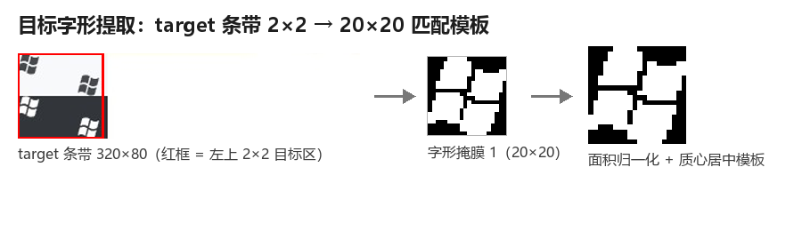
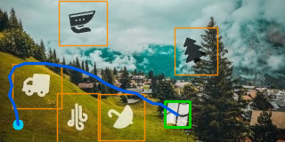
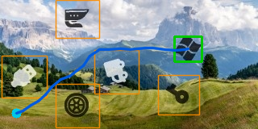

# 网易易盾 · 障碍躲避（avoid）

> 拖动左下白色排球，避开障碍击中目标图标；3 张固定场景中值重建背景库 → 差分出图标，20×20 字形全角度旋转匹配定目标，A* 规划路径，纯 CV、零 LLM。
>
> 返回：[易盾索引](../../../docs/yidun.md) · [全量类型](../../../docs/types.md) · [方法论](../../../docs/00-methodology.md)

## 一、速览

| 项 | 值 |
|---|---|
| 厂商 | 网易易盾（`yidun`） |
| 类型 / 变体 | `avoid` / classic |
| 中文 | 障碍躲避 |
| 媒体 | 图片 |
| 样本 | 12 组（001–012） |
| 答案格式 | `path`：起点、目标、路径点 |
| 方法 | `CV`（场景库差分 + 字形全角度匹配 + A*，无 LLM） |
| 求解器 | `exists` · 高（12/12 目标；24 组路径 0 碰撞） |
| 人工审查 | 12 通过 / 0 错误（截至 2026-11-21） |
| 证据等级 | `unverified`（12 组离线路径，未实机提交） |

## 二、题面与判定

题面是「拖动左下白色排球，躲避障碍击中目标图标」；球从固定起点 `(20,140)` 出发，用户拖动/滑动控制方向，避开场景中的障碍并碰到目标图标。`meta.pass_criteria` 写明：碰到障碍或未命中不通过。

| 案例 | 题面（`meta.prompt`） | 目标图标 | 答案摘要 |
|---|---|---|---|
| [001](001/) | 拖动左下白色排球，躲避障碍击中 | 四个方块（田字形） | 起点 (20,140) → 目标 (199,129)，24 个路径点 |
| [004](004/) | 同上 | 四格窗户方块 | 起点 (20,140) → 目标 (216,68)，21 个路径点 |
| [010](010/) | 同上 | 黑白方格旗 | 起点 (20,140) → 目标 (233,61)，22 个路径点 |

> 答案空间是「一条无碰撞路径」，不是单个点；`answer.txt` 同时记录起点、目标与路径点数，`result.json` 保存更细的路径。

## 三、样本长什么样

| 背景题面 | 目标图标条带 | 目标字形 | 路径结果 | 目标提取 |
|---|---|---|---|---|
|  |  |  |  |  |
|  |  |  |  |  |

- 第 2 列是 target 条带（通常 2×2 格），第 3 列是从条带左上 2×2 四格裁出的 20×20 字形掩膜。
- 第 4 列是规划路径；球从左侧固定起点出发，绕过场景障碍，终点落在目标图标上。
- 背景是 320×160 的固定场景，12 组来自 3 个场景族；同一场景的障碍布局固定。

## 四、形态与难点

- **固定场景库**：3 张场景的中值重建背景可把“动态图标”从静态障碍中分离；换场景就要重建库。
- **目标字形小**：目标只有 20×20，且在条带里可能带旋转；面积归一化 + 质心居中后才能做全角度匹配。
- **相似轮廓**：四格窗、车轮、方格旗等目标彼此相似，20×20 模板下分数接近，是方法固有上限。
- **障碍安全距离**：球半径 10，路径要求球心到障碍 bbox ≥ 12px；A* 的像素网格与安全距离要一起设。
- **交互线**：本库只验证路径无碰撞与终点命中，不验证拖动轨迹是否被服务端接受；12 组 `evidence: unverified`。

## 五、求解思路

源方案是「场景库差分 → 目标字形匹配 → A* 路径」：

| 步骤 | 做法 | 关键判据 / 参数 |
|---|---|---|
| 1 背景库 | 对 3 个固定场景做中值重建，得到无障碍底图 | 同一场景多帧中值 |
| 2 图标候选 | 当前图与背景库差分，提取动态图标候选 | 差分阈值/连通域 |
| 3 目标字形 | target 条带左上 2×2 四格 → 20×20 字形掩膜 | 面积归一化 + 质心居中 |
| 4 全角度匹配 | 20×20 字形按全角度旋转与候选匹配 | 形状分；相似轮廓会接近 |
| 5 路径规划 | A* 在 4px 网格上搜索，球心到障碍 bbox ≥ 12px | 起点 `(20,140)`；球半径 10 |
| 6 修复 | 推出/线段修复，处理贴边与窄缝 | 最小球心距 11.4px > 10 |
| 7 输出 | 路径点序列 + 目标坐标 | 24 组路径 0 碰撞 |

```text
# 障碍躲避（伪代码，对应场景库 + 字形匹配 + A*）

bg_lib  = median(stack(scene_frames))         # 3 个固定场景
cands   = diff(current, bg_lib)              # 动态图标候选
glyph   = crop(target_strip, 2x2)[:20, :20]  # 20 x 20 目标字形
glyph   = normalize_area_center(glyph)

for cand in cands:
    score[cand] = max over angle of shape_score(rotate(glyph, angle), cand)
target = argmax(score)                        # 相似轮廓时分数接近

path = A_star(grid=4px, start=(20,140), goal=target,
              clearance=12px, ball_radius=10)
path = repair_push_out_and_segments(path)
answer = path                                 # 路径点序列
```

> 20×20 模板使四格窗/车轮等相似轮廓的分数接近；这是方法的固有上限，不是调参能完全消除的。源记录用 24 组路径（含 13–24）验证 0 碰撞，最小球心距 11.4px。

## 六、结果与审查

- **源记录**：目标 12/12；24 组路径 0 碰撞（球心距障碍 bbox ≥ 11.4px，球半径 10）；零 LLM。
- **本库**：12 组 `answer.txt` / `result.json` / `aux-01.png` / `solved.png` / `process-01-crop.png` 齐全；`evidence: unverified`（离线路径，未实机提交）。
- **人工审查**：12 组 `review.state=pass`、`result=correct`（人工核对目标与路径）。

| 组 | 目标 | 路径点 | 审查 |
|---|---|---|---|
| [001](001/) | 四个方块（田字形） | 24 | pass |
| [002](002/) | 十字圆形轮盘 | 22 | pass |
| [003](003/) | 风（气流）图标 | 22 | pass |
| [004](004/) | 四格窗户方块 | 21 | pass |
| [005](005/) | 车轮（轮毂） | 21 | pass |
| [006](006/) | 车轮（轮毂） | 19 | pass |
| [007](007/) | 黑色四格窗 | 22 | pass |
| [008](008/) | 四个深色圆角方块 | 22 | pass |
| [009](009/) | 四格方块（田字/旗形） | 22 | pass |
| [010](010/) | 黑白方格旗 | 22 | pass |
| [011](011/) | 四格方块（方格窗/十字分隔） | 23 | pass |
| [012](012/) | 船舵（方向盘/救生圈状） | 21 | pass |

## 七、失败与边界

| 现象 | 根因 | 证据 | 结论 |
|---|---|---|---|
| 相似轮廓目标选错 | 20×20 模板下四格窗/车轮分数接近 | 源记录明确写“方法固有上限” | 近似目标需人工复核，或换更大模板 |
| 路径贴障碍 | A* 安全距离不足 | 要求球心到障碍 bbox ≥12px | 用 4px 网格 + 12px clearance + 推出修复 |
| 窄缝无解 | 障碍间距小于球直径 | 24 组中最小球心距 11.4px | 线段修复/推出；仍无解则记录边界 |
| 无实机验证 | 路径未在服务端跑 | `evidence: unverified` | 离线 0 碰撞 ≠ 线上通过 |

**边界**：本类型依赖固定场景库；换场景/换障碍布局需要重建背景库。交互轨迹与提交链路不在本库验证范围。

## 八、相关

- 厂商索引：[docs/yidun.md](../../../docs/yidun.md)
- 全量类型：[docs/types.md](../../../docs/types.md) · 方法论：[docs/00-methodology.md](../../../docs/00-methodology.md)
- 同厂商对照：[icon-click](../icon-click/)（图标点选）、[word-order](../word-order/)（语序点选）、[jigsaw](../jigsaw/)（缺口滑块）
- 案例：[001](001/) – [012](012/)（每组含 `meta.json` / `answer.txt` / `result.json` / `aux-01.png` / `solved.png` / `process-01-crop.png`）
- 来源：<https://dun.163.com/trial>；样本版权归网易易盾所有，仅用于研究与教学。
