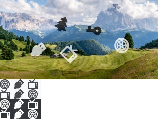
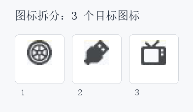
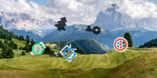
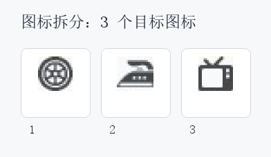
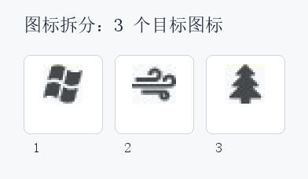
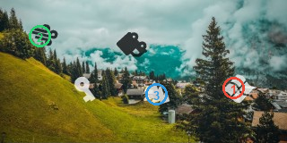

# 网易易盾 · 图标点选（icon-click）

> 320×240 背景上散布图标，题面给出目标图标，按顺序点击对应位置；黑/白双色掩膜 + 旋转模板匹配，纯 CV、零 LLM。
>
> 返回：[易盾索引](../../../docs/yidun.md) · [全量类型](../../../docs/types.md) · [方法论](../../../docs/00-methodology.md)

## 一、速览

| 项 | 值 |
|---|---|
| 厂商 | 网易易盾（`yidun`） |
| 类型 / 变体 | `icon-click` / classic |
| 中文 | 图标点选 |
| 媒体 | 图片 |
| 样本 | 12 组（001–012） |
| 答案格式 | `points`：按题面顺序的点击坐标 |
| 方法 | `CV`（黑/白双色掩膜 + 旋转模板匹配，无 LLM） |
| 求解器 | `exists` · 中（12 组按目标轮廓复核） |
| 人工审查 | 12 通过 / 0 错误（截至 2026-11-21） |
| 证据等级 | 案例未写 `evidence` 字段；有 `solved.png` / `process-01-split.png`，无 `answer.txt` / `result.json` |

## 二、题面与判定

题面给出一组目标图标（通常是图标条或提示图），用户在背景中按顺序点击对应图标。该批 12 组的 `meta.prompt` 都是「按顺序点击图中图标」，`pass_criteria` 未记录；从结果图看，判定是目标图标的位置与顺序都正确。

| 案例 | 题面（`meta.prompt`） | 通过条件 | 结果 |
|---|---|---|---|
| [001](001/) | 按顺序点击图中图标 | 该批案例未记录 `pass_criteria`；按图标与顺序判定 | 见 `solved.png` |
| [006](006/) | 同上 | 同上 | 见 `solved.png` |
| [012](012/) | 同上 | 同上 | 见 `solved.png` |

> 本类型没有落盘逐点坐标，`solved.png` 是源求解器的点击标注，不是服务端回执；审查结论只说明「标注与目标轮廓一致」。

## 三、样本长什么样

| 背景题面 | 图标拆分 | 点击结果 |
|---|---|---|
|  |  |  |
|  |  |  |
|  |  |  |

- 第 1 列是 320×240 背景；图标有黑色线稿，也有反色/白色线稿，颜色分布不固定。
- 第 2 列把目标图标拆成单图；拆分质量直接决定模板匹配的上限。
- 第 3 列在背景上标出点击位置；同分候选多时，模板匹配容易选到相邻的相似轮廓。

## 四、形态与难点

- **双极性**：row1 是黑线稿，row3 是反色白线稿；只用黑色掩膜会漏掉白图标，只用白色掩膜会漏掉黑图标。
- **旋转与缩放**：图标在背景中会旋转，尺寸也可能变化；模板必须做旋转搜索，不能只做平移匹配。
- **背景干扰**：背景是照片或纹理，图标颜色可能与场景接近；黑色/白色掩膜都可能在背景上产生伪候选。
- **相似轮廓**：同一背景下可能有形状相近的干扰图标；单看轮廓分难以区分，需要按目标集合做整体指派。
- **无逐点真值**：12 组只有 `solved.png`，没有 `answer.txt`；审查是人工看标注，不是逐坐标误差统计。

## 五、求解思路

源方案是「双色掩膜分割候选 + 旋转模板匹配 + 按目标轮廓复核」：

| 步骤 | 做法 | 关键判据 / 参数 |
|---|---|---|
| 1 拆目标 | 从题面图标条拆出目标图标 | 每个目标一张模板 |
| 2 双色掩膜 | 黑色与白色两套掩膜分别提取候选 | 黑线稿 / 反色白线稿 |
| 3 候选生成 | 连通域 + 尺寸/形状过滤 | 排除背景大块与细碎噪声 |
| 4 旋转模板 | 模板按多个角度与候选做 IoU/轮廓匹配 | 旋转搜索，取最高分 |
| 5 复核 | 按目标轮廓逐点核对，必要时人工修正 | 12 组均按目标轮廓复核 |
| 6 输出 | 按题面顺序输出点击坐标 | 无 `answer.txt`，结果在 `solved.png` |

```text
# 图标点选（伪代码，对应双色掩膜 + 旋转模板）

targets = split_target_strip(prompt)        # 每个目标图标一张模板
mask_b  = black_mask(bg)                    # 黑线稿
mask_w  = white_mask(bg)                    # 反色白线稿
cands   = connected_components(mask_b | mask_w)
cands   = filter_size_and_shape(cands)

for target in targets:
    for cand in cands:
        cost[target][cand] = max over angles of
                              contour_iou(rotate(target, angle), cand)

assign = one_to_one(cost)                   # 按顺序指派，避免共用候选
click([center(cands[assign[t]]) for t in targets])
```

> 双色掩膜是这类题的关键：仅用黑色会把白线稿图标判为缺失，仅用白色会把黑线稿判为缺失；两套掩膜并集再按目标轮廓筛选，才能覆盖本批两种渲染。

## 六、结果与审查

- **源记录**：12 组按目标轮廓逐点复核，结果见各组 `solved.png`；没有 `answer.txt` / `result.json`。
- **本库**：12 组 `bg.jpg` / `process-01-split.png` / `solved.png` / `meta.json` 齐全；`evidence` 字段未写，按源记录标为「待审」后由人工复核。
- **人工审查**：12 组 `review.state=pass`、`result=correct`（人工核对标注与目标轮廓/顺序是否一致）。

| 组 | 审查 | 组 | 审查 |
|---|---|---|---|
| [001](001/) | pass | [007](007/) | pass |
| [002](002/) | pass | [008](008/) | pass |
| [003](003/) | pass | [009](009/) | pass |
| [004](004/) | pass | [010](010/) | pass |
| [005](005/) | pass | [011](011/) | pass |
| [006](006/) | pass | [012](012/) | pass |

## 七、失败与边界

| 现象 | 根因 | 证据 | 结论 |
|---|---|---|---|
| 白色图标漏检 | 只用了黑色掩膜 | row3 为反色白线稿 | 改用黑/白双色掩膜 |
| 相似轮廓误选 | 背景有形状相近的干扰图标 | 同分候选多 | 按目标集合一对一指派，必要时人工复核 |
| 旋转图标匹配分低 | 模板未做旋转搜索 | 图标随机旋转 | 旋转模板搜索；仍以轮廓复核兜底 |
| 没有逐点误差 | 只保存了 `solved.png` | 无 `answer.txt` / `result.json` | 只能做人工目检，不能算像素级准确率 |

**边界**：12 组是人工复核的离线结果，没有线上提交；不要用 `solved.png` 反推服务端接受率。

## 八、相关

- 厂商索引：[docs/yidun.md](../../../docs/yidun.md)
- 全量类型：[docs/types.md](../../../docs/types.md) · 方法论：[docs/00-methodology.md](../../../docs/00-methodology.md)
- 同厂商对照：[text-click](../text-click/)（文字点选）、[jigsaw](../jigsaw/)（缺口滑块）、[avoid](../avoid/)（障碍躲避）
- 案例：[001](001/) – [012](012/)（每组含 `meta.json` / `bg.jpg` / `process-01-split.png` / `solved.png`）
- 来源：<https://dun.163.com/trial>；样本版权归网易易盾所有，仅用于研究与教学。
