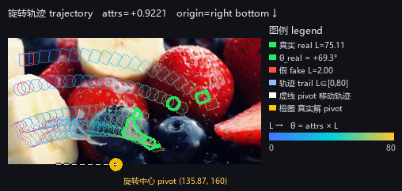
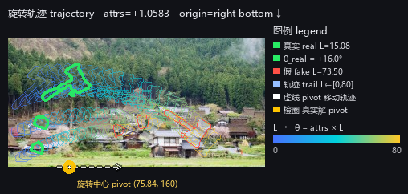

# 网易易盾 · 旋转拼图（slide-rotate）

> 320×160 背景上有一个旋转角未知的拼图块，拖动滑块把它旋转并补进缺口；源方案用旋转几何 + 边缘方向一致性，纯 CV、零 LLM。
>
> 返回：[易盾索引](../../../docs/yidun.md) · [全量类型](../../../docs/types.md) · [方法论](../../../docs/00-methodology.md)

## 一、速览

| 项 | 值 |
|---|---|
| 厂商 | 网易易盾（`yidun`） |
| 类型 / 变体 | `slide-rotate` / enhanced-rotate |
| 中文 | 旋转拼图 |
| 媒体 | 图片 |
| 样本 | 12 组（001–012） |
| 答案格式 | `offset+rotation`：水平位移 + 旋转角 |
| 方法 | `CV`（旋转几何 + 边缘方向一致性；无 LLM） |
| 求解器 | `exists` · 高（源记录可过） |
| 人工审查 | 12 通过 / 0 错误（截至 2026-11-21） |
| 证据等级 | 案例未写 `evidence` 字段；有 `solved.png` / `trajectory.png`，无 `answer.txt` / `result.json` |

## 二、题面与判定

用户拖动滑块，让旋转的拼图块转正并移动到缺口位置；与普通滑块不同，答案同时包含旋转角和水平位移。本批 12 组的 `meta.prompt` 都是「拖动滑块，将旋转的拼图块补入缺口」，`pass_criteria` 未记录。

| 案例 | 题面（`meta.prompt`） | 通过条件 | 结果 |
|---|---|---|---|
| [001](001/) | 拖动滑块，将旋转的拼图块补入缺口 | 该批案例未记录 `pass_criteria`；按旋转角与位移判定 | 见 `solved.png` / `trajectory.png` |
| [006](006/) | 同上 | 同上 | 同上 |
| [012](012/) | 同上 | 同上 | 同上 |

> 答案空间是「旋转角 + 水平位移」；只把拼图块平移到缺口但角度不对，仍然不通过。

## 三、样本长什么样

| 背景题面 | 旋转拼图块 | 拼合结果 | 轨迹 |
|---|---|---|---|
|  |  |  |  |
|  |  |  |  |

- 第 2 列是带旋转的拼图块；角度不是 0°，需要先估角再匹配。
- 第 3 列是拼合结果；第 4 列是滑块轨迹，能看到拖动过程中的中间位置。

## 四、形态与难点

- **双自由度**：水平位移与旋转角互相影响；只搜索位移会在错误角度上得到高分。
- **旋转边缘**：旋转后拼图块的四角会露出空白，alpha 掩膜与边缘方向必须同步旋转。
- **背景纹理**：背景照片的边缘可能与拼图块边缘相似，单看梯度容易在错误角度上匹配。
- **轨迹**：结果图包含 `trajectory.png`，说明交互线（拖动路径）也是题面的一部分；本库只记录可视化，不验证轨迹统计。
- **无逐组答案**：12 组只有 `solved.png` / `trajectory.png`，没有 `answer.txt` / `result.json`。

## 五、求解思路

源方案的记录只有两条：旋转几何与边缘方向一致性。下面按可确认的层次写，未展开的参数不猜测。

| 步骤 | 做法 | 关键判据 / 参数 |
|---|---|---|
| 1 取块 | 从题面拆出旋转拼图块与背景缺口候选 | 保留 alpha |
| 2 估角 | 用拼图块与缺口的边缘方向估计旋转角 | 边缘方向一致性 |
| 3 旋转 | 按候选角度旋转拼图块与 alpha | 旋转后四角空白需屏蔽 |
| 4 位移 | 在旋转后的块上搜索水平位移 | 与缺口边缘对齐 |
| 5 输出 | 旋转角 + 水平位移 | 结果见 `solved.png` / `trajectory.png` |

> 源记录只给到「旋转几何 + 边缘方向一致性」，没有给出角度搜索范围、步长、评分函数或容差；本页不编造这些参数。

## 六、结果与审查

- **源记录**：可过；本库 12 组 `bg.jpg` / `aux-01.png` / `solved.png` / `trajectory.png` 齐全。
- **本库**：没有 `answer.txt` / `result.json`，无法重算角度/位移误差；`evidence` 字段未写。
- **人工审查**：12 组 `review.state=pass`、`result=correct`（人工对拼合结果与轨迹）。

| 组 | 审查 | 组 | 审查 |
|---|---|---|---|
| [001](001/) | pass | [007](007/) | pass |
| [002](002/) | pass | [008](008/) | pass |
| [003](003/) | pass | [009](009/) | pass |
| [004](004/) | pass | [010](010/) | pass |
| [005](005/) | pass | [011](011/) | pass |
| [006](006/) | pass | [012](012/) | pass |

## 七、失败与边界

| 现象 | 根因 | 证据 | 结论 |
|---|---|---|---|
| 平移对了但角度不对 | 只搜索位移 | 题面要求旋转 + 补入 | 必须同时估角 |
| 旋转后边缘分数下降 | 四角空白/插值伪影 | 旋转块四角露出空白 | alpha 同步旋转并屏蔽空白 |
| 错误角度出现高分 | 背景边缘与块边缘相似 | 源记录强调边缘方向一致性 | 用方向一致性而非单纯梯度 |
| 无角度/位移真值 | 只保存可视化结果 | 无 `answer.txt` / `result.json` | 只能人工目检，不能算误差 |

**边界**：本类型与普通滑块 `slide` 不同，答案含旋转；与 `jigsaw` 的缺口滑块也不同，不要把三类混用同一套求解链。

## 八、相关

- 厂商索引：[docs/yidun.md](../../../docs/yidun.md)
- 全量类型：[docs/types.md](../../../docs/types.md) · 方法论：[docs/00-methodology.md](../../../docs/00-methodology.md)
- 同厂商对照：[jigsaw](../jigsaw/)（缺口滑块）、[inference](../inference/)（8 块换位）、[icon-click](../icon-click/)（图标点选）
- 案例：[001](001/) – [012](012/)（每组含 `meta.json` / `bg.jpg` / `aux-01.png` / `solved.png` / `trajectory.png`）
- 来源：<https://dun.163.com/trial>；样本版权归网易易盾所有，仅用于研究与教学。
