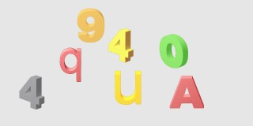
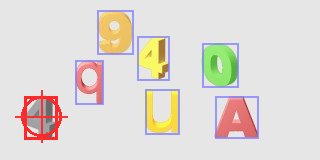
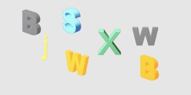
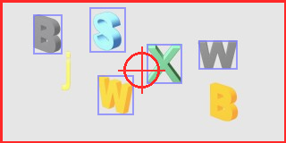
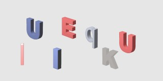
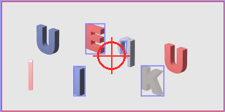

# 网易易盾 · 空间推理（spatial）

> 一张图里散布数字/字母/图形，题面用颜色、朝向、大小、相对位置描述目标；本地 CV 定位候选，视觉 LLM 选空间关系。
>
> 返回：[易盾索引](../../../docs/yidun.md) · [全量类型](../../../docs/types.md) · [方法论](../../../docs/00-methodology.md)

## 一、速览

| 项 | 值 |
|---|---|
| 厂商 | 网易易盾（`yidun`） |
| 类型 / 变体 | `spatial` / space-inference |
| 中文 | 空间推理 |
| 媒体 | 图片 |
| 样本 | 12 组（001–012） |
| 答案格式 | `points`：目标坐标 |
| 方法 | `VLM+CV`（本地 CV 定位 + 视觉 LLM 选关系） |
| 求解器 | `exists` · 高（源记录 3/3 离线） |
| 人工审查 | 10 通过 / 2 错误（005、011，截至 2026-11-21） |
| 证据等级 | 案例未写 `evidence` 字段；有 `annotated.png`，无 `answer.txt` / `result.json` |

## 二、题面与判定

题面是一句空间关系描述，例如「点击灰色数字 4」「点击正向的大写 A」「点击与小写 l 颜色一样的大写 Q」。用户需要先在图中找到所有候选，再按颜色/朝向/大小/相对位置筛选出唯一目标。

| 案例 | 题面（`meta.prompt`） | 审查 | 备注 |
|---|---|---|---|
| [001](001/) | 请点击灰色数字4 | pass | 颜色 + 字符类型 |
| [002](002/) | 请点击正向的大写A | pass | 朝向 + 大小写 |
| [003](003/) | 请点击小写l颜色一样的大写Q | pass | 以另一个字符的颜色为参照 |
| [004](004/) | 请点击数字6颜色一样的大写G | pass | 跨字符类型的颜色匹配 |
| [005](005/) | 请点击黄色大写B | **fail/incorrect** | 人工复核判错 |
| [006](006/) | 请点击蓝色小写y | pass | 颜色 + 大小写 |
| [007](007/) | 请点击绿色小写 c朝向一样的数字4 | pass | 朝向 + 跨类型 |
| [008](008/) | 请点击侧向的大写J | pass | 朝向 |
| [009](009/) | 请点击小写c朝向一样的数字2 | pass | 朝向 + 跨类型 |
| [010](010/) | 请点击侧向的大写E | pass | 朝向 |
| [011](011/) | 请点击红色大写U | **fail/incorrect** | 人工复核判错 |
| [012](012/) | 请点击小写o颜色一样的小写p | pass | 颜色参照 + 大小写 |

> 题面不是固定类别，而是「颜色 + 字符类型 + 朝向 + 大小写 + 相对参照」的组合；同一句里可能同时有 2–3 个约束。

## 三、样本长什么样

| 背景题面 | 答案标注 |
|---|---|
|  |  |
|  |  |
|  |  |

- 第 2 列是源求解器的目标标注；005/011 的审查结论是 `fail/incorrect`，说明标注点不代表正确目标。
- 其余 10 组的标注与题面约束一致；形近字符、颜色相近、朝向判断是最容易出错的地方。

## 四、形态与难点

- **多约束组合**：颜色、字符类型、大小写、朝向、相对参照可能同时出现；只满足其中一条会选错。
- **跨类型参照**：如「与小写 l 颜色一样的大写 Q」，需要先找到参照字符，再把颜色迁移到另一类字符。
- **朝向判断**：旋转/镜像后的字母数字，模型需要区分「正向/侧向」；本地 CV 难，VLM 也可能看错。
- **颜色相近**：黄/橙、红/粉、蓝/青在压缩图上差异小；颜色约束需要人工复核。
- **无逐点真值**：12 组只有 `annotated.png`，没有 `answer.txt` / `result.json`；审查结论是人工对标注的判定。

## 五、求解思路

源方案是「本地 CV 定位候选 + 视觉 LLM 选空间关系」：

| 步骤 | 做法 | 关键判据 / 参数 |
|---|---|---|
| 1 定位 | 本地 CV 找出图中的字符/图形候选 | 连通域/检测框；源记录未展开 |
| 2 读属性 | 读取每个候选的颜色、字符类型、朝向、大小写 | CV + 视觉模型 |
| 3 解析题面 | 从题面提取约束与参照物 | 颜色/朝向/大小写/相对位置 |
| 4 选目标 | 视觉 LLM 在候选集合中选择满足全部约束的目标 | 本地 CV 提供候选，LLM 做关系判断 |
| 5 输出 | 目标坐标 | 结果见 `annotated.png` |

> 源记录只说明「本地 CV 定位 + 视觉 LLM 选关系」，没有给出候选生成、提示词或约束解析的细节；本页不编造这些参数。

## 六、结果与审查

- **源记录**：3/3 离线；本库 12 组 `bg.jpg` / `annotated.png` / `meta.json` 齐全。
- **本库**：没有 `answer.txt` / `result.json`，无法重算逐点误差；`evidence` 字段未写。
- **人工审查**：10 通过 / 2 错误；005（黄色大写 B）与 011（红色大写 U）被人工判错。

| 组 | 审查 | 组 | 审查 |
|---|---|---|---|
| [001](001/) | pass | [007](007/) | pass |
| [002](002/) | pass | [008](008/) | pass |
| [003](003/) | pass | [009](009/) | pass |
| [004](004/) | pass | [010](010/) | pass |
| [005](005/) | **fail** | [011](011/) | **fail** |
| [006](006/) | pass | [012](012/) | pass |

## 七、失败与边界

| 现象 | 根因 | 证据 | 结论 |
|---|---|---|---|
| 005 黄色大写 B 判错 | 颜色/字符/大小写多约束，源标注未满足全部条件 | `review.state=fail`、`result=incorrect` | 多约束必须逐条核对，不能只看颜色 |
| 011 红色大写 U 判错 | 同上；红色/粉色相近或朝向判断错误 | `review.state=fail`、`result=incorrect` | 颜色接近时需人工复核 |
| 跨类型参照选错 | 先找参照字符再迁移颜色，参照错则目标错 | 003/004/007/009/012 都是参照型 | 把「参照字符」作为独立子目标先定位 |
| 朝向判断不稳 | 旋转/镜像字符对 CV 和 VLM 都难 | 002/007/008/009/010 涉及朝向 | 朝向需要单独分类，不并入 OCR |
| 无逐点真值 | 只有标注图 | 无 `answer.txt` / `result.json` | 只能人工目检，不能算像素误差 |

**边界**：12 组审查中 2 组错误，说明这条 VLM+CV 路线还不稳定；不要把「源记录 3/3」当成 12 组的准确率。

## 八、相关

- 厂商索引：[docs/yidun.md](../../../docs/yidun.md)
- 全量类型：[docs/types.md](../../../docs/types.md) · 方法论：[docs/00-methodology.md](../../../docs/00-methodology.md)
- 同厂商对照：[text-click](../text-click/)（文字点选）、[word-order](../word-order/)（语序点选）、[word-group](../word-group/)（语序选词）
- 案例：[001](001/) – [012](012/)（每组含 `meta.json` / `bg.jpg` / `annotated.png`）
- 来源：<https://dun.163.com/trial>；样本版权归网易易盾所有，仅用于研究与教学。
