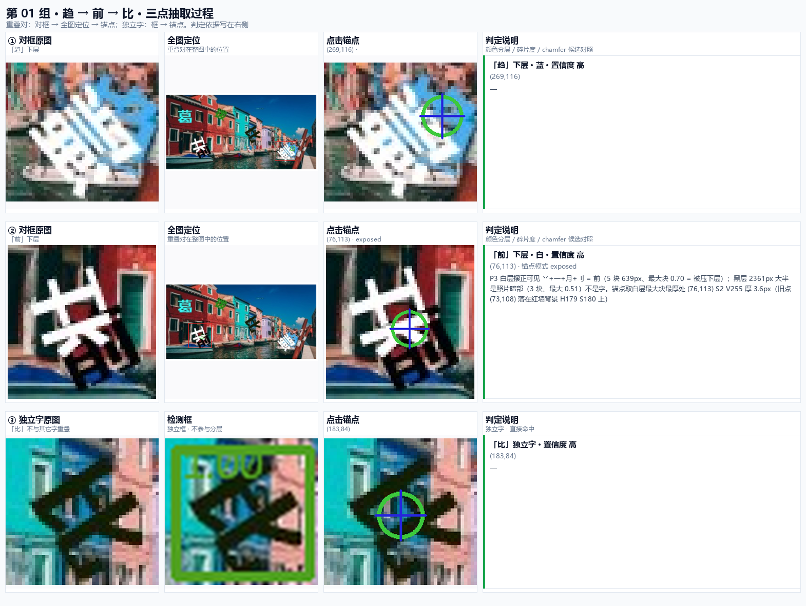
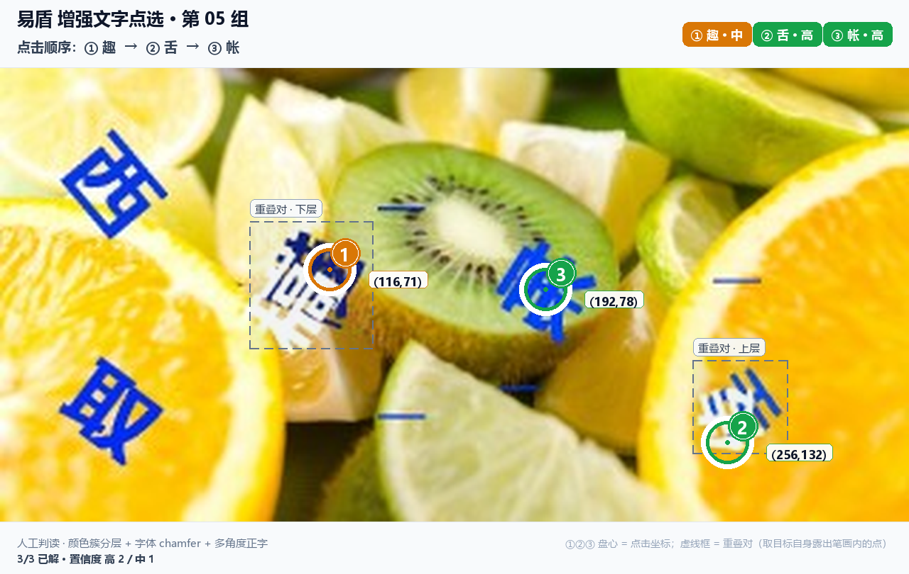
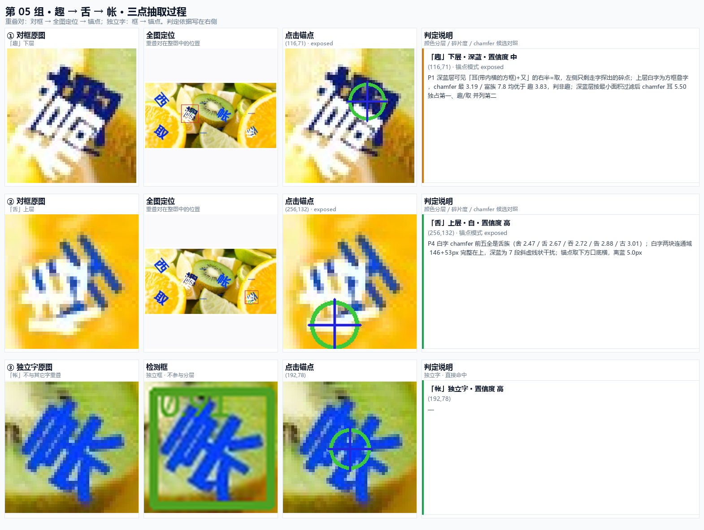
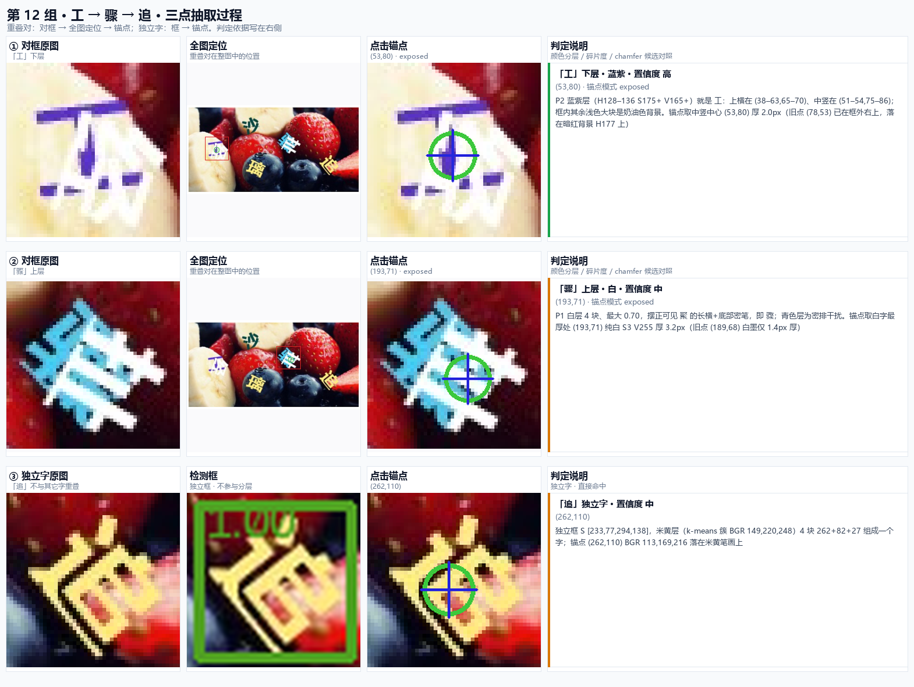

# 网易易盾 · 增强文字点选（text-click-enhanced）

> 320×160 背景上约 6–7 个汉字，题面给 3 个目标字、要求按序点击。12 组全部给出 **3 点有序结果**（人工逐字判读，`evidence: manual`）。自动求解器 v14 按 2026-11-22 的人工真值重算，命中 **21/36**：不判断「哪一层是目标字」，只用框级结构分挑出两个近方形的重叠对框（先过字径尺度，见第二节），落点取框内墨迹像素的坐标中位；独立字用 OCR 钉盒。人工判读用的「按颜色分层 + 碎片度判上下」在这个样本量上**无法自动复现**——颜色/结构类信号都在随机水平附近，色差有区分度但不提升选盒（见第七节）。
>
> 返回：[易盾索引](../../../docs/yidun.md) · [全量类型](../../../docs/types.md) · [方法论](../../../docs/00-methodology.md)

## 一、速览

| 项 | 值 |
|---|---|
| 厂商 | 网易易盾（`yidun`） |
| 类型 / 变体 | `text-click-enhanced` / enhanced |
| 中文 | 增强文字点选 |
| 媒体 | 图片 |
| 样本 | 12 组（001–012） |
| 答案格式 | `points`：按题面字序的 3 个点击坐标 |
| 方法 | `DET+CV+OCR`（YOLO + 字径闸门 + 结构分选对框 + 墨迹中位锚点 + RapidOCR 钉独立字；人工判读另用颜色分层取露出笔画） |
| 求解器 | `exists`；**答案** 3/3（12 组人工逐字判读）。**自动求解器 v14** 离线 **21/36**（2026-11-22 按现行人工真值重算；重叠对 13/25、独立字 8/11、对框选对 20/25） |
| 人工审查 | 现行 `meta.review`：通过 11 / 部分 1 / 不通过 0（截至 2026-11-22）。006/009/010/011/012 已在答案重写后复审；其余 7 组（001–005、007、008）仍是旧答案审查，待复审 |
| 证据等级 | `manual`（001–012）；每组含 `answer.txt` / `result.json` / `annotated.png` / `process-02-pairs.png`，其中 11 组另有 `process-01-standalone.png`（独立字的过程图）；006 经审核确认三个目标全在重叠对里，只有过程图 `process-02-pairs.png` |

## 二、题面与判定

题面给 3 个目标字，要求**按顺序**点击；顺序来自题面字符串，与目标在画面里的左右位置无关。

增强版的难点不是干扰字数量，而是背景里有两组**颜色不同、一上一下、笔画穿插**的重叠双字，YOLO 通常只给一个合并框。

- **布局规律**（12 组实测）：多数组是 2 个重叠对（每对 2 字）+ 若干独立字框（另有 YOLO 在路面/植被上的误检框）。**但这不是硬约束**：006 经审核确认画面里 3 个目标全部落在重叠对里，没有独立单字。所以先按「框内是否出现两种异色墨迹」把框分成单字 / 重叠对，再看目标数怎么分配，不要先假定"1 独立 + 2 对"。
- **一题三字怎么分**：常见形态是独立字 1 + 两组重叠对各 1——3 个目标里只有 1 个单独放置，扣掉它以后剩下的 2 个目标正好对上 2 组重叠对，**两组都要点，每组各取 1 个字**。不能假设「一个对对应两个目标」；也不能假设「一定有独立字」（006 就全是对）。
- **独立字的位置不固定**：本批 12 组的独立字多数排在题面第 3 位，但这是这批样本的巧合，序位不能当成规律用。
- **重叠对区域有尺度上限**：一组字只占一个字号大小的区域。12 组里真正用到的对框，max 边都在全图字径中位数的 0.79–1.54 倍；超过 1.7 倍的框不是两个字，而是背景块被并了进来——011 的 88×93 框把整头小牛框成了「重叠对」，真正的字框是它里面 39×38 的子框（全图字径 42px 的 2.2 倍，一个汉字不可能这么大）。
- **命中语义**：只在重叠区中心点时，才是「点在哪层响应哪层」；一旦分开，四种可能的服务端命中模型——最上层字形响应、目标多边形命中、最近质心、最下层优先——会有分歧。审核（006）给出的口径是：**要点的永远是被压住的那一层**，露在表面的完整字是诱饵。人工答案因此落在**目标自己的字**的露出笔画上；自动求解器不判层，退而取两字墨迹的公共区域（第五、七节），这是准确率与可判定性的折中。

样本图与结果图能对上答案；`annotated.png` 的 ①②③ 圆盘心即点击坐标，虚线框标出重叠对。

## 三、样本长什么样

| 背景题面 | 结果标注（①②③ + 点击点） | 重叠对判读过程 |
|---|---|---|
|  |  |  |
|  |  |  |
|  |  |  |

- 第 2 列：空心环 + 右上角大号序号，环心 = 点击坐标（保留原字可见，放大能核对点在哪一笔）；头部三枚芯片给 ①②③ 的目标字与置信度（绿=高 / 橙=中 / 红=低）。
- 第 3 列：每个目标一行——左侧框内 4× 放大（虚线框标出对的位置）、中为整图定位、右为锚点特写（绿圈 + 红十字）、末列为判读依据文字。
- 目标字可以是任意颜色/明度：蓝、绿、黑、黄、白、粉、藏青、深橄榄都有。

## 四、形态与难点

- **两个重叠对**：每个对由两个不同颜色的字组成，一上一下、笔画穿插；YOLO 往往只给出一个合并框。人眼先按颜色分层，但**颜色只是表象**——做成掩码后层身份并不稳定，见第七节实测。
- **对框会套进背景**：YOLO 除了给合并框，也常在背景纹理上出框——011 的 88×93 框就是整头小牛，字只在里面占 39×38 的一块。所以画框、裁过程图、取锚点之前都要先按字径尺度收框（见第二节），否则「重叠对区域」会比字大一个数量级。
- **人工分层方法**（判读答案时用）：按颜色把对框拆成两套掩码，各自数连通域。露在表面的一层**完整可读**（块少而大，最大块占比常 ≥0.85），是被压那层的**诱饵**；被压的一层**碎片化**（碎成多块，最大块占比低），才是目标。这是人眼判读的做法，不保证可自动复现（第七节）。
- **哪个是目标**：审核（006）确认的判据是「**点被压住的那一层**」——上面那个完整清晰的字只用来排除和匹配，不用来点击。旧的判读记录按「目标层最大连通域的距离变换峰」取点，24 个对目标里自判 18 个下层、6 个上层；006 复核后**推翻**了它自判的「驱 = 上层」，改为三处一律点下层（见第六节）。
- **层身份自动判定不成立（本批实测）**：目标落在像素较少的颜色簇 12/24、较大的簇 7/24、两簇都不在 5/24，接近随机（以下统计均为 006/011 重判前的 24 个对目标）；按颜色属性（明暗/饱和度）判目标的规则只对 7–12/24；骨架端点/被切断统计 9–11/24；两色面积比方向相反（AUC 0.325）；LAB ΔE 能区分对框（AUC 0.811），但加进选盒分后 top-2 仍是 20–21/24。**颜色分层的「能看见」和「能判身份」是两件事**：拆出两层可以稳定做到，判断哪层被压还要靠亮层 vs 暗层这种更原始的线索。
- **颜色≠墨色**：拍照背景里同一色相有大量像素（蓝天、路面、植被、白色牛毛）。掩码必须用连通域面积与包围盒跟字框比对，否则最深处会落在背景上。
- **白字最危险**：白色字与白色背景（牛毛、墙、雪）同色，宽松的白掩码会把背景一起纳入；要用更严的阈值（V 高且 S 极低）并只认字框内的块。
- **字形被压**：下层字可能只剩偏旁的一部分，chamfer 候选会挤在一起（如 织/帜/积）。判字靠「可见的那部分结构」+ 目标候选表，不是整字相似度。

## 五、求解思路

自动求解器 v14（2026-11-22，12 组 21/36）的流程：

| 步骤 | 做法 | 实测 |
|---|---|---|
| 1 定位 | YOLO 检出全部字符/字符组框（每组 5–8 个，含背景误检框），不预设哪个是对框；同时算全图字径 = 所有框 max 边的中位数 | 12 组全部有框 |
| 2 收到字径 | 先剔除 max 边 > 1.7×字径（或 < 0.55×）的框：这类框是牛身/船体/植被，不是字（011 的 88×93 整牛框就属于此类） | 11 的牛身框被剔掉 |
| 3 选对框 | 框级结构分 = z(框面积) − z(中位笔宽/框高)：叠字框**大而笔画细**；再叠长宽比先验 0.8–1.3（12 个真对框全在 0.94–1.18），取分最高的两个（分支①先排除独立字框） | 对框选对 20/25（对框打分不看字） |
| 4 定主体 | 两种走法：① OCR 里有恰好一个目标字只被一个框读到 → 先定它为独立字，再从其余框里选对框（6 组）；② 否则先选两个对框，再从剩余框里把「最好与次好 chamfer 差距最大」的目标字配上去（6 组） | 独立字锚点命中 8/11；09/11/12 配错（11 把对目标 搬 当成了独立字），正确框与几乎重合的锚点其实都存在 |
| 5 定落点 | 对框**不认字、不分层**：取框内全部墨迹像素的坐标中位 | 真对框上的锚点 13/20 |
| 6 输出 | 独立字 1 点 + 两个对框各 1 点，按题面字序排列 | 合计 21/36 |

落点用的是**对冲锚点**：两个字叠在一起时，墨迹中位必然落在两字笔画都覆盖到的区域，所以不需要知道哪一层是目标字，也不需要把两个字配给两个框。伪代码如下：

```text
框 = 检测全部字符框
字径 = 全部框 max 边的中位数
框 = 剔除 max 边 >1.7×字径 或 <0.55×字径 的框      # 牛身/船体/植被不是字
候选对框 = 框按「面积大、笔宽细」结构分 + 长宽比 0.8–1.3 排序
若 OCR 里恰好一个目标字只被一个框读到:
    独立字 = 该字、该框；对框 = 候选里排除它后取前二
否则:
    对框 = 候选里取前二；独立字 = 剩余框里 chamfer 差距最大的字-框对
对框落点 = 框内墨迹像素坐标的中位             # 不看层、不看字
独立字落点 = 该框内与目标字最像的颜色簇的中位  # 簇覆盖过半时退回框心
输出 3 点（按题面字序）
```

人工判读答案的路线是另一条，套用审核后的口径可以写成四步：

```text
先给所有框过字径尺度：max 边 0.55–1.7× 全图字径中位数，超出的是背景块（牛/船/植被），直接丢
对每个检测框：框里是否出现两种互不相同的墨色？否 → 单字框；是 → 重叠对
对每个重叠对：
    亮层 = 完整清晰、能整字读出来 —— 诱饵，只用来排除和匹配候选字
    暗层 / 异色层 = 被压在下面、轮廓残缺 —— 目标，从中挑出题面要求的那个字
    锚点 = 目标层露出碎片（离诱饵层 ≥3px 的部分）的面积重心
按题面字序输出 3 点；没有独立字时 3 个点全部来自重叠对（006 即此型）
```

这条路线人眼可做，但自动化在本批样本上不成立（第四、七节）。006 的教训是它还有两个前置条件：**先确认框里真的有两个字**（否则会把植被/船体误检框当成对，见第七节），以及**判读时别把可读的上层当成目标**。

> 本页只记录方法概念与判据，不展开模型权重、阈值和代码。v14 的核心取舍：**不知道哪层是目标时，点在两字墨迹的公共区域**；这比猜层身份稳。21/36 的结构是：5 个对目标的真框没进前二，7 个盒选对了但中点压在笔画交界/空隙上（真对框上的锚点本身只有 13/20），另有 3 个点错在独立字环节（09/11/12，都是字-框配错）。

## 六、结果与审查

- **完整度**：12/12 组给出 3 个有序点（solved 3/3），`answer.txt` 与 `result.json` 都是 3 点。
- **证据**：12 组均为人工判读（`manual`，逐字放大 12–26× 摆正 + 网格坐标 + 候选模板对照），没有线上提交记录。
- **审查**：表内「审查」列取 `meta.json` 当前值：**通过 11 / 部分 1 / 不通过 0**（截至 2026-11-22）。需要注意时间：`answer.txt` 在 2026-11-22 08:29（本地）按「独立字 + 两组重叠对各取一字」整体重写过。009/010/012 于 12:34–12:35、006 于 14:55、011 于 14:57（均为本地）复审，对当前答案有效；其余 7 组（001–005、007、008）的审查发生在 2026-11-22 00:04–06:42（本地），早于重写，只对旧坐标有效，需复审。
- **改动集中处**：002 擦、006 驱/重、008 多、011 搬/第、012 工/骤——旧答案要么点到了另一个字的墨上，要么把两个字塞进了同一个重叠对；010 则是整组换成了新样本。
- **006 按审核重判**（2026-11-22）：审核给的三条意见是「② 识别错误」「①③ 部分正确，是重叠的两个字但点击区域不准确」。核对下来：
  - ② 旧点 (198,106) 落在 YOLO 置信度 **0.35** 的框上，45× 放大看清是**橄榄枝**——检测误检被当成了字。真正含「重」的是中上区域那组对：**青色 #00FCF6 的「异」压着褐色的「重」**（青层 595px、V196、完整可读；褐层 bbox (180,46)–(200,92)）。
  - ① 旧点 (275,100)、③ 旧点 (53,79) 都落在**可读的完整层**上——正是审核说的「点击区域不准确」。规则改为点被压的下层后，三点变成 驱(283,103)、重(185,67)、灭(62,84)，③ 灭也从"独立字"改判为重叠对成员。
  - 这一组的布局也随之改写：**不是"1 独立 + 2 对"，而是 3 个目标全在重叠对里**。

**自动求解器离线成绩**（2026-11-22 按现行人工答案重算：006 已按审核改点、011 的对框已收到真正的字框；与人工答案逐点比对，方形 12px 判命中；求解器不重写案例答案）：

| 指标 | 结果 |
|---|---|
| 三点合计 | 21/36（58.3%） |
| 重叠对目标 | 13/25（真对框上的锚点 13/20） |
| 独立字目标 | 8/11 |
| 对框选进前二 | 20/25 |
| OCR 钉住独立字 | 6/12 组 |

逐组：003、004 三点全中；001、005、007、008、010、012 中 2 点；002、009、011 中 1 点；006 全脱——人工答案按审核改到「被压的下层」后，v14 的墨迹中位锚点一个也没对上。这里不回填也不调参：006 的失败正是「不判层」这条取舍的代价，如实记账。

| 组 | 题面 | 三点（按序） | 重叠对归属（层/色） | 审查（`meta.json`） |
|---|---|---|---|---|
| [001](001/) | 趋 → 前 → 比 | 趋(269,116) 前(76,113) 比(183,84) | 趋=P4 下/蓝，前=P3 下/白，比=独立 | 通过（旧答案，待复审） |
| [002](002/) | 允 → 擦 → 赞 | 允(65,97) 擦(99,33) 赞(244,93) | 允=P3 下/绿，擦=P1 上/白，赞=独立 | 部分（旧答案，待复审） |
| [003](003/) | 业 → 织 → 略 | 业(127,71) 织(278,95) 略(48,50) | 业=P5 下/蓝，织=P6 下/蓝，略=独立 | 通过（旧答案，待复审） |
| [004](004/) | 润 → 以 → 念 | 润(75,48) 以(242,87) 念(161,101) | 润=P0 下/白，以=P1 下/黄，念=独立 | 通过（旧答案，待复审） |
| [005](005/) | 趣 → 舌 → 帐 | 趣(116,71) 舌(256,132) 帐(192,78) | 趣=P1 下/深蓝，舌=P4 上/白，帐=独立 | 通过（旧答案，待复审） |
| [006](006/) | 驱 → 重 → 灭 | 驱(283,103) 重(185,67) 灭(62,84) | 驱=P2 下/暗绿，重=P0 下/褐（压在青色「异」下面），灭=P1 下/暗——三点全在重叠对，无独立字 | 通过（2026-11-22 复审） |
| [007](007/) | 病 → 遵 → 沿 | 病(161,108) 遵(70,103) 沿(266,88) | 病=P4 下/深绿，遵=P3 下/黑，沿=独立 | 通过（旧答案，待复审） |
| [008](008/) | 仆 → 多 → 深 | 仆(33,63) 多(128,53) 深(253,67) | 仆=P1 下/蓝，多=P0 上/白，深=独立 | 通过（旧答案，待复审） |
| [009](009/) | 方 → 课 → 尘 | 方(139,95) 课(50,98) 尘(266,72) | 方=P3 下/绿，课=P2 下/近黑，尘=独立 | 通过（2026-11-22 复审） |
| [010](010/) | 般 → 虽 → 祸 | 般(119,21) 虽(177,121) 祸(259,117) | 般=P0 下/黄，虽=P5 下/黑，祸=独立 | 通过（2026-11-22 复审） |
| [011](011/) | 搬 → 第 → 雪 | 搬(216,122) 第(102,104) 雪(41,119) | 搬=P6 下/白（旧 P3 是 88×93 的过并框，已弃用），第=P4 上/白，雪=独立 | 通过（2026-11-22 复审） |
| [012](012/) | 工 → 骤 → 追 | 工(53,80) 骤(193,71) 追(262,110) | 工=P2 下/蓝紫，骤=P1 上/白，追=独立 | 通过（2026-11-22 复审） |

> 「审查」列取 `meta.json.review` 现值，时间为本地时区：009/010/012 于 2026-11-22 12:34–12:35、006 于 14:55、011 于 14:57 复审，均在 08:29 答案重写之后，对当前答案有效；001–005、007、008 七条在 00:04–06:42，早于重写，只对旧坐标有效。

## 七、失败与边界

| 现象 | 根因 | 证据 | 结论 |
|---|---|---|---|
| 颜色簇身份判不出来（自动） | 目标层与像素多少、明暗、饱和度没有稳定关系 | 24 个对目标（006/011 重判前的口径）：像素少的簇 12、多的簇 7、两簇都不在 5；明暗/饱和度规则 7–12/24；骨架端点 9–11/24；两色面积比反向（AUC 0.325）；LAB ΔE 能区分对框（中位 151 vs 107，AUC 0.811）但加进选盒分不提升（仍 20–21/24） | 放弃层身份，改点在两字墨迹的公共区域 |
| 人工锚点定义不可复现（自动） | 真值取「目标色层最大连通域的距离变换峰」，自动侧的掩码与人工 HSV 阈值不同 | 已知目标字（oracle）时最大块 DT 峰 6–10/24、整层 DT 峰 4–10/24，墨迹中位 16/24（同为重判前 24 个）；按颜色距离重建整层掩码后最多 16/24，而错层的同法也有 15/24 | 不追求复刻真值定义，中位锚点更稳 |
| 对框识别天花板（自动） | 结构分 + 长宽比先验选两个对框 | 最好 20/25（现行口径）；再加 ΔE、硬阈值过滤都到不了更高 | 剩 5 个是选错框 |
| 独立字配错框（自动） | chamfer 把目标字配给了另一个框；011 甚至把对目标 搬 当成独立字 | 009 尘：正确框 b1 锚点 (266,68) vs 真值 (266,72)；011 雪：b5 (44,119) vs (41,119)；012 追：b3 (261,105) vs (262,110) | 属字-框配错，不是缺框 |
| 把两个目标塞进同一个重叠对 | 默认「一组对出两个字」的旧结论，硬凑出每对两个目标 | 010 旧样本的答案把 窃、爹 都放进 P0，而 P0 里只有一个白字能对上目标；真正含 爹 的是 P3 粉层（该样本已于 2026-11-22 换为 般/虽/祸） | 规则改为「先把框分成单字/重叠对，再按目标数分配」：本批多数是 1 独立 + 两组对各 1，但 006 三个目标全在对里；旧 010 重判为 窃(P0 白下层) + 爹(P3 粉上层) |
| 检测误检框当成了重叠对 | YOLO 在植被/船体/栏杆上也会出框，低分框没有先做字形校验 | 006 的 重 旧点 (198,106) 落在置信度 **0.35** 的框上，45× 放大看到的是橄榄枝，框里根本没有字 | 低分框先过「框内有没有高彩度、低厚度的笔画层」再进入排队；006 改判到中上区域那组对 |
| 对框套进背景（框画得太大） | 合并框会把背景块一起并进来，框的尺寸远超一个字 | 011 的旧对框 P3 = (205,67)–(293,160) 88×93，画出来是整头小牛，max 边是字径（全图框 max 边中位数 42px）的 **2.2 倍**；真正的字框是它内部的 P6 (203,103)–(242,141) 39×38 | 对框先过字径尺度：12 组真对框实测 0.79–1.54×，超 1.7× 一律按背景处理（<0.55× 也不是字）；超限时取框内最贴锚点的子框，没有子框就按锚点裁到 2× 字径 |
| 点在了可读的上层（诱饵）上 | 「完整清晰的那层是字」被当成了「那层就是目标」 | 审核 006：① 驱 (275,100) 与 ③ 灭 (53,79) 都落在完整可读层，被评「是重叠的两个字，点击区域不准确」；② 更把上层青字判成了目标 | 上层只用于排除与匹配，点击一律给被压的下层（006 重判为 283,103 / 185,67 / 62,84） |
| 点击落在上层字/背景上 | 落点取「框中心」或「掩码最深处」，两者都可能落在另一层或背景 | 002 旧点 (86,32) 是灰照片边缘（S32 V174）；006 旧点 (285,99) 落在船体；012 旧点 (78,53) 在框外的暗红路面 | 锚点必须落在目标自身颜色层内，并逐点回验 HSV |
| 独立字被误读 | 限定候选把形近字强行掰成目标 | 011 把独立蓝字读成「雪」0.835，还据此撤下了真正的独立字 | 独立字开放词表复核；011 恢复阶段一结果 雪 @(41,119)，第 改判到 P4 白上层 |
| 白色层判成非白 | 宽松白阈值（V≥185 & S≤95）把暖色毛发/墙当白 | 011 P4 的 (93,76) 实测 HSV(14,49,210) 是牛毛；换成严格阈值（V≥195 & S≤45）后白层只剩字的笔画 | 白掩码用严格阈值，再按字框裁掉背景块 |
| 形态学闭运算造出假墨点 | 2×2 闭运算把 1–2px 的缝补上，看起来像一条厚笔画 | 011 P4 的 (100,101) 声称「白厚 3.2」，实际像素 V=137 S=41 | 落点必须回原图取像素，不信掩码统计 |
| 单字被当成重叠对 | 白色描边形成第二个颜色簇 | 003 的「略」被当成对 | 扫描所有框；对框也要逐层判，但单字框要能退出 |
| 背景框读成数字/字母 | YOLO 在水果/草地/路面上的碎片框 | 03 顶部读出 1/7/F | 只保留与目标候选一致的命中 |
| 判字置信不足 | 下层被压后只剩局部结构，候选同档 | 003 织/帜/积 同档；007 遵 与 薄 形近；006 重 只剩褐色残笔压在青字右下 | 标中置信并进人工审查 |
| 灰影当成黑字 | 低饱和的暗灰阴影 V 也低，会混进黑字掩码 | 010 的 (142,128) HSV(120,15,33) 是背景阴影；真黑字 S≈255（(177,121) 为 HSV(0,255,11)） | 黑掩码加 S>100 约束，落点逐点回验饱和度 |

**边界**：本页的 3 点是**离线人工判读结果**，没有线上提交记录；`evidence: manual` 只说明答案怎么得来，不等于线上通过。21/36 是求解器与这份人工答案的离线比对，既不是线上通过率，也不代表人工答案一定正确。增强版与标准版 `text-click` 不是同一类型。

## 八、相关

- 厂商索引：[docs/yidun.md](../../../docs/yidun.md)
- 全量类型：[docs/types.md](../../../docs/types.md) · 方法论：[docs/00-methodology.md](../../../docs/00-methodology.md)
- 同厂商对照：[text-click](../text-click/)（标准版 5 个独立字）、[word-order](../word-order/)（语序点选）、[word-group](../word-group/)（语序选词）
- 案例：[001](001/) – [012](012/)（每组含 `meta.json` / `bg.jpg` / `annotated.png` / `process-02-pairs.png` / `answer.txt` / `result.json`；除 006 外另含 `process-01-standalone.png`）
- 来源：<https://dun.163.com/trial>；样本版权归网易易盾所有，仅用于研究与教学。
