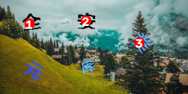
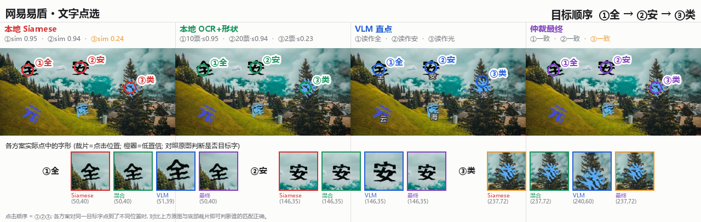
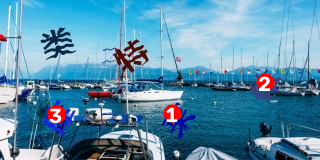
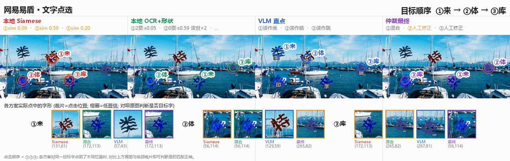
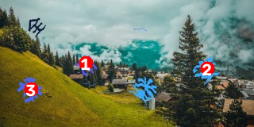
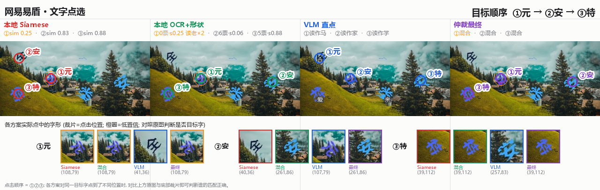

# 网易易盾 · 文字点选（text-click）

> 320×160 背景上分布 5 个独立汉字（3 目标 + 2 干扰），按提示顺序点击 3 个目标字；YOLO 定位 + Siamese/OCR 双识别 + VLM 只对分歧点仲裁。
>
> 返回：[易盾索引](../../../docs/yidun.md) · [全量类型](../../../docs/types.md) · [方法论](../../../docs/00-methodology.md)

## 一、速览

| 项 | 值 |
|---|---|
| 厂商 | 网易易盾（`yidun`） |
| 类型 / 变体 | `text-click` / classic（标准版，5 个独立字） |
| 中文 | 文字点选 |
| 媒体 | 图片 |
| 样本 | 12 组（001–006、013–018；旧 007–012 已删除） |
| 答案格式 | `points`：按提示顺序的 3 个坐标 |
| 方法 | `DET+OCR+VLM`（YOLO + Siamese/OCR + VLM 仲裁） |
| 求解器 | `exists` · 高（源记录 12/12） |
| 人工审查 | 12 通过 / 0 错误（截至 2026-11-21） |
| 证据等级 | 案例未写 `evidence` 字段；有 `annotated.png` / `process-01-compare.png`，无 `answer.txt` / `result.json` |

## 二、题面与判定

题面给出一串目标字（如「全 → 安 → 类」），用户按顺序在背景中点击这些字。标准版每张图有 5 个独立汉字，其中 3 个是目标、2 个是干扰；`meta.prompt` 直接来自源 `data.front`。

| 案例 | 题面（`meta.prompt`） | 通过条件 | 目标（来自题面） |
|---|---|---|---|
| [001](001/) | 请依次点击：全 → 安 → 类 | 按顺序点击 3 个目标字；顺序错误不通过 | 全、安、类 |
| [003](003/) | 请依次点击：来 → 体 → 库 | 同上 | 来、体、库 |
| [018](018/) | 请依次点击：元 → 安 → 特 | 同上 | 元、安、特 |

> 答案空间是「3 个有序坐标」；顺序错、点到干扰字或点到非字符框都不通过。12 组的目标字与干扰字都是独立渲染，没有增强版的重叠双字。

## 三、样本长什么样

| 背景题面 | 答案标注 | 四方案对比过程 |
|---|---|---|
|  |  |  |
|  |  |  |
|  |  |  |

- 第 2 列按 ①②③ 标出点击顺序与目标字；绿色是答案，红色/黄色是候选或被排除的框。
- 第 3 列是四方案对比：本地 Siamese、本地 OCR+形状混合、VLM 直点、仲裁最终；栏顶是逐击证据（相似度 / 票数 / OCR 读字 / VLM 读字），底部裁片是实际点中的字形。
- 无可用框的目标在过程图里显示「缺失」，这通常意味着检测漏框，而不是目标字不存在。

## 四、形态与难点

- **5 字 3 目标**：背景有 5 个独立汉字，题面只点其中 3 个；另外 2 个是干扰，形状可能相近。
- **旋转与变形**：字会旋转、压缩、加描边；Siamese 字形匹配对旋转敏感，OCR 对低对比和艺术字敏感。
- **非字符框**：背景中的船只、纹理会触发检测框，混合识别要过滤这些非字符框。
- **单字多解**：形近字（如「体/休」「库/裤」）单看字形容易错，需要 OCR 与 Siamese 互相校验。
- **无逐点真值**：12 组只有 `annotated.png`，没有 `answer.txt`；审查是人工核对标注，不是像素误差统计。

## 五、求解思路

源方案是四路并行、只对分歧点调用 VLM：

| 步骤 | 路线 | 做法 | 关键判据 / 参数 |
|---|---|---|---|
| 1 定位 | DET | YOLO 检测字符框，过滤非字符框与强干扰框 | 置信度阈值；框尺寸/长宽比 |
| 2 识别 A | Siamese | 字形模板与检测框做相似度匹配 | 归一化相似度 |
| 3 识别 B | OCR+形状 | RapidOCR 读字 + 形状特征；含颜色轮廓路线 | OCR 票数、形状分 |
| 4 直点 | VLM | 视觉模型直接读图给点击位置 | 只作为一路证据 |
| 5 仲裁 | 规则 | 三路一致直接采用；分歧时调用 VLM 仲裁 | 票数/相似度/来源 |
| 6 输出 | — | 按题面顺序排列 3 个坐标 | 无可用框的目标标「缺失」 |

```text
# 文字点选（伪代码，对应四方案 + 仲裁）

boxes = yolo(best_v3, bg)                     # 字符框 + 非字符框
boxes = filter_charset(boxes)                 # 尺寸/长宽比/非字符过滤

for box in boxes:
    sim   = siamese(box, target_glyphs)       # 字形相似度
    ocr   = rapidocr(box)                     # 读字 + 票数
    shape = shape_score(box, target_glyphs)   # 形状分
    vlm   = vlm_read(box)                     # 只在必要时调用

answer = arbitrate(sim, ocr, shape, vlm)      # 一致采用，分歧仲裁
click(order_by_prompt(answer))
```

> 混合识别的价值在于过滤：OCR 读字负责语义，Siamese 形状负责同字形判定，VLM 只在两路分歧时介入，成本比整图直点低。

## 六、结果与审查

- **源记录**：源方案 12/12；本库 12 组 `bg.jpg` / `annotated.png` / `process-01-compare.png` 齐全。
- **本库**：没有 `answer.txt` / `result.json`，无法重算逐点误差；`evidence` 字段未写。
- **人工审查**：12 组 `review.state=pass`、`result=correct`（人工对照题面、标注与四方案过程图）。

| 组 | 题面 | 审查 |
|---|---|---|
| [001](001/) | 全 → 安 → 类 | pass |
| [002](002/) | 元 → 安 → 库 | pass |
| [003](003/) | 来 → 体 → 库 | pass |
| [004](004/) | 类 → 验 → 扩 | pass |
| [005](005/) | 元 → 库 → 扩 | pass |
| [006](006/) | 扩 → 类 → 库 | pass |
| [013](013/) | 安 → 特 → 全 | pass |
| [014](014/) | 扩 → 库 → 体 | pass |
| [015](015/) | 元 → 全 → 安 | pass |
| [016](016/) | 特 → 体 → 扩 | pass |
| [017](017/) | 元 → 验 → 扩 | pass |
| [018](018/) | 元 → 安 → 特 | pass |

## 七、失败与边界

| 现象 | 根因 | 证据 | 结论 |
|---|---|---|---|
| 检测框落到船只/纹理 | 背景干扰触发 YOLO | 过程图出现非字符框 | 混合识别过滤非字符框与强干扰框 |
| 形近字判错 | 单看字形/OCR 都可能错 | 「体/休」「库/裤」类 | Siamese + OCR + VLM 仲裁，不单路决策 |
| 某目标显示「缺失」 | 检测漏框或框被过滤 | 过程图底部无裁片 | 先查检测，再查过滤规则；不要硬点最近的字 |
| 没有逐点真值 | 只保存标注图 | 无 `answer.txt` / `result.json` | 只能人工目检，不能算像素级准确率 |

**边界**：标准版（5 个独立字）与增强版（7 字含重叠双字）不是同一类型；重叠字请到 [text-click-enhanced](../text-click-enhanced/) 查看。所有结果均为离线，无线上提交记录。

## 八、相关

- 厂商索引：[docs/yidun.md](../../../docs/yidun.md)
- 全量类型：[docs/types.md](../../../docs/types.md) · 方法论：[docs/00-methodology.md](../../../docs/00-methodology.md)
- 同厂商对照：[text-click-enhanced](../text-click-enhanced/)（重叠双字）、[word-order](../word-order/)（语序点选）、[icon-click](../icon-click/)（图标点选）
- 案例：[001](001/) – [006](006/)、[013](013/) – [018](018/)（每组含 `meta.json` / `bg.jpg` / `annotated.png` / `process-01-compare.png`）
- 来源：<https://dun.163.com/trial>；样本版权归网易易盾所有，仅用于研究与教学。
