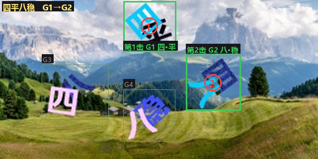
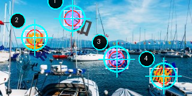

# 网易易盾 · 语序选词（word-group）

> 背景中散落若干词语，题面要求选出正确的词并按语义顺序排列；源方案用 `llm_solver` 选词/排序，无需训练。
>
> 返回：[易盾索引](../../../docs/yidun.md) · [全量类型](../../../docs/types.md) · [方法论](../../../docs/00-methodology.md)

## 一、速览

| 项 | 值 |
|---|---|
| 厂商 | 网易易盾（`yidun`） |
| 类型 / 变体 | `word-group` / classic |
| 中文 | 语序选词 |
| 媒体 | 图片 |
| 样本 | 12 组（001–012） |
| 答案格式 | `points+order`：选中词语 + 排列顺序 |
| 方法 | `VLM`（llm_solver 选词/排序；用 LLM） |
| 求解器 | `exists` · 高（源 llm_solver 12/12） |
| 人工审查 | 待审 12（截至 2026-11-21） |
| 证据等级 | 案例未写 `evidence` 字段；001–006 有 `annotated.png`，007–012 只有 `bg.jpg` |

## 二、题面与判定

题面给出一句目标语义（或若干候选词），用户需要在背景中选出正确的词，并按语义顺序排列。该批 12 组的 `meta.prompt` 都是「选出并排列正确词语」，`pass_criteria` 未记录。

| 案例 | 题面（`meta.prompt`） | 通过条件 | 结果 |
|---|---|---|---|
| [001](001/) | 选出并排列正确词语 | 该批案例未记录 `pass_criteria`；按选词与顺序判定 | 见 `annotated.png` |
| [004](004/) | 同上 | 同上 | 见 `annotated.png` |
| [007](007/) | 同上 | 同上 | 只有 `bg.jpg`，无标注 |

> 答案空间是「选哪些词 + 怎么排序」，不是单纯点选；选对词但顺序错，仍不通过。

## 三、样本长什么样

| 背景题面 | 答案标注 |
|---|---|
|  |  |
|  |  |
|  |  |

- 背景中词语的位置、字号、颜色都不固定；部分词是干扰项，语义上与目标无关或顺序不对。
- 007–012 没有 `annotated.png`，说明这 6 组只有题面，没有可直接展示的源结果。

## 四、形态与难点

- **语义选择**：先要判断哪些词属于目标语义，再做排序；不是所有词都参与排列。
- **顺序约束**：正确词之间的先后有语义/语法依据，不能按空间位置排。
- **干扰词**：背景可能有近义词、反义词或同主题词，单看词形无法排除。
- **无逐组答案**：12 组没有 `answer.txt` / `result.json`；001–006 只有标注图，007–012 连标注都没有。
- **审查未回填**：12 组均为 `pending`，源记录 12/12 不能当成已复核结论。

## 五、求解思路

源记录只说明使用 `llm_solver` 选词/排序，不需要训练数据；没有给出提示词、候选词构造或排序规则。

| 步骤 | 做法 | 关键判据 / 参数 |
|---|---|---|
| 1 读题 | 读取题面/提示，确定目标语义 | 题面文本 |
| 2 读词 | 识别背景中的候选词 | OCR/视觉模型；源记录未展开 |
| 3 选词 | 选出属于目标语义的词 | llm_solver |
| 4 排序 | 按语义/语法顺序排列 | llm_solver |
| 5 输出 | 选中词 + 顺序 | 结果见 `annotated.png`（001–006） |

> 本页不写伪代码：源记录没有公开提示词、候选生成和排序规则，凭空补全会误导。需要复现时，应从题面语义、候选词集合和输出顺序重新设计，并把 LLM 输出当建议而非真值。

## 六、结果与审查

- **源记录**：llm_solver 12/12；本库 12 组 `bg.jpg` / `meta.json` 齐全，001–006 另有 `annotated.png`。
- **本库**：没有 `answer.txt` / `result.json`；`evidence` 字段未写，无法重算选词/排序准确率。
- **人工审查**：12 组均为 `pending`；不要把源记录写成已复核。

| 组 | 审查 | 标注 |
|---|---|---|
| [001](001/) | pending | 有 `annotated.png` |
| [002](002/) | pending | 有 `annotated.png` |
| [003](003/) | pending | 有 `annotated.png` |
| [004](004/) | pending | 有 `annotated.png` |
| [005](005/) | pending | 有 `annotated.png` |
| [006](006/) | pending | 有 `annotated.png` |
| [007](007/)–[012](012/) | pending | 只有 `bg.jpg` |

## 七、失败与边界

| 现象 | 根因 | 证据 | 结论 |
|---|---|---|---|
| 选对词但顺序错 | 只做词义匹配，没做语义排序 | 题面要求「排列」 | 选词与排序要分开评估 |
| 近义词混入 | 背景有同主题干扰词 | 部分组只有标注图可对照 | 需要语义约束 + 人工复核 |
| 无逐组答案 | 只有标注图/题面 | 无 `answer.txt` / `result.json` | 不能算准确率，只能看可视化 |
| 审查未回填 | 12 组 pending | 无人工结论 | 源记录 12/12 仅作线索 |

**边界**：本类型依赖 LLM 的语义判断，成本按调用计费；12 组样本不足以覆盖完整词表/语义空间。

## 八、相关

- 厂商索引：[docs/yidun.md](../../../docs/yidun.md)
- 全量类型：[docs/types.md](../../../docs/types.md) · 方法论：[docs/00-methodology.md](../../../docs/00-methodology.md)
- 同厂商对照：[word-order](../word-order/)（语序点选，零 LLM）、[text-click](../text-click/)（文字点选）、[text-click-enhanced](../text-click-enhanced/)（重叠双字）
- 案例：[001](001/) – [012](012/)（001–006 含 `annotated.png`；007–012 只有 `bg.jpg`）
- 来源：<https://dun.163.com/trial>；样本版权归网易易盾所有，仅用于研究与教学。
