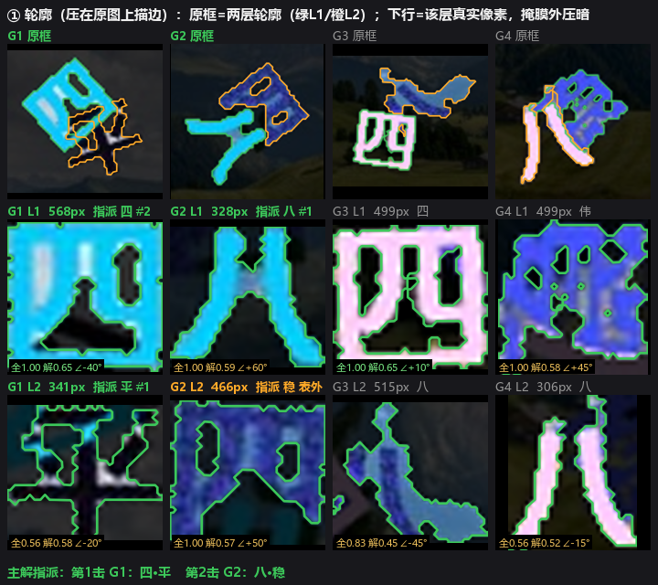
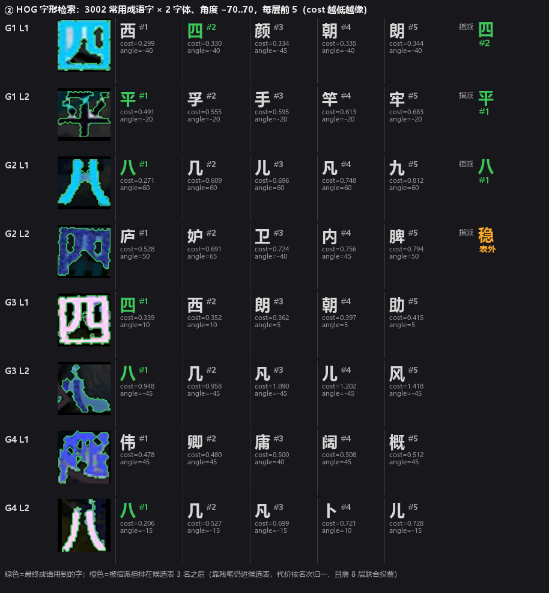
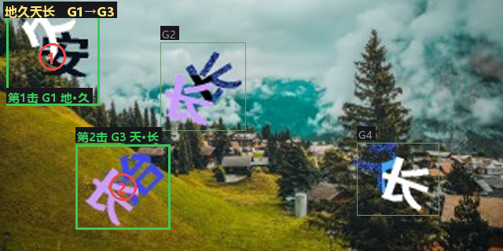

# 网易易盾 · 语序选词（word-group）

> 320×160 照片背景上排 4 组「两字叠印」，只点 2 下、点的是**组**，先后顺序即成语顺序。
> 当前方案为**纯 CV（无 VLM/LLM）**：离线 24/24 都能出解。线上 40 轮累计通过 11 轮（27.5%），
> 那是 11-22 之前三个构建的战绩；11-25 构建只有 14 轮回放证据（判对 6 轮），还没有真机战绩。
>
> 返回：[易盾索引](../../../docs/yidun.md) · [全量类型](../../../docs/types.md) · [方法论](../../../docs/00-methodology.md)

## 一、速览

| 项 | 值 |
|---|---|
| 厂商 | 网易易盾（`yidun`） |
| 类型 / 变体 | `word-group` / classic |
| 中文 | 语序选词（实际形态：叠印双字点选两次组成语） |
| 媒体 | 图片（320×160 JPEG） |
| 样本 | 12 组（001–012），源目录 24 组 |
| 答案格式 | `points+order`：两个点击坐标 + 先后顺序 |
| 方法 | `CV`（色族/覆盖度/射线/k-means 四路分层 + HOG 字形检索 + 成语联合约束） |
| 求解器 | `exists` · 低（线上通过的 14 轮回放判对 6；离线 12 组现行答案待重审；线上 27.5% 属 11-22 前构建） |
| 人工审查 | 已审 12（2026-11-22 版答案；11-23、11-25 两版均未审） |
| 证据等级 | `unverified`（离线无真值；001 有人工读图对照，另有 14 轮线上通过图可作旁证） |

## 二、题面与判定

线上真实题面是「请点击两下"叠加的文字"，组成成语」。`data.json` 只带 `type=8` 与等待时长，没有题面文本，题面取自实际挑战页。

| 要素 | 说明 |
|---|---|
| 画面 | 一张风景照，上面 4 组「两字叠印」共 8 个字 |
| 真组 | 2 组：组 A = 成语第 1/2 字，组 B = 第 3/4 字 |
| 干扰组 | 另外 2 组是被拉来凑数的字，不参与答案 |
| 点击 | 只点 2 下，一下一组，点**组中心**而不是单字 |
| 顺序 | 第一次点的是成语前两字那组，第二次是后两字那组 |
| 判定 | 两个组要同时正确、顺序也要正确；点错组或顺序颠倒都不通过 |
| 时限 | 300 ms 等待 + 会话级限时，需在挑战新鲜期内完成 |

## 三、样本长什么样

| 原图（001） | 求解结果（001：四平八稳，点 G1 → G2） |
|---|---|
|  |  |

| 过程①：轮廓描边（真实像素，按识别角度转正） | 过程②：每层字形检索前 5 |
|---|---|
|  |  |

| 原图（004） | 求解结果（004：地久天长，与次解天长地久代价完全相同） |
|---|---|
|  |  |

- 过程①上排是原框里两层轮廓（绿=L1、橙=L2）直接描在照片上；下排是每层**自己的真实像素**，掩膜外
  压暗 20%，并按识别出的角度转正。**上层字转正后基本能一眼读出**，下层往往只剩一两根笔画——
  这就是"上层清晰、下层靠推测"的直接证据。
- 每组两个字一上一下：**上层字完整可辨，下层字被上层笔画切断成碎片**，所以单看一组最多读出 1 个字。
- 字色不固定（青、紫、粉、蓝等），但同组两字通常同色族；照片里也有饱和度高的色斑，会伪装成字。
- 004 的 `margin=0`：`地久天长` 与 `天长地久` 的联合代价完全相同，顺序只能靠语义赌，属于低置信输出。

## 四、形态与难点

| 难点 | 具体表现 |
|---|---|
| 组定位 | 背景是照片，字叠在天空、草地、山体上，颜色对比差异大 |
| 组内分层 | 两层字同色族、互相压盖；全局 HSV 色族会把天空/海水与同色字混成一片，必须**逐框**做精确色聚类 |
| 假字 | 照片里的光滑色斑面积、饱和度和字接近，需用笔画几何（中位半宽、腐蚀留存、紧凑度、主连通域占比）剔除 |
| 字形识别 | 字径约 40 px、笔画细、任意旋转；相似度全挤在 0.70–0.75 一条窄带，**绝对相似度不可比**，只能把"这个字在本层排第几"归一成代价 |
| 证据不足 | 每层只有 1 个真字、其余 3001 个都是干扰；下层碎片常读不成形（11-25 重测：上层头名命中真字 46.4%、下层仅 16.7%，见第七节），8 层里真正可信的往往只有 1–3 层 |
| 干扰组 | 干扰组也可能读出常用字（甚至和真答案同字），靠"4 组 × 2 层必须全由同一个成语的四字解释"这条联合约束 + 词频先验压掉 |
| 顺序 | 顺序由成语语义决定，不能按空间位置（左上→右下）排 |

## 五、求解思路

全流程传统 CV，没有模型推理、没有大模型调用。

| 步骤 | 做法 | 关键参数 |
|---|---|---|
| 1 组定位 | 检测器给出 4 个组框；退化路径用色族连通域配对 | 框约 40–50 px |
| 2 组内分层 | 每框独立枚举掩膜来源：`(r//16,g//16,b//16)` 色格枚举与中位色（最大通道差 ≤ 22）→ 覆盖度分带 → 同色射线生长，三条互补；再加**区域 Lab 空间 k-means 10 色团**，专捞被倒角/浮雕切成亮面暗面的整字色团（k-means 掩膜**不填内腔**：囗类字的空腔正是判别信息）；8 个笔画几何量过闸门 → 综合分取 2 层；再按同色族轮廓沿笔画方向做连通扩展，把被上层切断的下半字补回来 | 掩膜开 (0,3)、连通域最小 4 px；k-means 固定随机种子（同图两次必须选出同一层） |
| 3 字形代价 | 掩膜归一化 56×56 → 角度 −70..70 步长 5（每角度旋转后重新归一化、3×3 轻模糊）→ HOG（10×10 格 × 8 方向 + 每格密度 = 900 维）→ 与 **3002 个常用成语字 × 2 字体**求余弦 → 减掉公共分量、按该层前 30 名的极差归一 | 代价 0 = 最像；`1.01` = 该字没进前 30（按 MISS 计） |
| 4 同字配对 | 8 个实例两两算旋转不变 chamfer，按"每类最多 2 个"聚成 4 类；同类两处掩膜旋转对齐后取并集再识别一次，作为该类证据的上界 | 同类阈值 0.78（实测同字 0.15–0.60、异字 ≥ 0.75） |
| 5 八层联合指派（主解） | 4 组 × 2 层必须**全部**由同一个成语的四个字解释：A 组 = 前两字、B 组 = 后两字（点击的两组，顺序即成语顺序），另外两组用三种互补切分取最优；总代价 = 8 层代价和 − `0.10 × log₂(四字词频先验乘积)`。头名与次名差距 ≥ 0.35 的层判为可信层并钉死，违规按满罚（`1.01`）计 | 约 8500 条成语（THUOCL 词频序） |
| 6 补充候选 | 定向比对（先用可信层收窄词表、只比候选成语的字）与配对联合指派（第 4 步的类当约束）各跑一遍，只排在主解后面当备选 | 两种路线做主解都更差，见第七节 |
| 7 输出 | 两个组中心点即两次点击；组对顺序 = 点击顺序 | 坐标取框中心 |

```text
输入 图 320x160
1 组定位: 4 个组框
2 对每个组框:
    像素量化 (r//16, g//16, b//16) 聚类 -> 色簇样本数达标的取中位色
    每簇掩膜 = max|px - 中位色| <= 22
    另跑三条互补来源: 覆盖度分带 / 同色射线生长 / Lab 空间 k-means 10 色团(不填内腔)
    算 面积 / 密度 / 中位笔画半宽 / 紧凑度 / 腐蚀留存 / 主连通域占比 / 触边 / 离轴
    过闸门后综合分取前 2 -> 第 1 层(上层完整字) / 第 2 层(下层碎片)
    同色族轮廓沿笔画方向连通扩展 -> 补回被切断的下半字
3 对每层:
    掩膜最近邻缩到 56x56
    for 角度 in -70..70 步长 5: 旋转 -> 重新归一化 -> HOG(10x10x8 + 每格密度)
    与 3002 常用成语字 x 2 字体 求余弦 -> 减公共分量 -> 按前 30 名极差归一
    得该层对每个字的代价: 0 最像, 1.01 未进前 30
4 同字配对: 8 层两两 chamfer -> 每类最多 2 个 -> 聚成 4 类
            同类两处掩膜旋转对齐取并集 -> 再识别一遍
5 八层联合指派:
    for 成语 w in 约 8500 条:
      for 有序组对 (A,B) in 12 种:
      for 另外两组的互补切分 in 3 种:
        total = sum(8 层对 w 对应字的代价) - 0.10 x log2(四字词频先验乘积)
        可信层(头名-次名 >= 0.35)上违规 -> 记满罚
    取 total 最小 -> 主解; 次小者当备选
6 补充候选: 定向比对 / 配对联合指派 各出一条, 排在主解之后
7 输出 点击1 = A 框中心, 点击2 = B 框中心
```

## 六、结果与审查

离线 24 组**全部出解**（给得出成语 + 两个坐标），但这只是"不空转"，**不等于答对**：离线没有真值。
线上通过的 10 个成语（天长日久 / 四平八稳 / 长治久安 / 坐立不安 / 缓兵之计 / 图财害命 /
薄技在身 / 固若金汤 / 发号施令 / 盘石之固）与纯 CV 方案的路子是相容的。

下表是**当前构建（2026-11-25，第 4 条掩膜源 Lab k-means 入生产）**在 12 组上的输出。最早一版
（2026-11-22）经人工审核为 4 正确 / 8 错误；此后 11-23、11-25 两版都是整体重解、**都没有人工结论**
——`meta.json` 里保留的 `review` 仍是 11-22 那版答案的记录，要按新答案重审。11-25 与 11-23 对比：
12 组里 **4 组变了**（007 偏安一隅 → 一路平安、008 第 2 击换组、009 铁马金戈 → 金戈铁马（组对颠倒）、
012 安如泰山 → 稳如泰山），其余 8 组成语与组对不变。但同一构建在 **24 组全集上换掉了 20 组答案**——
答案对掩膜差异极其敏感，这张表读作"一次快照"，不能读作稳定解。

| 组 | 求解输出 | 组对 | 两次点击 | 观测层 | 可信层 | cost | margin |
|---|---|---|---|---|---|---|---|
| [001](001/) | 四平八稳 | G1 → G2 | (150,26) → (214,83) | 8 | 4 | 3.38 | −1.01 |
| [002](002/) | 固若金汤 | G4 → G1 | (66,125) → (65,29) | 7 | 2 | 3.18 | −2.50 |
| [003](003/) | 一字千金 | G3 → G2 | (178,65) → (98,90) | 7 | 3 | 5.67 | 0.00 |
| [004](004/) | 地久天长 | G1 → G3 | (33,36) → (78,119) | 8 | 5 | 4.04 | 0.00 |
| [005](005/) | 稳如泰山 | G4 → G1 | (224,108) → (42,30) | 8 | 1 | 4.04 | −1.01 |
| [006](006/) | 一事无成 | G2 → G1 | (59,74) → (128,35) | 8 | 3 | 5.85 | 0.05 |
| [007](007/) | 一路平安 | G2 → G1 | (67,109) → (114,27) | 8 | 5 | 5.05 | 0.00 |
| [008](008/) | 固若金汤 | G4 → G2 | (229,118) → (169,70) | 8 | 4 | 4.33 | −2.09 |
| [009](009/) | 金戈铁马 | G2 → G1 | (57,92) → (133,39) | 7 | 2 | 5.37 | 0.00 |
| [010](010/) | 坐立不安 | G2 → G1 | (266,80) → (97,53) | 8 | 3 | 5.05 | 0.00 |
| [011](011/) | 长治久安 | G2 → G1 | (172,55) → (93,35) | 8 | 5 | 2.18 | −2.14 |
| [012](012/) | 稳如泰山 | G1 → G2 | (120,51) → (236,79) | 8 | 4 | 3.03 | −1.01 |

> `cost` 是 8 层联合指派的代价和（越小越好）；`margin = 主解 cost − 次解 cost`，**负值才表示主解更便宜**，
> 绝对值越大越有把握；`margin = 0` 说明次解代价完全相同（003 / 004 / 007 / 009 / 010 五组并列），这类输出
> 只能算"候选之一"。`观测层` = 真正读到候选数的层数，缺层时小于 8（如 002 / 003 / 009）。
> 反复出现的高频成语（002 与 008 都读到固若金汤、005 / 012 都是稳如泰山）是局部最优的典型症状，
> 这些组优先人工复核。

**线上实测**（每轮解→点两下→读判定，原图与判定截图留档）——这组数据属于 **11-22 之前**的三个构建，
**不能当作当前构建的通过率**：

| 构建 | 轮数 | 通过 | 通过率 |
|---|---:|---:|---:|
| 名次证据 + 成语词表 | 10 | 3 | 30% |
| + 跨组 IDF | 15 | 4 | 27% |
| + 词表字频先验（线上最后一版） | 15 | 4 | 27% |
| **合计** | **40** | **11** | **27.5%** |

**回放复核（2026-11-25）**：把线上通过的那 14 轮原图用当前构建重跑，判对 6 轮（43%）；关掉 k-means
源同样是 6 轮，这条改动没有改变命中。这与上表不矛盾、也不能直接比较——上表的分母是全部尝试轮，这里
只统计"线上已经答对过"的轮，衡量的是构建自身的稳定性，而不是通过率。

**k-means 色团源 A/B（2026-11-25）**：同一张图开/关第 4 条源，对 14 轮 × 4 组共 56 个组逐层比 IoU——
**7 个组换了层**，其余 49 组掩膜逐像素一致。端到端：整轮命中 6/14 → 6/14（不变），前 3 名含真字的层
6 → 7，按 0.55 差值钉死的层准确率 70.4% → 71.4%（0.35 档 54.9% → 55.8%）。换掉的 7 组大多是把
**深蓝下层掩膜补大**（270 → 390 px、254 → 299 px、482 → 513 px），正是"补回被上层切断的下半字"想要
的形状；但它没有把"读不出的层"变成"读得出的层"。所以这次改动买到的是**轮廓完整性与可读性**（第三节
过程图能直接用肉眼判上层字），不是准确率。

**人工审查**：11-22 版答案 12 组已审，正确 4 / 错误 8。审核口径是"求解给出的成语与点击是否就是该图
真解"，错的那 8 组里既有成语读错，也有组对/顺序选错。11-23 与 11-25 两版**都没有重审**；相对已审的
11-22 版，11-23 时已有 10 组成语或组对改变、11-25 又动了 4 组，所以 `meta.json` 里的 `review`
只能当历史记录，不能当现行答案的结论。

## 七、失败与边界

| 现象 | 根因 | 证据 | 结论 |
|---|---|---|---|
| 只有 27.5% 通过（11-22 前构建） | 单字识别只到"层内前 30 名"级别 | 001 人工确认的 4 字名次 41 / 5 / 7 / 1，top-1 只对 1/4 | 不是调参能解决，识别器要换 |
| 真成语排不进候选（2026-11-25） | 真字的四个字进不了任何一层的候选池 | 判错的 8 轮里，真成语名次是 第 4 / 4 / 14 / 55 / 179 / 3810 / 5197 名，还有 1 轮根本不在词表 | 排序没错，是字没读出来 |
| 假字符排第一 | 早期全字集版里噪声 top-1 多为 魍/鬣/韡/篦/髻 这类笔画多的生僻字 | 各层前 5 列表 | 已把模板字集收窄到常用成语字集（3002 字），这类吸引子不再出现 |
| 读错的冠军是"枢纽字成语" | 固/若/长/治/四/平/八/安 这类笔画密的字跟什么掩膜都像 | 判错 8 轮的冠军：固若金汤 ×2、四平八稳 ×2、长治久安、知命之年、一字千金、置之不理 | 枢纽字罚分能压住单层名次，却压不住整条成语，因为真解本身也常是它们 |
| 下层字读不出 | 被上层切断成碎片，HOG 无方向 | 下层名次常在 1e3–1e4 | 只能靠上层锚点反推 |
| 多个成语同分 | 2 个锚点同时满足的成语有几十条 | 004 / 007 margin=0 | 靠词频与证据赌，非确定解 |
| 相似度差值无效 | 40 px 细笔画字的 sim 全在 0.70–0.75 窄带 | 实验记录 | 证据必须按名次换算 |
| 去均值 / Fisher 内积更差 | 模板均值范数 0.78，公共分量正好携带"笔画量" | 实验记录 | 不要做中心化 |
| 形态学开运算伤害细笔画 | 吃掉 1–2 px 笔画 | 名次从 5 恶化到 4160 | 掩膜只用 (0,3) 轻开 |

### 分层可读性实测（2026-11-25 重测，14 轮线上通过轮回放）

把 14 轮线上通过的图重新跑一遍，逐层看"这一层识别头名是不是成语四个字之一"。题设决定了
**每一层的正确答案一定是成语四字之一**（8 个字全是这四个字的副本），所以这项指标是可以逐层判
对错的，分辨率远高于"整轮成语对不对"。再按"头名与次名的代价差"分档，就能看出头名到底有多可信
（下表测于 k-means 源接入之前；接入后同一池整轮命中仍是 6/14、钉死层准确率只动 1 个百分点量级，
所以这张表按"识别层稳定性诊断"读，不要按某个构建的通过率承诺读）：

| 头次名代价差 | L0 层数 | L0 头名命中真字 | L1 层数 | L1 头名命中真字 |
|---|---:|---:|---:|---:|
| < 0.10 | 10 | 10.0% | 9 | 11.1% |
| 0.10–0.20 | 6 | 16.7% | 12 | 0.0% |
| 0.20–0.35 | 10 | 30.0% | 12 | 8.3% |
| 0.35–0.60 | 18 | 55.6% | 12 | 16.7% |
| ≥ 0.60 | 12 | 91.7% | 9 | 55.6% |
| **合计 110 层** | **56** | **46.4%** | **54** | **16.7%** |

随机水平是 4/3002 ≈ 0.13%。结论比"平均 30%"更有用：

- **上层只在"差得开"时才可信**：差值 ≥0.60 的 12 层里 11 层读对（92%）；差值 <0.20 的 16 层里
  只对 2 层。现有钉死门槛 0.35 恰好落在拐点上——按它钉出来的上层字 30 个里对 21 个（70%），
  钉死字作为成语硬约束时，约三成会把正确成语钉死（violation 罚分）。
- **下层不分档位都读不出**：任何差值的命中率都在 0–17%，只有 ≥0.60 的 9 层到 55.6%。按 0.35
  门槛钉出来的下层字 **20 个全错（0/20）**——它是"这一层最像哪个字"，不是"这个字是不是答案"。
- 所以"下层靠推测"在数据上是成立的：下层证据只配当弱信号（权重归零会丢掉长治久安那一轮，
  说明它的弱信息仍有边际价值）。
- **整轮成语判对 6 / 14 = 43%**，且这 6 次命中的真值全是高频成语（见下节）。

### 命中即先验：43% 是怎么来的（2026-11-25）

14 轮里判对的 6 轮，真值分别是 固若金汤（1 次） / 长治久安（3 次） / 四平八稳（1 次） / 坐立不安（1 次）——
**全是枢纽字（固/若/长/治/四/平/八/安）拼出来的高频成语**；判错的 8 轮，真值是 发号施令 /
缓兵之计（2 次） / 天长日久 / 薄技在身 / 图财害命 / 十有八九 / 盘石之固 这类字面完全不同的成语。
三步对照实验证明这不是"识别器碰巧"：

| 实验 | 结果 | 含义 |
|---|---|---|
| 把 6 条吸引子成语从词表里删掉再解 | 0/14 | 正确的那些轮**全靠吸引子本身** |
| 换成全量成语表（29250 条，含大量生僻与倒序变体） | 3/14 | 生僻变体会被拼出来（金汤之固、久安长治、金石之计），把正解挤掉 |
| 加大枢纽字罚分 / 反向罚高频 | 罚分 0.6 起命中掉到 4/14 以下 | 罚不到"错的吸引子"，只罚掉了"对的吸引子" |

配合"真成语名次"（判对 6 轮全是第 1 名；判错 8 轮是第 4 / 4 / 14 / 55 / 179 / 3810 / 5197 名、
或根本不在词表），可以确认：**决策层没有犯错空间，输出的其实是"能凑出来的最可能的成语"**，
43% 近似等于词频先验在这批样本上的命中率，不是读字读出来的。

### 已证伪的改进方向（逐条实测，均未提升）

| 尝试 | 想法 | 实测 | 结论 |
|---|---|---|---|
| 定向比对 | 先用读得准的 1–2 个字把词表收窄，再只比候选成语的那几个字 | 单独做主解 3/14；用作"否决整表头名" 4/14 | 都比整表联合的 6/14 差；收窄用的"可信字"里混着噪声层，否决时把对的答案否决掉 |
| 同字配对 + 联合指派 | 8 个字是四字各两份，先把 8 层按图像自相似配成 4 对，再要求配对的两层读成同一个字 | 配对本身正确（已验证的两对 长/长、久/久 都配对成功），但整轮只判对 3/14，且没有救回任何一轮 | "配对的两层必须同字"这条约束太硬：碎片层读不出时，它反而把正确成语判死 |
| 模板加粗 | 字是浮雕加粗的，模板是细笔画黑体，怀疑厚度不匹配 | 3 个难轮 24 层上，膨胀半径 0/1/2/3 的层头名命中是 2/24、2/24、2/24、3/24 | 零改善，厚度不是瓶颈 |
| 填内洞的实心剪影 | 掩膜常是"外轮廓 + 内腔空了"的环状，模板是实心笔画，把内洞填上让两边同构 | 层头名 30.0% → 27.3%，L1 14.8% → 9.3%，整轮仍 6/14 | 变差，内腔是有效信息不是噪声 |
| L1 降权 | 下层只有 14.8%，在 8 层联合里降权 | 权重 0.5 仍是 6/14；权重 0 丢掉长治久安 | 不变或变差，L1 的弱信息有用 |
| 加大可信层罚分 | 读得准的层违规时罚得更重，让 1–3 个可信层压过 6 层噪声 | 罚分 ×2.5 仍是 6/14，但把"知命之年"改判成"长久之计" | 方向对（结构判断变对了），但缺的那两个字靠罚分补不出来 |
| 分层门控（2026-11-25） | 头次名差太小或读成枢纽字的层，整层按"没读到"压掉 | 只按差值压：≤5/14（不压是 6/14）；只按枢纽度压：任何阈值都是 6/14（完全无动作） | 被压层本来就在"没读到"一侧，压了等于没压 |
| 去掉诱饵组的证据 | 4 组里只有 2 组装着成语的字，另 2 组是干扰，按理不该参与联合指派 | 只保留 2 组：5/14 | 诱饵组的字形是"真的读到了干扰字"，它给的是真信息 |
| 位置硬约束 | 先点击的组必须给出前两字、后点击的组给后两字，把读到的字当位置锚点 | 6/14（完全无动作） | 锚点本来就已经通过软代价起作用 |
| 粗排 → 定向精排 | 取粗排前 20/80/300 个成语，只在它们自己的字上重比一遍，再做 8 层指派 | 5/14、5/14、5/14（前 800 时候选字太多直接放弃） | 精排会把"坐立不安"改判成"安身立命"，错误更自信 |
| 整图锁定字体 | 逐字挑最像的字体等于给每个字开后门，整张图锁定同一种字体应当更严 | 12 轮全部锁到微软雅黑粗体，锁定前后逐字节一致（6/12 命中、钉死 21/28 都一样） | 字体选择根本不是变量 |
| HOG 细节档 | 更细的格子 + 更少的模糊能保轮廓细节（经验上"判别信息全在轮廓上"） | 10×10 格 + 3×3 模糊：6/12（钉 21/28）；10 格 + 1×1：5/12；14 格 + 1×1：4/12（钉 16/25）；10 格 + 5×5：5/12；12 格：5/12 | 模糊在做"抗错位"的活，去掉它细节反而更糊 |
| 横纵比搜索 | 3D 浮雕是透视投影，掩膜等比归一化后字被压扁，HOG 对压扁极敏感；掩膜侧按 x 拉伸 0.85 / 1.18 再取最优 | 8 轮：上层头名 15/24 → 14/24、15/24，命中 3/6 不变 | 投影压扁不是主要误差 |
| 全量词表 / 补缺口 | 常用表没有 盘石之固（只在全量表里），补上就能多救一轮 | 补这一条：冠军不变（盘 读不出来）；换全量表：3/14 | 缺口在识别不在词表，打开全量表只会放进倒序变体 |
| 亮度三档分离（2026-11-25） | 字是浮雕，有亮面 / 侧壁 / 暗面三档，先按亮度切开再合并，以为能把侧壁从轮廓里剔掉 | 层头名命中 0.468 → 0.426（更差） | 侧壁本身就是字的笔画，切掉它轮廓更假 |
| 退化匹配模板（2026-11-25） | 模板是干净细笔画黑体、掩膜是 40 px 带噪声的浮雕，把模板先做 26 px 低清 + 模糊 + 加粗，"同病相怜"再比 | 生产掩膜上命中 0.482 → 0.496，56 层里头名多对 1 层（22 → 23） | 边际到不值得多养一套模板库，没有接入 |

十六条尝试的共同结论：**决策层（词表、先验、钉死、指派、精排、门控）已经做到没有收益，识别层
（掩膜 + 字形表示）才是天花板**。证据链闭合：

1. 判对的轮次，真成语在候选里就是第 1 名；判错的轮次，真成语在第 4 名之后甚至不在词表——说明
   排序逻辑本身没出错，是"字没读出来"。
2. 上层读得准的层（差值 ≥0.6）能到 92%，但只占四分之一多一点（12/56）；其余层读不准，是因为
   掩膜本身是碎片/粘连（"长"的掩膜是一团带洞的色块、"八"是两根断开的长条），不是 HOG 参数问题。
3. 所以下一步不是继续调分数，而是换更强的字形表示。两条"顺着掩膜走"的路子已经试过——把模板退化成
   掩膜的低清版本（只多对 1 层）、把亮度拆成三档再合并（更差）；再往下要么用真实层掩膜训练小分类器
   （现有 110 层样本根本不够训练），要么换整个识别范式。这一步没有做，本页不给出未验证的准确率。

**边界**：

- 字体固定（微软雅黑粗体 / 黑体两个模板库），换皮肤或换字体必须重建模板；不是通用 OCR。
- 样本只有易盾 trial 的 type=8；同厂商其它叠字形态（如 `text-click-enhanced` 的重叠双字）机制相近但题面不同，不能直接套答案格式。
- 12 组样本量不足以估计准确率，线上 40 轮也只能给出 ±7% 量级的粗略区间。

## 八、相关

- 厂商索引：[docs/yidun.md](../../../docs/yidun.md)
- 全量类型：[docs/types.md](../../../docs/types.md) · 方法论：[docs/00-methodology.md](../../../docs/00-methodology.md)
- 同厂商对照：[word-order](../word-order/)（语序点选，零 LLM）、[text-click](../text-click/)（文字点选）、[text-click-enhanced](../text-click-enhanced/)（重叠双字，点被压住的下层）
- 案例：[001](001/) – [012](012/)，每组含 `bg.jpg` / `annotated.png` / `process-01-groups.png` / `process-02-chars.png` / `answer.txt` / `result.json`
- 来源：<https://dun.163.com/trial>；样本版权归网易易盾所有，仅用于研究与教学。
