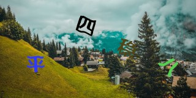
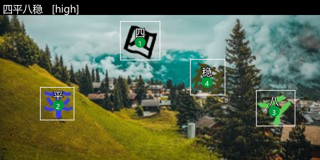
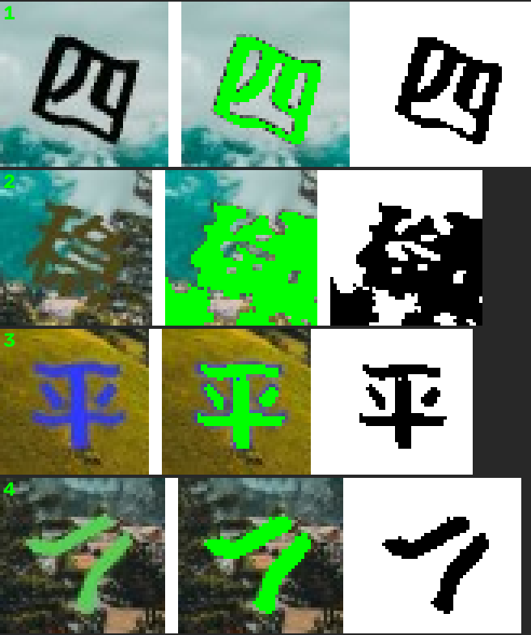
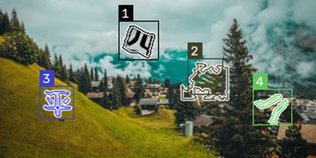
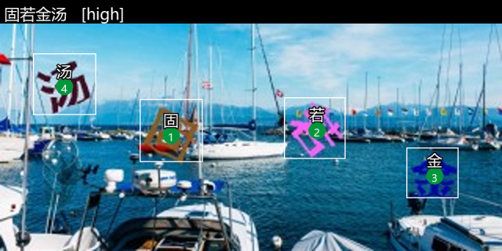
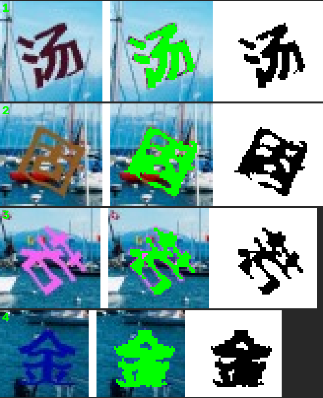
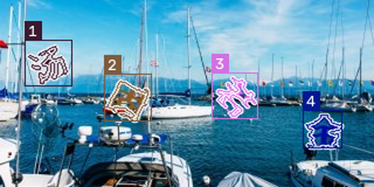

# 网易易盾 · 语序点选（word-order）

> 4 个散落汉字组成一个四字成语，按成语语序依次点击；零 LLM 路线：YOLO 定位 + 颜色轮廓 + 多角度 OCR + 29,502 条成语库约束。
>
> 返回：[易盾索引](../../../docs/yidun.md) · [全量类型](../../../docs/types.md) · [方法论](../../../docs/00-methodology.md)

## 一、速览

| 项 | 值 |
|---|---|
| 厂商 | 网易易盾（`yidun`） |
| 类型 / 变体 | `word-order` / classic |
| 中文 | 语序点选 |
| 媒体 | 图片 |
| 样本 | 12 组（001–012） |
| 答案格式 | `points+order`：4 个有序坐标 |
| 方法 | `DET+OCR+CV`（零 LLM、纯 CPU） |
| 求解器 | `exists` · 高（源记录 12/12 离线匹配） |
| 人工审查 | 12 通过 / 0 错误（截至 2026-11-21） |
| 证据等级 | `unverified`（离线自评，未实机提交） |

## 二、题面与判定

一张 320×160 的照片背景上散落 4 个旋转汉字，4 字恰好组成一个四字成语。用户需要按成语语序点击，顺序由服务端判定；API `type=10`、`front="4"` 只给字数，不给答案。

| 案例 | 题面（`meta.prompt`） | 通过条件 | 实际成语 / 点击序 |
|---|---|---|---|
| [001](001/) | 按正确语序点击图中 4 个汉字（组成四字成语） | 按四字成语语序依次点击 4 个散落汉字 | 四平八稳：四(140,42) → 平(58,105) → 八(274,111) → 稳(207,82) |
| [002](002/) | 同上 | 同上 | 稳如泰山：稳(110,53) → 如(161,116) → 泰(239,69) → 山(42,113) |
| [003](003/) | 同上 | 同上 | 固若金汤：固(109,86) → 若(202,83) → 金(277,112) → 汤(41,55) |

> 题面统一、答案空间是「4 个字的排列」而不是自由坐标；真正的难点是先把 4 个字读对，再确定成语。

## 三、样本长什么样

| 题面 | 答案标注 | 颜色轮廓过程 | 定位过程 |
|---|---|---|---|
|  |  |  |  |
|  |  |  |  |

- 左起第 1 列是原始题面；第 2 列按点击顺序标注 ①②③④；第 3 列是颜色聚类得到的字形轮廓（原始裁片 / 轮廓覆盖 / 二值）；第 4 列是 4 个字的定位编号（按空间顺序，不按语序）。
- 低对比字（如 001 的「稳」、011 的「八」）会把邻近背景并入掩码，`result.json` 用 `contour_reliable=false` 标记，识别交给 OCR + 成语约束兜底。

## 四、形态与难点

- **背景**：320×160 照片，纹理、物体边缘、暗部都可能伪装成笔画。
- **字形**：实心色 + 对比描边，旋转约 ±40°，轻微形变；部分字压暗背景、对比度很低。
- **答案结构**：4 个字必须能组成成语；厂商侧成语池较小，12 组只出现 4 个成语（四平八稳 ×4、稳如泰山 ×2、固若金汤 ×3、立国安邦 ×3）。
- **主要难点**：低对比与旋转导致单字 OCR 不稳定；形近字（如「固/因/国」）单看字形很容易错，必须靠成语约束收敛。

## 五、求解思路

零 LLM 两步走：先定位 4 个字，再把「逐字 OCR 票数」与「四字成语库」联合起来找最优排列。

| 步骤 | 做法 | 关键判据 / 参数 | 12 组结果 |
|---|---|---|---|
| 1 定位 | YOLO `best_v3`（与 text-click 同模型）检测字符框 | `conf ≥ 0.05`，取置信前 4 | **48/48 框**；最暗字 0.08 也召回 |
| 2 颜色轮廓 | 每框外扩 6px，k-means 颜色聚类，选笔形细、居中、非背景色的簇，紧色距掩码 + 邻接生长 | `k=5`；排除边框/背景色簇 | 作为 OCR 变体与兜底 |
| 3 多角度 OCR | RapidOCR 读原图裁片 ±25° + 颜色分簇变体；轮廓掩码 ±40° + 蓝/深墨迹掩码；两路票数合并 | 每字得到 `{候选字: 票数}` | 单字常有错，但正确字通常在前列 |
| 4 成语约束 | 枚举 4! 种「成语位置 → 图中字框」双射；按证据分排序 | 29,502 条成语库；8,519 条 THUOCL 词频先验 | 12/12 匹配成功 |
| 5 输出 | 取最高分成语的分配，按语序输出 4 个坐标 | 覆盖率、top-1 命中数、与次名分差 | 12 组全部 high |

```text
# 语序点选：定位 → OCR 票数 → 成语约束（伪代码）

boxes = yolo(best_v3, bg, conf >= 0.05)[:4]

votes = []
for box in boxes:
    crop = expand(box, 6px)
    contour = color_cluster_contour(bg, crop, k=5)   # 笔形细 / 居中 / 非背景色
    v1 = rapidocr(crop, angles=[-25°..+25°])          # 原图角度扫描
    v2 = rapidocr(contour, angles=[-40°..+40°])       # 颜色轮廓角度扫描
    votes.append(merge(v1, v2))                        # {候选字: 票数}

best = None
for idiom in idiom_lib:                                # 29,502 条四字成语
    for assign in permutations(4):                     # 4! 种「字位 → 字框」
        score = norm_votes(assign) * box_reliability
              + top1_bonus(assign)
              + 0.5 * freq_prior(idiom)                # THUOCL 词频先验
        if best is None or score > best.score:
            best = (idiom, assign, score)

click(order_of(best.idiom, best.assign))               # 按成语语序点击
```

> 证据分的三项分别奖励「OCR 票数高」「字框可靠」「排在候选首位的字多」，再叠加成语常用度。003 的「固」没有正确票，仍靠「汤 16 / 若 8 / 金 13」和成语约束定为「固若金汤」。

## 六、结果与审查

- **源记录**：12/12 组匹配到成语，全部 high；DET 定位 48/48，纯 CV 兜底只命中 26/48。
- **本库结果**：12 组 `answer.txt` / `result.json` / `annotated.png` 齐全，`evidence: unverified`（离线自评，未在 dun.163.com 跑服务端闭环）。
- **人工审查**：12 组 `review.state=pass`、`result=correct`（人工核对的是离线标注与成语语序是否正确，不等同线上通过率）。

| 组 | 成语 | 语序（图中空间编号） | OCR 关键证据 |
|---|---|---|---|
| 001 | 四平八稳 | 四(1) → 平(3) → 八(4) → 稳(2) | 四 25 票 / 平 26 票 / 稳 2 票 / 八 4 票 |
| 002 | 稳如泰山 | 稳(1) → 如(4) → 泰(2) → 山(3) | — |
| 003 | 固若金汤 | 固(2) → 若(3) → 金(4) → 汤(1) | 固无正确票，由汤/若/金 + 成语约束定 |
| 004 | 固若金汤 | 固(3) → 若(4) → 金(2) → 汤(1) | — |
| 005 | 立国安邦 | 立(2) → 国(3) → 安(4) → 邦(1) | 立仅 1 票，Siamese 立 0.95 佐证 |
| 006 | 立国安邦 | 立(2) → 国(1) → 安(4) → 邦(3) | — |
| 007 | 稳如泰山 | 稳(1) → 如(2) → 泰(3) → 山(4) | — |
| 008 | 固若金汤 | 固(1) → 若(4) → 金(2) → 汤(3) | — |
| 009 | 四平八稳 | 四(4) → 平(1) → 八(2) → 稳(3) | 稳仅 2 票，由四/平/八强票收敛 |
| 010 | 四平八稳 | 四(3) → 平(1) → 八(4) → 稳(2) | 稳仅 1 票 + Siamese 字形抽检 0.93 |
| 011 | 四平八稳 | 四(2) → 平(3) → 八(4) → 稳(1) | — |
| 012 | 立国安邦 | 立(3) → 国(2) → 安(1) → 邦(4) | — |

## 七、失败与边界

| 现象 | 根因 | 证据 | 结论 |
|---|---|---|---|
| LLM 给出不存在的成语（古今多少 / 太平盛世 / 春风入画 / 安邦定国） | 整图语义猜测，没有逐字约束 | 12 组实际只出现 4 个标准成语；005/008/009/010/012 被纠正 | 改为逐字 OCR + 成语库联合约束，零 LLM |
| 纯 CV 定位在暗字 / 复杂背景漏检 | 局部对比不足、背景同色 | 纯 CV 48 框仅命中 26；DET 48/48 | 定位以 DET 为主，CV 只做轮廓/兜底 |
| 低对比字轮廓并入背景 | 颜色可分性不足 | 001「稳」、011「八」掩码含背景 | 标记 `contour_reliable=false`，识别交给 OCR + 成语约束 |
| 单票字可能带偏成语选择 | 旋转 / 低对比导致 OCR 不确定 | 005 立 1 票、009 稳 2 票、010 稳 1 票 | 成语约束 + Siamese 字形抽检；仍建议实机验证 |
| 尚未实机验证 | 离线样本无服务端判定 | 12/12 为离线自评 | 在 demo 跑通闭环后再更新审查结论 |

**适用边界**：成语语料以四字成语为主；若图中 4 字不成成语，会落到低置信候选并保留 top-1 读字，不强行输出。低对比、强纹理背景下应先看 `contour_reliable` 与 OCR 票数，不要只看最终成语。

## 八、相关

- 厂商索引：[docs/yidun.md](../../../docs/yidun.md)
- 全量类型：[docs/types.md](../../../docs/types.md) · 方法论：[docs/00-methodology.md](../../../docs/00-methodology.md)
- 案例：[001](001/) – [012](012/)（每组含 `meta.json`；有结果的含 `answer.txt` / `result.json` / `annotated.png`）
- 同源对照：`yidun/text-click`（标准文字点选）、`yidun/word-group`（语序选词）
- 来源：<https://dun.163.com/trial>；样本版权归网易易盾所有，仅用于研究与教学。
