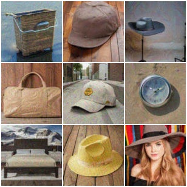
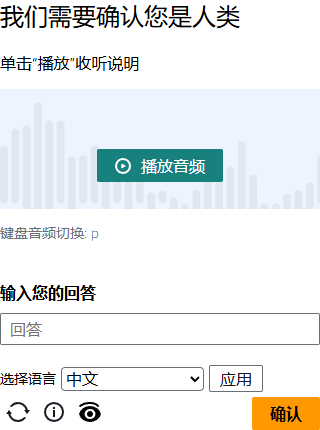

# Amazon AWS WAF — 样本、方法与求解器状态

> 厂商：Amazon AWS WAF | 来源：https://www.amazon.com/ | 类型：3 | 样本：24
>
> grid/token 不复制求解器结果；audio 12 组保留源 ASR 建议答案与 `result.json`，全部待人工审查。

## 一、类型总表

| 类型 | 中文 | 变体 | 样本 | 方法 | 求解器 / 源记录 | 审查 | 思路与说明 |
|---|---|---|---:|---|---|---|---|
| `grid` | 九宫格多选 | grid-5 | 12 | VLM | 有求解器（exists）· 高 | pending | 视觉 LLM 直接输出格子编号；无需训练检测器；源记录 30/30 离线、20/20 线上；待审 |
| `audio` | 音频听写 | noisyneighbour-en-us | 12 | ASR | 有求解器（exists）· 高 | pending | 说话人分离 + Whisper；无视觉 LLM；源记录 45/46 轮最终通过（61 次提交 45 成功）；待人工审查 |
| `token` | 指纹 / Token 挑战 | token | 0 | PROTO | 有求解器（exists）· 高 | pending | PoW/token 协议；无视觉模型；纯 HTTP token 链；无题面样本 |

> 方法标签：`CV`=传统视觉；`DET`=目标检测；`OCR`=文字识别；`VLM`=多模态 LLM；`ASR`=语音识别；`PROTO`=协议/枚举；`ACT`=行为/轨迹；`AUDIO`=音频信号；`NONE`=无求解器（括号内为建议路线）。VLM 无需训练数据、按调用计费，起步便宜；量大时 CV 更便宜，常见组合是 CV/OCR 先定位、VLM 只对分歧或语义点调用。

## 二、样本速览

每类取 1 组代表样本；完整样本见 `cases/amazon/`。

| 类型 | 方法 | 代表样本 | 样本数 |
|---|---|---|---:|
| `grid` | VLM |  | 12 |
| `audio` | ASR |  | 12 |
| `token` | PROTO | — | 0 |

### 音频题说明（noisyneighbour-en-us）

- 形态：背景旁白朗读文章，出题人同时念 `Type one of the two following words spoken by me.` + 两个英文单词；填任意一个即可。
- 媒体：16 kHz 立体声 AAC，约 9.8–11.8 秒；同一 widget 的耳机/眼睛图标在视觉与音频题之间切换。
- 12 组样本：01–12；ASR 建议答案在 `answer.txt` / `result.json`，**不是真值**。
- 两套 ASR 一致性：01/02/03/11 不一致（标 `low`）；006 无二次复核（标 `low`）；004/005/007/008/009/010/012 一致（标 `medium`）。
- 审查建议：直接听 `audio.aac`，或听源样本目录中的 `sep_src0.wav`（分离后的出题人轨），核对两个词后回填 `review`。

## 三、求解器与人工审查

> grid/token 不复制求解器结果；audio 12 组保留源 ASR 建议答案与 `result.json`，全部待人工审查。 审查通过/不通过由维护者后续回填。

### 有求解器、待人工审查（exists）

以下类型有求解器与源记录准确率，但本库未复制结果（或仅复制了明确标注的结果），等待人工审查。

| 类型 | 样本 | 方法 | 准确率（源记录） | 说明 |
|---|---:|---|---|---|
| `grid` | 12 | VLM | 高 | 视觉 LLM 直接输出格子编号；无需训练检测器；源记录 30/30 离线、20/20 线上；待审 |
| `audio` | 12 | ASR | 高 | 说话人分离 + Whisper；无视觉 LLM；源记录 45/46 轮最终通过（61 次提交 45 成功）；待人工审查 |
| `token` | 0 | PROTO | 高 | PoW/token 协议；无视觉模型；纯 HTTP token 链；无题面样本 |

## 四、来源

来源：Amazon AWS WAF 公开挑战页（amazon.com 等）与 wuxuwang 公开音频题页 <https://www.wuxuwang.com/yljg>。grid 采集于 2026-11-01；audio 采集于 2026-11-07。样本版权归 Amazon 所有。
