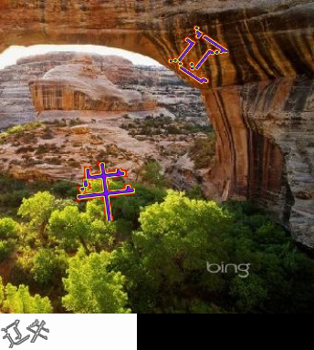
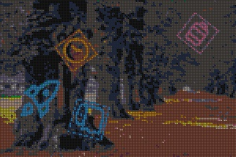

# 哔哩哔哩 B站 — 厂商索引

> 站点：哔哩哔哩 B站 | 来源：<https://passport.bilibili.com/login> | 2 个类型（均有案例）| 18 组案例
>
> B站登录验证码由极验 GeeTest 提供：文字点选为 v3 `word`（2026-07 历史样本，v3 已不再下发图片），图标点选为 v4 `icon-pixel`（2026-11 现行）。本库只覆盖图面与离线求解，不含接口调用与提交实现。
>
> 返回 [README](../README.md) · [全量类型](types.md) · [方法论](00-methodology.md) · 详细内容在类型页（下方第 8 列）。

## 一、厂商概览

B站登录页接入极验 GeeTest。本库按「极验代际 + 站点渲染」拆成两类：v3 `word` 文字点选（历史样本）与 v4 `icon-pixel` 图标点选（现行）。两类都不是极验官方 demo 的默认样式：文字点选是合成图 + 底部提示条，图标点选是 B站定制的像素画 + 空心描边渲染，因此求解链要按站点重写。

建议阅读顺序：

- 先看 [text-click 类型页](../cases/bilibili/text-click/README.md)，了解 v3 的 YOLO + Siamese 路线与停发原因；
- 再看 [icon-click 类型页](../cases/bilibili/icon-click/README.md)，了解 v4 的 2×2 网点还原、Lab k-means、描边旋转 IoU 与审查状态（12 通过）；
- 需要极验官方 demo 的四类对照，跳到 [极验索引](geetest.md)。

两类都是 `CV`，均未使用多模态 LLM；`evidence` 为 `offline` / `manual-review`，没有线上提交。

## 二、类型总表

| 类型 | 中文 | 变体 | 样本 | 方法 | 求解器 / 源记录 | 审查 | 说明与详情 |
|---|---|---|---:|---|---|---|---|
| `text-click` | 文字点选 | geetest-v3/word | 6 | CV | 有求解器（exists）· 高 | 6 通过 | 344×384 图，底线提示 2–4 字；YOLO 字符检测 + Siamese 匹配 + 贪心分配。v3 已不再下发 `pic/pic_type`，无法复采。[类型页](../cases/bilibili/text-click/README.md) |
| `icon-click` | 图标点选 | geetest-v4/icon-pixel | 12 | CV | 有求解器（exists）· 中（7 组人工复核） | 12 通过 | 300×200 像素画 + 3 图标；2×2 网点 `bg[1::2,1::2]` 还原、Lab k-means、描边旋转 IoU，启发式；5 组直接命中、7 组人工/VLM 修正。[类型页](../cases/bilibili/icon-click/README.md) |

> 方法标签：`CV`=传统视觉（含 YOLO 检测与 Siamese 匹配）。准确率一律为**源记录**；审查统计按案例 `meta.review` 现算（截至 2026-11-21）。本表保持 8 列，viewer 依赖第 4 列样本数与第 8 列链接。

## 三、代表样本

每类取 1 组，点击图片或「详情」进入类型页；完整样本见 `cases/bilibili/`。

| 类型 | 方法 | 代表样本 | 详情 |
|---|---|---|---|
| `text-click` | CV |  | [详情](../cases/bilibili/text-click/README.md) |
| `icon-click` | CV |  | [详情](../cases/bilibili/icon-click/README.md) |

## 四、厂商级结论

- **题型由极验换代决定**：v3 `word` 时代留下 6 组文字点选；2026-11-21 复测，v3 配置接口仍返回 `gt/challenge`，但 `/get.php` 不再下发 `pic/pic_type`，文字点选已无法复采。当前 v4 只出图标点选。
- **v4 的 `risk_type` 无效**：B站 captcha_id `a431eaf5e5dadd28bc0553c29682bd4b` 的 `/load` 对 `risk_type`（word/click/icon/slide/winlinze/match/ai/nine/obstacle）、`client_type`、`pt`、`lang` 全组合都返回 `captcha_type=icon`、`captcha_mode=adaptive`；题型由服务端策略固定。
- **B站渲染与官方 demo 不同**：背景是 150×100 像素画按 2×2 放大（仅绝对奇行奇列保留原色，其余压暗约 55%），取 `bg[1::2,1::2]` 可还原清晰图（源记录 30/30 组验证）；图标是单色空心描边、随机旋转，90 张模板中 28 张自带画布边框；背景还有题面之外的图标状干扰图形。官方 demo 的颜色连通 + chamfer 链不能直接复用。
- **求解器状态**：text-click 离线 6/6，review 6 通过；icon-click 自动求解 5/12 直接命中，另 7 组（004–008/010/012）经人工/VLM 复核修正后 review **12 通过**；近色描边、带框模板、干扰图形和形状相近仍是结构性边界，不能把 12/12 当自动求解器命中率。text-click 的 `evidence` 全部为 `offline`；icon-click 为 `offline` 5 组 + `manual-review` 7 组。两类都没有线上提交记录。
- **方法成本**：两类都是纯 CPU 的传统 CV；text-click 需要两个 ONNX 模型（检测 + Siamese），icon-click 只需颜色聚类 + 形状匹配；都没有调用 LLM。
- **样本用途**：6 组 v3 只能用于回顾历史题型；12 组 v4 用于观察站点定制渲染，不代表完整题面空间。
- **证据边界**：`review` 是对离线点击位置的核对，不是线上通过率；不要拿页面统计当 B站服务端的接受率。

## 五、采集与复采状态

- **文字点选**：2026-07-03 采集 6 组。2026-11-21 复测确认 v3 `/get.php` 不再下发 `pic/pic_type`，无法复采；这 6 组是历史样本。
- **图标点选**：2026-11-21 采集 30 组，本库收录 12 组（001–012）。`/load` 对 `risk_type` 等参数全组合都返回 `icon`，题型固定；可继续采集同类样本。
- **保存内容**：两类都只有题面、目标图、`answer.txt`、`result.json` 与结果图，没有原始接口报文、轨迹或提交记录。
- **扩充方式**：只能等 v4 服务端策略变化或重新采集 v4 样本；本库不记录绕过方式，也不保证旧样本在线上仍可复现。

> 口径：`review` 统计按案例 `meta.review` 现算，准确率一律为源记录；统计截至 2026-11-21，以 `meta.json` 为准。

## 六、来源与版权

来源：<https://passport.bilibili.com/login>（B站登录入口，极验 GeeTest v3/v4）。文字点选采集于 2026-07-03，图标点选采集于 2026-11-21；样本版权归哔哩哔哩/极验所有，仅用于研究与教学展示。统计截至 2026-11-21，以案例 `meta.json` 为准。
