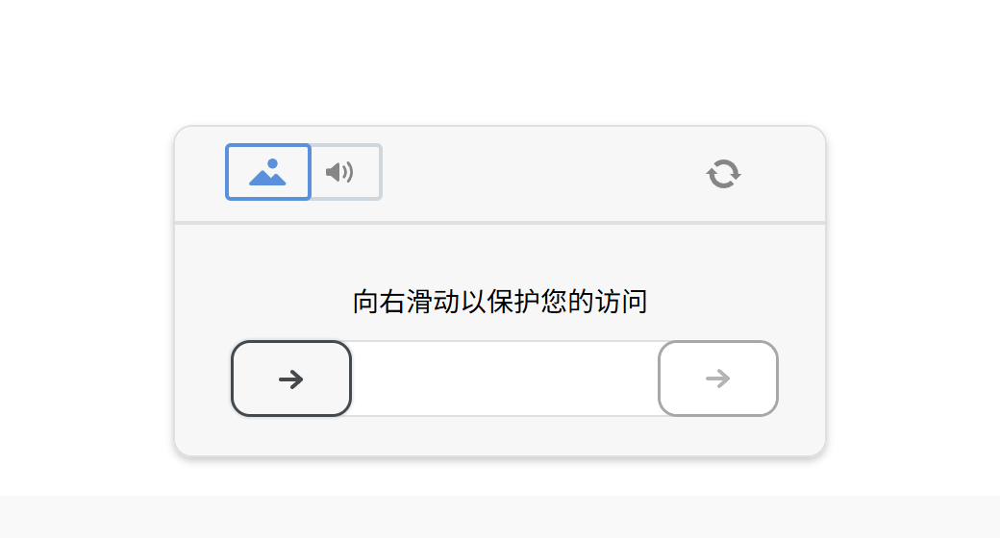

# DataDome — 厂商索引

> 厂商：DataDome | 来源：<https://www.klook.com/> | 2 个类型（均有案例）| 13 组案例
>
> 反爬/风控厂商，本库收录两条线：`audio` 六位数字听写（AUDIO+ASR，源方案 20/20）与 `slide` 无图滑块（实际为 `noPuzzle`，NONE(CV)，仅 1 组机制样本）。
>
> 返回 [README](../README.md) · [全量类型](types.md) · [方法论](00-methodology.md) · 详细内容在类型页（下方表内链接）。

## 一、类型总表

| 类型 | 中文 | 变体 | 样本 | 方法 | 求解器 / 源记录 | 审查 | 说明与详情 |
|---|---|---|---:|---|---|---|---|
| `audio` | 音频听写 | digits（6 位） | 12 | AUDIO+ASR | 有求解器（exists）· 高 | pending 12 | 音频 DSP 模板 1-NN；Whisper 仅标注/复核；源记录 20/20。[类型页](../cases/datadome/audio/README.md) |
| `slide` | 滑动验证 | simple/noPuzzle | 1 | NONE(CV) | 无求解器（none）· 未知 | not-applicable 1 | 无图滑块，拖到右端；仅有机制说明，无提交闭环。[类型页](../cases/datadome/slide/README.md) |

> 方法标签：`CV`=传统视觉；`DET`=目标检测；`OCR`=文字识别；`VLM`=多模态 LLM；`ASR`=语音识别；`PROTO`=协议/枚举；`ACT`=行为/轨迹；`AUDIO`=音频信号；`NONE`=无求解器（括号内为建议路线）。准确率一律为**源记录**，不代表本库已复核；审查统计按案例 `meta.review` 现算（截至 2026-11-21）。

## 二、方法重点

- **音频优先**：`audio` 的源方案是音频 DSP 模板 1-NN，Whisper 只做标注/复核；不是「Whisper 一把梭」。
- **形态稳定**：12 组都是 16 kHz / 单声道 / 16-bit WAV，时长 15.88–17.56 s；源目录名 `audio-6digit` 表明 6 位数字。
- **滑动线不是缺口题**：唯一样本是 `noPuzzle`，没有背景图/拼图块，目标框固定在轨道右端；`meta.prompt` 的「拼图块补入缺口」与实际界面不符。
- **无提交闭环**：两条线都没有线上通过记录；`audio` 是 `unverified`，`slide` 是 `sample-only`。
- **结果口径**：源记录 20/20 只属于音频线，不能外推到滑动线，也不能当成本库复算结果。

## 三、类型页导读

| 类型 | 类型页重点 |
|---|---|
| `audio` | WAV 属性、6 位数字、DSP 切分与 1-NN、Whisper 辅助、无逐组真值 |
| `slide` | noPuzzle 真实界面、轨道终点、`aux` 机制说明、单样本与无闭环 |

## 四、代表样本

每类取 1 组，点击「详情」进入类型页；完整样本见 `cases/datadome/`。

| 类型 | 方法 | 代表样本 | 详情 |
|---|---|---|---|
| `audio` | AUDIO+ASR | 音频样本（`001/audio.wav`，16 kHz 单声道，无缩略图） | [详情](../cases/datadome/audio/README.md) |
| `slide` | NONE(CV) |  | [详情](../cases/datadome/slide/README.md) |

## 五、厂商级结论

- **音频线是唯一有源结果的分支**：12 组样本齐全、格式一致；但本库没有逐组答案，审查仍是 `pending`，证据只能记 `unverified`。
- **滑动线信息量很低**：只有 1 组 noPuzzle 截图和 1 张人工说明图；能确认「拖到右端」的交互，不能确认轨迹或通过条件。
- **不要混淆两条线**：音频是听写，滑动是行为交互；方法、答案格式和失败模式完全不同。
- **难点**：音频切分/数字混淆、滑动轨迹与风控；源记录没有给出失败样本或参数细节。
- **后续优先**：给音频补逐组真值，给滑动补真实提交闭环；在两者完成前不做效果宣称。

## 六、审查与证据

| 类型 | 样本 | 求解器 | 审查 | 证据等级 |
|---|---:|---|---|---|
| `audio` | 12 | exists · 高 | pending 12 | unverified（无逐组答案） |
| `slide` | 1 | none · 未知 | not-applicable 1 | sample-only |

> 音频线有源记录 20/20，但本库没有逐组真值；滑动线只有机制说明，没有提交结果。两条线都不能写成「已通过」。

## 七、使用建议

- 音频复现先看类型页第 3 节的 WAV 属性与第 5 节的切分/模板步骤；源参数未展开，不能照抄 20/20。
- 滑动线不要套缺口检测：本组是 `noPuzzle`，没有背景图与拼图块；先读类型页第 2 节的口径提醒。
- 引用数据时以 `meta.json` 为准；源记录准确率一律标「源记录」，审查统计截至 2026-11-21。
- 需要提交闭环时，先补轨迹/会话记录，再更新 `review` 与证据等级。

## 八、来源

来源：<https://www.klook.com/>。样本采集日期见各案例 `meta.json`（`audio` 为 `unknown`）；样本版权归 DataDome 所有，仅用于研究与教学展示。
