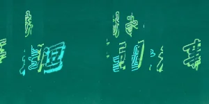
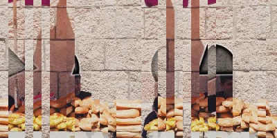
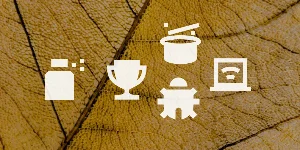
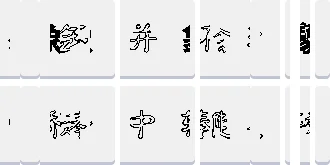
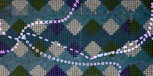
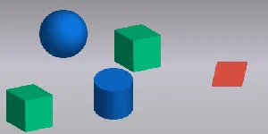

# 顶象 — 厂商索引

> 厂商：顶象 | 来源：<https://www.dingxiang-inc.com/business/captcha> | 13 个类型（全部有案例）| 156 组案例
>
> 题型覆盖滑块、文字/图标/差异点选、拼图、还原、旋转、面积、字体、空间推理、语序与语音。方法以 **CV 为主**；文字点选用 YOLO + 视觉模型四视角投票，已做到 12/12 实机 `live-pass`；语音与语序尚未解。
>
> 返回 [README](../README.md) · [全量类型](types.md) · [方法论](00-methodology.md) · 详细内容在类型页（下方表内链接）。

## 一、类型总表

| 类型 | 中文 | 变体 | 样本 | 方法 | 求解器 / 源记录 | 审查 | 说明与详情 |
|---|---|---|---:|---|---|---|---|
| `text-click` | 文字点选 | classic | 12 | CV+VLM | 有求解器（exists）· 高（发布 12/12 live-pass） | 12 通过（001/012 待重审） | YOLO best_v3 多尺度检测 + 四视角投票（权重 2/1/2/1）+ direct 兜底。[类型页](../cases/dingxiang/text-click/README.md) |
| `slide` | 滑动拼图 | classic | 12 | CV | 有求解器（exists）· 高 | 12 通过 | 400×200 背景条带还原 + Canny 候选 + 色差斑块 + Sobel 精修；无 LLM。[类型页](../cases/dingxiang/slide/README.md) |
| `scratch` | 刮刮卡 | classic | 12 | CV+DET | 有求解器（exists）· 未知（离线 12/12） | 12 通过 | U²-Netp 显著分割 + 完整轮廓 + 30×15 最小刮擦位图；未实机提交。[类型页](../cases/dingxiang/scratch/README.md) |
| `icon-click` | 图标点选 | classic | 12 | CV+VLM | 有求解器（exists）· 高（IoU 0.90–0.97） | 12 通过 | 白色图标多尺度模板匹配；LLM whole1x 有落空风险，whole3x 仅对照。[类型页](../cases/dingxiang/icon-click/README.md) |
| `diff-click` | 差异点击 | classic | 12 | CV | 有求解器（exists）· 高（12/12 IoU） | 12 通过 | 4 个同源图形找 1 个差异；Canny 墨迹掩膜平移对齐 IoU 离群；无逐组分离度。[类型页](../cases/dingxiang/diff-click/README.md) |
| `font` | 字体识别 | classic | 12 | CV | 有求解器（exists）· 高（源记录） | 12 通过 | 8 张字卡 4×2；风格特征 + 稳健离群；`notes` 与 `solver` 口径冲突。[类型页](../cases/dingxiang/font/README.md) |
| `jigsaw` | 乱序拼图 | classic | 12 | CV | 有求解器（exists）· 高（12/12） | 12 通过 | 2×2 四块换位；切缝 + 半边 + 阴影先验；24 种排列搜索。[类型页](../cases/dingxiang/jigsaw/README.md) |
| `area` | 面积验证 | classic | 12 | CV | 有求解器（exists）· 高（源记录） | 12 通过 | K-Means + Watershed 切区域后按面积选点；结果未纳入。[类型页](../cases/dingxiang/area/README.md) |
| `slide-restore` | 滑动还原 | classic | 12 | CV | 有求解器（exists）· 高（源记录） | 12 通过 | 水平接缝窄带匹配 + 接缝裁决；`notes` 称求解器未写。[类型页](../cases/dingxiang/slide-restore/README.md) |
| `spatial` | 空间推理 | classic | 12 | CV | 有求解器（exists）· 高（总表 12/12 / 类型表 —） | 12 通过 | 6 族指令；受光比平面/立体判别 + 字形匹配；无 LLM。[类型页](../cases/dingxiang/spatial/README.md) |
| `rotate` | 旋转验证 | classic | 12 | NONE(CV+VLM) | 无求解器（none）· 未知 | 12 通过（无求解器） | 圆形补片旋入黑洞；建议 CV 角度估计 + VLM 兜底。[类型页](../cases/dingxiang/rotate/README.md) |
| `voice` | 语音验证 | classic | 12 | NONE(ASR) | 无求解器（none）· 未知 | not-applicable | 仅 mp3（22.05 kHz 单声道，14.66–17.51 s）；建议 ASR；无转写。[类型页](../cases/dingxiang/voice/README.md) |
| `word-order` | 语序点选 | classic | 12 | NONE(OCR+VLM) | 无求解器（none）· 未知 | not-applicable | 4 个毛笔字排语序；建议 OCR + VLM；无答案落盘。[类型页](../cases/dingxiang/word-order/README.md) |

> 方法标签：`CV`=传统视觉；`DET`=目标检测；`OCR`=文字识别；`VLM`=多模态 LLM；`ASR`=语音识别；`NONE`=无求解器（括号内为建议路线）。准确率一律为**源记录**，不代表本库已复核；审查统计按案例 `meta.review` 现算（截至 2026-11-21，以案例 meta 为准）。
>
> 分档说明：`text-click`、`slide`、`scratch` 有逐组结果图，写 A 档详解；`area`、`font`、`slide-restore` 等源记录只有方法摘要，写 B 档步骤页；`rotate`、`voice`、`word-order` 无求解器，写 C 档短页。

## 二、代表样本

每类取 1 组，点击图片或「类型页」进入详解；完整样本见 `cases/dingxiang/`。

| 类型 | 方法 | 代表样本 | 详情 |
|---|---|---|---|
| `text-click` | CV+VLM |  | [类型页](../cases/dingxiang/text-click/README.md) |
| `slide` | CV |  | [类型页](../cases/dingxiang/slide/README.md) |
| `scratch` | CV+DET |  | [类型页](../cases/dingxiang/scratch/README.md) |
| `icon-click` | CV+VLM |  | [类型页](../cases/dingxiang/icon-click/README.md) |
| `diff-click` | CV |  | [类型页](../cases/dingxiang/diff-click/README.md) |
| `font` | CV |  | [类型页](../cases/dingxiang/font/README.md) |
| `jigsaw` | CV |  | [类型页](../cases/dingxiang/jigsaw/README.md) |
| `area` | CV |  | [类型页](../cases/dingxiang/area/README.md) |
| `slide-restore` | CV |  | [类型页](../cases/dingxiang/slide-restore/README.md) |
| `spatial` | CV |  | [类型页](../cases/dingxiang/spatial/README.md) |
| `rotate` | NONE(CV+VLM) |  | [类型页](../cases/dingxiang/rotate/README.md) |
| `voice` | NONE(ASR) | 音频无图（[audio.mp3](../cases/dingxiang/voice/001/audio.mp3)） | [类型页](../cases/dingxiang/voice/README.md) |
| `word-order` | NONE(OCR+VLM) |  | [类型页](../cases/dingxiang/word-order/README.md) |

## 三、厂商级结论

- **强项**：`text-click` 是 13 类中唯一有 `live-pass` 的类型，12 组均为 2026-11-19 实机 `verify success` 样本（001/012 的结果图待重审）；`slide`、`scratch` 有 `offline-verified` 的 12 组结果图，是 CV 路线的两个完整样本。
- **CV 可解族**：`icon-click` 白色图标模板匹配 IoU 0.90–0.97；`diff-click` 4 图形找 1 差异，12/12 IoU；`jigsaw` 三信号 2×2 排列 12/12；`font`、`area`、`slide-restore`、`spatial` 也有源记录，但只给方法摘要。
- **未解族**：`rotate`（圆形补片旋转）、`voice`（纯音频）、`word-order`（4 字语序）均为 `none`；`rotate` 有结果图但没有角度，`voice` 没有转写，`word-order` 只有顺序标注。
- **典型失败模式**：条带错位不还原就匹配（slide/diff-click/font/word-order）；相似字形/图标靠单一阈值（font/icon-click）；低纹理接缝多峰（slide-restore/jigsaw）；平面/立体只按颜色判断（spatial）。
- **证据边界**：只有 `text-click` 是 `live-pass`，`slide`/`scratch` 是 `offline-verified`；其余 10 类没有 `meta.evidence` 字段，其中 8 类 `review=pass` 针对标注图/结果图，`voice`/`word-order` 为 `not-applicable`。引用数字时必须标“源记录”。

## 四、来源

来源：<https://www.dingxiang-inc.com/business/captcha>。样本采集日期见各案例 `meta.json`；样本版权归顶象所有，仅用于研究与教学展示。
