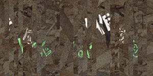
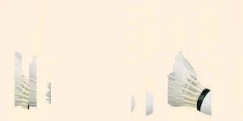
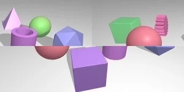
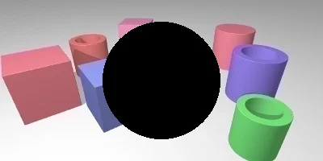
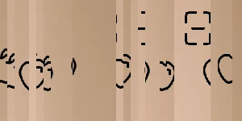
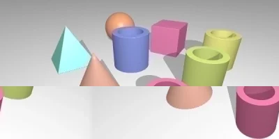

# 顶象 — 样本、方法与求解器状态

> 厂商：顶象 | 来源：https://www.dingxiang-inc.com/business/captcha | 类型：13 | 样本：156
>
> 本页只记录求解器状态，不复制源求解器结果；`review.state` 初始为 `pending` 或 `not-applicable`，审查结果留空待回填。

## 一、类型总表

| 类型 | 中文 | 变体 | 样本 | 方法 | 求解器 / 源记录 | 审查 | 思路与说明 |
|---|---|---|---:|---|---|---|---|
| `slide` | 滑动拼图 | classic | 12 | CV | 有求解器（exists）· 高 | pending | 背景还原 + Canny 候选 + 色差斑块判别 + Sobel 梯度精修；无 LLM；结果已纳入，待人工审查 |
| `text-click` | 文字点选 | classic | 12 | VLM | 有求解器（exists）· 高 | pending | DeepSeek 视觉多视角投票直接坐标；DeepSeek 视觉多视角投票，类型表称实机验证；总表称待做；待审 |
| `icon-click` | 图标点选 | classic | 12 | CV+VLM | 有求解器（exists）· 高 | pending | 多尺度模板匹配 + LLM 校验；VLM 用于兜底；多尺度模板匹配；待审 |
| `word-order` | 语序点选 | classic | 12 | NONE(OCR+VLM) | 无求解器（none）· 未知 | not-applicable | 未撰写；建议 OCR + VLM 语序 |
| `scratch` | 刮刮卡 | classic | 12 | CV | 部分攻克（partial）· 未知 | pending | 背景还原/刮刮卡区域；无 LLM；源记录冲突：总表称已攻克，类型表称仅背景还原；待审 |
| `spatial` | 空间推理 | classic | 12 | CV | 有求解器（exists）· 高 | pending | 受光比平面/立体判别 + 字形匹配；无 LLM；源总表称 12/12，类型表标 —；待人工审查 |
| `jigsaw` | 乱序拼图 | classic | 12 | CV | 有求解器（exists）· 高 | pending | 切缝 + 半边 + 阴影先验；无 LLM；三信号切缝+阴影先验，12/12；待审 |
| `rotate` | 旋转验证 | classic | 12 | NONE(CV+VLM) | 无求解器（none）· 未知 | not-applicable | 未撰写；建议 CV 角度估计 + VLM 兜底 |
| `area` | 面积验证 | classic | 12 | CV | 有求解器（exists）· 高 | pending | K-Means + Watershed；无 LLM；源记录已攻克；待审 |
| `diff-click` | 差异点击 | classic | 12 | CV | 有求解器（exists）· 高 | pending | Canny + SSIM 离群；无 LLM；源记录已攻克；待审 |
| `voice` | 语音验证 | classic | 12 | NONE(ASR) | 无求解器（none）· 未知 | not-applicable | 未撰写；建议 ASR |
| `font` | 字体识别 | classic | 12 | CV | 有求解器（exists）· 高 | pending | 风格特征 + 稳健离群；无 LLM；风格特征 + 稳健离群；类型表称已攻克；待审 |
| `slide-restore` | 滑动还原 | classic | 12 | CV | 有求解器（exists）· 高 | pending | 窄带匹配 + 接缝裁决；无 LLM；窄带匹配 + 接缝裁决；类型表称已攻克；待审 |

> 方法标签：`CV`=传统视觉；`DET`=目标检测；`OCR`=文字识别；`VLM`=多模态 LLM；`ASR`=语音识别；`PROTO`=协议/枚举；`ACT`=行为/轨迹；`AUDIO`=音频信号；`NONE`=无求解器（括号内为建议路线）。VLM 无需训练数据、按调用计费，起步便宜；量大时 CV 更便宜，常见组合是 CV/OCR 先定位、VLM 只对分歧或语义点调用。

## 二、样本速览

每类取 1 组代表样本；完整样本见 `cases/dingxiang/`。

| 类型 | 方法 | 代表样本 | 样本数 |
|---|---|---|---:|
| `slide` | CV |  | 12 |
| `text-click` | VLM |  | 12 |
| `icon-click` | CV+VLM |  | 12 |
| `word-order` | NONE(OCR+VLM) |  | 12 |
| `scratch` | CV |  | 12 |
| `spatial` | CV |  | 12 |
| `jigsaw` | CV |  | 12 |
| `rotate` | NONE(CV+VLM) |  | 12 |
| `area` | CV |  | 12 |
| `diff-click` | CV |  | 12 |
| `voice` | NONE(ASR) | 音频/无图（见案例目录） | 12 |
| `font` | CV |  | 12 |
| `slide-restore` | CV |  | 12 |

## 三、求解器与人工审查

> 本库只记录求解器状态，不复制源求解器结果。 审查通过/不通过由维护者后续回填。

### 无求解器（none）

以下类型没有撰写求解器，仅为样本收录。原因包括未尝试、仅采集、优先级低、能力不足或未完成；具体以说明为准。

| 类型 | 样本 | 方法 | 准确率（源记录） | 说明 |
|---|---:|---|---|---|
| `word-order` | 12 | NONE(OCR+VLM) | 未知 | 未撰写；建议 OCR + VLM 语序 |
| `rotate` | 12 | NONE(CV+VLM) | 未知 | 未撰写；建议 CV 角度估计 + VLM 兜底 |
| `voice` | 12 | NONE(ASR) | 未知 | 未撰写；建议 ASR |

### 部分攻克 / 部分进展（partial）

以下类型有部分进展：图像/答案已解但提交未通，或只完成前置还原/检测；线上通过率不能按离线准确率计算。

| 类型 | 样本 | 方法 | 准确率（源记录） | 说明 |
|---|---:|---|---|---|
| `slide` | 12 | CV | 高 | 背景还原 + Canny 候选 + 色差斑块 + 梯度精修；无 LLM；结果已纳入，待人工审查 |
| `scratch` | 12 | CV | 未知 | 背景还原/刮刮卡区域；无 LLM；源记录冲突：总表称已攻克，类型表称仅背景还原；待审 |

### 有求解器、待人工审查（exists）

以下类型有求解器与源记录准确率，但本库未复制结果（或仅复制了明确标注的结果），等待人工审查。

| 类型 | 样本 | 方法 | 准确率（源记录） | 说明 |
|---|---:|---|---|---|
| `text-click` | 12 | VLM | 高 | DeepSeek 视觉多视角投票直接坐标；DeepSeek 视觉多视角投票，类型表称实机验证；总表称待做；待审 |
| `icon-click` | 12 | CV+VLM | 高 | 多尺度模板匹配 + LLM 校验；VLM 用于兜底；多尺度模板匹配；待审 |
| `spatial` | 12 | CV | 高 | 受光比平面/立体判别 + 字形匹配；无 LLM；源总表称 12/12，类型表标 —；待人工审查 |
| `jigsaw` | 12 | CV | 高 | 切缝 + 半边 + 阴影先验；无 LLM；三信号切缝+阴影先验，12/12；待审 |
| `area` | 12 | CV | 高 | K-Means + Watershed；无 LLM；源记录已攻克；待审 |
| `diff-click` | 12 | CV | 高 | Canny + SSIM 离群；无 LLM；源记录已攻克；待审 |
| `font` | 12 | CV | 高 | 风格特征 + 稳健离群；无 LLM；风格特征 + 稳健离群；类型表称已攻克；待审 |
| `slide-restore` | 12 | CV | 高 | 窄带匹配 + 接缝裁决；无 LLM；窄带匹配 + 接缝裁决；类型表称已攻克；待审 |

## 四、来源

来源：https://www.dingxiang-inc.com/business/captcha。样本采集日期见各案例 `meta.json`；样本版权归厂商所有，仅用于研究与教学展示。
