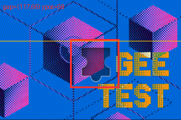
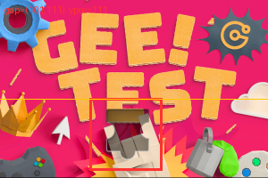
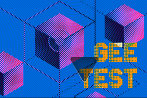
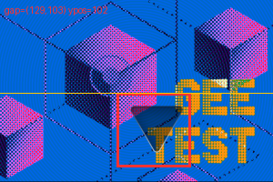
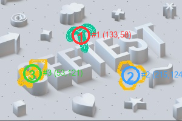
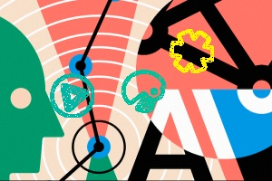
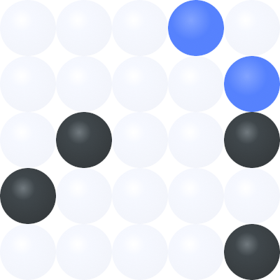
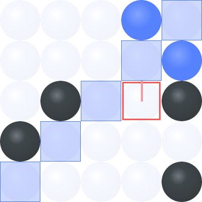
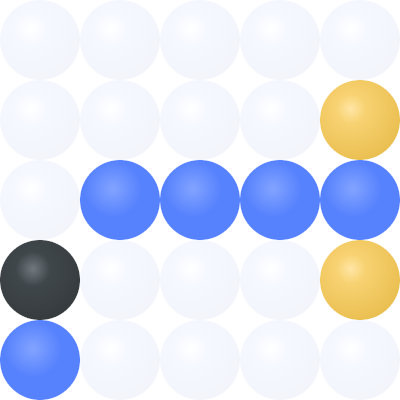
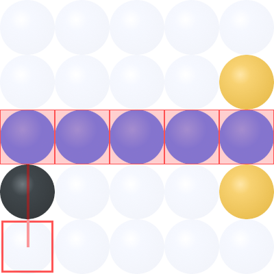

# 极验 GeeTest — 验证码形态与求解思路

> 厂商：极验 GeeTest | 来源：官方 demo | 规范化类型：4 | 案例：48 | 证据：仅离线验证，无线上通过记录
>
> **审查状态**：本页答案均来自源求解器，`review.state = pending`；准确率以源记录为准，尚未经人工复核。审查结果后续逐例回填。
>
> **方法标签**：`CV`=传统视觉；`PROTO`=协议/枚举。本页四类均未使用多模态 LLM。

## 一、厂商与产品线

极验 GeeTest v4 自适应验证码，官方 demo 提供 slide、icon、gobang、iconcrush 四类题。四类的共同点是：题面由题面接口下发，答案空间由接口字段直接决定（`ypos`、`ques`、`board`），因此图像线之外还有很强的“读接口字段”成分。

本库只记录题面形态、答案与求解思路，不包含接口调用、参数构造或提交实现。

## 二、类型总表

| 类型 | 中文 | 交互 | 媒体 | 方法 | 案例 | 状态 | 证据 | 说明 |
|---|---|---|---|---|---:|---|---|---|
| `slide` | 滑动拼图 | 拖动 | 图 | `CV` | 12 | 待审 12 | offline 12 | 缺口定位，`ypos` 由接口给定 |
| `icon-click` | 图标点选 | 点击 | 图 | `CV` | 12 | 待审 12 | offline 9 / unverified 3 | 3 个图标按顺序点击 |
| `gobang` | 五子棋 | 交换 | 图 | `PROTO` | 12 | 待审 12 | offline 12 | 5×5 棋盘，交换成五连 |
| `icon-crush` | 图标消除 | 交换 | 图 | `PROTO` | 12 | 待审 12 | offline 12 | 3×3 棋盘，交换成三连 |

## 三、类型逐一拆解

### 3.1 slide — 滑动拼图

#### 形态与通过条件

300×200 背景图，80×80 拼接块。服务端给出缺口顶部 `ypos`，用户拖动滑块把拼图块补进缺口；校验的是水平位移与纵向对齐。

#### 求解思路

缺口像素与拼图块颜色并不一致，纯色/SSD/NCC 像素匹配得分很低；有效的是 **Canny 边缘 + 归一化互相关模板匹配**：拼图块的 alpha 轮廓与缺口边界形状一致，用边缘图匹配更稳。`ypos` 直接取 API 值，只解 X。

**方法标签：`CV`（Canny + NCC）**；未使用多模态 LLM，单次成本最低，适合大量重复题。

#### 代表案例

| 样本 | 标注 | 答案 |
|---|---|---|
|  |  | [001](../cases/geetest/slide/001/)：gap_x=117, gap_y=66, ypos=68 |
|  |  | [002](../cases/geetest/slide/002/)：gap_x=101, gap_y=111, ypos=111 |
|  |  | [004](../cases/geetest/slide/004/)：gap_x=129, gap_y=103, ypos=102 |

#### 12 组案例

| # | 答案 | 证据 | 置信度 |
|---|---|---|---|
| [001](../cases/geetest/slide/001/) | gap_x=117, gap_y=66, ypos=68 | offline-verified | high |
| [002](../cases/geetest/slide/002/) | gap_x=101, gap_y=111, ypos=111 | offline-verified | high |
| [003](../cases/geetest/slide/003/) | gap_x=101, gap_y=24, ypos=23 | offline-verified | high |
| [004](../cases/geetest/slide/004/) | gap_x=129, gap_y=103, ypos=102 | offline-verified | high |
| [005](../cases/geetest/slide/005/) | gap_x=188, gap_y=36, ypos=40 | offline-verified | high |
| [006](../cases/geetest/slide/006/) | gap_x=184, gap_y=99, ypos=97 | offline-verified | high |
| [007](../cases/geetest/slide/007/) | gap_x=133, gap_y=93, ypos=94 | offline-verified | high |
| [008](../cases/geetest/slide/008/) | gap_x=132, gap_y=99, ypos=102 | offline-verified | high |
| [009](../cases/geetest/slide/009/) | gap_x=190, gap_y=22, ypos=24 | offline-verified | high |
| [010](../cases/geetest/slide/010/) | gap_x=110, gap_y=51, ypos=52 | offline-verified | high |
| [011](../cases/geetest/slide/011/) | gap_x=127, gap_y=59, ypos=62 | offline-verified | high |
| [012](../cases/geetest/slide/012/) | gap_x=116, gap_y=67, ypos=69 | offline-verified | high |

#### 难点与边界

缺口边缘被背景纹理淹没时匹配分下降；`ypos` 容差约 ±4px；缩放/显示尺寸变化会让坐标偏移，需固定坐标系。

**实测数据**：源方案离线 12/12，Δy ≤ 4px；本库 12 组全部 `offline-verified`，无线上提交记录。

### 3.2 icon-click — 图标点选

#### 形态与通过条件

300×200 主题背景图 + 3 个 48×48 图标。用户按图标列表顺序，在背景中依次点击对应位置。

题目图标示例（顺序 1→3）：

#### 求解思路

先在背景中分割“纯色实心区域”（颜色连通域），再取区域轮廓做距离变换；把每个图标的 alpha 外轮廓按 72 个旋转角做 chamfer 匹配；最后用匈牙利指派保证 3 个图标各占一个不同区域，点击点取区域质心。

**方法标签：`CV`（颜色连通 + 轮廓 chamfer + 匈牙利）**；未使用多模态 LLM。

#### 代表案例

| 样本 | 标注 | 答案 |
|---|---|---|
|  |  | [001](../cases/geetest/icon-click/001/)：1:(133,58); 2:(215,124); 3:(53,121) |
|  |  | [002](../cases/geetest/icon-click/002/)：1:(174,29); 2:(113,164); 3:(25,99) |
|  |  | [004](../cases/geetest/icon-click/004/)：1:(80,106); 2:(156,106); 3:(211,56) |

#### 12 组案例

| # | 答案 | 证据 | 置信度 |
|---|---|---|---|
| [001](../cases/geetest/icon-click/001/) | 1:(133,58); 2:(215,124); 3:(53,121) | unverified | medium |
| [002](../cases/geetest/icon-click/002/) | 1:(174,29); 2:(113,164); 3:(25,99) | offline-verified | high |
| [003](../cases/geetest/icon-click/003/) | 1:(126,160); 2:(128,29); 3:(53,63) | offline-verified | medium |
| [004](../cases/geetest/icon-click/004/) | 1:(80,106); 2:(156,106); 3:(211,56) | offline-verified | high |
| [005](../cases/geetest/icon-click/005/) | 1:(255,77); 2:(110,25); 3:(134,81) | offline-verified | medium |
| [006](../cases/geetest/icon-click/006/) | 1:(140,121); 2:(113,97); 3:(39,75) | unverified | medium |
| [007](../cases/geetest/icon-click/007/) | 1:(226,135); 2:(69,61); 3:(244,160) | offline-verified | high |
| [008](../cases/geetest/icon-click/008/) | 1:(29,33); 2:(244,44); 3:(121,89) | offline-verified | high |
| [009](../cases/geetest/icon-click/009/) | 1:(235,64); 2:(24,163); 3:(202,115) | unverified | medium |
| [010](../cases/geetest/icon-click/010/) | 1:(39,61); 2:(173,92); 3:(130,78) | offline-verified | medium |
| [011](../cases/geetest/icon-click/011/) | 1:(173,92); 2:(185,43); 3:(50,46) | offline-verified | medium |
| [012](../cases/geetest/icon-click/012/) | 1:(158,127); 2:(211,88); 3:(77,66) | offline-verified | high |

#### 难点与边界

图标可能与场景色带几乎同色而被并入背景；图标可能被画幅裁剪、相互重叠；场景中可能有形状相似的干扰物。

**实测数据**：源方案在可验证集上 23/27 ≈ 85%（±20px 计命中）；本库 5 组 `offline-verified`、4 组部分命中、3 组无真值（`unverified`）。

### 3.3 gobang — 五子棋

#### 形态与通过条件

5×5 棋盘，5 种棋子（`img0`–`img4`）。用户交换两个棋子，使同色棋子横/纵/斜五连。

#### 求解思路

棋盘矩阵由 API 的 `ques` 给出，答案空间很小：枚举所有交换对（最多 300 种），逐一检查四个方向是否出现五连，取第一个有效解。01–06 的源解与枚举结果完全一致；07–12 的棋盘由矩阵与棋子图重建后求解。

**方法标签：`PROTO`（棋盘枚举）**；未使用视觉模型或多模态 LLM。

#### 代表案例

| 样本 | 标注 | 答案 |
|---|---|---|
|  |  | [001](../cases/geetest/gobang/001/)：swap=(1,3)↔(2,3); win_color=3; win_line=(0,4)-(1,3)-(2,2)-(3,1)-(4,0) |
|  |  | [002](../cases/geetest/gobang/002/)：swap=(2,0)↔(4,0); win_color=1; win_line=(2,0)-(2,1)-(2,2)-(2,3)-(2,4) |
|  |  | [004](../cases/geetest/gobang/004/)：swap=(2,1)↔(3,4); win_color=4; win_line=(0,4)-(1,4)-(2,4)-(3,4)-(4,4) |

#### 12 组案例

| # | 答案 | 证据 | 置信度 |
|---|---|---|---|
| [001](../cases/geetest/gobang/001/) | swap=(1,3)↔(2,3); win_color=3; win_line=(0,4)-(1,3)-(2,2)-(3,1)-(4,0) | offline-verified | high |
| [002](../cases/geetest/gobang/002/) | swap=(2,0)↔(4,0); win_color=1; win_line=(2,0)-(2,1)-(2,2)-(2,3)-(2,4) | offline-verified | high |
| [003](../cases/geetest/gobang/003/) | swap=(0,4)↔(1,0); win_color=1; win_line=(0,0)-(1,0)-(2,0)-(3,0)-(4,0) | offline-verified | high |
| [004](../cases/geetest/gobang/004/) | swap=(2,1)↔(3,4); win_color=4; win_line=(0,4)-(1,4)-(2,4)-(3,4)-(4,4) | offline-verified | high |
| [005](../cases/geetest/gobang/005/) | swap=(2,1)↔(3,2); win_color=4; win_line=(0,2)-(1,2)-(2,2)-(3,2)-(4,2) | offline-verified | high |
| [006](../cases/geetest/gobang/006/) | swap=(1,1)↔(2,1); win_color=2; win_line=(0,0)-(1,1)-(2,2)-(3,3)-(4,4) | offline-verified | high |
| [007](../cases/geetest/gobang/007/) | swap=(4,0)↔(4,1); win_color=3; win_line=(0,4)-(1,3)-(2,2)-(3,1)-(4,0) | offline-verified | high |
| [008](../cases/geetest/gobang/008/) | swap=(2,1)↔(4,0); win_color=2; win_line=(4,0)-(4,1)-(4,2)-(4,3)-(4,4) | offline-verified | high |
| [009](../cases/geetest/gobang/009/) | swap=(2,3)↔(4,0); win_color=3; win_line=(2,0)-(2,1)-(2,2)-(2,3)-(2,4) | offline-verified | high |
| [010](../cases/geetest/gobang/010/) | swap=(1,3)↔(4,4); win_color=3; win_line=(0,4)-(1,4)-(2,4)-(3,4)-(4,4) | offline-verified | high |
| [011](../cases/geetest/gobang/011/) | swap=(3,1)↔(4,3); win_color=2; win_line=(0,1)-(1,1)-(2,1)-(3,1)-(4,1) | offline-verified | high |
| [012](../cases/geetest/gobang/012/) | swap=(1,1)↔(3,2); win_color=3; win_line=(1,0)-(1,1)-(1,2)-(1,3)-(1,4) | offline-verified | high |

#### 难点与边界

可能存在多个有效交换，题目只要求其一；真正难点在 UI 坐标映射与提交流程，而不是棋盘求解。

**实测数据**：本库 12/12 棋盘解经枚举校验，全部 `offline-verified`；未做线上提交。

### 3.4 icon-crush — 图标消除

#### 形态与通过条件

3×3 棋盘，4 种图标（`img0`–`img3`）。用户交换两个图标，使同色图标横向或纵向三连。

#### 求解思路

同样是棋盘枚举：9 个格子、36 种交换，检查四方向三连。源解可能给出多个有效交换，本库取第一个。

**方法标签：`PROTO`（棋盘枚举）**；未使用视觉模型或多模态 LLM。

#### 代表案例

| 样本 | 标注 | 答案 |
|---|---|---|
|  |  | [001](../cases/geetest/icon-crush/001/)：swap=(0,0)↔(0,1); win_color=1; win_line=(0,0)-(1,0)-(2,0) |
|  |  | [002](../cases/geetest/icon-crush/002/)：swap=(0,2)↔(2,2); win_color=3; win_line=(2,0)-(2,1)-(2,2) |
|  |  | [004](../cases/geetest/icon-crush/004/)：swap=(0,0)↔(1,1); win_color=2; win_line=(0,0)-(0,1)-(0,2) |

#### 12 组案例

| # | 答案 | 证据 | 置信度 |
|---|---|---|---|
| [001](../cases/geetest/icon-crush/001/) | swap=(0,0)↔(0,1); win_color=1; win_line=(0,0)-(1,0)-(2,0) | offline-verified | high |
| [002](../cases/geetest/icon-crush/002/) | swap=(0,2)↔(2,2); win_color=3; win_line=(2,0)-(2,1)-(2,2) | offline-verified | high |
| [003](../cases/geetest/icon-crush/003/) | swap=(1,1)↔(1,2); win_color=3; win_line=(0,1)-(1,1)-(2,1) | offline-verified | high |
| [004](../cases/geetest/icon-crush/004/) | swap=(0,0)↔(1,1); win_color=2; win_line=(0,0)-(0,1)-(0,2) | offline-verified | high |
| [005](../cases/geetest/icon-crush/005/) | swap=(0,2)↔(2,0); win_color=1; win_line=(2,0)-(2,1)-(2,2) | offline-verified | high |
| [006](../cases/geetest/icon-crush/006/) | swap=(0,0)↔(1,2); win_color=2; win_line=(0,2)-(1,2)-(2,2) | offline-verified | high |
| [007](../cases/geetest/icon-crush/007/) | swap=(0,2)↔(2,1); win_color=3; win_line=(2,0)-(2,1)-(2,2) | offline-verified | high |
| [008](../cases/geetest/icon-crush/008/) | swap=(0,0)↔(1,1); win_color=3; win_line=(0,0)-(0,1)-(0,2) | offline-verified | high |
| [009](../cases/geetest/icon-crush/009/) | swap=(0,1)↔(1,1); win_color=2; win_line=(1,0)-(1,1)-(1,2) | offline-verified | high |
| [010](../cases/geetest/icon-crush/010/) | swap=(0,2)↔(1,2); win_color=2; win_line=(0,0)-(0,1)-(0,2) | offline-verified | high |
| [011](../cases/geetest/icon-crush/011/) | swap=(0,2)↔(2,2); win_color=3; win_line=(2,0)-(2,1)-(2,2) | offline-verified | high |
| [012](../cases/geetest/icon-crush/012/) | swap=(0,1)↔(0,2); win_color=2; win_line=(0,1)-(1,1)-(2,1) | offline-verified | high |

#### 难点与边界

多解时选择哪一个不影响正确性；难点在图标识别成矩阵与 UI 点击映射。

**实测数据**：本库 12/12 源解经枚举校验，全部 `offline-verified`；未做线上提交。

## 四、共性经验

- 四类题的答案空间都很小：缺口 X、3 个点击点、一对交换。真正需要“理解”的只有图标点选的定位。
- 接口字段（`ypos`、`ques`、`board`）能直接给出答案或把答案空间压到可枚举，这比纯图像识别更可靠；但本库只记录这一事实，不记录接口调用方式。
- 所有结果都是离线验证：图像/棋盘答案正确，不等于线上提交能通过。后者涉及轨迹、时序与提交链路，本库不做闭环。

## 五、失败与未解

| 现象 | 根因 | 结论 |
|---|---|---|
| slide 纯色/SSD/NCC 匹配得分极低 | 缺口偏暗，拼图块是彩色，像素分布不一致 | 改用边缘轮廓匹配 |
| icon 部分组只命中 2/3 | 图标与场景色带同色、被画幅裁剪、或存在相似干扰物 | 颜色连通分割 + 轮廓匹配的边界，不是参数问题 |
| gobang/icon-crush 多解 | 棋盘可能存在多个有效交换 | 只要求其一；本库取第一个源解 |
| 全部类型无线上记录 | 未做提交闭环 | 统一标 `offline-verified`，不冒充线上通过 |

## 六、实测数据

| 类型 | 样本 | 结论 | 日期 |
|---|---:|---|---|
| slide | 12 | 离线 12/12，Δy ≤ 4px | 2026-07-23 |
| icon-click | 12 | 可验证集 23/27 ≈ 85%（±20px） | 2026-07-23 |
| gobang | 12 | 12/12 棋盘解经枚举校验；07–12 为矩阵重建 | 2026-07-23/24 |
| icon-crush | 12 | 12/12 源解经枚举校验 | 2026-07-23 |

## 七、来源

官方 demo：<https://www.geetest.com/en/adaptive-captcha-demo>。样本采集于 2026-07-23/24；每组的源路径与采集日期见案例 `meta.json`。样本版权归极验所有，仅用于研究与教学展示。

## 八、人工审查

| 类型 | 求解器 | 源记录准确率 | 审查状态 | 备注 |
|---|---|---|---|---|
| slide | exists | high | pending | 源方案离线 12/12，Δy ≤ 4px |
| icon-click | exists | medium | pending | 源方案可验证集 23/27 ≈ 85% |
| gobang | exists | high | pending | 棋盘解唯一，已枚举校验 |
| icon-crush | exists | high | pending | 源解有效，已枚举校验 |

审查结果回填到各案例 `meta.json` 的 `review` 字段：`state` 改为 `pass` / `fail`，并填写 `result`、`reviewed_at`、`notes`。

