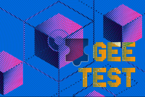

# 极验 GeeTest — 厂商索引

> 厂商：极验 GeeTest | 来源：<https://www.geetest.com/en/adaptive-captcha-demo> | 4 个类型（均有案例）| 48 组案例
>
> 极验 v4 自适应验证码，官方 demo 覆盖滑动拼图、图标点选、五子棋、图标消除。共同点是题面由接口字段下发，答案空间很小（缺口 X、3 个点击点、一对交换），图像线之外有很强的「读接口字段」成分。方法以 CV + 棋盘枚举为主，四类均不使用多模态 LLM；全部只有离线结果，无线上提交记录。
>
> 返回 [README](../README.md) · [全量类型](types.md) · [方法论](00-methodology.md) · 详细内容在类型页（下方第 8 列）。

## 一、厂商概览

极验 GeeTest v4 自适应版本把「题型 + 题面参数」放在服务端下发。本库的 4 类全部来自官方 demo，只记录题面形态、答案与求解思路，不记录接口调用方式。

按求解方式可以分成两组：

- **图像定位组**：`slide` 与 `icon-click`。前者只需要在 `ypos` 约束下找缺口 X；后者需要把 3 个图标一一对应到背景区域。前者 masked 梯度匹配已经稳定，后者仍是本厂商最弱的一类。
- **棋盘枚举组**：`gobang` 与 `icon-crush`。棋盘矩阵一旦可读，答案空间只有 300 / 36 种交换，求解是常数级；难点转移到矩阵读取与 UI 坐标映射。

四类都没有使用多模态 LLM：`slide` / `icon-click` 是 `CV`，`gobang` / `icon-crush` 是 `PROTO`。所有结果均为离线记录，没有线上提交。

## 二、类型总表

| 类型 | 中文 | 变体 | 样本 | 方法 | 求解器 / 源记录 | 审查 | 说明与详情 |
|---|---|---|---:|---|---|---|---|
| `slide` | 滑动拼图 | v4/slide | 12 | CV | 有求解器（exists）· 高 | 12 通过 | 300×200 背景 + 80×80 拼图块；masked Sobel 梯度 + alpha 掩膜 NCC，`ypos` 由接口给出。[类型页](../cases/geetest/slide/README.md) |
| `icon-click` | 图标点选 | v4/icon | 12 | CV | 有求解器（exists）· 中 | 1 通过 / 11 错误 | 3 个 48×48 图标按序点击；颜色连通 + 轮廓 chamfer + 匈牙利。[类型页](../cases/geetest/icon-click/README.md) |
| `gobang` | 五子棋 | winlinze | 12 | PROTO | 有求解器（exists）· 高 | 12 通过 | 5×5 棋盘交换两子成五连；300 种交换枚举，12/12 经校验。[类型页](../cases/geetest/gobang/README.md) |
| `icon-crush` | 图标消除 | match | 12 | PROTO | 有求解器（exists）· 高 | 12 通过 | 3×3 棋盘交换两图标成三连；36 种交换枚举，12/12 经校验。[类型页](../cases/geetest/icon-crush/README.md) |

> 方法标签：`CV`=传统视觉；`PROTO`=协议/枚举。准确率一律为**源记录**；审查统计按案例 `meta.review` 现算（截至 2026-11-21）。本表保持 8 列，viewer 依赖第 4 列样本数与第 8 列链接。

## 三、代表样本

每类取 1 组，点击图片或「详情」进入类型页；完整样本见 `cases/geetest/`。

| 类型 | 方法 | 代表样本 | 详情 |
|---|---|---|---|
| `slide` | CV |  | [详情](../cases/geetest/slide/README.md) |
| `icon-click` | CV |  | [详情](../cases/geetest/icon-click/README.md) |
| `gobang` | PROTO |  | [详情](../cases/geetest/gobang/README.md) |
| `icon-crush` | PROTO |  | [详情](../cases/geetest/icon-crush/README.md) |

## 四、厂商级结论

- **强项**：slide 的 masked 梯度 + NCC 在 12 组上离线 12/12；gobang / icon-crush 的棋盘矩阵一读出来就是常数级枚举，12/12 经暴力校验，五子棋本批全部解唯一。
- **弱点**：icon-click 是四类里唯一需要「理解图像」的题型，颜色连通 + chamfer 对同色、裁剪、重叠和相似干扰物都不稳；源记录 23/27 ≈ 85%，人工审查只有 1/12 通过。002/004/007/008/012 的 notes 写源方案 3/3 命中，但 review 仍为错误，meta 未记录判因，类型页按 review 统计。
- **接口成分**：slide 的 `ypos`、gobang 的 `ques`、icon-crush 的 `board` 都能直接给出答案或把答案空间压到可枚举；本库只记录这一事实，不记录接口调用方式。
- **站点变体**：B站登录的 v4 `icon-pixel` 是极验的定制渲染（2×2 网点、单色空心描边、随机旋转），不能直接套官方 demo 的 CV 链；详见 [B站索引](bilibili.md)。
- **证据边界**：48 组全部只有离线结果（`offline-verified` / `unverified`），无线上提交；离线答案正确不等于服务端接受，不要把它当线上通过率。
- **审查口径**：审查统计只看 `meta.review`，不沿用旧文档的 `pending` 汇总；icon-click 的 `notes` 与 `review` 不一致已在类型页说明。
- **索引用法**：先按第 8 列进类型页；类型页内含题面实例、图片、伪代码、逐组结果与失败记录，厂商页不再重复这些细节。
- **复采状态**：官方 demo 的四类是本库来源，本库未记录复采限制；B站变体是站点定制渲染，另行收录在 B站索引中。
- **类型关系**：gobang 与 icon-crush 共享同一套棋盘枚举骨架，区别只是棋盘大小、目标长度与解的数量；slide 与 icon-click 则分别代表「一维定位」和「二维指派」两类图像问题。
- **样本用途**：48 组中两个棋盘类型占 24 组，主要验证枚举；slide 12 组验证梯度匹配；icon-click 12 组用于暴露 CV 边界，不能当作稳定求解器。
- **方法成本**：四类都可纯 CPU 离线跑，无 LLM 调用；成本最低的是两个棋盘枚举，最高的是 icon-click（候选多、需人工复核）。
- **未覆盖**：接口调用、轨迹生成、提交链路都不在本库；不要据离线答案推断线上成功率。

## 五、相关索引

- B站变体（v3 `word` / v4 `icon-pixel`）：[bilibili.md](bilibili.md)
- 全量类型与厂商总览：[types.md](types.md) · [README](../README.md)

## 六、来源与版权

来源：<https://www.geetest.com/en/adaptive-captcha-demo>。样本采集于 2026-07-23/24，每组源路径与日期见案例 `meta.json`；版权归极验 GeeTest 所有，仅用于研究与教学展示。统计截至 2026-11-21，以案例 `meta.json` 为准。
