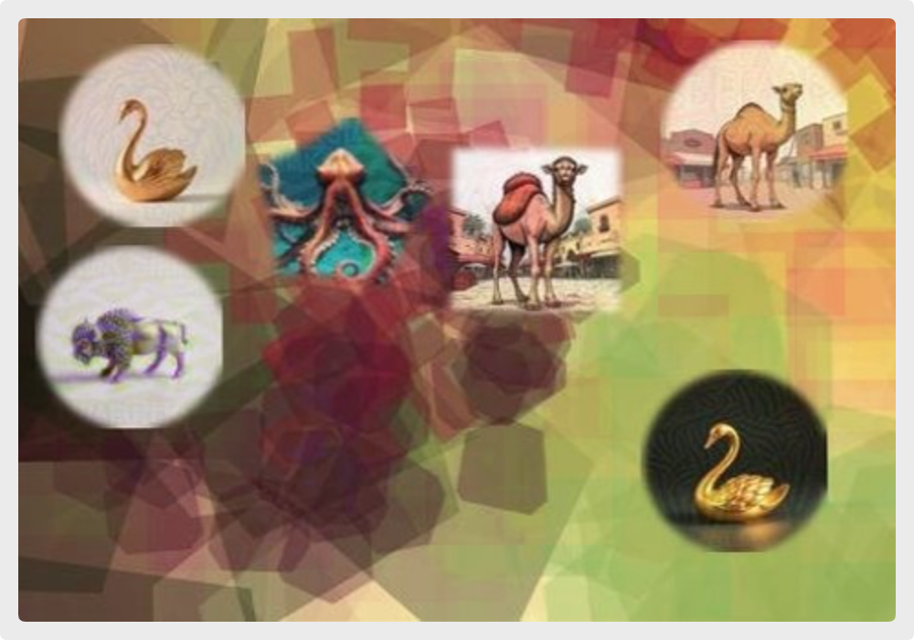
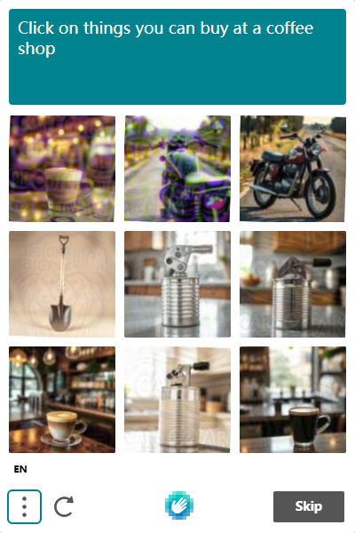
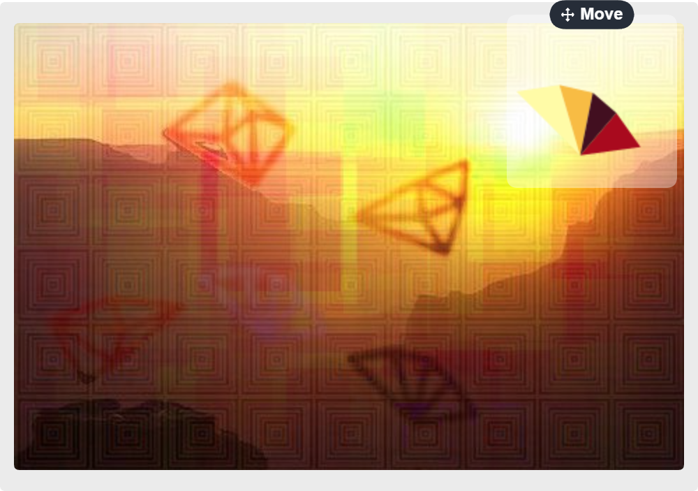

# hCaptcha — 样本、方法与求解器状态

> 厂商：hCaptcha | 来源：https://accounts.hcaptcha.com/demo | 类型：3 | 样本：36
>
> 本页只记录求解器状态，不复制源求解器结果；`review.state` 初始为 `pending` 或 `not-applicable`，审查结果留空待回填。

## 一、类型总表

| 类型 | 中文 | 变体 | 样本 | 方法 | 求解器 / 源记录 | 审查 | 思路与说明 |
|---|---|---|---:|---|---|---|---|
| `area-select` | 区域点选 | animal_habitat / camping / closed_loops / different_icon / icon_not_following_pattern / identical / incomplete_tower / island_not_visited / number_group / odd_shape_grid / three_matching_shapes | 12 | NONE(VLM) | 无求解器（none）· 未知 | not-applicable | 未撰写；建议 VLM 直接读图，起步便宜 |
| `binary` | 九宫格二分类 | coffee_shop / cook_and_eat / hot_or_cold / live_in_this_place / motion_example / useful_here | 12 | NONE(VLM) | 无求解器（none）· 未知 | not-applicable | 未撰写；建议 VLM 读格，起步便宜 |
| `drag-drop` | 拖拽拼块 | element_fit / line_segments / pattern_fill / pattern_fill_2_items / shape_match | 12 | NONE(VLM) | 无求解器（none）· 未知 | not-applicable | 未撰写；建议 VLM 读图 + 拖拽 |

> 方法标签：`CV`=传统视觉；`DET`=目标检测；`OCR`=文字识别；`VLM`=多模态 LLM；`ASR`=语音识别；`PROTO`=协议/枚举；`ACT`=行为/轨迹；`AUDIO`=音频信号；`NONE`=无求解器（括号内为建议路线）。VLM 无需训练数据、按调用计费，起步便宜；量大时 CV 更便宜，常见组合是 CV/OCR 先定位、VLM 只对分歧或语义点调用。

## 二、样本速览

每类取 1 组代表样本；完整样本见 `cases/hcaptcha/`。

| 类型 | 方法 | 代表样本 | 样本数 |
|---|---|---|---:|
| `area-select` | NONE(VLM) |  | 12 |
| `binary` | NONE(VLM) |  | 12 |
| `drag-drop` | NONE(VLM) |  | 12 |

## 三、求解器与人工审查

> 本库只记录求解器状态，不复制源求解器结果。 审查通过/不通过由维护者后续回填。

### 无求解器（none）

以下类型没有撰写求解器，仅为样本收录。原因包括未尝试、仅采集、优先级低、能力不足或未完成；具体以说明为准。

| 类型 | 样本 | 方法 | 准确率（源记录） | 说明 |
|---|---:|---|---|---|
| `area-select` | 12 | NONE(VLM) | 未知 | 未撰写；建议 VLM 直接读图，起步便宜 |
| `binary` | 12 | NONE(VLM) | 未知 | 未撰写；建议 VLM 读格，起步便宜 |
| `drag-drop` | 12 | NONE(VLM) | 未知 | 未撰写；建议 VLM 读图 + 拖拽 |

## 四、题面族

hCaptcha 的交互形态只有 3 类，题面族共 22 个；每族取 1 到 2 组样本。

| 类型 | 题面族 | 样本 |
|---|---|---:|
| `area-select` | animal_habitat | 2 |
| `area-select` | camping | 1 |
| `area-select` | closed_loops | 1 |
| `area-select` | different_icon | 1 |
| `area-select` | icon_not_following_pattern | 1 |
| `area-select` | identical | 1 |
| `area-select` | incomplete_tower | 1 |
| `area-select` | island_not_visited | 1 |
| `area-select` | number_group | 1 |
| `area-select` | odd_shape_grid | 1 |
| `area-select` | three_matching_shapes | 1 |
| `binary` | coffee_shop | 2 |
| `binary` | cook_and_eat | 2 |
| `binary` | hot_or_cold | 2 |
| `binary` | live_in_this_place | 2 |
| `binary` | motion_example | 2 |
| `binary` | useful_here | 2 |
| `drag-drop` | element_fit | 4 |
| `drag-drop` | line_segments | 2 |
| `drag-drop` | pattern_fill | 2 |
| `drag-drop` | pattern_fill_2_items | 2 |
| `drag-drop` | shape_match | 2 |

## 五、来源

来源：https://accounts.hcaptcha.com/demo。样本采集日期见各案例 `meta.json`；样本版权归厂商所有，仅用于研究与教学展示。
