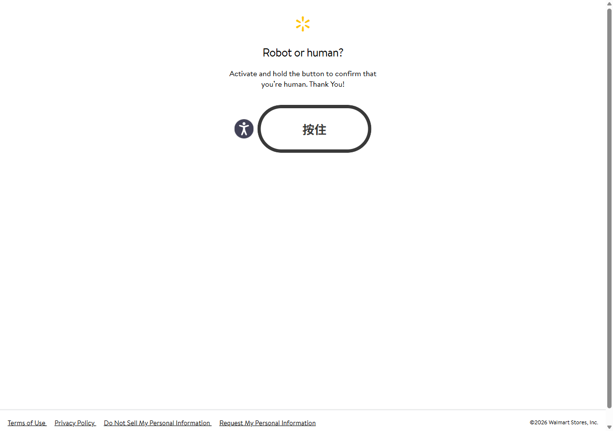
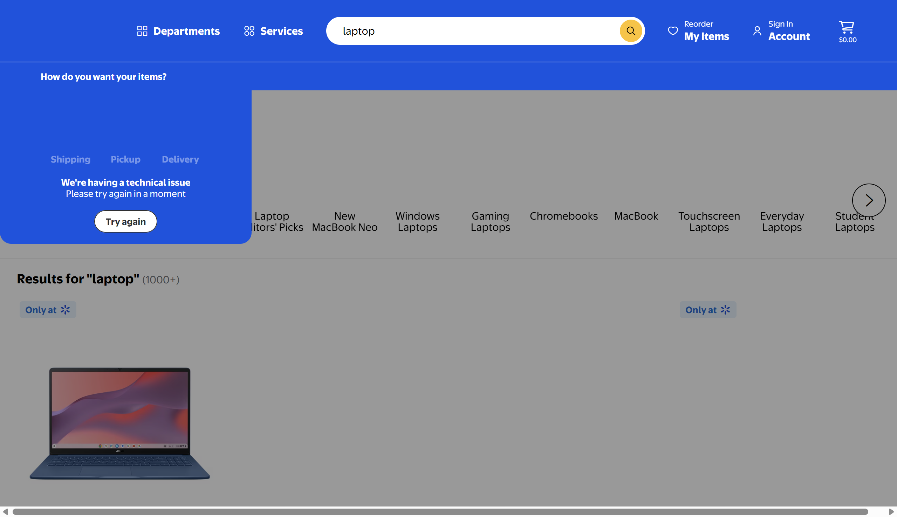
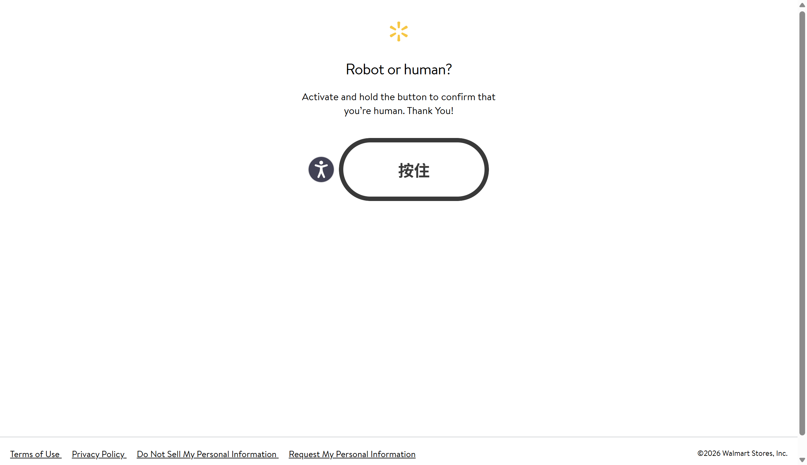

# HUMAN Security — 样本、方法与求解器状态

> 厂商：HUMAN Security | 来源：https://www.walmart.com/blocked | 类型：3 | 样本：8
>
> 本页只记录求解器状态，不复制源求解器结果；`review.state` 初始为 `pending` 或 `not-applicable`，审查结果留空待回填。

## 一、类型总表

| 类型 | 中文 | 变体 | 样本 | 方法 | 求解器 / 源记录 | 审查 | 思路与说明 |
|---|---|---|---:|---|---|---|---|
| `press-hold` | 按压 | press-hold | 5 | ACT | 需浏览器（browser）· 高 | pending | 真实浏览器按压；无题面/无 LLM；真实浏览器可解；纯 HTTP 被拒；待审 |
| `invisible` | 无感 | invisible | 2 | ACT | 需浏览器（browser）· 高 | pending | 浏览器/环境放行；无题面；零注入 Chrome 可过；无题面 |
| `accessible-email` | 无障碍邮件码 | accessible-email | 1 | NONE(OCR/VLM) | 无求解器（none）· 未知 | not-applicable | 未撰写；建议 OCR/VLM |

> 方法标签：`CV`=传统视觉；`DET`=目标检测；`OCR`=文字识别；`VLM`=多模态 LLM；`ASR`=语音识别；`PROTO`=协议/枚举；`ACT`=行为/轨迹；`AUDIO`=音频信号；`NONE`=无求解器（括号内为建议路线）。VLM 无需训练数据、按调用计费，起步便宜；量大时 CV 更便宜，常见组合是 CV/OCR 先定位、VLM 只对分歧或语义点调用。

## 二、样本速览

每类取 1 组代表样本；完整样本见 `cases/human-security/`。

| 类型 | 方法 | 代表样本 | 样本数 |
|---|---|---|---:|
| `press-hold` | ACT |  | 5 |
| `invisible` | ACT |  | 2 |
| `accessible-email` | NONE(OCR/VLM) |  | 1 |

## 三、求解器与人工审查

> 本库只记录求解器状态，不复制源求解器结果。 审查通过/不通过由维护者后续回填。

### 无求解器（none）

以下类型没有撰写求解器，仅为样本收录。原因包括未尝试、仅采集、优先级低、能力不足或未完成；具体以说明为准。

| 类型 | 样本 | 方法 | 准确率（源记录） | 说明 |
|---|---:|---|---|---|
| `accessible-email` | 1 | NONE(OCR/VLM) | 未知 | 未撰写；建议 OCR/VLM |

### 需真实浏览器交互（browser）

以下类型纯协议不可行，需要真实浏览器操作；离线样本只用于形态记录。

| 类型 | 样本 | 方法 | 准确率（源记录） | 说明 |
|---|---:|---|---|---|
| `press-hold` | 5 | ACT | 高 | 真实浏览器按压；无题面/无 LLM；真实浏览器可解；纯 HTTP 被拒；待审 |
| `invisible` | 2 | ACT | 高 | 浏览器/环境放行；无题面；零注入 Chrome 可过；无题面 |

## 四、来源

来源：https://www.walmart.com/blocked。样本采集日期见各案例 `meta.json`；样本版权归厂商所有，仅用于研究与教学展示。
