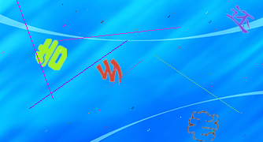
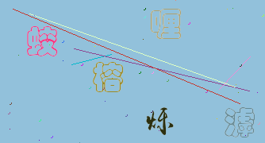

# 凯格 — 厂商索引

> 厂商：凯格 | 来源：<https://www.kgcaptcha.com/> | 5 个类型（全部有案例）| 60 组案例
>
> 题型覆盖滑动拼图、文字点选、语序点选、字体识别与空间推理。整体以样本收录为主：只有 `text-click` 有一条纯本地弱求解器，其余 4 类没有求解器。
>
> 返回 [README](../README.md) · [全量类型](types.md) · [方法论](00-methodology.md) · 详细内容在类型页（下方表内链接）。

## 一、类型总表

| 类型 | 中文 | 变体 | 样本 | 方法 | 求解器 / 源记录 | 审查 | 说明与详情 |
|---|---|---|---:|---|---|---|---|
| `slide` | 滑动拼图 | classic | 12 | NONE(CV) | 无求解器（none）· 未知 | 9 通过 / 3 不适用 | 仅采集；334×180 白色剪影 + 72×180 拼图条带；建议 CV 边缘/模板。[类型页](../cases/kgcaptcha/slide/README.md) |
| `text-click` | 文字点选 | classic | 12 | DET+CV+OCR | 有求解器（weak）· 低 | 5 通过 / 7 未通过 | 全本地 v2：DBNet + 颜色拆分 + Canny 边缘候选 + 多字体×24 角度 chamfer + RapidOCR 加分；形近/中空仍错。[类型页](../cases/kgcaptcha/text-click/README.md) |
| `word-order` | 语序点选 | classic | 12 | NONE(OCR+VLM) | 无求解器（none）· 未知 | 12 不适用 | 仅采集；4 个散落字形按语序点击；建议 OCR + VLM 组词排序。[类型页](../cases/kgcaptcha/word-order/README.md) |
| `font` | 字体识别 | classic | 12 | NONE(OCR+VLM) | 无求解器（none）· 未知 | 9 通过 / 3 不适用 | 仅采集；5–6 个汉字，标注用 `DIFF` 指出字体不同者；建议 OCR + VLM。[类型页](../cases/kgcaptcha/font/README.md) |
| `spatial` | 空间推理 | classic | 12 | NONE(VLM) | 无求解器（none）· 未知 | 12 不适用 | 仅采集；颜色/角度/距离/大小写关系题；建议 VLM 空间推理。[类型页](../cases/kgcaptcha/spatial/README.md) |

> 方法标签：`CV`=传统视觉；`DET`=目标检测；`OCR`=文字识别；`VLM`=多模态 LLM；`NONE`=无求解器（括号内为建议路线）。准确率一律为**源记录**；审查统计按案例 `meta.review` 现算（截至 2026-11-21）。
>
> 阅读提示：`slide` / `font` 的「9 通过」针对样本或参考图，不代表求解准确率——这两类没有求解器。`text-click` 的 5/7 对应 2026-11-20 更新之前的版本，010/012 的修正结果尚未复核。

## 二、证据与文件

| 类型 | 每组文件 | 机器可读答案 | 本库实测 |
|---|---|---|---|
| `slide` | `meta.json` + `bg.png` + `aux-01.png` + `solved.png` | 无 | 无求解器；`solved` 仅参考 |
| `text-click` | `meta.json` + `bg.png` + `denoised.png` + `mark.png` + `annotated.png` | 无 | 本地 v2，审查 5/12 |
| `font` | `meta.json` + `bg.png` + `annotated.png` | 无 | 无求解器 |
| `spatial` | `meta.json` + `bg.png` + `annotated.png` | 无 | 无求解器 |
| `word-order` | `meta.json` + `bg.png` + `annotated.png` | 无 | 无求解器 |

- 12 组均无 `answer.txt` / `result.json`；`annotated.png` 是人工标注，不是求解器输出。
- `text-click` 的 `mark.png` / `annotated.png` 记录候选与命中，但同样没有逐组答案文件，无法离线重算准确率。

## 三、代表样本

每类取 1 组，点击「详情」进入类型页；完整样本见 `cases/kgcaptcha/`。

| 类型 | 方法 | 代表样本 | 详情 |
|---|---|---|---|
| `slide` | NONE(CV) |  | [详情](../cases/kgcaptcha/slide/README.md) |
| `text-click` | DET+CV+OCR |  | [详情](../cases/kgcaptcha/text-click/README.md) |
| `word-order` | NONE(OCR+VLM) |  | [详情](../cases/kgcaptcha/word-order/README.md) |
| `font` | NONE(OCR+VLM) |  | [详情](../cases/kgcaptcha/font/README.md) |
| `spatial` | NONE(VLM) |  | [详情](../cases/kgcaptcha/spatial/README.md) |

## 四、厂商级结论

- **唯一有求解器的是文字点选**：纯本地、无 LLM、无训练；强项是干扰字多、字体极端的场景，弱点是形近字与中空/细体，当前审查 5/12。
- **其余 4 类都是样本级覆盖**：`slide` 有 `solved` 参考图但没有机器可读答案；`font` / `spatial` / `word-order` 只有题面与标注，没有 `answer.txt` / `result.json`。
- **题面风格统一**：图片尺寸小（slide/text-click/font/word-order 334×180，spatial 300×150），背景用照片/渐变，目标与干扰同场，适合作为轻量 CV 与 VLM 的对照样本。
- **建议路线清楚但未落地**：slide 用 CV 边缘/模板；font 与 word-order 用 OCR + VLM；spatial 用 VLM。它们都没有本库实测，不能标准确率。
- **证据边界**：全部 60 组没有线上提交记录；`text-click` 也只有标注图。不要把离线标注或源记录准确率当成线上通过率。

## 五、统计口径与维护

- **样本数**：按 `cases/kgcaptcha/<type>/` 下的目录数现算，5 类各 12 组，共 60 组。
- **审查**：按 `meta.review.state` 计数；`not-applicable` 是「无求解器/未进入审查」，不等同于通过。
- **准确率**：本厂商没有可复核的机器答案，统一写「未知」；`text-click` 的效果只以用户复核的 5/12 表示。
- **更新方式**：新增案例时同步补 `meta.json`、`bg.png` 与标注文件；若未来补 `answer.txt` / `result.json`，再在类型页补准确率。
- **不要混用**：`solved.png`（slide 参考图）与求解器结果不是一回事，索引里已分开标注。

## 六、来源

来源：<https://www.kgcaptcha.com/>。样本采集日期见各案例 `meta.json`；样本版权归凯格所有，仅用于研究与教学展示。
