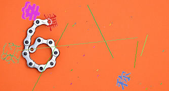
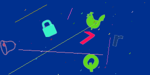

# 凯格 — 样本、方法与求解器状态

> 厂商：凯格 | 来源：https://www.kgcaptcha.com/ | 类型：5 | 样本：45
>
> 本页只记录求解器状态，不复制源求解器结果；`review.state` 初始为 `pending` 或 `not-applicable`，审查结果留空待回填。

## 一、类型总表

| 类型 | 中文 | 变体 | 样本 | 方法 | 求解器 / 源记录 | 审查 | 思路与说明 |
|---|---|---|---:|---|---|---|---|
| `slide` | 滑动拼图 | classic | 9 | NONE(CV) | 无求解器（none）· 未知 | not-applicable | 未撰写；建议 CV 边缘/模板，成本低 |
| `text-click` | 文字点选 | classic | 9 | NONE(OCR+VLM) | 无求解器（none）· 未知 | not-applicable | 未撰写；建议 OCR + VLM，起步便宜 |
| `word-order` | 语序点选 | classic | 9 | NONE(OCR+VLM) | 无求解器（none）· 未知 | not-applicable | 未撰写；建议 OCR + VLM 语序 |
| `font` | 字体识别 | classic | 9 | NONE(OCR+VLM) | 无求解器（none）· 未知 | not-applicable | 未撰写；建议 OCR + VLM |
| `spatial` | 空间推理 | classic | 9 | NONE(VLM) | 无求解器（none）· 未知 | not-applicable | 未撰写；建议 VLM 空间推理 |

> 方法标签：`CV`=传统视觉；`DET`=目标检测；`OCR`=文字识别；`VLM`=多模态 LLM；`ASR`=语音识别；`PROTO`=协议/枚举；`ACT`=行为/轨迹；`AUDIO`=音频信号；`NONE`=无求解器（括号内为建议路线）。VLM 无需训练数据、按调用计费，起步便宜；量大时 CV 更便宜，常见组合是 CV/OCR 先定位、VLM 只对分歧或语义点调用。

## 二、样本速览

每类取 1 组代表样本；完整样本见 `cases/kgcaptcha/`。

| 类型 | 方法 | 代表样本 | 样本数 |
|---|---|---|---:|
| `slide` | NONE(CV) |  | 9 |
| `text-click` | NONE(OCR+VLM) |  | 9 |
| `word-order` | NONE(OCR+VLM) |  | 9 |
| `font` | NONE(OCR+VLM) |  | 9 |
| `spatial` | NONE(VLM) |  | 9 |

## 三、求解器与人工审查

> 本库只记录求解器状态，不复制源求解器结果。 审查通过/不通过由维护者后续回填。

### 无求解器（none）

以下类型没有撰写求解器，仅为样本收录。原因包括未尝试、仅采集、优先级低、能力不足或未完成；具体以说明为准。

| 类型 | 样本 | 方法 | 准确率（源记录） | 说明 |
|---|---:|---|---|---|
| `slide` | 9 | NONE(CV) | 未知 | 未撰写；建议 CV 边缘/模板，成本低 |
| `text-click` | 9 | NONE(OCR+VLM) | 未知 | 未撰写；建议 OCR + VLM，起步便宜 |
| `word-order` | 9 | NONE(OCR+VLM) | 未知 | 未撰写；建议 OCR + VLM 语序 |
| `font` | 9 | NONE(OCR+VLM) | 未知 | 未撰写；建议 OCR + VLM |
| `spatial` | 9 | NONE(VLM) | 未知 | 未撰写；建议 VLM 空间推理 |

## 四、来源

来源：https://www.kgcaptcha.com/。样本采集日期见各案例 `meta.json`；样本版权归厂商所有，仅用于研究与教学展示。
