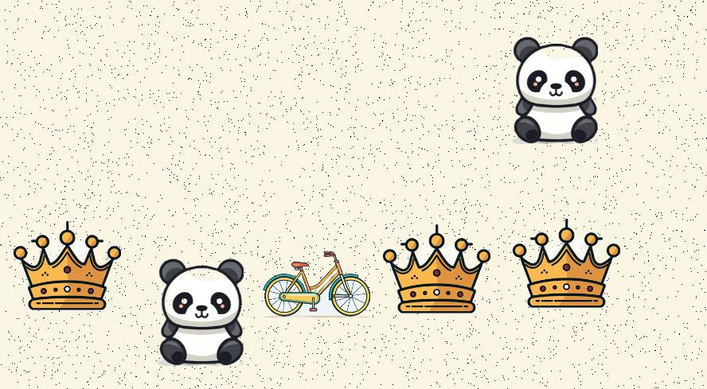

# 美团 Yoda — 厂商索引

> 厂商：美团 Yoda | 来源：<https://verify.meituan.com/v2> | 5 个类型（全部有案例）| 60 组案例
>
> 题型覆盖滑块、图标/文字点选、背景还原连点、滑动推理与字符识别。四个 CV 类型图像侧准确率高，但**五个类型全部是 `partial`**：图像答案解出来了，线上提交链没有打通。
>
> 返回 [README](../README.md) · [全量类型](types.md) · [方法论](00-methodology.md) · 详细内容在类型页（下方表内链接）。

## 一、类型总表

| 类型 | 中文 | 变体 | 样本 | 方法 | 求解器 / 源记录 | 审查 | 说明与详情 |
|---|---|---|---:|---|---|---|---|
| `slide` | 滑动拼图 | 163 | 12 | CV | 部分（partial）· 高 | 12 通过 / 0 错误 | 边缘 + 暗填充双信号；图像 90/90；提交闭环未打通；71 无图仅静态逆向。[类型页](../cases/meituan/slide/README.md) |
| `icon-click` | 图标点选 | 130 | 12 | CV | 部分（partial）· 高 | 12 通过 / 0 错误 | 背景切点还原 + 提示条拆分 + 多尺度/旋转模板；图像 83/83；人工复核 12/12 满意。[类型页](../cases/meituan/icon-click/README.md) |
| `line-connect` | 最短线连点 | 103 | 12 | CV | 部分（partial）· 高 | 12 通过 / 0 错误 | 1.png 颜色字 → 还原 0.png → 同色两点 → 最短直线；图像 50/50。[类型页](../cases/meituan/line-connect/README.md) |
| `slide-inference` | 滑动推理 | 202 | 12 | CV | 部分（partial）· 高 | 12 通过 / 0 错误 | CV 定位目标 + 计数规则；图像 1502/1502；提交闭环未打通。[类型页](../cases/meituan/slide-inference/README.md) |
| `text` | 字符识别 | 1 | 12 | DET+OCR | 部分（partial）· 低 | 12 待审 | YOLO26 字符检测/OCR；字符 51.6% / 全对 13.2%；提交未打通。[类型页](../cases/meituan/text/README.md) |

> 方法标签：`CV`=传统视觉；`DET`=目标检测；`OCR`=文字识别。准确率一律为**源记录**；审查统计按案例 `meta.review` 现算（截至 2026-11-21）。
>
> 阅读提示：四个 `高` 是图像侧记录，不是线上通过率；`text` 的 51.6% / 13.2% 是源记录，本库没有逐组答案可复核。

## 二、代表样本

每类取 1 组，点击「详情」进入类型页；完整样本见 `cases/meituan/`。

| 类型 | 方法 | 代表样本 | 详情 |
|---|---|---|---|
| `slide` | CV |  | [详情](../cases/meituan/slide/README.md) |
| `icon-click` | CV |  | [详情](../cases/meituan/icon-click/README.md) |
| `line-connect` | CV |  | [详情](../cases/meituan/line-connect/README.md) |
| `slide-inference` | CV |  | [详情](../cases/meituan/slide-inference/README.md) |
| `text` | DET+OCR |  | [详情](../cases/meituan/text/README.md) |

## 三、厂商级结论

- **五个类型全是 `partial`，没有一个完成线上闭环。** 图像侧「90/90」「83/83」「50/50」「1502/1502」只说明本地答案对，不能写成「几乎完美」。
- **`slide` / `slide-inference` 缺证据字段**：`meta.evidence` 为空，审查只核对图像答案；`answer.txt` / `result.json` 也没有，无法逐组重算。
- **`icon-click` 的证据最完整**：`answer.txt` / `result.json` 齐全，`evidence=manual`、`confidence=high`，人工复核 12/12 满意；但提交链仍未打通。
- **`line-connect` 是离线验证**：`evidence=offline-verified`、`confidence=high`，颜色与两点选择 12/12 通过；同样没有线上提交。
- **`text` 是短板**：字符级 51.6%、全对 13.2%（源记录），12 组待审，且只有 `bg.jpg`，没有答案文件。
- **共同难点**：背景打乱/还原（icon-click、line-connect）、全尺寸预填贴合（slide）、「刚好完整露出」的计数边界（slide-inference）、100×40 小图变形（text）。
- **结论口径**：这些类型适合做图像侧方法样本；要说「攻破」，必须等提交链与线上验证补齐。

## 四、证据与文件

| 类型 | 本库文件 | 证据等级 | 审查 | 备注 |
|---|---|---|---|---|
| `slide` | `bg.jpg` + `aux-01.png` + `solved.png` | 未记录 | 12 通过 | 无 `answer.txt` / `result.json` |
| `icon-click` | `answer.txt` + `result.json` + 打乱/拆分/还原/结果图 | `manual` · high | 12 通过 | 人工复核 12/12 满意 |
| `line-connect` | `answer.txt` + `result.json` + 背景/颜色字/3 张过程图/结果图 | `offline-verified` · high | 12 通过 | 坐标与距离可复核 |
| `slide-inference` | `bg.jpg` + `solved.png` | 未记录 | 12 通过 | 无 `answer.txt` / `result.json` |
| `text` | 仅 `bg.jpg` | 未记录 | 12 待审 | 仅源记录准确率 |

## 五、统计口径与来源

- **样本数**：按 `cases/meituan/<type>/` 下的目录数现算，5 类各 12 组，共 60 组。
- **审查**：按 `meta.review.state` 计数；`text` 的 12 组仍是 `pending`，不要写成通过。
- **准确率**：全部标「源记录」，本库没有把求解器输出改写成人工真值。
- **边界**：离线图像准确率 ≠ 线上通过率；五个类型的提交链都未打通，不能按「几乎完美」宣传。
- 来源：<https://verify.meituan.com/v2>。样本采集日期见各案例 `meta.json`；样本版权归美团所有，仅用于研究与教学展示。
