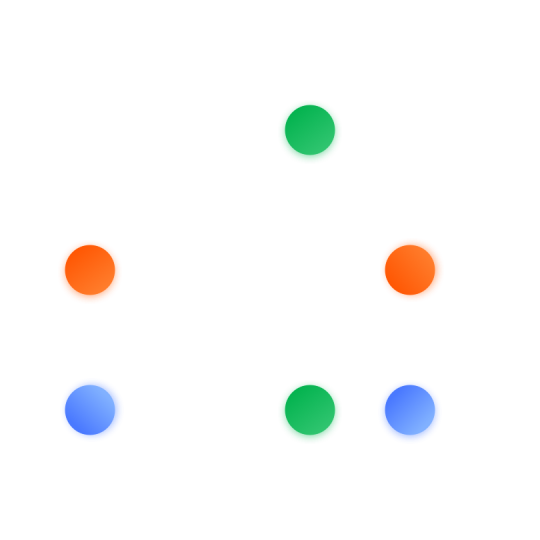

# 美团 Yoda — 样本、方法与求解器状态

> 厂商：美团 Yoda | 来源：https://verify.meituan.com/v2 | 类型：5 | 样本：60
>
> 本页只记录求解器状态，不复制源求解器结果；`review.state` 初始为 `pending` 或 `not-applicable`，审查结果留空待回填。

## 一、类型总表

| 类型 | 中文 | 变体 | 样本 | 方法 | 求解器 / 源记录 | 审查 | 思路与说明 |
|---|---|---|---:|---|---|---|---|
| `slide` | 滑动拼图 | 163 | 12 | CV | 部分攻克（partial）· 高 | pending | 边缘 + 暗填充双信号；无 LLM；图像 90/90；全尺寸预填贴合；提交闭环未打通；71 无图仅静态逆向 |
| `slide-inference` | 滑动推理 | 202 | 12 | CV | 部分攻克（partial）· 高 | pending | CV 定位 + 计数规则；无 LLM；图像 1502/1502；提交闭环未打通 |
| `line-connect` | 最短线连点 | 103 | 12 | CV | 部分攻克（partial）· 高 | pending | 颜色/连线规则；无 LLM；图像 50/50；提交闭环未打通 |
| `icon-click` | 图标点选 | 130 | 12 | CV | 部分攻克（partial）· 高 | pending | 模板/滑窗匹配；无 LLM；图像 83/83；提交闭环未打通 |
| `text` | 字符识别 | 1 | 12 | DET+OCR | 部分攻克（partial）· 低 | pending | YOLO26 字符检测/OCR；效果差；字符 51.6% / 全对 13.2%；提交未打通 |

> 方法标签：`CV`=传统视觉；`DET`=目标检测；`OCR`=文字识别；`VLM`=多模态 LLM；`ASR`=语音识别；`PROTO`=协议/枚举；`ACT`=行为/轨迹；`AUDIO`=音频信号；`NONE`=无求解器（括号内为建议路线）。VLM 无需训练数据、按调用计费，起步便宜；量大时 CV 更便宜，常见组合是 CV/OCR 先定位、VLM 只对分歧或语义点调用。

## 二、样本速览

每类取 1 组代表样本；完整样本见 `cases/meituan/`。

| 类型 | 方法 | 代表样本 | 样本数 |
|---|---|---|---:|
| `slide` | CV |  | 12 |
| `slide-inference` | CV |  | 12 |
| `line-connect` | CV |  | 12 |
| `icon-click` | CV |  | 12 |
| `text` | DET+OCR |  | 12 |

## 三、求解器与人工审查

> 本库只记录求解器状态，不复制源求解器结果。 审查通过/不通过由维护者后续回填。

### 部分攻克 / 部分进展（partial）

以下类型有部分进展：图像/答案已解但提交未通，或只完成前置还原/检测；线上通过率不能按离线准确率计算。

| 类型 | 样本 | 方法 | 准确率（源记录） | 说明 |
|---|---:|---|---|---|
| `slide` | 12 | CV | 高 | 边缘 + 暗填充双信号；无 LLM；图像 90/90；全尺寸预填贴合；提交闭环未打通；71 无图仅静态逆向 |
| `slide-inference` | 12 | CV | 高 | CV 定位 + 计数规则；无 LLM；图像 1502/1502；提交闭环未打通 |
| `line-connect` | 12 | CV | 高 | 颜色/连线规则；无 LLM；图像 50/50；提交闭环未打通 |
| `icon-click` | 12 | CV | 高 | 模板/滑窗匹配；无 LLM；图像 83/83；提交闭环未打通 |
| `text` | 12 | DET+OCR | 低 | YOLO26 字符检测/OCR；效果差；字符 51.6% / 全对 13.2%；提交未打通 |

## 四、来源

来源：https://verify.meituan.com/v2。样本采集日期见各案例 `meta.json`；样本版权归厂商所有，仅用于研究与教学展示。
