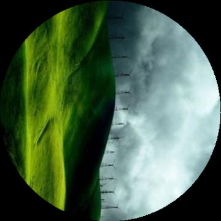

# 企讯通 — 厂商索引

> 厂商：企讯通（`qingtongbu`）| 来源：<http://www.qingtongbu.com/#experience> | 6 个类型（均有案例）| 84 组案例
>
> 平台 SDK 与天爱同源（`QCaptcha.js`），题型覆盖拼图、文字/图标点选、角度、旋转补图与曲线。共同点：**全部已写求解器或明确不做**；文字、图标、拼图、曲线都是纯 CV/OCR，无多模态 LLM；曲线新 12 组有在线 `code=200` 记录。
>
> 返回 [README](../README.md) · [全量类型](types.md) · [方法论](00-methodology.md) · 详细内容在类型页（下方第 8 列）。

## 一、厂商概览

- **图像定位组**：`slide`（拼图缺口）、`text-click`（4 选 4 + 1 干扰）、`icon-click`（4 模板对 5–7 图标）、`rotate`（圆形补片旋转归位）。
- **角度组**：`angle` 用 ResNet50 360 类分类回正，ConvNeXt-T 只作对照。
- **曲线组**：`curve` 用双色描边模型 + 端点吸附/`p` 解码，24 组里 12 组在线通过。

除 `rotate` 外都有求解器；`rotate` 只有样本，没有角度答案。所有方法都可 CPU 离线推理，没有 LLM 调用。

## 二、类型总表

| 类型 | 中文 | 变体 | 样本 | 方法 | 求解器 / 源记录 | 审查 | 说明与详情 |
|---|---|---|---:|---|---|---|---|
| `slide` | 滑动拼图 | classic | 12 | CV | 有求解器（exists）· 中 | 12 通过 | 600×360 + 84×84 拼图；alpha/RGB 双模板 + 局部 Sobel 精修；无 LLM；离线坐标未在线校验。[类型页](../cases/qingtongbu/slide/README.md) |
| `text-click` | 文字点选 | classic | 12 | DET+OCR+CV | 有求解器（exists）· 高（源记录 12/12 人工复核） | 12 通过 | 4 提示字对 5 背景彩色旋转字；局部背景 Lab 掩膜 + 多角度 OCR + Siamese 三矩阵 + 匈牙利；无 LLM。[类型页](../cases/qingtongbu/text-click/README.md) |
| `icon-click` | 图标点选 | classic | 12 | CV | 有求解器（exists）· 高（源记录 12/12 人工目检） | 12 通过 | 4 个灰描边模板对 5–7 个背景图标；去架线切分 + 三通道颜色模型 + 多尺度 0.8–1.2 + 匈牙利。[类型页](../cases/qingtongbu/icon-click/README.md) |
| `angle` | 角度验证 | classic | 12 | CV | 有求解器（exists）· 中（源记录 12/12 目检） | 9 通过 / 1 部分 / 2 错误 | 360×360 圆形照片回正；ResNet50 360 类 vs ConvNeXt 回归；**meta 审查与源记录 12/12 不一致**。[类型页](../cases/qingtongbu/angle/README.md) |
| `rotate` | 旋转验证 | classic | 12 | NONE(CV+VLM) | 无求解器（none）· 未知 | 12 通过（样本审查） | 600×360 场景 + 中央黑盘 + 旋转圆形补片；无 `answer/result`，`solved.png` 只画目标圆位；建议 CV 角度 + VLM 兜底。[类型页](../cases/qingtongbu/rotate/README.md) |
| `curve` | 曲线滑动 | CURVE | 24 | CV+ACT | 有求解器（exists）· 高（源记录累计在线 36/36） | 24 通过 | 三次贝塞尔、两控制点重合；`moveX=ctrlX/2`；双色描边 + 端点吸附；旧 12 组离线、新 12 组 live-pass；容差 5%。[类型页](../cases/qingtongbu/curve/README.md) |

> 方法标签：`CV`=传统视觉；`DET`=目标检测；`OCR`=文字识别；`Siamese` 属 CV 匹配；`VLM`=多模态 LLM；`ACT`=行为/轨迹；`NONE`=无求解器。准确率一律为**源记录**；审查统计按 `meta.review` 现算（截至 2026-11-21）。本表保持 8 列，viewer 依赖第 4 列样本数与第 8 列链接。

## 三、代表样本

每类取 1 组；完整样本见 `cases/qingtongbu/`。

| 类型 | 方法 | 代表样本 | 详情 |
|---|---|---|---|
| `slide` | CV |  | [详情](../cases/qingtongbu/slide/README.md) |
| `text-click` | DET+OCR+CV |  | [详情](../cases/qingtongbu/text-click/README.md) |
| `icon-click` | CV |  | [详情](../cases/qingtongbu/icon-click/README.md) |
| `angle` | CV |  | [详情](../cases/qingtongbu/angle/README.md) |
| `rotate` | NONE(CV+VLM) |  | [详情](../cases/qingtongbu/rotate/README.md) |
| `curve` | CV+ACT |  | [详情](../cases/qingtongbu/curve/README.md) |

## 四、厂商级结论

- **强项**：`text-click` / `icon-click` 是两条成熟的零 LLM 点选链路，分别用 Siamese 三矩阵与三通道颜色模型 + 匈牙利，源记录均 12/12；`curve` 有 12 组在线 `code=200`，是本厂商证据最硬的一类。
- **角度要更正**：旧文档与源记录写 ResNet50 12/12、ConvNeXt 11/12 偏差；但 `meta.review` 实际是 **9 通过 / 1 部分 / 2 错误**（002、005 错，006 部分）。本索引以 meta 为准，不能再把「12/12」写成已审查结论。
- **旋转是空白**：`rotate` 没有求解器、没有角度答案；12 组 `review=pass` 审的是样本可用性，不是求解准确率。
- **证据分层**：`slide` / `text-click` / `icon-click` 为 `unverified`；`angle` 为 `manual`；`curve` 旧 12 组 `offline-verified`、新 12 组 `live-pass`。不要把源记录、离线拟合和在线通过混成一个数字。
- **曲线机制**：参考/预览同为三次贝塞尔，两个控制点重合；`p` 直接给端点与 `ctrlY`，答案只剩 `ctrlX`，`moveX = ctrlX × 300 / 600`。旧 12 组 GT 残差 0.85–4.38px，新 12 组在线 12/12，容差 5%（±30 图像 px 通过、+35 拒绝）。
- **成本**：四类纯 CV 可 CPU；`angle` 的 ResNet50 推理成本高于其他；`rotate` 若重做，VLM 只是建议路线，尚未验证。
- **样本结构**：84 组中曲线占 24 组，其余各 12 组；适合覆盖题型，不是训练集规模。
- **审查口径**：本页与类型页都按 `meta.review` 统计，不用旧文档的 `pending` 汇总；类型页会逐组标出错误/部分案例。

## 五、相关索引

- 全量类型与厂商总览：[types.md](types.md) · [README](../README.md)
- 同平台对照（曲线机制相近）：[天爱索引](tianai.md)
- 方法论与成本：[00-methodology.md](00-methodology.md)

## 六、来源与版权

来源：<http://www.qingtongbu.com/#experience>；`curve` 的 013–024 来自同平台白标站 <https://www.shipinren.com/>。样本采集于 2026-07-23 / 2026-11-20，每组源路径与日期见案例 `meta.json`；版权归平台所有，仅用于研究与教学展示。统计截至 2026-11-21，以案例 `meta.json` 为准。
