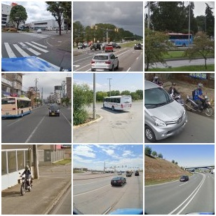
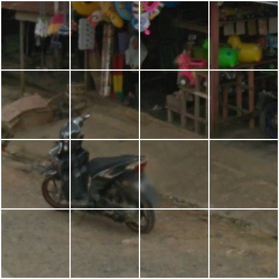

# Google reCAPTCHA — 厂商索引

> 厂商：Google reCAPTCHA | 来源：<https://www.google.com/sorry/index>（音频题另见 <https://test.cap.guru/demo/recap#recap2>）| 4 个类型（3 个有案例、1 个仅文档）| 36 组案例
>
> 经典 reCAPTCHA 图片与音频挑战：九宫格分「独立子图」和「整图切分」两族，均用视觉 LLM 直接读格；音频题用 faster-whisper small.en 听写；v3 token 只记录形态、不收录。
>
> **2026-11-25 复核**：本地 VLM 线上 **2/2 会话**收口（3×3 单格 2/6；4×4 未线上）；外部论文的 YOLO 方案 30 次挑战 **0 收口**（其中 7 次 4×4 未跑）。会话级成功依赖换题重试，不是单格 100%。
>
> 返回 [README](../README.md) · [全量类型](types.md) · [方法论](00-methodology.md) · 详细拆解在类型页（下方表内链接）。

## 一、类型总表

| 类型 | 中文 | 变体 | 样本 | 方法 | 求解器 / 源记录 | 审查 | 说明与详情 |
|---|---|---|---:|---|---|---|---|
| `grid-independent` | 独立子图九宫格 | independent | 12 | VLM | 有求解器（exists）· 高（会话级） | 已审 12（通过 5 / 部分 7） | 3×3 张互不连续的照片；VLM 读格；源记录旧批次 33/33 离线、7/7 线上；2026-11-25 VLM 线上 2/2 会话、3×3 单格 2/6，4×4 未线上，新批次待补跑。[类型页](../cases/recaptcha/grid-independent/README.md) |
| `grid-split` | 整图切分九宫格 | split | 12 | VLM | 有求解器（exists）· 高（会话级） | 待审 11（012 不适用） | 单张连续图切块（本批为 4×4=16 格）；VLM 读块；源记录旧批次 33/33 离线、7/7 线上；2026-11-25 VLM 线上 2/2 会话但只覆盖 3×3，4×4 未线上；离线 Google 接受 2/2 一致；新批次待补跑。[类型页](../cases/recaptcha/grid-split/README.md) |
| `audio` | 音频听写 | recaptcha-v2-audio | 12 | ASR | 有求解器（exists）· 高 | 12 通过 | 英文短句听写；faster-whisper small.en；源记录 20/20 离线、15/15 线上。[类型页](../cases/recaptcha/audio/README.md) |
| `token` | 指纹 / Token 挑战 | v3-score | 0 | PROTO | 无求解器（none）· 未知 | not-applicable | 仅文档 / 无题面；v3 一次性 token、仅服务端评分，不收录。 |

> 方法标签：`CV`=传统视觉；`DET`=目标检测；`OCR`=文字识别；`VLM`=多模态 LLM；`ASR`=语音识别；`PROTO`=协议/枚举；`ACT`=行为/轨迹；`NONE`=无求解器（括号内为建议路线）。准确率一律为**源记录**，不代表本库已复核；审查统计按案例 `meta.review` 现算（截至 2026-11-25）。

### 类型页速查

| 类型 | 先看什么 | 适合谁 |
|---|---|---|
| `grid-independent` | 3×3 独立照片与题面族 | 想做通用物体读格的人 |
| `grid-split` | 4×4 切块与跨格目标 | 想处理连续图切分的人 |
| `audio` | 12 条短音频与转写表 | 想跑 Whisper 听写的人 |
| `token` | 无题面，v3 只记录形态 | 只想了解 v3 边界的人 |

## 二、代表样本

每类取 1 组；音频没有题面图，用音频直链代替缩略图。完整样本见 `cases/recaptcha/`。

| 类型 | 方法 | 代表样本 | 详情 |
|---|---|---|---|
| `grid-independent` | VLM |  | [详情](../cases/recaptcha/grid-independent/README.md) |
| `grid-split` | VLM |  | [详情](../cases/recaptcha/grid-split/README.md) |
| `audio` | ASR | [听音频 001](../cases/recaptcha/audio/001/audio.mp3) | [详情](../cases/recaptcha/audio/README.md) |
| `token` | PROTO | —（仅文档，无题面） | 无案例目录 |

## 三、方法选择与审查

| 场景 | 建议路线 | 成本特征 | 本库状态 |
|---|---|---|---|
| 独立子图九宫格（`grid-independent`） | 9 格分别读图，按行优先输出 1–9；失败换题重试 | 一次调用可读全图；按会话收口 | 12 组仅样本，已审 12（5 通过 / 7 部分）；2026-11-25 VLM 线上 2/2 会话、3×3 单格 2/6 |
| 整图切分九宫格（`grid-split`） | 按 4×4 切块，逐格判断是否含目标；跨格目标看相邻块；无目标点跳过 | 需要处理切缝与跨格目标 | 12 组仅样本，11 组有源标注图，012 无；4×4 线上未验证 |
| 音频听写（`audio`） | faster-whisper small.en 转写整段，按原文提交 | 短音频，单模型即可 | 12 组结果齐全，12 通过 |
| v3 token（`token`） | 不适用；token 一次性且仅服务端评分 | 无题面 | 仅文档，样本 0 |

- **分类说明**：`grid-independent` 的 9 格来自不同照片，格与格之间没有场景连续性；`grid-split` 是同一张大图切开，目标可能跨多块。前者按「独立物体」判断，后者要按「这块是否含目标的一部分」判断。
- **口径说明（2026-11-25）**：图片题新增的线上记录是**会话级**（答错换题、同会话继续），不是单格准确率；`grid-independent` 本次 3×3 单格 2/6，`grid-split` 的 4×4 在本次线上 harness 中直接跳过。不能把 2/2 会话写成 2/2 单格，也不能外推到 4×4。
- **审查口径**：`audio` 12 组 `review.state=pass`、`result=correct`；`grid-independent` 12 组已审（5 通过、7 部分正确，2026-11-22）；`grid-split` 11 组 `pending`，012 无源标注、`not-applicable`。两个 grid 类型没有复制逐题结果，`solved.png` 只是源求解标注截图，不能当作官方答案。

## 四、厂商级结论

- **强项**：图片九宫格用视觉 LLM 直接读格即可，零训练；音频题用 small.en 一次转写就能给出可提交文本。源记录显示两族图片题旧批次均 33/33 离线、7/7 线上，音频 20/20 离线、15/15 线上；2026-11-25 又复核到 VLM 线上 2/2 会话（3×3 单格 2/6）。
- **难点**：`grid-split` 的切缝会切断目标，模型需要理解相邻块的连续性；本批实际是 4×4=16 格，不能按「九宫格」三个字硬编码 9 格。`grid-independent` 则有相似物体与无关格子的干扰。
- **已暴露的弱点**：动态换图后，被替换的旧选中格可能变成非目标，当前 harness 复判了新图但没有可靠取消旧选中，仍是失败来源；2026 demo 还出现风格化/描边网格，固定类别检测器（外部 YOLO）在 30 次挑战中 0 收口。音频边缘标点会带入转写（002/009 的 `...`、005 的尾逗号）；本库未对句尾静音做核验，省略号按 ASR 原文保留。
- **证据边界**：`audio` 的 `evidence` 均为 `unverified`，人工审查只核对转写文本，不等同线上提交；grid 类型无逐题结果，源记录不可重算。2026-11-25 的线上复核是 samples 侧记录，不是本库案例的逐题审查；`grid-split` 的 4×4 本轮线上未跑。

## 五、统计口径

- **样本数**：按 `cases/recaptcha/<type>/` 下的案例目录现算，`grid-independent` 12、`grid-split` 12、`audio` 12、`token` 0；共 36 组。
- **审查数**：`meta.review` 现算；`audio` 12 通过；`grid-independent` 12 组已审（5 通过、7 部分正确）；`grid-split` 11 待审、012 不适用；`token` 无案例。
- **源记录**：`solver.notes` 抄录，未在本库复跑；两个 grid 类型为旧批次 33/33 离线、7/7 线上，2026-11-25 VLM 线上 2/2 会话（`grid-independent` 3×3 单格 2/6；`grid-split` 4×4 未线上），新批次待补跑；`audio` 为 20/20 离线、15/15 线上。
- **本库证据**：`audio` 为 `unverified`（人工听音复核）；grid 类型为 `sample-only`（只收题面与源标注，不复制逐题结果）。2026-11-25 复核不改变案例审查状态：`grid-independent` 仍是 12 组已审（5 通过、7 部分正确），`grid-split` 仍是 11 组 `pending`（012 不适用）。

## 六、来源

来源：Google reCAPTCHA 图片题（`/sorry` 公开页）与 cap.guru 的 reCAPTCHA demo（音频 / v3，2026-11-07）。图片题采集于 2026-11-01。2026-11-25 的线上复核使用 Google 官方 demo（`https://recaptcha.net/recaptcha/api2/demo`），Chrome/ChromeDriver 158 直连，未使用 VPN、cookies 或鼠标轨迹。样本版权归 Google 所有；v3 token 不收录。
