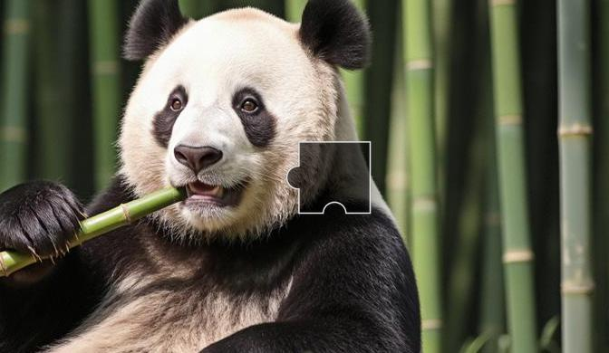
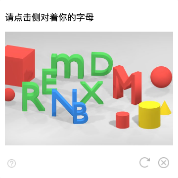

# 腾讯云验证码 — 样本、方法与求解器状态

> 厂商：腾讯云验证码 | 来源：https://cloud.tencent.com/product/captcha | 类型：5 | 样本：48
>
> 本页只记录求解器状态，不复制源求解器结果；`review.state` 初始为 `pending` 或 `not-applicable`，审查结果留空待回填。

## 一、类型总表

| 类型 | 中文 | 变体 | 样本 | 方法 | 求解器 / 源记录 | 审查 | 思路与说明 |
|---|---|---|---:|---|---|---|---|
| `slide` | 滑动拼图 | classic | 12 | CV | 有求解器（exists）· 高 | pending | mask 模板匹配 + alpha 合成；无 LLM；源记录 100%；结果待人工审查 |
| `text-click` | 文字点选 | classic | 12 | DET+OCR+VLM | 有求解器（exists）· 高 | pending | YOLO + Siamese + VLM 仲裁；VLM 只对分歧点调用；源方案 12/12 离线 + 5/5 实机；待审 |
| `icon-click` | 图标点选 | classic | 12 | NONE(VLM) | 无求解器（none）· 未知 | not-applicable | 未撰写；建议 VLM 读图 + 坐标点击 |
| `spatial` | 空间推理 | vtt-spatial | 12 | NONE(VLM) | 无求解器（none）· 未知 | not-applicable | 未撰写；建议 VLM 空间推理 |
| `invisible` | 无感 | invisible | 0 | NONE(ACT) | 无求解器（none）· 未知 | not-applicable | 无题面；需浏览器/环境行为 |

> 方法标签：`CV`=传统视觉；`DET`=目标检测；`OCR`=文字识别；`VLM`=多模态 LLM；`ASR`=语音识别；`PROTO`=协议/枚举；`ACT`=行为/轨迹；`AUDIO`=音频信号；`NONE`=无求解器（括号内为建议路线）。VLM 无需训练数据、按调用计费，起步便宜；量大时 CV 更便宜，常见组合是 CV/OCR 先定位、VLM 只对分歧或语义点调用。

## 二、样本速览

每类取 1 组代表样本；完整样本见 `cases/tencent/`。

| 类型 | 方法 | 代表样本 | 样本数 |
|---|---|---|---:|
| `slide` | CV |  | 12 |
| `text-click` | DET+OCR+VLM |  | 12 |
| `icon-click` | NONE(VLM) |  | 12 |
| `spatial` | NONE(VLM) |  | 12 |
| `invisible` | NONE(ACT) | — | 0 |

## 三、求解器与人工审查

> 本库只记录求解器状态，不复制源求解器结果。 审查通过/不通过由维护者后续回填。

### 无求解器（none）

以下类型没有撰写求解器，仅为样本收录。原因包括未尝试、仅采集、优先级低、能力不足或未完成；具体以说明为准。

| 类型 | 样本 | 方法 | 准确率（源记录） | 说明 |
|---|---:|---|---|---|
| `icon-click` | 12 | NONE(VLM) | 未知 | 未撰写；建议 VLM 读图 + 坐标点击 |
| `spatial` | 12 | NONE(VLM) | 未知 | 未撰写；建议 VLM 空间推理 |
| `invisible` | 0 | NONE(ACT) | 未知 | 无题面；需浏览器/环境行为 |

### 有求解器、待人工审查（exists）

以下类型有求解器与源记录准确率，但本库未复制结果（或仅复制了明确标注的结果），等待人工审查。

| 类型 | 样本 | 方法 | 准确率（源记录） | 说明 |
|---|---:|---|---|---|
| `slide` | 12 | CV | 高 | mask 模板匹配 + alpha 合成；无 LLM；源记录 100%；结果待人工审查 |
| `text-click` | 12 | DET+OCR+VLM | 高 | YOLO + Siamese + VLM 仲裁；VLM 只对分歧点调用；源方案 12/12 离线 + 5/5 实机；待审 |

## 四、来源

来源：https://cloud.tencent.com/product/captcha。样本采集日期见各案例 `meta.json`；样本版权归厂商所有，仅用于研究与教学展示。
