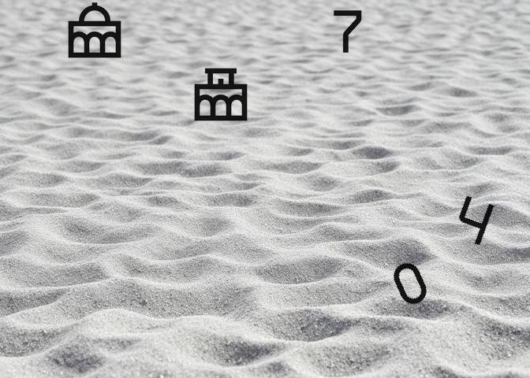

# 腾讯云验证码 — 厂商索引

> 厂商：腾讯云验证码 | 来源：<https://cloud.tencent.com/product/captcha> | 5 个类型（4 个有案例、1 个仅文档）| 48 组案例
>
> 腾讯云行为验证码的公开演示样本，覆盖滑块、文字点选、图标点选和 3D 空间推理。方法以 CV 与 DET+OCR+VLM 为主；图标点选 011/012 有纯 CV 修复记录，但审查仍为未通过。
>
> 返回 [README](../README.md) · [全量类型](types.md) · [方法论](00-methodology.md) · 详细内容在类型页（下方表内链接）。

## 一、类型总表

| 类型 | 中文 | 变体 | 样本 | 方法 | 求解器 / 源记录 | 审查 | 说明与详情 |
|---|---|---|---:|---|---|---|---|
| `slide` | 滑动拼图 | classic | 12 | CV | 有求解器（exists）· 高 | 12 通过 | 672×390 背景 + 120×120 拼图块；mask 模板匹配 + alpha 合成；源记录 100%，本库无结果文件。[类型页](../cases/tencent/slide/README.md) |
| `text-click` | 文字点选 | classic | 12 | DET+OCR+VLM | 有求解器（exists）· 高 | 12 通过 | 3 个目标字；YOLO + Siamese + VLM 仲裁，VLM 只在分歧点调用；源记录 12/12 离线 + 5/5 实机。[类型页](../cases/tencent/text-click/README.md) |
| `icon-click` | 图标点选 | classic | 12 | CV / NONE(VLM) | 部分求解（011/012）· 高（源记录 3/3） | 10 通过 / 2 错误 | 001–010 仅样本；011/012 整列投影 + 黑色掩膜模板 IoU；审查记录早于修复描述。[类型页](../cases/tencent/icon-click/README.md) |
| `spatial` | 空间推理 | vtt-spatial | 12 | NONE(VLM) | 无求解器（none）· 未知 | not-applicable | 360×360 的 3D 字母/数字/几何体；仅题面，建议 VLM 空间推理。[类型页](../cases/tencent/spatial/README.md) |
| `invisible` | 无感 | invisible | 0 | NONE(ACT) | 无求解器（none）· 未知 | not-applicable | 无题面；需浏览器/环境行为，仅文档收录（无案例目录）。 |

> 方法标签：`CV`=传统视觉；`DET`=目标检测；`OCR`=文字识别；`VLM`=多模态 LLM；`PROTO`=协议/枚举；`ACT`=行为/轨迹；`NONE`=无求解器（括号内为建议路线）。准确率一律为**源记录**，不代表本库已复核。

## 二、怎么读这张表

- **样本列**是案例目录数，`invisible` 为 0 表示没有案例目录，只在本页说明。
- **求解器列**按 `meta.solver.status` 汇总：`exists` 有求解器，`weak` 效果差，`none` 未撰写；`icon-click` 是 10 组 `none` + 2 组 `exists`，不能按整类写成已解。
- **审查列**按 `meta.review` 现算：`slide`、`text-click` 各 12 通过；`icon-click` 10 通过 / 2 错误；`spatial` 与 `invisible` 无可审结果。
- **详情**在每行最后一列，点进去看题面、样本图、思路、伪代码（仅 CV 路线）与失败记录。

## 三、案例目录

每个类型以 001 为例；除此之外每组至少含 `meta.json` 与 `bg.png`。

| 类型 | 001 目录内容 |
|---|---|
| `slide` | `bg.png` + `aux-01.png` + `solved.png` + `meta.json` |
| `text-click` | `bg.png` + `annotated.png` + `process-01-compare.png` + `meta.json` |
| `icon-click` | `bg.png` + `aux-01.png` + `annotated.png` + `process-01-split.png` + `process-02-compare.png` + `meta.json` |
| `spatial` | `bg.png` + `meta.json` |
| `invisible` | 无案例目录（仅文档） |

## 四、代表样本

每类取 1 组，点击「详情」进入类型页；完整样本见 `cases/tencent/`。

| 类型 | 方法 | 代表样本 | 详情 |
|---|---|---|---|
| `slide` | CV |  | [详情](../cases/tencent/slide/README.md) |
| `text-click` | DET+OCR+VLM |  | [详情](../cases/tencent/text-click/README.md) |
| `icon-click` | CV / NONE(VLM) |  | [详情](../cases/tencent/icon-click/README.md) |
| `spatial` | NONE(VLM) |  | [详情](../cases/tencent/spatial/README.md) |
| `invisible` | NONE(ACT) | — | 仅文档，无案例目录 |

## 五、厂商级结论

- **强项**：`slide` 的 mask 模板 + alpha 合成路线成熟，源记录 100%；`text-click` 用本地检测 + 字形比对 + VLM 仲裁，源记录 12/12 离线 + 5/5 实机。
- **图标点选是半成品**：001–010 只收样本与源方案过程图；011/012 的 CV 修复记录「3/3 图标正确」，但 `review` 仍是 `fail/incorrect`，两套状态没有同步。
- **空间推理未解**：12 组只有 360×360 题面，没有答案/标注/结果；建议路线是 VLM 读指令 + 定位，但没有本库准确率。
- **证据边界**：腾讯案例普遍没有 `answer.txt` / `result.json` / `evidence`，所有 100%、12/12、5/5、3/3 都只能标「源记录」。
- **典型失败模式**：图标重叠/宽底座切分、边界缺口、行为轨迹校验；前两类在类型页有明确修复记录，轨迹类没有本库数据。

## 六、来源与版权

来源：<https://cloud.tencent.com/product/captcha>。样本采集日期见各案例 `meta.json`；样本版权归腾讯云所有，仅用于研究与教学展示。

> 统计截至 2026-11-21，以案例 `meta.json` 为准；`invisible` 为 documented-only，样本数为 0。
