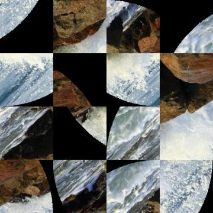
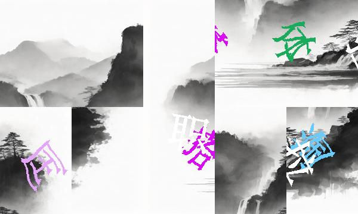
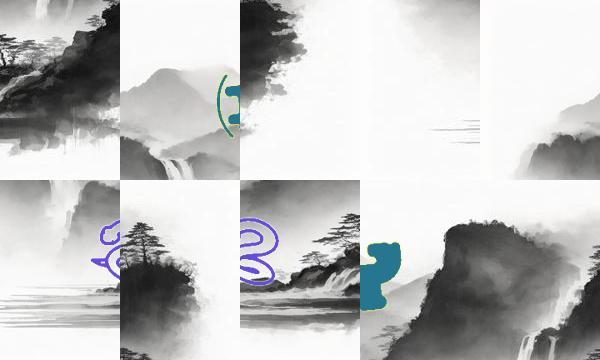
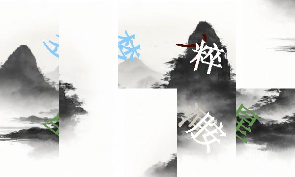
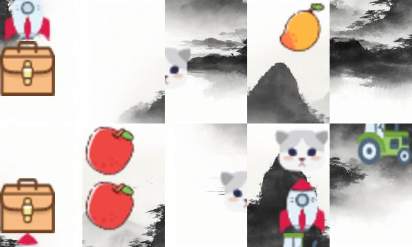
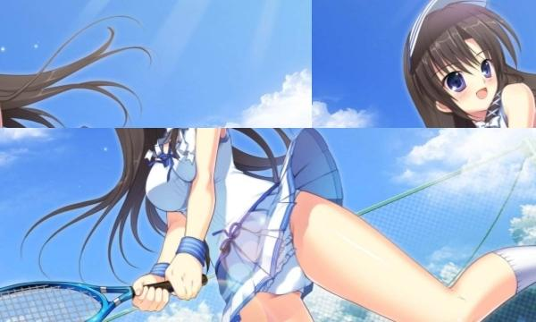

# 天爱 — 样本、方法与求解器状态

> 厂商：天爱 | 来源：https://captcha.tianai.cloud/ | 类型：13 | 样本：132
>
> 本页只记录求解器状态，不复制源求解器结果；`review.state` 初始为 `pending` 或 `not-applicable`，审查结果留空待回填。

## 一、类型总表

| 类型 | 中文 | 变体 | 样本 | 方法 | 求解器 / 源记录 | 审查 | 思路与说明 |
|---|---|---|---:|---|---|---|---|
| `slide` | 滑动拼图 | v1 / v2 | 12 | CV | 有求解器（exists）· 高 | pending | Canny 共识缺口定位；无 LLM；v1 12/12；v2 单次约 10%，多次重试约 80%；待审 |
| `curve` | 曲线滑动 | v1 / v2 / v3 | 12 | VLM+ACT | 有求解器（exists）· 中 | pending | 视觉模型理解曲线 + 贝塞尔轨迹；VLM 起步便宜；源报告部分通过；待审 |
| `rotate` | 旋转验证 | classic | 12 | CV+VLM | 有求解器（exists）· 中 | pending | SIFT/ORB + 视觉模型兜底；源报告部分通过；待审 |
| `angle` | 角度验证 | classic | 12 | CV+VLM | 有求解器（exists）· 中 | pending | 霍夫线 + 视觉模型兜底；源报告部分通过；待审 |
| `text-click` | 文字点选 | classic | 12 | DET+OCR+VLM | 效果差（weak）· 低 | pending | YOLO + OCR + 视觉模型；源记录约 33% 通过；参考价值有限 |
| `icon-click` | 图标点选 | classic | 12 | DET+VLM | 效果差（weak）· 低 | pending | YOLO + 视觉模型；源记录约 33% 通过；参考价值有限 |
| `word-order` | 语序点选 | classic | 12 | VLM | 有求解器（exists）· 高 | pending | 视觉模型理解语序；Vision 理解语序；待审 |
| `scratch` | 刮刮卡 | classic | 12 | CV | 效果差（weak）· 低 | pending | 提示图匹配；精度不足；提示图匹配精度不够；参考价值有限 |
| `slide-restore` | 滑动还原 | classic | 12 | CV | 有求解器（exists）· 中 | pending | 分块/接缝还原；无 LLM；源报告部分通过；待审 |
| `gesture` | 手势轨迹 | classic | 12 | VLM+ACT | 有求解器（exists）· 中 | pending | 视觉模型理解图形 + 贝塞尔轨迹；Vision 理解图形 + 贝塞尔轨迹；待审 |
| `jigsaw` | 乱序拼图 | classic | 12 | NONE(VLM) | 无求解器（none）· 未知 | not-applicable | 未撰写；建议 VLM 直接读图，起步便宜 |
| `pow` | 工作量证明 | classic | 0 | PROTO | 有求解器（exists）· 高 | pending | 工作量证明计算；无视觉模型；源方案 10/10；无题面媒体 |
| `random` | 智能随机 | classic | 0 | NONE | 无求解器（none）· 未知 | not-applicable | 随机路由，无独立题面 |

> 方法标签：`CV`=传统视觉；`DET`=目标检测；`OCR`=文字识别；`VLM`=多模态 LLM；`ASR`=语音识别；`PROTO`=协议/枚举；`ACT`=行为/轨迹；`AUDIO`=音频信号；`NONE`=无求解器（括号内为建议路线）。VLM 无需训练数据、按调用计费，起步便宜；量大时 CV 更便宜，常见组合是 CV/OCR 先定位、VLM 只对分歧或语义点调用。

## 二、样本速览

每类取 1 组代表样本；完整样本见 `cases/tianai/`。

| 类型 | 方法 | 代表样本 | 样本数 |
|---|---|---|---:|
| `slide` | CV |  | 12 |
| `curve` | VLM+ACT |  | 12 |
| `rotate` | CV+VLM |  | 12 |
| `angle` | CV+VLM |  | 12 |
| `text-click` | DET+OCR+VLM |  | 12 |
| `icon-click` | DET+VLM |  | 12 |
| `word-order` | VLM |  | 12 |
| `scratch` | CV |  | 12 |
| `slide-restore` | CV |  | 12 |
| `gesture` | VLM+ACT |  | 12 |
| `jigsaw` | NONE(VLM) |  | 12 |
| `pow` | PROTO | — | 0 |
| `random` | NONE | — | 0 |

## 三、求解器与人工审查

> 本库只记录求解器状态，不复制源求解器结果。 审查通过/不通过由维护者后续回填。

### 无求解器（none）

以下类型没有撰写求解器，仅为样本收录。原因包括未尝试、仅采集、优先级低、能力不足或未完成；具体以说明为准。

| 类型 | 样本 | 方法 | 准确率（源记录） | 说明 |
|---|---:|---|---|---|
| `jigsaw` | 12 | NONE(VLM) | 未知 | 未撰写；建议 VLM 直接读图，起步便宜 |
| `random` | 0 | NONE | 未知 | 随机路由，无独立题面 |

### 求解器效果差 / 参考价值有限（weak）

以下类型有求解器，但准确率低、误报多或只对特定样本有效；结果不宜当作可用能力。

| 类型 | 样本 | 方法 | 准确率（源记录） | 说明 |
|---|---:|---|---|---|
| `text-click` | 12 | DET+OCR+VLM | 低 | YOLO + OCR + 视觉模型；源记录约 33% 通过；参考价值有限 |
| `icon-click` | 12 | DET+VLM | 低 | YOLO + 视觉模型；源记录约 33% 通过；参考价值有限 |
| `scratch` | 12 | CV | 低 | 提示图匹配；精度不足；提示图匹配精度不够；参考价值有限 |

### 有求解器、待人工审查（exists）

以下类型有求解器与源记录准确率，但本库未复制结果（或仅复制了明确标注的结果），等待人工审查。

| 类型 | 样本 | 方法 | 准确率（源记录） | 说明 |
|---|---:|---|---|---|
| `slide` | 12 | CV | 高 | Canny 共识缺口定位；无 LLM；v1 12/12；v2 单次约 10%，多次重试约 80%；待审 |
| `curve` | 12 | VLM+ACT | 中 | 视觉模型理解曲线 + 贝塞尔轨迹；VLM 起步便宜；源报告部分通过；待审 |
| `rotate` | 12 | CV+VLM | 中 | SIFT/ORB + 视觉模型兜底；源报告部分通过；待审 |
| `angle` | 12 | CV+VLM | 中 | 霍夫线 + 视觉模型兜底；源报告部分通过；待审 |
| `word-order` | 12 | VLM | 高 | 视觉模型理解语序；Vision 理解语序；待审 |
| `slide-restore` | 12 | CV | 中 | 分块/接缝还原；无 LLM；源报告部分通过；待审 |
| `gesture` | 12 | VLM+ACT | 中 | 视觉模型理解图形 + 贝塞尔轨迹；Vision 理解图形 + 贝塞尔轨迹；待审 |
| `pow` | 0 | PROTO | 高 | 工作量证明计算；无视觉模型；源方案 10/10；无题面媒体 |

## 四、来源

来源：https://captcha.tianai.cloud/。样本采集日期见各案例 `meta.json`；样本版权归厂商所有，仅用于研究与教学展示。
