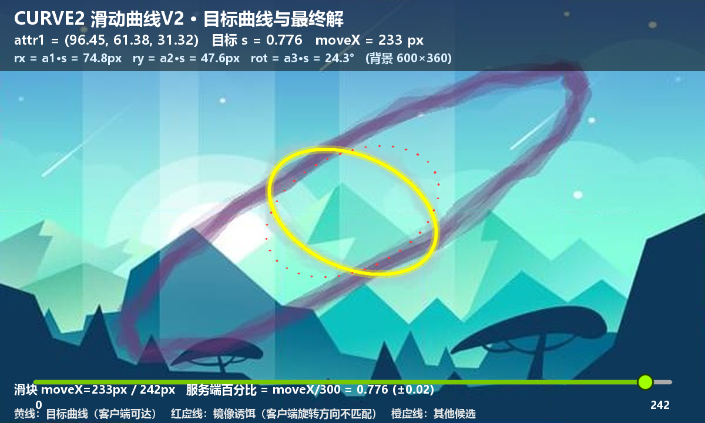
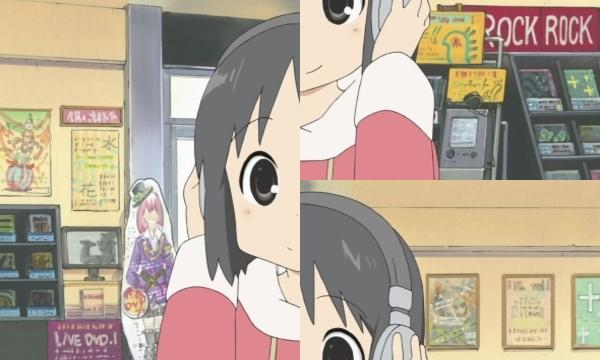

# 天爱 — 厂商索引

> 厂商：天爱（`tianai`） | 来源：<https://captcha.tianai.cloud/> | 14 个类型（13 个有案例、1 个仅文档）| 156 组案例
>
> 官网入口只列一个「曲线」，API 实际下发 `CURVE` / `CURVE2` / `CURVE3` 三种不同题面；本库拆成 `curve`、`curve-ellipse`、`curve-bezier`，不是同一类型的 v1/v2/v3。
>
> 返回 [README](../README.md) · [全量类型](types.md) · [方法论](00-methodology.md) · 详细内容在类型页（下方表内链接）。

## 一、类型总表

| 类型 | 中文 | 变体 | 样本 | 方法 | 求解器 / 源记录 | 审查 | 说明与详情 |
|---|---|---|---:|---|---|---|---|
| `slide` | 滑动拼图 | v1 / v2 | 12 | CV | 有求解器（exists）· 高 | 11 通过 / 1 部分 | Canny 共识缺口定位；v1 12/12，v2 单次约 10%、重试约 80%；无答案文件。[类型页](../cases/tianai/slide/README.md) |
| `curve` | 曲线滑动 | CURVE | 12 | CV+ACT | 有求解器（exists）· 中 | 12 通过 | `p` 无控制点 x；白度 top-hat + 对称脊对 + 族内扫描；旧中点公式仅巧合。[类型页](../cases/tianai/curve/README.md) |
| `curve-ellipse` | 椭圆曲线 | CURVE2 | 12 | CV+ACT | 有求解器（exists）· 中 | 12 通过 | 单参数椭圆族；目标多为内侧细线，镜像 `s` 是诱饵；`moveX=300·s`，未实拖。[类型页](../cases/tianai/curve-ellipse/README.md) |
| `curve-bezier` | 双贝塞尔曲线 | CURVE3 | 12 | CV+ACT | 部分进展（partial）· 中 | 12 通过 | 两段二次贝塞尔；白管两壁中线拟合 `x_ref`，12/12 残差 0.26–2.24px；旧 A 0/12、B 2/12。[类型页](../cases/tianai/curve-bezier/README.md) |
| `rotate` | 旋转验证 | classic | 12 | CV+VLM | 有求解器（exists）· 中 / 高 | 12 通过 | SIFT/ORB 场景库；抽象几何用色带共线；6 组 offline、6 组 unverified；源报告 8/50。[类型页](../cases/tianai/rotate/README.md) |
| `angle` | 角度验证 | classic | 12 | CV+VLM | 有求解器（exists）· 中 | 8 通过 / 2 部分 / 2 错误 | 霍夫线 + VLM 兜底；007/009 结果仍倾斜；无角度真值。[类型页](../cases/tianai/angle/README.md) |
| `text-click` | 文字点选 | classic | 12 | DET+OCR+VLM | 效果差（weak）· 低 | 待审 12 | YOLO+OCR+VLM；001 提示 3 字、背景 5 字；源约 33%。[类型页](../cases/tianai/text-click/README.md) |
| `icon-click` | 图标点选 | classic | 12 | DET+VLM | 效果差（weak）· 低 | 待审 12 | YOLO+VLM；提示条是文字（001 马/蛇），不是图标模板；源约 33%。[类型页](../cases/tianai/icon-click/README.md) |
| `word-order` | 语序点选 | classic | 12 | VLM | 有求解器（exists）· 高（存疑） | 待审 12 | `meta` 写 exists/high，`notes` 却称未撰写、无结果；按样本收录处理。[类型页](../cases/tianai/word-order/README.md) |
| `scratch` | 刮刮卡 | classic | 12 | CV | 效果差（weak）· 低 | 12 通过 | 提示图匹配；提示条给数量+类别（001 为「2个 火箭」）；精度不足。[类型页](../cases/tianai/scratch/README.md) |
| `slide-restore` | 滑动还原 | classic | 12 | CV | 有求解器（exists）· 中 | 12 通过 | 多段垂直条带错位，按接缝连续还原；源部分通过，无位移数值。[类型页](../cases/tianai/slide-restore/README.md) |
| `gesture` | 手势轨迹 | classic | 12 | CV+ACT | 有求解器（exists）· 中 | 12 通过 | v7 胶囊管+端帽；21 组源标注 19/21 <15px；8 组自动、4 组人工。[类型页](../cases/tianai/gesture/README.md) |
| `jigsaw` | 乱序拼图 | classic | 12 | CV | 有求解器（exists）· 高 | 12 通过 | 2×2 交换枚举；切缝外 6px 颜色 + Canny；源图与回归均 12/12，人工复核 12/12。[类型页](../cases/tianai/jigsaw/README.md) |
| `pow` | 工作量证明 | classic | 0 | PROTO | 有求解器（exists）· 高 | not-applicable | 工作量证明计算；无题面媒体；仅文档收录（0 组，无类型页）。 |

> 方法标签：`CV`=传统视觉；`DET`=目标检测；`OCR`=文字识别；`VLM`=多模态 LLM；`PROTO`=协议/枚举；`ACT`=行为/轨迹；`NONE`=无求解器（括号内为建议路线）。准确率一律为**源记录**，不代表本库已复核；审查统计按案例 `meta.review` 现算（截至 2026-11-21）。
>
> 曲线三型：`CURVE` 是端点固定的单条三次贝塞尔（控制点 x 不在 `p` 里）；`CURVE2` 是单参数椭圆族（`s=moveX/300`）；`CURVE3` 是两段二次贝塞尔（起点→J→终点），滑块按 `moveX/展示宽` 等比缩放中间坐标。
>
> `random` 不是独立类型：体验页的「智能随机」只从上述类型中随机返回一种，没有独立题面/判定，因此不建类型与案例。

## 二、代表样本

每类取 1 组，点击「详情」进入类型页；完整样本见 `cases/tianai/`。

| 类型 | 方法 | 代表样本 | 详情 |
|---|---|---|---|
| `slide` | CV |  | [详情](../cases/tianai/slide/README.md) |
| `curve` | CV+ACT |  | [详情](../cases/tianai/curve/README.md) |
| `curve-ellipse` | CV+ACT |  | [详情](../cases/tianai/curve-ellipse/README.md) |
| `curve-bezier` | CV+ACT |  | [详情](../cases/tianai/curve-bezier/README.md) |
| `rotate` | CV+VLM |  | [详情](../cases/tianai/rotate/README.md) |
| `angle` | CV+VLM |  | [详情](../cases/tianai/angle/README.md) |
| `text-click` | DET+OCR+VLM |  | [详情](../cases/tianai/text-click/README.md) |
| `icon-click` | DET+VLM |  | [详情](../cases/tianai/icon-click/README.md) |
| `word-order` | VLM |  | [详情](../cases/tianai/word-order/README.md) |
| `scratch` | CV |  | [详情](../cases/tianai/scratch/README.md) |
| `slide-restore` | CV |  | [详情](../cases/tianai/slide-restore/README.md) |
| `gesture` | CV+ACT |  | [详情](../cases/tianai/gesture/README.md) |
| `jigsaw` | CV |  | [详情](../cases/tianai/jigsaw/README.md) |
| `pow` | PROTO | — | 仅文档收录 |

## 三、厂商级结论

- **强项**：`jigsaw` 2×2 交换用纯 CV 做到源图 12/12、人工复核 12/12；`slide` v1 12/12；`gesture` 21 组源标注 19/21 <15px；`curve-bezier` 管轴拟合 12/12、残差 0.26–2.24px。
- **混合路线**：`curve` 必须从背景恢复控制点 x，旧中点公式只偶然命中；`curve-ellipse` 必须固定 `sign=+1` 才能排除镜像诱饵；`rotate` 依赖直立场景库，抽象几何才走色带共线。
- **已暴露的弱点**：`angle` 有 2 组错误、2 组部分；`slide` v2 单次约 10%；`rotate` 源报告仅 8/50；`text-click` / `icon-click` 约 33%；`scratch` 精度不足；`word-order` 的求解器状态自相矛盾。
- **证据边界**：只有 `jigsaw`、`gesture` 的 4 组人工标注、`rotate`/`curve-ellipse` 的离线结果有较明确的证据分层；多数类型是 `sample-only` 或 `unverified`，源准确率不能当线上通过率。

## 四、来源

来源：<https://captcha.tianai.cloud/>。样本采集日期见各案例 `meta.json`；样本版权归天爱所有，仅用于研究与教学展示。
