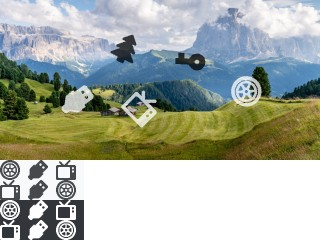

# 网易易盾 — 厂商索引

> 厂商：网易易盾 | 来源：<https://dun.163.com/trial> | 12 个类型（10 个有案例、2 个仅文档）| 120 组案例
>
> 国内主流行为验证码厂商，题型覆盖滑块、点选、空间推理、语序、乱序拼图与障碍躲避。本库的方法重点是 **CV 为主、点选类用 DET+OCR+VLM**；语序点选已做到零 LLM。
>
> 返回 [README](../README.md) · [全量类型](types.md) · [方法论](00-methodology.md) · 详细内容在类型页（下方表内链接）。

## 一、类型总表

| 类型 | 中文 | 变体 | 样本 | 方法 | 求解器 / 源记录 | 审查 | 说明与详情 |
|---|---|---|---:|---|---|---|---|
| `jigsaw` | 滑块拼图 | classic | 12 | CV | 有求解器（exists）· 高 | 12 通过 | 缺口滑块；masked Sobel 梯度 + alpha mask 匹配；无 LLM。[类型页](../cases/yidun/jigsaw/README.md) |
| `inference` | 乱序拼图 | inference | 12 | CV | 有求解器（exists）· 中 | 12 通过 | 8 块换位；切缝断裂度 + 双全排列 + 亮度不变全切缝成本。[类型页](../cases/yidun/inference/README.md) |
| `slide-rotate` | 旋转拼图 | enhanced-rotate | 12 | CV | 有求解器（exists）· 高 | 12 通过 | 旋转几何 + 边缘方向一致性；无 LLM。[类型页](../cases/yidun/slide-rotate/README.md) |
| `icon-click` | 图标点选 | classic | 12 | CV | 有求解器（exists）· 中 | 12 通过 | 黑/白双色掩膜 + 旋转模板匹配（row1/inv 双极性）。[类型页](../cases/yidun/icon-click/README.md) |
| `text-click` | 文字点选 | classic | 12 | DET+OCR+VLM | 有求解器（exists）· 高 | 12 通过 | 5 个独立字；YOLO + Siamese/OCR 双识别 + VLM 仲裁。[类型页](../cases/yidun/text-click/README.md) |
| `text-click-enhanced` | 增强文字点选 | enhanced | 12 | DET+CV+OCR | 有求解器（exists）· 答案 3/3 · 自动 21/36（2026-11-22） | 11 通过 / 1 部分 / 0 不通过（006/009/010/011/012 为答案重写后复审；其余 7 组仍是旧答案审查，待复审） | 约 6–7 字 = 若干重叠双字 + 若干独立字；**布局不固定**：多数组是 2 组重叠对 + 1 个独立字，006 经审核确认 3 个目标全在重叠对里。要点的永远是被压住的下层，露在表面的完整字是诱饵。**对框有尺度上限**：真对框是字径的 0.79–1.54 倍，超过 1.7 倍的框是背景块（011 的 88×93 框把整头小牛框了进来）。自动求解器 v14 不判层、不配字：先按字径尺度剔掉背景框，再按「框面积大、笔宽细」+ 长宽比 0.8–1.3 选两个近方形对框，落点取框内墨迹中位，独立字用 OCR 钉住；离线 21/36（对框选对 20/25、真对框锚点 13/20）。颜色分层自动不可复现（对目标落在小簇 12/24、大簇 7/24）。[类型页](../cases/yidun/text-click-enhanced/README.md) |
| `word-order` | 语序点选 | classic | 12 | DET+OCR+CV | 有求解器（exists）· 高 | 12 通过 | 零 LLM：YOLO + 颜色轮廓 + 多角度 OCR + 29,502 条成语库；12/12 离线匹配。[类型页](../cases/yidun/word-order/README.md) |
| `word-group` | 语序选词 | classic | 12 | VLM | 有求解器（exists）· 高 | 待审 12 | llm_solver 选词/排序；无需训练。[类型页](../cases/yidun/word-group/README.md) |
| `spatial` | 空间推理 | space-inference | 12 | VLM+CV | 有求解器（exists）· 高 | 10 通过 / 2 错误 | 本地 CV 定位图形 + 视觉 LLM 选空间关系；005/011 未通过。[类型页](../cases/yidun/spatial/README.md) |
| `avoid` | 障碍躲避 | classic | 12 | CV | 有求解器（exists）· 高 | 12 通过 | 场景库差分 + 条带字形全角度匹配 + A* 避障；零 LLM。[类型页](../cases/yidun/avoid/README.md) |
| `invisible` | 无感 | sense | 0 | NONE(ACT) | 无求解器（none）· 未知 | not-applicable | 无题面；需浏览器/环境行为，仅文档收录。 |
| `sms` | 短信上行 | classic | 0 | NONE | 无求解器（none）· 未知 | not-applicable | 无题面、需短信；仅文档收录。 |

> 方法标签：`CV`=传统视觉；`DET`=目标检测；`OCR`=文字识别；`VLM`=多模态 LLM；`PROTO`=协议/枚举；`ACT`=行为/轨迹；`NONE`=无求解器（括号内为建议路线）。准确率一律为**源记录**，不代表本库已复核；审查统计按案例 `meta.review` 现算（截至 2026-11-22）。
>
> 分类说明：源目录 `jigsaw` 下 12 组全部是缺口滑块；`inference` 是 8 块换位乱序拼图。文字点选按源目录拆成标准版 `text-click`（5 个独立字）与增强版 `text-click-enhanced`（约 6–7 字含重叠双字），不是同一类型的变体。

## 二、代表样本

每类取 1 组，点击「详情」进入类型页；完整样本见 `cases/yidun/`。

| 类型 | 方法 | 代表样本 | 详情 |
|---|---|---|---|
| `jigsaw` | CV |  | [详情](../cases/yidun/jigsaw/README.md) |
| `inference` | CV |  | [详情](../cases/yidun/inference/README.md) |
| `slide-rotate` | CV |  | [详情](../cases/yidun/slide-rotate/README.md) |
| `icon-click` | CV |  | [详情](../cases/yidun/icon-click/README.md) |
| `text-click` | DET+OCR+VLM |  | [详情](../cases/yidun/text-click/README.md) |
| `text-click-enhanced` | DET+CV+OCR |  | [详情](../cases/yidun/text-click-enhanced/README.md) |
| `word-order` | DET+OCR+CV |  | [详情](../cases/yidun/word-order/README.md) |
| `word-group` | VLM |  | [详情](../cases/yidun/word-group/README.md) |
| `spatial` | VLM+CV |  | [详情](../cases/yidun/spatial/README.md) |
| `avoid` | CV |  | [详情](../cases/yidun/avoid/README.md) |

## 三、厂商级结论

- **强项**：滑块、拼图、旋转、障碍躲避都能用纯 CV 做到高置信；语序点选用「OCR + 成语库」零 LLM 收敛，12/12。
- **混合路线**：文字点选用 YOLO 定位、Siamese/OCR 辨字，VLM 只对分歧点仲裁；增强版的自动求解器（v14）不判层——先按字径尺度剔掉背景框（真对框 0.79–1.54× 字径，>1.7× 就是牛身/船体这类整块背景），再按「框面积大、笔宽细」+ 长宽比 0.8–1.3 选两个近方形对框，落点取框内墨迹坐标中位，独立字用 OCR 钉住，离线 21/36（2026-11-22）。人工判读用的颜色分层取露出笔画无法自动复现（对目标落在小簇 12/24、大簇 7/24）。
- **已暴露的弱点**：空间推理有 2 组审查错误（005/011）；增强文字点选的真对框锚点只有 13/20，独立字有 3 组字-框配错（09/11/12），颜色/结构信号都在随机水平附近；YOLO 的合并框会连背景一起框（011 的 88×93 整牛框），对框必须先过字径尺度；无感/短信无题面，无法离线求解。
- **证据边界**：多数类型只有离线结果，`evidence` 为 `unverified` / `offline-verified`；不要把它当成线上通过率。逐组状态以类型页与 `meta.json` 为准。

## 四、来源

来源：<https://dun.163.com/trial>。样本采集日期见各案例 `meta.json`；样本版权归网易易盾所有，仅用于研究与教学展示。
